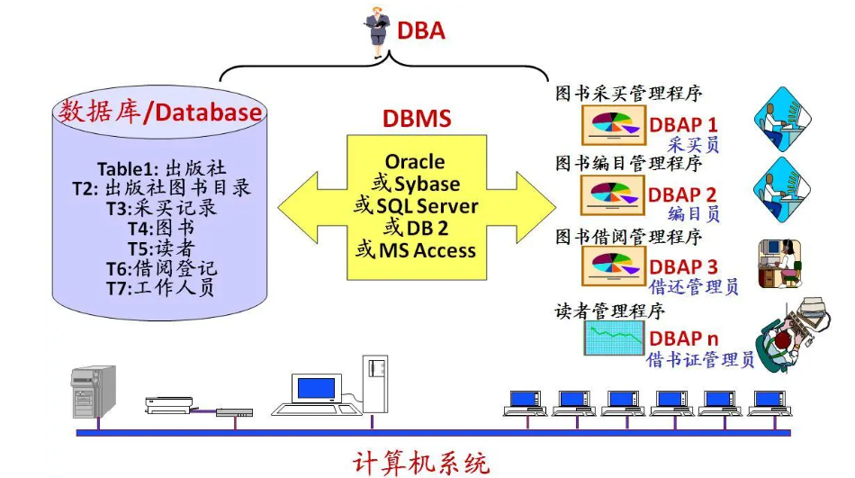
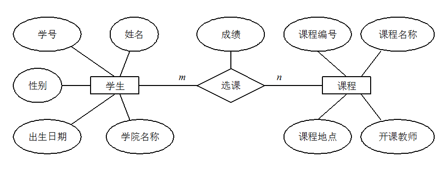
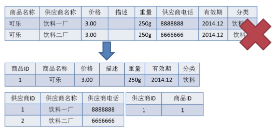
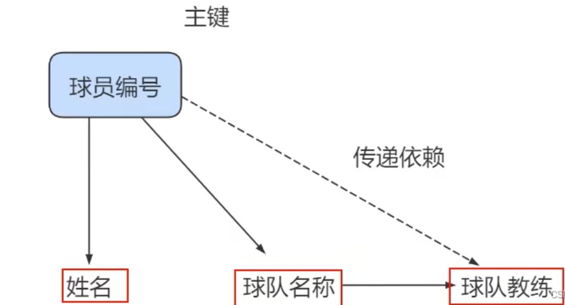
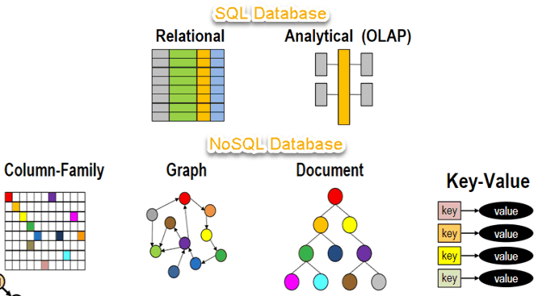
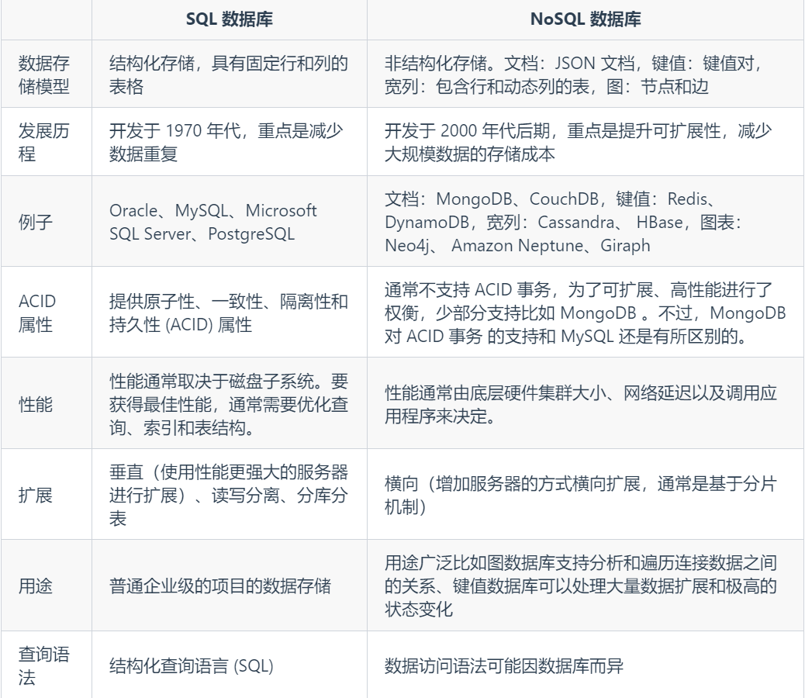

# 数据库基础知识总结

# 数据库基础

## 什么是数据库, 数据库管理系统, 数据库系统, 数据库管理员?

* **数据库** : 数据库(DataBase 简称 DB)就是信息的集合或者说数据库是由数据库管理系统管理的**数据的集合**。
* **数据库管理系统** : 数据库管理系统(Database Management System 简称 DBMS)是一种操纵和管理数据库的大型**软件**，**通常用于建立、使用和维护数据库。**
* **数据库系统** : 数据库系统(Data Base System，简称 DBS)通常由软件、数据库和数据管理员(DBA)组成。
* **数据库管理员** : 数据库管理员(Database Administrator, 简称 DBA)负责全面管理和控制数据库系统。

## 什么是元组, 码, 候选码, 主码, 外码, 主属性, 非主属性？

* **元组**：元组（tuple）是关系数据库中的基本概念，关系是一张表，**表中的每行（即数据库中的每条记录）就是一个元组，每列就是一个属性。**  在二维表里，元组也称为行。
* **码**：码就是能唯一标识实体的属性，对应表中的列。
* **候选码**：若关系中的某一属性或属性组的值能唯一的标识一个元组，而其任何、子集都不能再标识，则称该属性组为候选码。例如：在学生实体中，“学号”是能唯一的区分学生实体的，同时又假设“姓名”、“班级”的属性组合足以区分学生实体，那么 **{学号}和{姓名，班级}都是候选码**。
* **主码** : 主码也叫主键。主码是从候选码中选出来的。 **一个实体集中只能有一个主码，但可以有多个候选码**。
* **外码** : 外码也叫外键。如果一个关系中的一个属性是另外一个关系中的主码则这个属性为外码。
* **主属性**：**候选码中出现过的属性称为主属性**。比如关系 工人（工号，身份证号，姓名，性别，部门）. 显然工号和身份证号都能够唯一标示这个关系，所以都是候选码。工号、身份证号这两个属性就是主属性。如果主码是一个属性组，那么属性组中的属性都是主属性。
* **非主属性：**  不包含在任何一个候选码中的属性称为非主属性。比如在关系——学生（学号，姓名，年龄，性别，班级）中，主码是“学号”，那么其他的“姓名”、“年龄”、“性别”、“班级”就都可以称为非主属性。

## 什么是 ER 图？

**ER 图** 全称是\*\* Entity Relationship Diagram（实体联系图）**，提供了表示**实体类型、属性和联系\*\*的方法。

ER 图由下面 3 个要素组成：

* **实体**：通常是现实世界的业务对象，当然使用一些逻辑对象也可以。比如对于一个校园管理系统，会涉及学生、教师、课程、班级等等实体。在 ER 图中，实体使用矩形框表示。
* **属性**：即某个实体拥有的属性，属性用来描述组成实体的要素，对于产品设计来说可以理解为字段。在 ER 图中，属性使用椭圆形表示。
* **联系**：即实体与实体之间的关系，在 ER 图中用菱形表示，这个关系不仅有业务关联关系，还能通过数字表示实体之间的数量对照关系。例如，一个班级会有多个学生就是一种实体间的联系。

## 数据库范式了解吗?

* 1NF(第一范式)：属性不可再分。
* 2NF(第二范式)：1NF 的基础之上，消除了非主属性对于主键的部分函数依赖。
* 3NF(第三范式)：3NF 在 2NF 的基础之上，消除了非主属性对于主键的传递函数依赖 。

### 1NF(第一范式)

属性（对应于表中的字段）不能再被分割，也就是这个字段只能是一个值，不能再分为多个其他的字段了。**1NF 是所有关系型数据库的最基本要求** ，也就是说关系型数据库中创建的表一定满足第一范式。

### 2NF(第二范式)

在满足第一范式的基础上，还要<code>**满足数据表里的每一条数据记录，都是可唯一标识的。而且所有非主键字段，都必须完全依赖主键，不能只依赖主键的一部分**</code>。如果知道主键的所有属性的值，就可以检索到任何元组(行)的任何属性的任何值。(要求中的主键，其实可以拓展替换为候选键)。

`成绩表`（(学号，课程号，成绩)关系中，(学号，课程号）可以决定成绩，但是学号不能决定成绩，课程号也不能决定成绩，所以 **“(学号，课程号)→成绩”就是**`完全依赖关系`。

（学号，身份证号）->（姓名），（学号）->（姓名），（身份证号）->（姓名）；所以姓名部分函数依赖于（学号，身份证号）；

### 3NF(第三范式)

第三范式是在第二范式的基础上，确保数据表中的每一个非主键字段都和主键字段直接相关，也就是说，`要求数据表中的所有非主键字段不能依赖于其他非主键字段`。(即，不能存在非主属性A依赖于非主属性B，非主属性B依赖于主键c的情况，即存在"A→B→C""的决定关系）通俗地讲，该规则的意思是所有`非主键属性`之间不能有依赖关系，必须`相互独立`。

## drop、delete 与 truncate 区别？

* `drop`(丢弃数据): `drop table 表名` ，直接将表都删除掉，在删除表的时候使用。
* `truncate` (清空数据) : `truncate table 表名` ，只删除表中的数据，再插入数据的时候自增长 id 又从 1 开始，在清空表中数据的时候使用。
* `delete`（删除数据） : `delete from 表名 where 列名=值`，删除某一行的数据，如果不加 `where` 子句和`truncate table 表名`作用类似。

`truncate` 和 `drop` 属于 **DDL(数据定义语言)语句**，操作立即生效，原数据不放到 rollback segment 中，不能回滚，操作不触发 trigger。而 `delete` 语句是 **DML (数据库操作语言)** 语句，这个操作会放到 rollback segment 中，事务提交之后才生效。

# NoSQL基础

## NoSQL 是什么？

NoSQL（**Not Only SQL** 的缩写）泛指**非关系型的数据库**，主要针对的是**键值、文档以及图形类型数据存储**。并且，NoSQL 数据库天生支持分布式，数据冗余和数据分片等特性，旨在提供可扩展的高可用高性能数据存储解决方案。

NoSQL 数据库代表：**HBase、Cassandra、MongoDB、Redis。**

## SQL 和 NoSQL 有什么区别？

## NoSQL 数据库有什么优势？

NoSQL 数据库非常适合许多现代应用程序，例如移动、Web 和游戏等应用程序，它们需要**灵活、可扩展、高性能和功能强大**的数据库以提供卓越的用户体验。

* **灵活性：**  NoSQL 数据库通常提供灵活的架构，以实现更快速、更多的迭代开发。灵活的数据模型使 NoSQL 数据库成为半结构化和非结构化数据的理想之选。
* **可扩展性：**  NoSQL 数据库通常被设计为通过使用分布式硬件集群来横向扩展，而不是通过添加昂贵和强大的服务器来纵向扩展。
* **高性能：**  NoSQL 数据库针对特定的数据模型和访问模式进行了优化，这与尝试使用关系数据库完成类似功能相比可实现更高的性能。
* **强大的功能：**  NoSQL 数据库提供功能强大的 API 和数据类型，专门针对其各自的数据模型而构建。

‍

> 更新: 2024-09-10 16:59:01  
> 原文: <https://www.yuque.com/nibiwanxiamei/yrd6t1/ce640b896d7997d8dee5760f7ed763ce>