# Redis重要知识点

***

# Redis持久化机制 ♥♥♥♥

Redis 不同于 Memcached 的很重要一点就是，Redis 支持持久化，而且支持 3 种持久化方式:

* 快照（RedisDatabase，RDB）
* 只追加文件（append-only file, AOF）
* RDB 和 AOF 的混合持久化(Redis 4.0 新增)

官方文档地址：<https://redis.io/topics/persistence>。

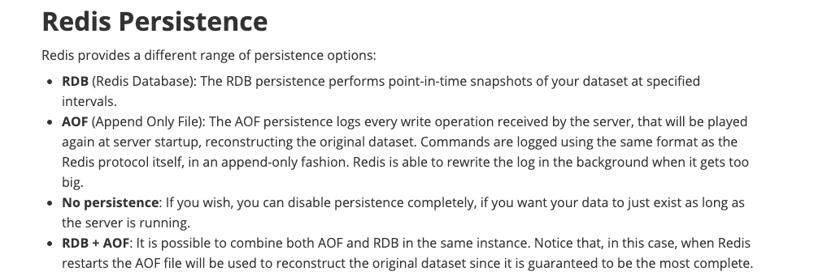

## RDB 持久化

### 什么是RDB持久化

Redis 可以通过\*\*<font style="color:#DF2A3F;">创建快照</font>**来获得存储在内存里面的数据在 **<font style="color:#DF2A3F;">某个时间点</font>** 上的**<font style="color:#DF2A3F;">副本</font>\*\*。Redis 创建快照之后，可以对快照进行备份，可以将快照复制到其他服务器从而创建具有相同数据的服务器副本（**Redis 主从复制**），还可以将快照留在原地以便重启服务器的时候使用。

快照持久化是 Redis 默认采用的持久化方式，在 `redis.conf` 配置文件中默认有此下配置：

```clojure
save 900 1   
#在900秒(15分钟)之后，如果至少有1个key发生变化，Redis就会自动触发bgsave命令创建快照。

save 300 10   
#在300秒(5分钟)之后，如果至少有10个key发生变化，Redis就会自动触发bgsave命令创建快照。
```

### RDB 创建快照时会阻塞主线程吗？

Redis 提供了两个命令来生成 RDB 快照文件：

* `save` : 同步保存操作，会阻塞 Redis 主线程；
* <code><font style="color:#DF2A3F;">bgsave</font></code> : fork 出一个子进程，子进程执行，不会阻塞 Redis 主线程，默认选项。

> 这里说 Redis 主线程而不是主进程的主要是因为 **Redis 启动之后主要是通过单线程的方式**完成主要的工作

## AOF 持久化

### 什么是 AOF 持久化？

**与快照持久化相比，\*\*\*\*<font style="color:#DF2A3F;">AOF 持久化的实时性更好</font>**。默认情况下 Redis 没有开启 AOF（append only file）方式的持久化（Redis 6.0 之后已经默认是开启了），可以通过 `appendonly` 参数开启：

```shell
appendonly yes
```

开启 AOF 持久化后**每执行一条会更改**  Redis 中的数据的命令， 就会将该命令写入到 AOF 缓冲区 `server.aof_buf` 中，然后再写入到 AOF 文件中（**此时还在系统内核缓存区未同步到磁盘**），最后再根据持久化方式（ `fsync`策略）的配置来决定何时将系统内核缓存区的数据同步到硬盘中的。

只有同步到磁盘中才算持久化保存了，否则依然存在数据丢失的风险，比如说：系统内核缓存区的数据还未同步，磁盘机器就宕机了，那这部分数据就算丢失了。

AOF 文件的保存位置和 RDB 文件的位置相同，都是通过 `dir` 参数设置的，默认的文件名是 `appendonly.aof`。

### AOF 工作基本流程是怎样的？

AOF 持久化功能的实现可以简单分为 **5 步**：

1. **命令追加（append）** ：所有的写命令会追加到 **AOF 缓冲区**中。
2. **文件写入（write）** ：将 AOF 缓冲区的数据写入到 **AOF 文件**中。这一步需要调用`write`**函数**（**系统调用**），`write`将数据写入到了**系统内核缓冲区**之后直接返回了（延迟写）。注意！！！此时并没有同步到磁盘。
3. **文件同步（fsync）** ：AOF 缓冲区根据对应的持久化方式（ `fsync` 策略）向硬盘做同步操作。这一步需要调用 `fsync` 函数（系统调用）， `fsync` 针对单个文件操作，对其进行强制硬盘同步，`fsync` 将阻塞直到写入磁盘完成后返回，保证了数据持久化。
4. **文件重写（rewrite）** ：随着 AOF 文件越来越大，需要定期对 AOF 文件进行重写，达到压缩的目的。
5. **重启加载（load）** ：当 Redis 重启时，可以加载 AOF 文件进行数据恢复。

> **<font style="color:#DF2A3F;background-color:#FBDE28;">写命令 -> 追加到AOF缓冲区 -> write系统调用写入AOF文件(系统内核缓冲区) -> fsync写入磁盘</font>**

\*\*系统调用: \*\***<font style="color:rgb(36, 41, 47);background-color:rgb(244, 246, 248);">操作系统（OS）提供给用户程序和应用程序的一种服务，用于请求操作系统核心（内核）提供某种特权操作或服务。它允许用户程序访问操作系统受限且受保护底层功能的，不能直接由普通用户程序直接访问。</font>**

**<font style="color:rgb(36, 41, 47);background-color:rgb(244, 246, 248);"></font>**

* `write`：写入系统内核缓冲区之后直接返回（仅仅是写到缓冲区），不会立即同步到硬盘。虽然提高了效率，但也带来了数据丢失的风险。同步硬盘操作通常依赖于系统调度机制，Linux 内核通常为 30s 同步一次，具体值取决于写出的数据量和 I/O 缓冲区的状态。
* `fsync`：`fsync`用于强制刷新系统内核缓冲区（同步到到磁盘），确保写磁盘操作结束才会返回。

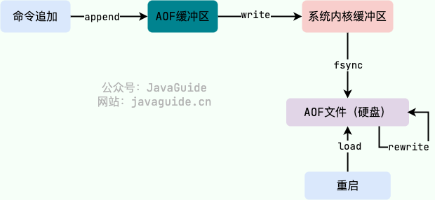

### AOF 持久化方式有哪些？

在 Redis 的配置文件中存在**三种**不同的 AOF 持久化方式（ `fsync`策略）：

1. `appendfsync always`：主线程调用 `write` 执行写操作后，后台线程（ `aof_fsync` 线程）**立即会调用** `fsync` **函数同步 AOF 文件**（刷盘），`fsync` 完成后线程返回，这样会严重降低 Redis 的性能（`write` + `fsync`）。
2. `appendfsync everysec`：主线程调用 `write` 执行写操作后立即返回，由后台线程（ `aof_fsync` 线程）**每秒钟调用** `fsync` **函数（系统调用）同步一次 AOF 文件**（`write`+`fsync`，`fsync`间隔为 1 秒）
3. `appendfsync no`：主线程调用 `write` 执行写操作后立即返回，**让操作系统决定何时进行同步，Linux 下一般为 30 秒一次**（`write`但不`fsync`，`fsync` 的时机由操作系统决定）。

**这 3 种持久化方式的主要区别在于** <code>**fsync**</code> **同步 AOF 文件的时机（刷盘）** 。

**为了兼顾数据和写入性能，可以考虑** `appendfsync everysec` **选项** ，让 Redis 每秒同步一次 AOF 文件，Redis 性能受到的影响较小。而且这样即使出现系统崩溃，用户最多只会丢失一秒之内产生的数据。当硬盘忙于执行写入操作的时候，Redis 还会优雅的放慢自己的速度以便适应硬盘的最大写入速度。

从 Redis 7.0.0 开始，Redis 使用了 **Multi Part AOF** 机制。顾名思义，Multi Part AOF 就是将原来的单个 AOF 文件拆分成多个 AOF 文件。在 Multi Part AOF 中，AOF 文件被分为三种类型，分别为：

* BASE：表示基础 AOF 文件，它一般由子进程通过重写产生，该文件最多只有一个。
* INCR：表示增量 AOF 文件，它一般会在 AOFRW 开始执行时被创建，该文件可能存在多个。
* HISTORY：表示历史 AOF 文件，它由 BASE 和 INCR AOF 变化而来，每次 AOFRW 成功完成时，本次 AOFRW 之前对应的 BASE 和 INCR AOF 都将变为 HISTORY，HISTORY 类型的 AOF 会被 Redis 自动删除。

### AOF 为什么是在执行完命令之后记录日志？

关系型数据库（如 MySQL）通常都是执行命令之前记录日志（方便故障恢复），而 Redis AOF 持久化机制是在执行完命令之后再记录日志。

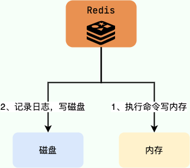

* **避免额外的检查开销，AOF 记录日志不会对命令进行语法检查**；
* **在命令执行完之后再记录，不会阻塞当前的命令执行**。

这样也带来了风险（我在前面介绍 AOF 持久化的时候也提到过）：

* 如果刚执行完命令 Redis 就宕机会导致对应的修改丢失；
* 可能会阻塞后续其他命令的执行（AOF 记录日志是在 Redis 主线程中进行的）。

### AOF 重写了解吗？

当 AOF 变得太大时，Redis 能够在后台自动重写 AOF 产生一个新的 AOF 文件，这个新的 AOF 文件和原有的 AOF 文件所保存的数据库状态一样，但体积更小。


> AOF 重写（rewrite） 是一个有歧义的名字，该功能是**通过读取数据库中的键值对来实现的**，程序无须对现有 AOF 文件进行任何读入、分析或者写入操作。

由于 AOF 重写会进行大量的写入操作，为了避免对 Redis 正常处理命令请求造成影响，Redis 将 AOF 重写程序放到子进程里执行。

AOF 文件重写期间，Redis 还会维护一个 **AOF 重写缓冲区**，该缓冲区会在子进程创建新 AOF 文件期间，记录服务器执行的所有写命令。当子进程完成创建新 AOF 文件的工作之后，服务器会将重写缓冲区中的所有内容追加到新 AOF 文件的末尾，使得新的 AOF 文件保存的数据库状态与现有的数据库状态一致。最后，服务器用新的 AOF 文件替换旧的 AOF 文件，以此来完成 AOF 文件重写操作。

## 混合持久化机制 RDB  + AOF ♥♥♥

设置\*\*<font style="color:#DF2A3F;">aof-use-rdb-preamble</font>\*\* 设置的值为yes，表示开启

**<font style="color:#DF2A3F;">RDB镜像做全量持久化，AOF做增量持久化</font>**。先使用RDB进行快照存储，然后使用AOF持久化记录生成RDB文件时的增量写操作，当重写策略满足或手动触发重写的时候，将最新的数据存储为新的RDB记录。

重启服务的时候会从RDB和AOF两部分恢复数据，既保证了数据完整性，又提高了恢复数据的性能。

简单来说:混合持久化方式产生的文件一部分是RDB格式，一部分是AOF格式，AOF包括了RDB头部+AOF混写。

# Redis内存管理 ♥♥

## 内存碎片

### 什么是内存碎片?

在储存分配过程中产生的、不能供用户作业使用的**主存里的小分区称成“*****内存碎片*** **”**

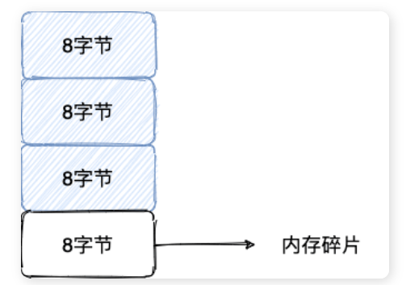

Redis 内存碎片虽然不会影响 Redis 性能，但是会增加内存消耗。

### 为什么会有 Redis 内存碎片?

**1、Redis 存储存储数据的时候向操作系统\*\*\*\*申请的内存空间 > 数据实际需要的空间** **。**

Redis 使用 `zmalloc` 方法(Redis 自己实现的内存分配方法)进行内存分配的时候，除了要分配 `size` 大小的内存之外，还会多分配 `PREFIX_SIZE` 大小的内存。

Redis 可以使用多种内存分配器来分配内存（ libc、jemalloc、tcmalloc），默认使用 [jemalloc](https://github.com/jemalloc/jemalloc)，而 jemalloc 按照一系列固定的大小（8 字节、16 字节、32 字节……）来分配内存的。jemalloc 划分的内存单元如下图所示：

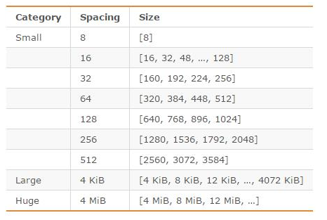

**2、频繁修改 Redis 中的数据也会产生内存碎片。**

当 Redis 中的某个数据删除时，Redis 通常不会轻易释放内存给操作系统。

### 如何查看 Redis 内存碎片的信息？

使用 `info memory` 命令即可查看 Redis 内存相关的信息。下图中每个参数具体的含义，Redis 官方文档有详细的介绍：<https://redis.io/commands/INFO>。

### 如何清理 Redis 内存碎片？

直接通过 `config set` 命令将 `activedefrag` 配置项设置为 `yes` 即可。

```yaml
config set activedefrag yes
```

```yaml
# 内存碎片占用空间达到 500mb 的时候开始清理
config set active-defrag-ignore-bytes 500mb
# 内存碎片率大于 1.5 的时候开始清理
config set active-defrag-threshold-lower 50
```

通过 Redis 自动内存碎片清理机制可能会对 Redis 的性能产生影响，我们可以通过下面两个参数来减少对 Redis 性能的影响：

```yaml
# 内存碎片清理所占用 CPU 时间的比例不低于 20%
config set active-defrag-cycle-min 20
# 内存碎片清理所占用 CPU 时间的比例不高于 50%
config set active-defrag-cycle-max 50
```

另外，重启节点可以做到内存碎片重新整理。如果你采用的是高可用架构的 Redis 集群的话，你可以将碎片率过高的主节点转换为从节点，以便进行安全重启。

# Redis 主从复制 ♥♥♥♥

单机 Redis 存在单点风险问题，如果唯一的一个 Redis 节点宕机的话，就会导致大量的请求直接被打到数据库，严重的情况下，数据库很可能会直接被干宕机了。

保证 Redis 服务高可用：**最简单的一种办法就是基于 ****<font style="color:#DF2A3F;">主从复制(读写分离)</font>**** 搭建一个 Redis 集群**，**master（主节点）主要负责处理写请求，slave（从节点）主要负责处理读请求。**

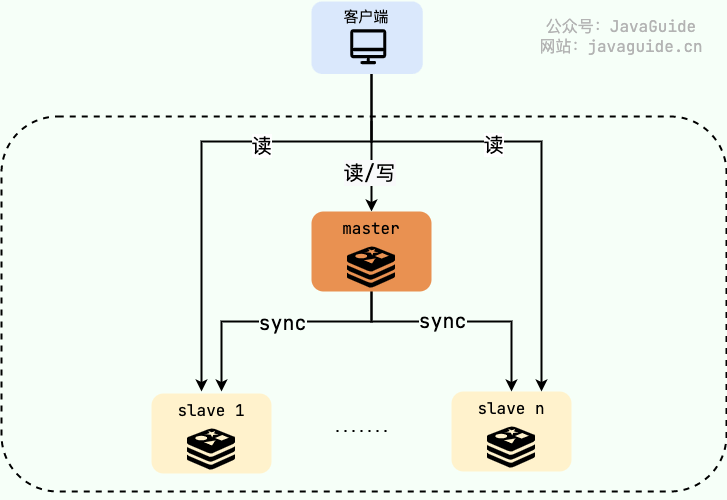

如果 master 宕机的话，从 slave 中选出一台作为 master 即可实现故障转移（Failover）。

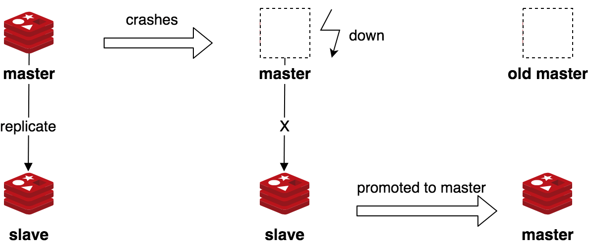

## 什么是主从复制？

主从复制 就是**将一台 Redis 主节点的数据复制到其他的 Redis 从节点中**，**尽最大可能保证 Redis 主节点和从节点的数据是一致的**。**主从复制这种方案不仅保障了 Redis 服务的高可用，还实现了读写分离** **，提高了系统的并发量，尤其是读并发量。**

* **<font style="color:#DF2A3F;">读写分离</font>**
* **<font style="color:#DF2A3F;">容灾恢复</font>**
* **<font style="color:#DF2A3F;">数据备份</font>**
* **<font style="color:#DF2A3F;">水平扩容支撑高并发</font>**

主从复制这种方案基于 [Redis replication](https://redis.io/docs/manual/replication/)（默认使用异步复制），开发者可以通过 replicaof （Redis 5.0 之前是 slaveof 命令）命令来配置各个 Redis 节点的主从关系。

```yaml
# 在指定 redis 节点上执行 replicaof 命令就可以让其成为 master 的 slave
# ip port 是 master 的
replicaof ip port
```

配置完成之后，主从节点之间的数据同步会自动进行


## 主从复制下从节点会主动删除过期数据吗？

* 主从复制下会读取到过期的数据吗？
* 主从复制下如何避免读取到过期的数据?

Redis 中常用的过期数据的删除策略就两个：

* **惰性删除** ：只会在取出 key 的时候才对数据进行过期检查。这样对 CPU 最友好，但是可能会造成太多过期 key 没有被删除。
* **定期删除** ： 每隔一段时间抽取一批 key 执行删除过期 key 操作。并且，Redis 底层会通过限制删除操作执行的时长和频率来减少删除操作对 CPU 时间的影响。

**Redis 3.2 版本之前，客户端读从库并不会判断数据是否过期，有可能返回过期数据。Redis 3.2 版本及之后，\*\*\*\*<font style="color:#DF2A3F;">客户端读从库会先判断数据是否过期，如果过期的话，就会删除对应的数据并返回空值</font>**<font style="color:#DF2A3F;"> </font>**<font style="color:#DF2A3F;">。</font>**

采用 EXPIRE 或者PEXPIRE设置过期时间的话，表示的是从执行这个命令开始往后 TTL 时间过期。如果从节点同步执行命令因为网络等原因延迟的话，客户端就可能会读取到过期的数据（如下图所示，客户端在 T3-T4 之间读取到的就是过期数据）。

这种情况可以考虑使用 EXPIREAT 和 PEXPIREAT，这两个命令语义和效果和 EXPIRE 或者PEXPIRE类似，但不是指定 TTL（生存时间）的秒数/毫秒数，而是使用绝对的 [Unix 时间戳](http://en.wikipedia.org/wiki/Unix_time)（自 1970 年 1 月 1 日以来的秒数）。由于设置的是时间点，主从节点的时钟需要保持一致。

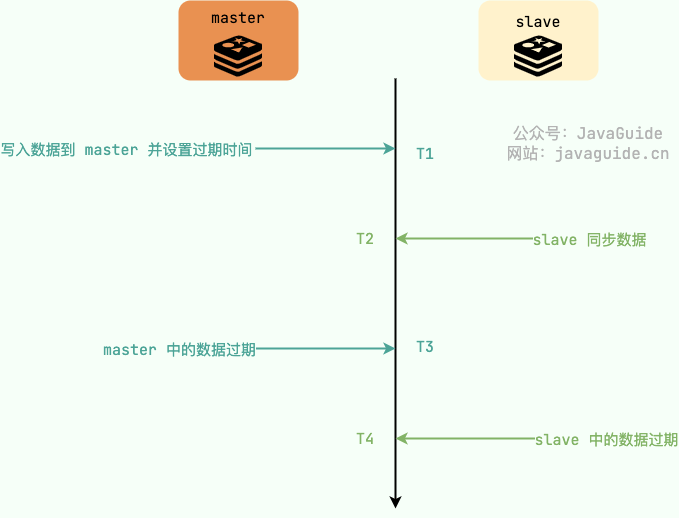

> **<font style="color:#DF2A3F;">原本是设置多少秒后过期，但是主从复制可能有延迟，后续改成什么时间点过期，这样只需要统一主从时钟</font>**

## 主从节点之间如何同步数据？

* 主从复制的原理是什么？
* master 节点的数据是如何同步给 slave 节点的?
* 复制积压缓冲区的有什么用?

### SYNC (全量同步)方案

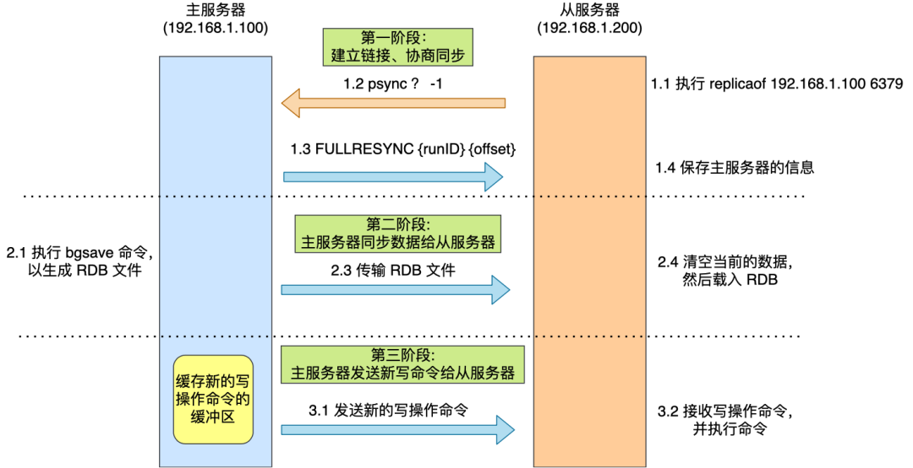

* \*\*执行 BGSAVE 命令之后，Redis 主线程会专门 fork 一个子进程，子进程共享主线程的内存数据。子进程会读取主线程中的内存数据写入 RDB 文件中，不会阻塞主线程。 \*\*
* **master 为每一个 slave 单独 开辟一块 ****<font style="color:#DF2A3F;background-color:#FBDE28;">replication buffer</font>****（复制缓存区） 来记录 RDB 文件生成时, 传输时，slaver加载RDB时，master 收到的所有写命令。之后将replication buffer的数据同步到slaver**
* \*\*<font style="color:#DF2A3F;">服务器通过全量RDB+ replication\_buffer 的方式</font>\*\***完成第一次全量同步的工作。**

### Redis 2.8 PSYNC (增量同步) 方案

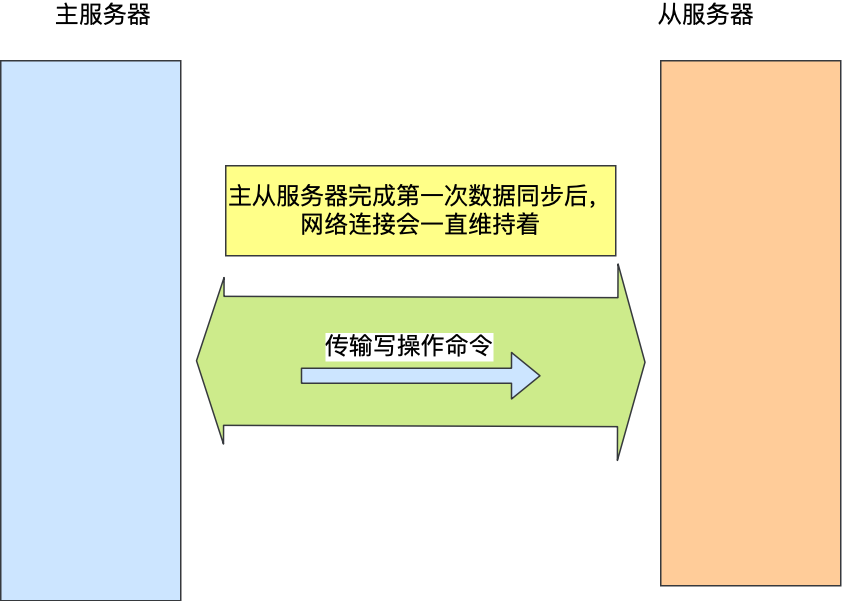

**<font style="color:rgb(48, 79, 254);">基于长连接的命令传播：</font>**<font style="color:rgb(44, 62, 80);">主从服务器在完成第一次同步后，双方之间就会维护一个 TCP 连接。后续主服务器可以通过这个连接继续将写操作命令传播给从服务器，然后从服务器执行该命令，使得与主服务器的数据库状态相同。</font>

**<font style="color:#DF2A3F;">PSYNC 解决了 slave 和 master 断开连接之后需要重新进行全量同步的问题</font>\*\*\*\*。** 不过，部分情况（比如 slave 突然宕机或者被重启）重连之后依然需要进行全量同步。

slave 会记录 master 的运行 id （也就是 runid）和自己的复制进度/偏移量（slave\_repl\_offset）。

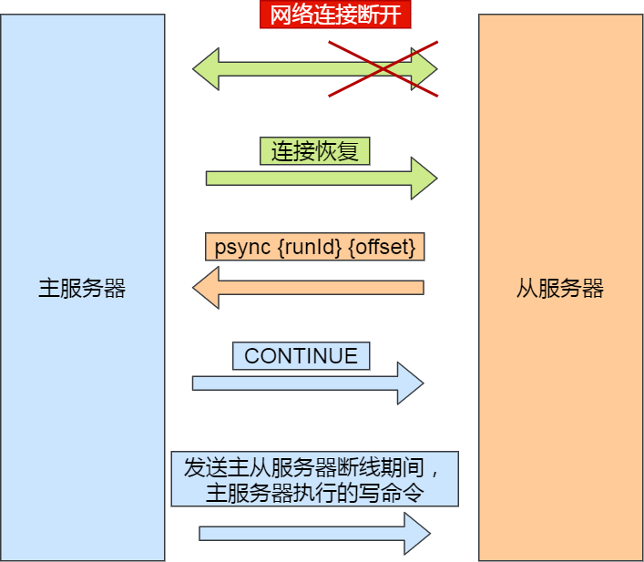

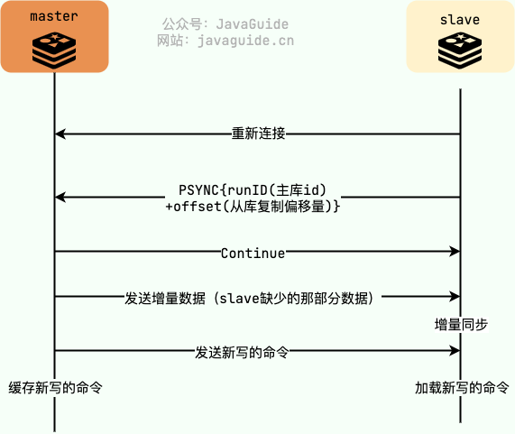

**master 如何通过复制偏移量找到 slave 缺少的数据从而避免全量复制呢？**

master 通过一个\*\*<font style="color:#DF2A3F;">环形的</font>**<font style="color:#DF2A3F;"> </font>**<font style="color:#DF2A3F;">复制积压缓冲区（repl\_backlog\_buffer）</font>\*\*  来记录从生成 RDB 文件开始收到的所有写命令。**<font style="color:#DF2A3F;">一个 master 中只有一个复制积压缓冲区，master 的 slave 共用</font>**<font style="color:#DF2A3F;">。</font>

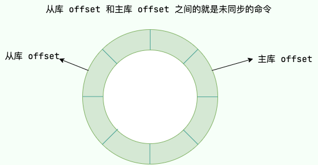

**主服务器使用 master\_repl\_offset 来记录自己「写」到的位置，从服务器使用 slave\_repl\_offset 来记录自己「读」到的位置。\*\*\*\*<font style="color:#DF2A3F;">如果 slave 缺少的那部分数据存在repl\_backlog\_buffer中，可以进行增量同步。否则的话， 还是要进行全量同步操作。</font>**

**当主服务器在 repl\_backlog\_buffer 中找到主从服务器差异（增量）的数据后，就会将增量的数据写入到 replication buffer 缓冲区**，**这个缓冲区缓存将要传播给从服务器的命令**。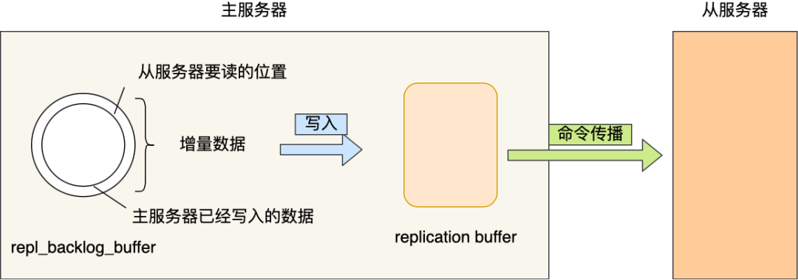

### Redis 4.0 PSYNC2.0 (增量同步)方案

PSYNC 方案中，我们通过 runid（master 的 id）+ offset（复制偏移量）来实现增量同步。不过，由于主从切换之后新选出来的 master 的 runid 和 offset 都会发生变化，依然需要进行全量同步。

**Redis 4.0 PSYNC2.0 方案优化了 PSYNC 方案的**\*\*<font style="color:#DF2A3F;">增量同步方案</font>\*\*\*\*，即使发生了主从切换，依然有可能进行增量同步而不是必须要全量同步。\*\*

PSYNC2.0 舍弃了 runid 的概念了，取而代之的是\*\*<font style="color:#DF2A3F;">replid 和 replid2</font>\*\*<font style="color:#DF2A3F;">：</font>

* 对于 master 来说，replid 就是自己的复制 id。没有发生主从切换之前，replid2为空。发生主从切换之后，新的 master 的 replid2是旧 master （前一个自己同步的 master） 的 replid，在主从角色切换的时候会用到。
* 对于 slave 来说，replid 保存的是自己当前正在同步的 master 的 replid。replid2保存的是旧 master 的 replid，在主从角色切换的时候会用到。

replid 和 replid2用于判断发生主从切换之后，新的 master 和 slave 曾经属于同一个主库。如果属于同一个主库，可以进行增量同步的尝试。

### <font style="color:rgb(44, 62, 80);">replication buffer vs repl backlog buffer </font>

<font style="color:rgb(44, 62, 80);">replication buffer 、repl backlog buffer 区别如下：</font>

* <font style="color:rgb(44, 62, 80);">出现的阶段不一样：</font>
  * <font style="color:rgb(44, 62, 80);">repl backlog buffer 是在增量复制阶段出现，</font>**<font style="color:rgb(48, 79, 254);">一个主节点只分配一个 repl backlog buffer</font>**<font style="color:rgb(44, 62, 80);">；</font>
  * <font style="color:rgb(44, 62, 80);">replication buffer 是在全量复制阶段和增量复制阶段都会出现，</font>**<font style="color:rgb(48, 79, 254);">主节点会给每个新连接的从节点，分配一个 replication buffer</font>**<font style="color:rgb(44, 62, 80);">；</font>
* <font style="color:rgb(44, 62, 80);">这两个 Buffer 都有大小限制的，当缓冲区满了之后，发生的事情不一样：</font>
  * <font style="color:rgb(44, 62, 80);">当 repl backlog buffer 满了，因为是环形结构，会直接</font>**<font style="color:rgb(48, 79, 254);">覆盖起始位置数据</font>**<font style="color:rgb(44, 62, 80);">;</font>
  * <font style="color:rgb(44, 62, 80);">当 replication buffer 满了，会导致连接断开，删除缓存，从节点重新连接，</font>**<font style="color:rgb(48, 79, 254);">重新开始全量复制</font>**<font style="color:rgb(44, 62, 80);">。</font>

## 为什么主从全量复制使用 RDB 而不是 AOF？

* **RDB 文件存储的内容是经过压缩的二进制数据，文件很小**。AOF 文件存储的是每一次写命令，类似于 MySQL 的 binlog 日志，通常会必 RDB 文件大很多。因此，传输 RDB 文件更节省带宽，速度也更快。
* **使用 RDB 文件恢复数据，直接解析还原数据即可，不需要一条一条地执行命令，速度非常快**。而 AOF 则需要依次执行每个写命令，速度非常慢。也就是说，与 AOF 相比，恢复大数据集的时候，RDB 速度更快。
* AOF 需要选择合适的刷盘策略，如果刷盘策略选择不当的话，会影响 Redis 的正常运行。并且，根据所使用的刷盘策略，AOF 的速度可能会慢于 RDB。

> \*\*<font style="color:#DF2A3F;">RDB文件小，节省带宽，恢复速度快</font>\*\*🦏

## 怎么判断 Redis 某个节点是否正常工作？

Redis 判断节点是否正常工作，基本都是通过\*\*<font style="color:#DF2A3F;">互相的 ping-pong 心跳检测机制</font>**，**<font style="color:#DF2A3F;">一半以上的节点</font>\*\*去 ping一个节点的时候没有 pong 回应，集群就会认为这个节点挂掉了，会断开与这个节点的连接。Redis 主从节点发送的心态间隔是不一样的，而且作用也有一点区别：

* Redis 主节点默认**每隔 10 秒对从节点发送 ping 命令**，判断从节点的存活性和连接状态，可通过参数repl-ping-slave-period控制发送频率。
* Redis **从节点每隔 1 秒发送 replconf ack{offset} 命令**，给主节点上报自身当前的复制偏移量，目的是为了：
  * 实时监测主从节点网络状态；
  * 上报自身复制偏移量， 检查复制数据是否丢失， 如果从节点数据丢失， 再从主节点的复制缓冲区(**replication buffer**)中拉取丢失数据。

## Redis主从不一致如何处理

<font style="color:rgb(44, 62, 80);">之所以会出现主从数据不一致的现象，是</font>**<font style="color:rgb(48, 79, 254);">因为主从节点间的命令复制是异步进行的</font>**<font style="color:rgb(44, 62, 80);">，所以无法实现强一致性保证（主从数据时时刻刻保持一致）。</font>

**<font style="color:rgb(44, 62, 80);">尽量保证主从节点间的网络连接状况良好，避免主从节点在不同的机房。</font>**

<font style="color:rgb(44, 62, 80);">外部程序来监控主从节点间的复制进度：</font>

* <font style="color:rgb(44, 62, 80);">Redis 的 INFO replication 命令可以查看主节点接收写命令的进度信息（master\_repl\_offset）和从节点复制写命令的进度信息（slave\_repl\_offset），所以可以开发一个监控程序，先用 INFO replication 命令查到主、从节点的进度，然后，我们用 master\_repl\_offset 减去 slave\_repl\_offset，这样就能得到从节点和主节点间的复制进度差值了。</font>
* <font style="color:rgb(44, 62, 80);">如果某个从节点的进度差超过预设的阈值，可以让客户端不再和这个从节点连接进行数据读取，这样就可以减少读到不一致数据的情况。不过，为了避免出现客户端和所有从节点都不能连接的情况，我们需要把复制进度差值的阈值设置得大一些。</font>

<font style="color:rgb(44, 62, 80);"></font>

## <font style="color:rgb(44, 62, 80);">Redis主从切换减少数据丢失</font>

<font style="color:rgb(44, 62, 80);">主从切换过程中，产生数据丢失的情况有两种：</font>

* <font style="color:rgb(44, 62, 80);">异步复制同步丢失 - </font>
* <font style="color:rgb(44, 62, 80);">集群产生脑裂数据丢失 - sentinel解决方案</font>

# Redis Sentinel ♥♥♥♥

普通的主从复制方案下，一旦 master 宕机，我们需要从 slave 中手动选择一个新的 master，同时需要修改应用方的主节点地址，还需要命令所有从节点去复制新的主节点 - **<font style="color:#DF2A3F;">无法自动完成主从切换</font>**

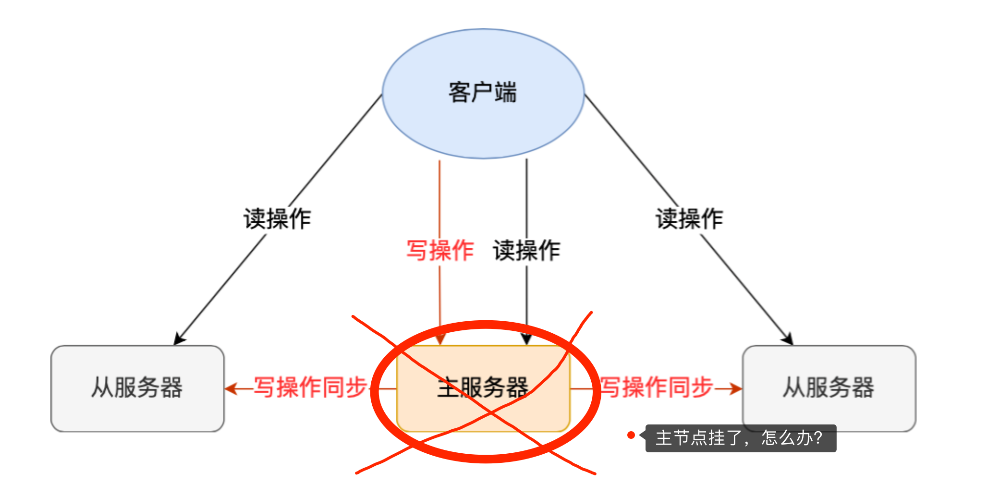

## 什么是 Sentinel？

**Sentinel（哨兵）**  只是 Redis 的一种运行模式 ，不提供读写服务，默认运行在 26379 端口上，依赖于 Redis 工作。通过下面的命令就可以让 Redis 以 Sentinel 的方式运行:

```yaml
redis-sentinel /path/to/sentinel.conf
或者
redis-server /path/to/sentinel.conf --sentinel
```

Redis 源码中的sentinel.conf是用来配置 Sentinel 的，一个常见的最小配置如下所示：

```plain
// 指定要监视的 master
// 127.0.0.1 6379 为 master 地址
// 2 表示当有 2 个 sentinel 认为 master 失效时，master 才算真正失效
sentinel monitor mymaster 127.0.0.1 6379 2
// master 节点宕机多长时间才会被 sentinel 认为是失效
sentinel down-after-milliseconds mymaster 60000
sentinel failover-timeout mymaster 180000
sentinel parallel-syncs mymaster 1

sentinel monitor resque 192.168.1.3 6380 4
sentinel down-after-milliseconds resque 10000
sentinel failover-timeout resque 180000
// 在发生主备切换时最多可以有 5 个 slave 同时对新的 master 进行同步
sentinel parallel-syncs resque 5
```

Redis Sentinel 实现 Redis 集群高可用，只是在主从复制实现集群的基础下，多了一个\*\* \*\***<font style="color:#DF2A3F;">Sentinel 监控 Redis 节点的运行状态并自动实现故障转移。</font>**

当 master 节点出现故障的时候， Sentinel 会帮助我们实现故障转移，自动根据一定的规则选出一个 slave 升级为 master，确保整个 Redis 系统的可用性。整个过程完全自动，不需要人工介入。

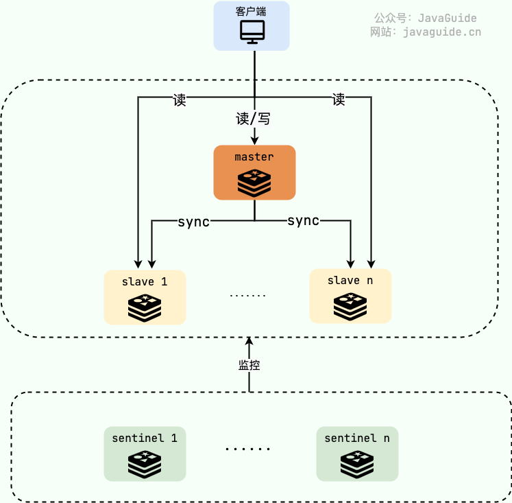

## Sentinel 有什么作用？

* **监控**：监控所有 redis 节点（包括 sentinel 节点自身）的状态是否正常。
* **故障转移**：如果一个 master 出现故障，Sentinel 会帮助我们实现故障转移，自动将某一台 slave 升级为 master，确保整个 Redis 系统的可用性。
* **通知** ：通知 slave 新的 master 连接信息，让它们执行 replicaof 成为新的 master 的 slave。
* **配置提供** ：客户端连接 sentinel 请求 master 的地址，如果发生故障转移，sentinel 会通知新的 master 链接信息给客户端。

Redis Sentinel 本身设计的就是一个分布式系统，建议多个 sentinel 节点协作运行。这样做的好处是：

* **多个 sentinel 节点通过投票的方式来确定 master 节点是否真的不可用**，**避免误判（比如网络问题可能会导致误判）。**
* **Sentinel 自身就是高可用。**

**如果想要实现高可用，建议将哨兵 Sentinel 配置成单数且大于等于 3 台。**

## Sentinel 如何检测节点是否下线？

> 相关的问题：
>
> * 主观下线与客观下线的区别?
> * Sentinel 是如何实现故障转移的？
> * 为什么建议部署多个 sentinel 节点（哨兵集群）？

Redis Sentinel 中有两个下线（Down）的概念：

* **主观下线(SDOWN)** ：sentinel 节点认为某个 Redis 节点已经下线了（主观下线），但还不是很确定，需要其他 sentinel 节点的投票。
* **客观下线(ODOWN)** ：法定数量（通常为过半）的 sentinel 节点认定某个 Redis 节点已经下线（客观下线），那它就算是真的下线了。

**主观下线当前的 sentinel 自己认为节点宕机，客观下线是 sentinel 整体达成一致认为节点宕机。**

每个 sentinel 节点以每秒一次的频率向整个集群中的 master、slave 以及其他 sentinel 节点发送一个 PING 命令。

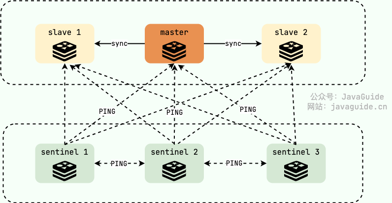

如果对应的节点超过规定的时间（down-after-millseconds）没有进行有效回复的话，就会被其认定为是 主观下线(SDOWN) 。

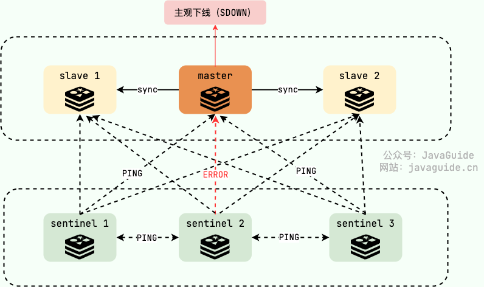

如果被认定为主观下线的是 slave 的话， sentinel 不会做什么事情，因为 slave 下线对 Redis 集群的影响不大，Redis 集群对外正常提供服务。但如果是 master 被认定为主观下线就不一样了，sentinel 整体还要对其进行进一步核实，确保 master 是真的下线了。

**所有 sentinel 节点要以每秒一次的频率确认 master 的确下线了，当法定数量（通常为过半）的 sentinel 节点认定 master 已经下线， master 才被判定为 客观下线(ODOWN) 。这样做的目的是为了防止误判**

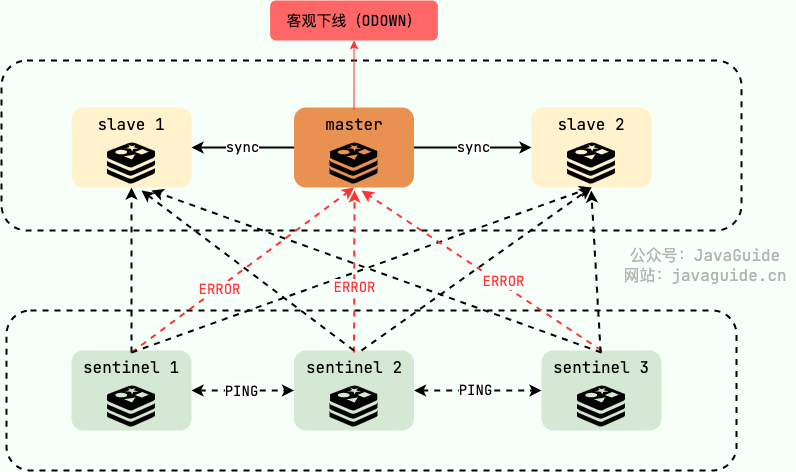

随后， sentinel 中会有一个<font style="color:#DF2A3F;background-color:#FBDE28;"> </font>**<font style="color:#DF2A3F;background-color:#FBDE28;">Leader</font>**<font style="color:#DF2A3F;background-color:#FBDE28;"> </font>的角色来负责故障转移，**自动地从 slave 中选出一个新的 master 并执行完相关的一些工作(比如通知 slave 新的 master 连接信息，让它们执行 replicaof 成为新的 master 的 slave)。**

如果没有足够数量的 sentinel 节点认定 master 已经下线的话，当 master 能对 sentinel 的 PING 命令进行有效回复之后，master 也就不再被认定为主观下线，回归正常。

## Sentinel 如何选择出新的 master?

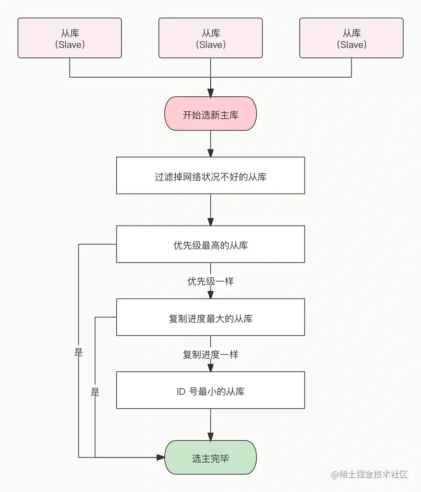

slave 必须是在线状态才能参加新的 master 的选举，筛选出所有在线的 slave 之后，通过下面 3 个维度进行最后的筛选（优先级依次降低）：

* **slave 优先级** ：可以通过修改 slave-priority（redis.conf中配置，Redis5.0 后该配置属性名称被修改为 replica-priority） 配置的值来手动设置 slave 的优先级。slave-priority默认值为 100，**其值越小得分越高**，越有机会成为 master。比如说假设有三个优先级分别为 10,100,25 的 slave ，哨兵将选择优先级为 10 的。不过，0 是一个特殊的优先级值 ，如果一个 slave 的 slave-priority值为 0，代表其没有参加 master 选举的资格。如果没有优先级最高的，再判断复制进度。
* **复制进度** ：Sentinel 总是希望选择出**数据最完整**也就是**复制进度最快**的 slave 被提升为新的 master，复制进度越快得分也就越高。
* **runid(运行 id)**  ：通常经过前面两轮筛选已经成功选出来了新的 master，万一真有多个 slave 的优先级和复制进度一样的话，那就 runid 小的成为新的 master，每个 redis 节点启动时都有一个 40 字节随机字符串作为运行 id。

## 如何从 Sentinel 集群中选择出 Leader ？

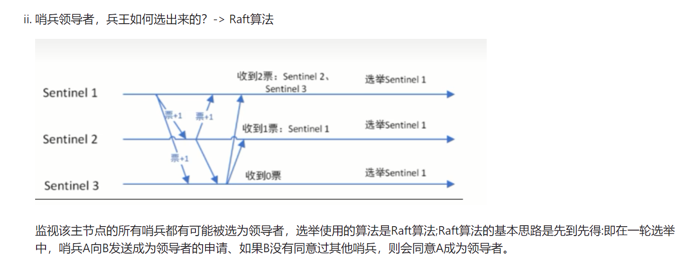

在 sentinel 选举 leader 这个场景下使用的是

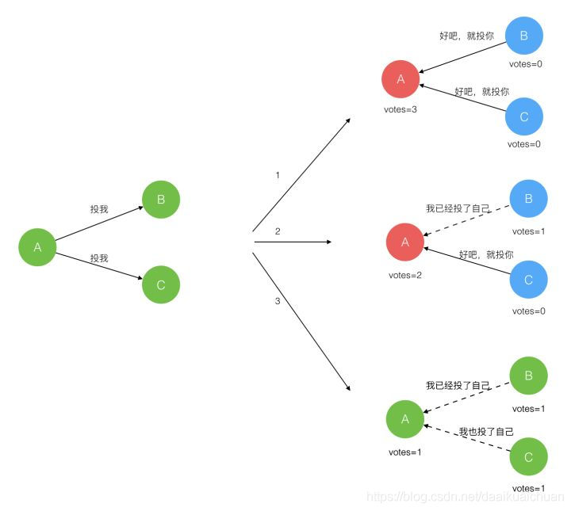

## Sentinel 可以防止脑裂吗？

**脑裂通常指的是分布式系统中的节点之间失去了一致性，导致数据不一致和系统不可用的情况**。

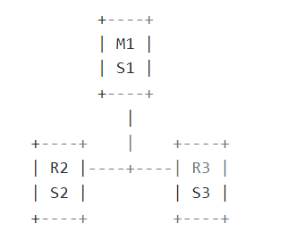

如果 **M1 和 R2、R3 之间的网络被隔离**，**也就是发生了脑裂**，M1 和 R2 、 R3 隔离在了两个不同的网络分区中。这意味着，R2 或者 R3 其中一个会被选为 master，这里假设为 R2。

如果客户端 C1 是和 M1 在一个网络分区的话，从网络被隔离到网络分区恢复这段时间，C1 写入 M1 的数据都会丢失，并且，C1 读取的可能也是过时的数据。这是因为当网络分区恢复之后，M1 将会成为 slave 节点。

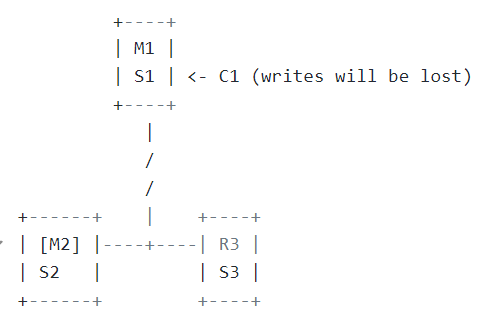

**对 Redis 主从复制**进行配置即可。

```plain
min-replicas-to-write 1
min-replicas-max-lag 10
```

下面对这两个配置进行解释：

* min-replicas-to-write 1：用于配置写 master 至少写入的 slave 数量，设置为 0 表示关闭该功能。3 个节点的情况下，可以配置为 1 ，**表示 master 必须写入至少 1 个 slave ，否则就停止接受新的写入命令请求。**
* min-replicas-max-lag 10 ：用于配置 master 多长时间（秒）无法得到从节点的响应，就认为这个节点失联。我们这里配置的是 10 秒，也就是说 master 10 秒都得不到一个从节点的响应，就会认为这个**从节点失联，停止接受新的写入命令请求。**

**不过，这样配置会降低 Redis 服务的整体可用性，如果 2 个 slave 都挂掉，master 将会停止接受新的写入命令请求。**

# Redis Cluster集群

## 为什么需要 Redis Cluster？

高并发场景下，使用 Redis 主要会遇到的两个问题：

* **缓存的数据量太大** ：实际缓存的数据量可以达到几十 G
* **并发量要求太大** ：虽然 Redis 号称单机可以支持 10w 并发，但实际项目中，不可靠因素太多，就比如一些复杂的写/读操作就可能会让这个并发量大打折扣。而且，就算真的可以实际支持 10w 并发，达到瓶颈了，可能也没办法满足系统的实际需求。

主从复制和 Redis Sentinel 这两种方案本质都是通过增加主库（master）的副本（slave）数量的方式来提高 Redis 服务的整体可用性和读吞吐量，**都不支持横向扩展来缓解**\*\*<font style="color:#DF2A3F;">写压力</font>****以及解决****<font style="color:#DF2A3F;">缓存数据量过大</font>\*\***的问题**。

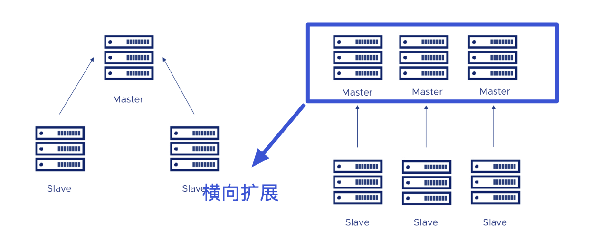

对于这两种方案来说，如果写压力太大或者缓存数据量太大的话，我们可以考虑提高服务器硬件的配置。

> 定义：$ \textcolor{red}{\large 由于数据量过大，单个Master复制集难以承担} $，因此需要对多个复制集进行集群，形成水平扩展每个复制集只负责存储整个数据集 的一部分，这就是Redis的集群，其作用是提供在多个Redis节点间共享数据的程序集。

**Redis 切片集群：部署多台 Redis 主节点（master），这些节点之间平等，并没有主从之分，同时对外提供读/写服务。缓存的数据相对均匀地分布在这些 Redis 实例上** **，客户端的请求通过路由规则转发到目标 master 上。**

**为了保障集群整体的高可用，我们需要保证集群中每一个 master 的高可用，可以通过主从复制给每个 master 配置一个或者多个从节点（slave）。**

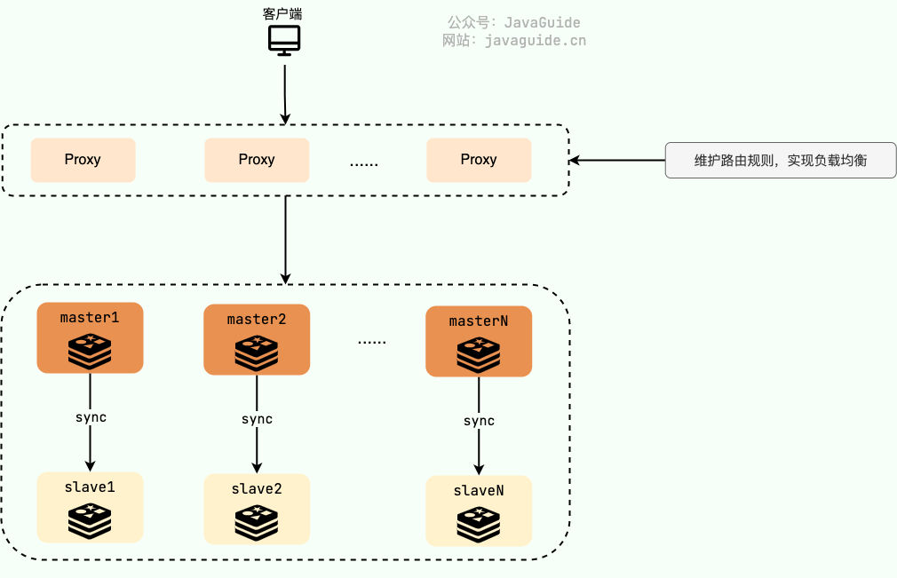

Redis Cluster 通过 **分片（Sharding）**  来进行数据管理，提供 **主从复制（Master-Slave Replication）** 、**故障转移（Failover）**  等开箱即用的功能，可以方便地解决 Redis 大数据量缓存以及 Redis 服务高可用的问题。

Redis Cluster 这种方案可以很方便地进行 **横向拓展（Scale Out）** ，内置了开箱即用的解决方案。当 Redis Cluster 的处理能力达到瓶颈无法满足系统要求的时候，直接动态添加 Redis 节点到集群中即可。根据官方文档中的介绍，Redis Cluster 支持扩展到 1000 个节点。反之，当 Redis Cluster 的处理能力远远满足系统要求，同样可以动态删除集群中 Redis 节点，节省资源。

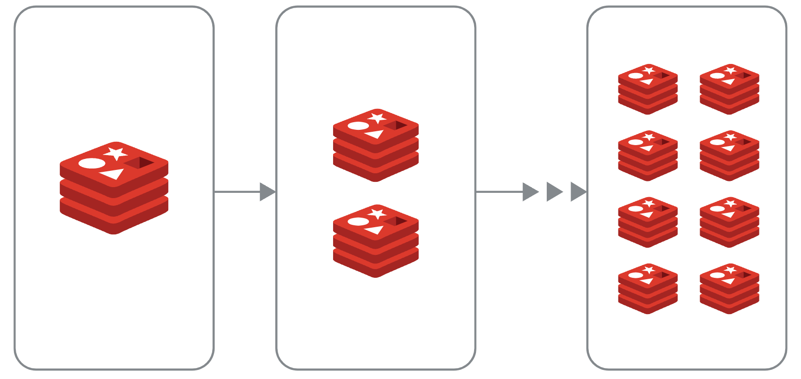

<font style="color:rgb(38, 38, 38);">虽说 Redis Cluster 可以扩展到 1000 个节点，但不推荐这样做，应尽量避免集群中的节点过多。这是因为 Redis Cluster 中的各个节点基于 </font>**<font style="color:#DF2A3F;">Gossip 协议</font>**<font style="color:rgb(38, 38, 38);"> 来进行通信共享信息，当节点过多时，Gossip 协议的效率会显著下降，通信成本剧增。</font>

***

**Redis Cluster 的主要优势：**

* **<font style="color:#DF2A3F;">横向扩展缓解写压力和存储压力，支持动态扩容和缩容(最大的优势)</font>\*\*\*\*；**
* **具备主从复制、故障转移（内置了 Sentinel 机制，无需单独部署 Sentinel 集群）等开箱即用的功能。**

## 一个最基本的 Redis Cluster 架构是怎样的？

为了保证高可用，Redis Cluster 至少需要 **3 个 master 以及 3 个 slave**，也就是说每个 master 必须有 1 个 slave。**master 和 slave 之间做主从复制**，slave 会实时同步 master 上的数据。

**不同于普通的 Redis 主从架构，** **slave 不对外提供读服务，主要用来保障 master 的高可用，当 master 出现故障的时候替代它。**

如果 master 只有一个 slave 的话，master 宕机之后就直接使用这个 slave 替代 master 继续提供服务。假设 master1 出现故障，slave1 会直接替代 master1，保证 Redis Cluster 的高可用。

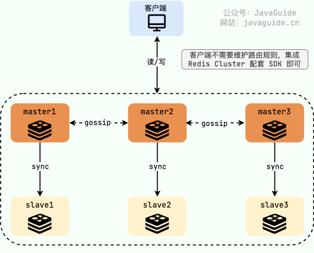

**如果 master 有多个 slave 的话，Redis Cluster 中的其他节点会从这个 master 的所有 slave 中选出一个替代 master 继续提供服务。Redis Cluster 总是希望数据最完整的 slave 被提升为新的 master。**

Redis Cluster 是去中心化的（**各个节点基于 Gossip 进行通信**），任何一个 master 出现故障，其它的 master 节点不受影响，因为 **key 找的是哈希槽而不是 Redis 节点**。不过，Redis Cluster 至少要保证宕机的 master 有一个 slave 可用。

如果宕机的 master 无 slave ，为了保障集群的完整性，保证所有的哈希槽都指派给了可用的 master ，整个集群将不可用。这种情况下，还是想让集群保持可用的话，可以将cluster-require-full-coverage 这个参数设置成 no，cluster-require-full-coverage 表示需要 16384 个 slot 都正常被分配的时候 Redis Cluster 才可以对外提供服务。

如果想要添加新的节点比如 master4、master5 进入 Redis Cluster 也非常方便，只需要重新分配哈希槽即可。

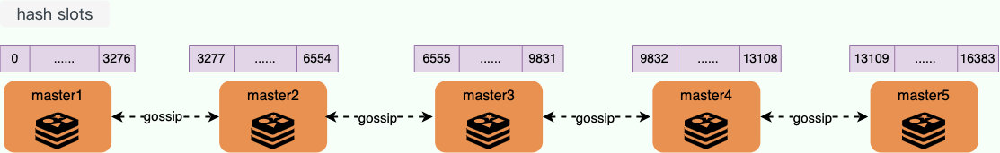

如果我们想要移除某个 master 节点的话，需要先将该节点的哈希槽移动到其他节点上，这样才可以进行删除，不然会报错

## Redis Cluster 是如何分片的？

Redis Cluster **没有使用一致性哈希**，采用 **<font style="color:#DF2A3F;">哈希槽分区</font>**<font style="color:#DF2A3F;"> </font>，每一个键值对都属于一个 hash slot（哈希槽） 。

Redis Cluster 通常有 **<font style="color:#DF2A3F;">16384</font>** 个哈希槽 ，要计算给定 key 应该分布到哪个哈希槽中，只需要先对每个 key 计算 CRC-16（XMODEM） 校验码，然后再对这个校验码对 **16384**(哈希槽的总数) 取模，得到的值即是 key 对应的哈希槽。

```c
HASH_SLOT = CRC16(key) mod NUMER_OF_SLOTS
```

**创建并初始化 Redis Cluster 的时候，Redis 会自动平均分配这 16384 个哈希槽到各个节点**，不需要我们手动分配。如果你想自己手动调整的话，Redis Cluster 也内置了相关的命令比如 ADDSLOTS、ADDSLOTSRANGE

* Node 1 ： 0 - 5500 的 hash slots
* Node 2 ： 5501 - 11000 的 hash slots
* Node 3 ： 11001 - 16383 的 hash slots

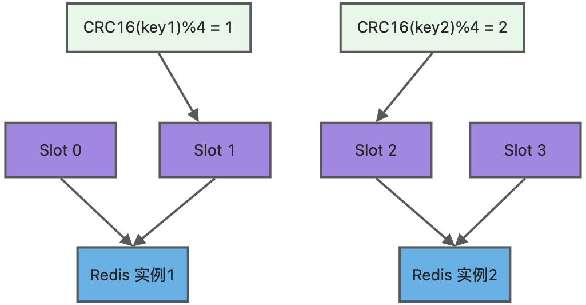

在任意一个 master 节点上执行 **CLUSTER SLOTS**命令即可返回哈希槽和节点的映射关系：

```bash
127.0.0.1:7000>> CLUSTER SLOTS
# 哈希槽的范围
1) 1) (integer) 0
   2) (integer) 5500
   # master 的 ip 和端口号
   3) 1) "127.0.0.1"
      2) (integer) 7002
   # slave 的 ip 和端口号
   4) 1) "127.0.0.1"
      2) (integer) 8002
2) 1) (integer) 11001
   2) (integer) 16383
   3) 1) "127.0.0.1"
      2) (integer) 7000
   4) 1) "127.0.0.1"
      2) (integer) 8000
3) 1) (integer) 5501
   2) (integer) 11000
   3) 1) "127.0.0.1"
      2) (integer) 7001
   4) 1) "127.0.0.1"
      2) (integer) 8001
```

**客户端连接 Redis Cluster 中任意一个 master 节点即可访问 Redis Cluster 的数据，当客户端发送命令请求的时候，需要先根据 key 通过上面的计算公示找到的对应的哈希槽，然后再查询哈希槽和节点的映射关系，即可找到目标节点。**

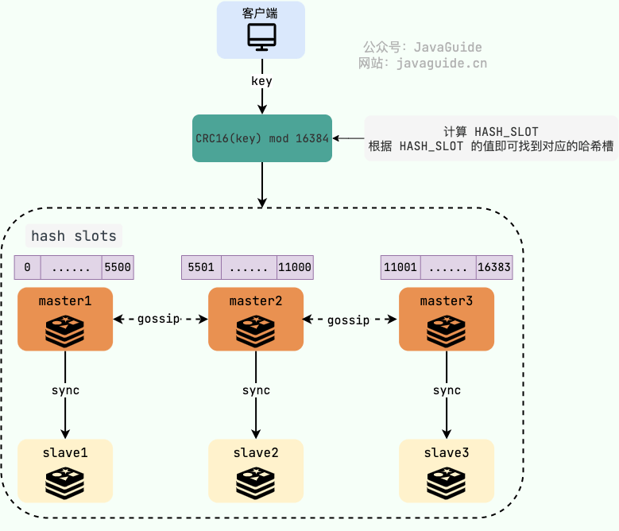

如果哈希槽确实是当前节点负责，那就直接响应客户端的请求返回结果，如果不由当前节点负责，就会返回 -MOVED 重定向错误，告知客户端当前哈希槽是由哪个节点负责，客户端向目标节点发送请求并更新缓存的哈希槽分配信息。

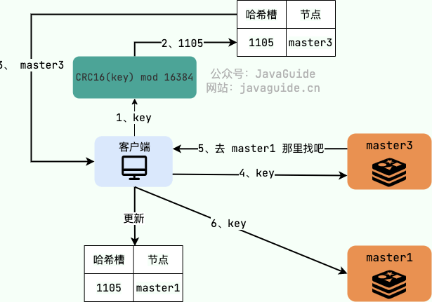

**为什么还会存在找错节点的情况呢？根据公式计算难道还会出错？**

因为 Redis Cluster 内部可能会重新分配哈希槽比如扩容缩容的时候（后文中有详细介绍到 Redis Cluster 的扩容和缩容问题），这就可能会导致客户端缓存的哈希槽分配信息会有误。

Redis Cluster 哈希槽分区机制的优点：**解耦了数据和节点之间的关系，提升了集群的横向扩展性和容错性**。

## 为什么 Redis Cluster 的哈希槽是 16384 个?

CRC16 算法产生的校验码有 16 位，理论上可以产生 65536（2<sup>16</sup>，0 ~ 65535）个值。为什么 Redis Cluster 的哈希槽偏偏选择的是 16384（2<sup>14</sup>）个呢？

> 正常的心跳包会携带一个节点的完整配置，它会以幂等的方式更新旧的配置，这意味着心跳包会附带当前节点的负责的哈希槽的信息。假设哈希槽采用 16384 ,则占空间 2k(16384/8)。假设哈希槽采用 65536， 则占空间 8k(65536/8)，这是令人难以接受的内存占用。
>
> 由于其他设计上的权衡，Redis Cluster 不太可能扩展到超过 1000 个主节点。

* 哈希槽太大会导致心跳包太大，消耗太多带宽；
* 哈希槽总数越少，对存储哈希槽信息的 bitmap 压缩效果越好；
* Redis Cluster 的主节点通常不会扩展太多，16384 个哈希槽已经足够用了。

## Redis Cluster 如何重新分配哈希槽？

**并不是完全平分，之前的集群各自匀出一部分给新的master**

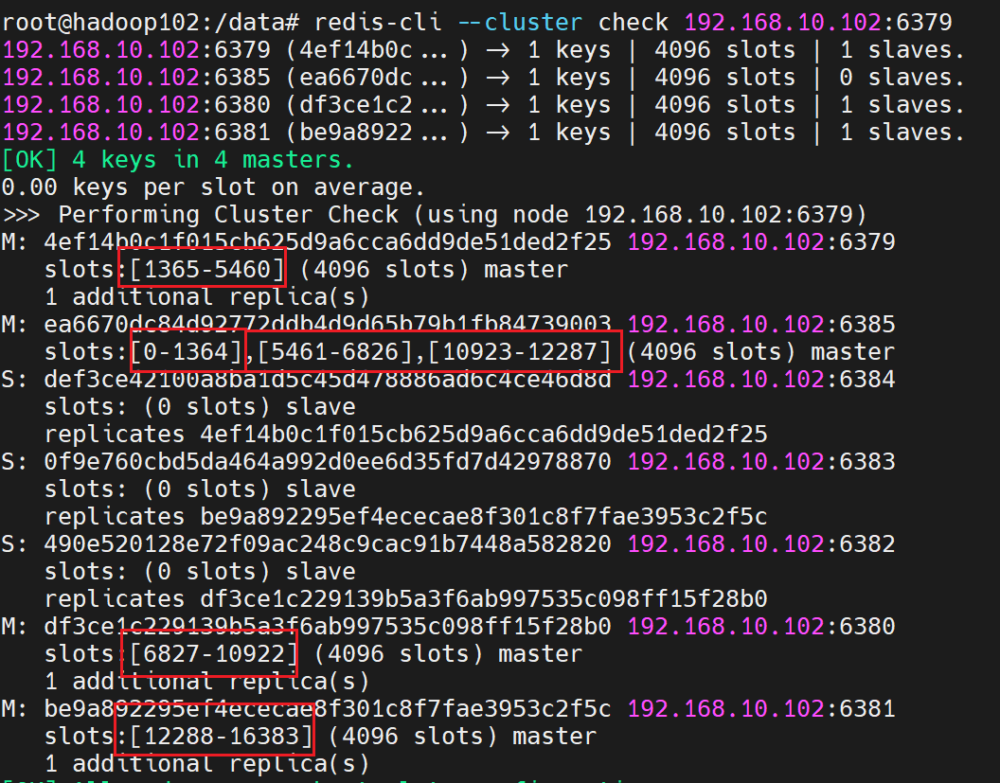

## Redis Cluster 扩容缩容期间可以提供服务吗？

> **类似的问题：**
>
> * **如果客户端访问的 key 所属的槽正在迁移怎么办？**
> * **如何确定给定 key 的应该分布到哪个哈希槽中？**

**Redis Cluster 扩容和缩容本质是进行重新分片，动态迁移哈希槽。**

为了保证 Redis Cluster 在扩容和缩容期间依然能够对外正常提供服务，Redis Cluster 提供了\*\*<font style="color:#DF2A3F;">重定向机制</font>\*\*，两种不同的类型：

* ASK 重定向 ：可以看做是临时重定向，后续查询仍然发送到旧节点。
* 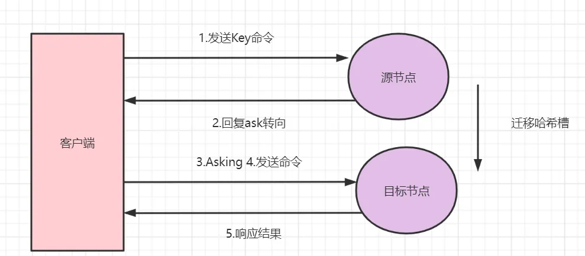
* MOVED 重定向 ：可以看做是永久重定向，后续查询发送到新节点。
* 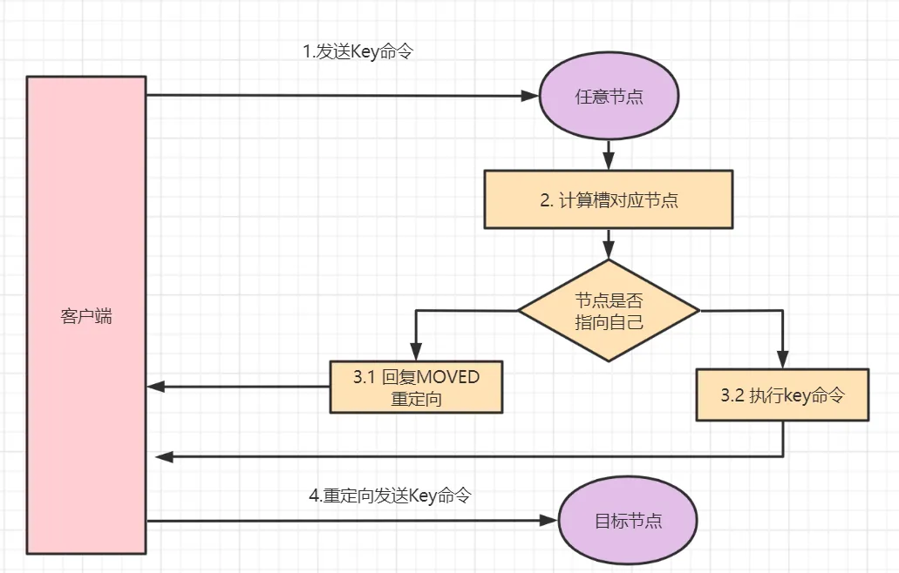

客户端向指定节点发送请求命令，从客户端的角度来看，ASK 重定向是下面这样的：

1. 如果请求的 key 对应的哈希槽还在当前节点的话，就直接响应客户端的请求。
2. 如果请求的 key 对应的哈希槽在迁移过程中，但是请求的 key 还未迁移走的话，说明当前节点可以处理当前请求，同样可以直接响应客户端的请求。
3. 如果客户端请求的 key 对应的哈希槽当前正在迁移至新的节点且请求的 key  已经被迁移走的话，就会返回 -ASK 重定向错误，告知客户端要将请求发送到哈希槽被迁移到的目标节点。 -ASK 重定向错误信息中包含请求 key 迁移到的新节点的信息。
4. 客户端收到 -ASK 重定向错误后，**将会临时（一次性）重定向，自动向新节点发送一条** [**ASKING**](https://redis.io/commands/asking/) **命令**。也就是说，接收到 ASKING 命令的节点会强制执行一次请求，下次再来需要重新提前发送 ASKING 命令。
5. 新节点在收到 ASKING 命令后可能会返回重试错误（TRYAGAIN），因为可能存在当前请求的 key 还在导入中但未导入完成的情况。
6. 客户端发送真正需要请求的命令。
7. ASK 重定向并不会同步更新客户端缓存的哈希槽分配信息，也就是说，客户端对正在迁移的相同哈希槽的请求依然会发送到旧节点而不是新节点。

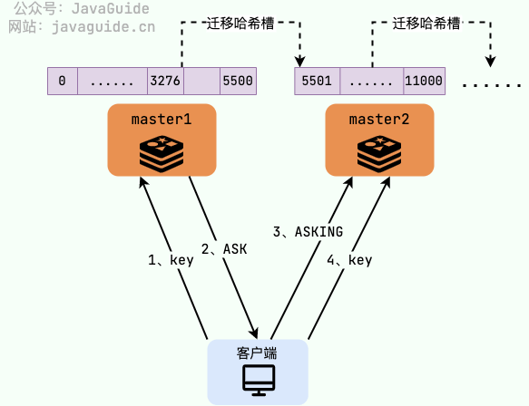

如果客户端请求的 key 对应的哈希槽已经迁移完成的话，就会返回 -MOVED 重定向错误，告知客户端当前哈希槽是由哪个节点负责，客户端向新节点发送请求并更新缓存的哈希槽分配信息，后续查询将被发送到新节点。

:::success

* **如果还在旧节点:可以响应**
* **如果迁移走了,发送ASK重定向错误去请求新节点,若还没有准备好,返回重试错误（TRYAGAIN）**
* **如果哈希槽已经迁移完成，返回 -MOVED 重定向错误**

:::

## Redis Cluster 中的节点是怎么进行通信的？

**Redis Cluster 中的各个节点基于  ****<font style="color:#DF2A3F;">Gossip 协议</font>**** 来进行通信共享信息，每个 Redis 节点都维护了一份集群的状态信息。Gossip是一种谣言传播协议，每个节点周期性地从节点列表中选择 k 个节点，将本节点存储的信息传播出去，直到所有节点信息一致，即算法收敛了。**

Redis Cluster 的节点之间会相互发送多种 Gossip 消息：

* **MEET** ：在 Redis Cluster 中的某个 Redis 节点上执行 CLUSTER MEET ip port 命令，可以向指定的 Redis 节点发送一条 MEET 信息，用于将其添加进 Redis Cluster 成为新的 Redis 节点。
* **PING/PONG** ：Redis Cluster 中的节点都会定时地向其他节点发送 PING 消息，来交换各个节点状态信息，检查各个节点状态，包括在线状态、疑似下线状态 PFAIL 和已下线状态 FAIL。
* **FAIL** ：Redis Cluster 中的节点 A 发现 B 节点 PFAIL ，并且在下线报告的有效期限内集群中半数以上的节点将 B 节点标记为 PFAIL，节点 A 就会向集群广播一条 FAIL 消息，通知其他节点将故障节点 B 标记为 FAIL 。

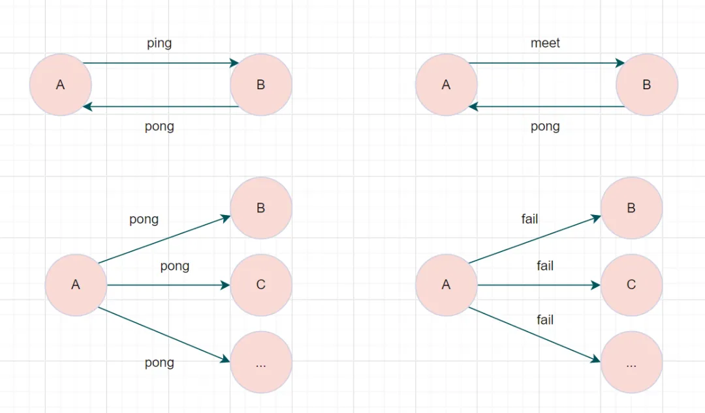

## <font style="color:rgb(5, 7, 59);">Redis中master挂了，余下的slave是怎么选举新master的。</font>

### <font style="color:rgb(5, 7, 59);background-color:rgb(253, 253, 254);">1. 检测Master节点状态</font>

* <font style="color:rgb(5, 7, 59);background-color:rgb(253, 253, 254);">Slave节点会定期检查与其连接的Master节点的状态。如果Master节点因为故障等原因变为FAIL状态（即无法响应或确认），Slave节点将开始尝试进行Failover（故障转移）。</font>

### <font style="color:rgb(5, 7, 59);background-color:rgb(253, 253, 254);">2. 发起选举准备</font>

* <font style="color:rgb(5, 7, 59);background-color:rgb(253, 253, 254);">Slave节点发现自己的Master变为FAIL后，会进行一系列准备工作以参与选举。首先，它会将自己的currentEpoch（集群状态版本号）增加1，currentEpoch是一个记录集群状态变更的递增版本号，用于标识选举的轮次。</font>
* <font style="color:rgb(5, 7, 59);background-color:rgb(253, 253, 254);">然后，Slave节点会广播FAILOVER\_AUTH\_REQUEST消息给集群中的其他节点，请求它们授权自己成为新的Master。</font>

### <font style="color:rgb(5, 7, 59);background-color:rgb(253, 253, 254);">3. 接收并处理投票</font>

* <font style="color:rgb(5, 7, 59);background-color:rgb(253, 253, 254);">当集群中的Master节点收到FAILOVER\_AUTH\_REQUEST消息时，它们会检查请求者的合法性（如currentEpoch是否最新）并决定是否授权。如果决定授权，Master节点会回复FAILOVER\_AUTH\_ACK消息给请求的Slave节点。</font>
* <font style="color:rgb(5, 7, 59);background-color:rgb(253, 253, 254);">Slave节点会收集来自Master节点的FAILOVER\_AUTH\_ACK响应。为了赢得选举，它需要收集到超过半数Master节点的授权（即N/2+1，N为集群中Master节点的总数）。</font>

### <font style="color:rgb(5, 7, 59);background-color:rgb(253, 253, 254);">4. 宣布选举结果</font>

* <font style="color:rgb(5, 7, 59);background-color:rgb(253, 253, 254);">一旦Slave节点确认自己赢得了选举（即收到了足够多的FAILOVER\_AUTH\_ACK响应），它会广播一条消息通知集群中的其他节点自己已成为新的Master节点。</font>
* <font style="color:rgb(5, 7, 59);background-color:rgb(253, 253, 254);">在此之后，新的Master节点会开始处理原本由旧Master节点负责的hash slots和客户端请求，同时与其他节点进行必要的数据同步。</font>

### <font style="color:rgb(5, 7, 59);background-color:rgb(253, 253, 254);">5. 选举过程中的延迟和优先级</font>

* <font style="color:rgb(5, 7, 59);background-color:rgb(253, 253, 254);">为了确保选举过程的稳定性和公平性，Redis Cluster在选举过程中引入了一定的延迟机制。Slave节点并不是在主节点一进入FAIL状态就立即尝试选举，而是会等待一段时间（具体延迟时间根据多种因素计算得出），以确保FAIL状态在集群中传播开来。</font>
* <font style="color:rgb(5, 7, 59);background-color:rgb(253, 253, 254);">此外，在多个Slave节点竞争成为新Master节点时，持有最新数据的Slave节点（即复制偏移量最大的Slave）会有更高的优先级。这是通过SLAVE\_RANK（表示从Master复制数据的总量的rank）来决定的，Rank越小表示已复制的数据越新。</font>

## 集群存在的问题

**redis集群模式下去中心化，节点采用gossip协议通信（meet pingpong fail），需要互相传递集群信息，如果几百个集群下，传递信息很慢，，一个节点10w  我有1亿的请求，需要几百个redis节点肯定是不合理的。**

集群模式

<font style="color:rgb(0, 0, 0);">优点：</font>

1. <font style="color:rgb(0, 0, 0);">客户端（Jedis）直连redis节点，性能会更好</font>

<font style="color:rgb(0, 0, 0);">缺点：</font>

* <font style="color:rgb(0, 0, 0);">客户端（Jedis）直连redis节点，意味着客户端就需要保存集群所有节点信息，当集群比较大100-200个master节点时，这个数据量会比较大</font>
* <font style="color:rgb(0, 0, 0);">当集群规模比较大，100-200个master节点时，算上从节点，要到200-400个节点，互相ping pong的健康检查网络开销会非常大</font>

**<font style="color:#DF2A3F;">redis proxy</font>**

<font style="color:rgb(0, 0, 0);">优点：</font>

* <font style="color:rgb(0, 0, 0);">客户端（Jedis）直连有限的proxy节点，会比较轻量和简单</font>
* <font style="color:rgb(0, 0, 0);">集群规模理论上可以非常大，因为proxy对外隐藏了集群规模</font>

<font style="color:rgb(0, 0, 0);">缺点：</font>

* <font style="color:rgb(0, 0, 0);">多了一层proxy访问，性能会有影响</font>
* <font style="color:rgb(0, 0, 0);">需要第三方的proxy实现，集群水平扩容时proxy要想平滑动态更新集群配置，需要开发工具支持</font>

# 缓存一致性

## 常用缓存策略

### Cache Aside（旁路缓存）

在该策略中应用程序直接与「数据库、缓存」交互，并负责对缓存的维护，该策略又可以细分为「读策略」和「写策略」。

* 写策略：**<font style="color:#DF2A3F;">先更新数据库中的数据，再删除缓存中的数据。</font>**
* 读策略：
  * 如果读取的数据命中了缓存，则直接返回数据；
  * 如果读取的数据没有命中缓存，则从数据库中读取数据，然后将数据写入到缓存，并且返回给用户。

> 先更新数据库，再删除缓存也是会出现数据不一致性的问题，但是在实际中，这个问题出现的概率并不高。这主要有以下原因：
>
> * **缓存的写入通常要远远快于数据库的写入，所以在实际中很难出现请求B已经更新了数据库并且删除了缓存，请求A才更新完缓存的情况。**
> * **而一旦请求A早于请求B删除缓存之前更新了缓存，那么接下来的请求就会因为缓存不命中而从数据库中重新读取数据，所以一般不会出现这种不一致的情况。**

<font style="color:rgb(44, 62, 80);">针对删除缓存异常的情况，可以使用 2 个方案避免：</font>

* <font style="color:rgb(44, 62, 80);">删除缓存重试策略（消息队列）</font>
* <font style="color:rgb(44, 62, 80);">订阅 binlog，再删除缓存（Canal+消息队列）</font>

### 延迟双删

延迟双删（Delay Double Delete）是一种在数据更新或删除时为了保证数据一致性而采取的策略。这种策略通常用于解决数据在缓存和数据库中不一致的问题。

1. 首先，代码先删除了 Redis 中的缓存数据，以确保接下来的读取操作会从数据库中读取最新的数据。
2. 接着，代码更新了数据库中的数据，将数据更新为最新的值。
3. 在此之后，代码让<font style="color:#DF2A3F;">当前线程休眠一段时间N</font>，这个时间段是为了给数据库操作足够的时间来完成，确保数据已经持久化到数据库中。
4. 最后，代码再次删除 Redis 中的缓存数据。这里是延迟双删的关键步骤。\*\*由于之前已经删除了缓存数据，再次删除的目的是为了防止在 Thread.sleep(N) 的时间内有其他线程读取到旧的缓存数据。\*\*因为在这段时间内，缓存数据已经被清空，所以其他线程在读取数据时会发现缓存中不存在，然后从数据库中读取最新的数据并写入缓存，从而保证了数据的一致性。

需要注意的是，这种延迟双删策略并不能完全保证数据的一致性。如果在 Thread.sleep(N) 的时间内发生了其他线程的写入操作，并且将新数据写入了缓存中，那么在第二次删除缓存时，会将这个新数据从缓存中删除，可能导致缓存和数据库中的数据不一致。

#### 为什么使用延迟双删

在延时双删策略中，当需要更新数据库中的数据时，首先会先删除缓存，然后再进行数据库的更新操作。这样做的目的是为了避免在数据库更新的过程中，有其他请求读取了已经失效的缓存数据。

通过延时双删策略，可以保证在数据库更新期间，其他读取请求在缓存不命中的情况下，会直接读取数据库的最新数据，而不会读取到已经失效的缓存数据。这样就保证了数据的一致性和缓存的即时更新。

延时双删策略虽然会增加一次缓存删除的开销，但是可以有效地提高数据的一致性，并且在高并发读取的场景下，减轻数据库的读取压力，提高读取性能和响应速度。

## binlog + canal

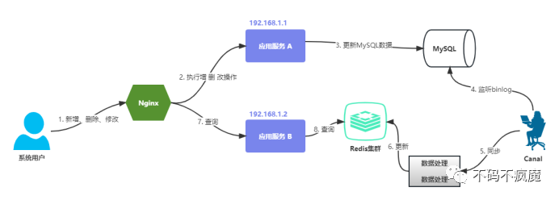

:::color4
**使用canal监听binlog异步更新redis需要注意的事项：MQ的消息是无序的，可能会造成ABA问题。**

**解决方案：保证MQ有序，但是会降低吞吐量。或者加上版本号，如果修改的版本低于内存版本则不变更**

:::

# Redis常见阻塞原因总结

## O(n) 命令

Redis 中的大部分命令都是 O(1)时间复杂度，但也有少部分 O(n) 时间复杂度的命令，例如：

* `KEYS *`：会返回所有符合规则的 key。
* `HGETALL`：会返回一个 Hash 中所有的键值对。
* `LRANGE`：会返回 List 中指定范围内的元素。
* `SMEMBERS`：返回 Set 中的所有元素。
* `SINTER`/`SUNION`/`SDIFF`：计算多个 Set 的交集/并集/差集。
* ……

由于这些命令时间复杂度是 O(n)，有时候也会全表扫描，随着 n 的增大，执行耗时也会越长，从而导致客户端阻塞。不过， 这些命令并不是一定不能使用，但是需要明确 N 的值。另外，有遍历的需求可以使用 `HSCAN`、`SSCAN`、`ZSCAN` 代替。

除了这些 O(n)时间复杂度的命令可能会导致阻塞之外， 还有一些时间复杂度可能在 O(N) 以上的命令，例如：

* `ZRANGE`/`ZREVRANGE`：返回指定 Sorted Set 中指定排名范围内的所有元素。时间复杂度为 O(log(n)+m)，n 为所有元素的数量， m 为返回的元素数量，当 m 和 n 相当大时，O(n) 的时间复杂度更小。
* `ZREMRANGEBYRANK`/`ZREMRANGEBYSCORE`：移除 Sorted Set 中指定排名范围/指定 score 范围内的所有元素。时间复杂度为 O(log(n)+m)，n 为所有元素的数量， m 被删除元素的数量，当 m 和 n 相当大时，O(n) 的时间复杂度更小。

## SAVE 创建 RDB 快照

Redis 提供了两个命令来生成 RDB 快照文件：

* `save` : 同步保存操作，会阻塞 Redis 主线程；
* `bgsave` : fork 出一个子进程，子进程执行，不会阻塞 Redis 主线程，默认选项。

默认情况下，Redis 默认配置会使用 `bgsave` 命令。如果手动使用 `save` 命令生成 RDB 快照文件的话，就会阻塞主线程。

## AOF

### AOF 日志记录阻塞

Redis AOF 持久化机制是在**执行完命令之后再记录日志**，这和关系型数据库（如 MySQL）通常都是执行命令之前记录日志（方便故障恢复）不同。


**为什么是在执行完命令之后记录日志呢？**

* 避免额外的检查开销，AOF 记录日志不会对命令进行语法检查；
* 在命令执行完之后再记录，不会阻塞当前的命令执行。

这样也带来了风险（我在前面介绍 AOF 持久化的时候也提到过）：

* 如果刚执行完命令 Redis 就宕机会导致对应的修改丢失；
* **可能会阻塞后续其他命令的执行（AOF 记录日志是在 Redis 主线程中进行的）** 。

### AOF 刷盘阻塞

开启 AOF 持久化后每执行一条会更改 Redis 中的数据的命令，Redis 就会将该命令写入到 AOF 缓冲区 `server.aof_buf` 中，然后再根据 `appendfsync` 配置来决定何时将其同步到硬盘中的 AOF 文件。

在 Redis 的配置文件中存在三种不同的 AOF 持久化方式（ `fsync`策略），它们分别是：

1. `appendfsync always`：主线程调用 `write` 执行写操作后，后台线程（ `aof_fsync` 线程）立即会调用 `fsync` 函数同步 AOF 文件（刷盘），`fsync` 完成后线程返回，这样会严重降低 Redis 的性能（`write` + `fsync`）。
2. `appendfsync everysec`：主线程调用 `write` 执行写操作后立即返回，由后台线程（ `aof_fsync` 线程）每秒钟调用 `fsync` 函数（系统调用）同步一次 AOF 文件（`write`+`fsync`，`fsync`间隔为 1 秒）
3. `appendfsync no`：主线程调用 `write` 执行写操作后立即返回，让操作系统决定何时进行同步，Linux 下一般为 30 秒一次（`write`但不`fsync`，`fsync` 的时机由操作系统决定）。

当后台线程（ `aof_fsync` 线程）调用 `fsync` 函数同步 AOF 文件时，需要等待，直到写入完成。当磁盘压力太大的时候，会导致 `fsync` 操作发生阻塞，主线程调用 `write` 函数时也会被阻塞。`fsync` 完成后，主线程执行 `write` 才能成功返回。

### AOF 重写阻塞

1. fork 出一条子线程来将文件重写，在执行 `BGREWRITEAOF` 命令时，Redis 服务器会维护一个 AOF 重写缓冲区，该缓冲区会在子线程创建新 AOF 文件期间，记录服务器执行的所有写命令。
2. 当子线程完成创建新 AOF 文件的工作之后，服务器会将重写缓冲区中的所有内容追加到新 AOF 文件的末尾，使得新的 AOF 文件保存的数据库状态与现有的数据库状态一致。
3. 最后，服务器用新的 AOF 文件替换旧的 AOF 文件，以此来完成 AOF 文件重写操作。

阻塞就是出现在第 2 步的过程中，**将缓冲区中新数据写到新文件的过程**中会产生**阻塞**。

相关阅读：[Redis AOF 重写阻塞问题分析](https://cloud.tencent.com/developer/article/1633077)。

## 大 Key

大 key 造成的阻塞问题如下：

* 客户端超时阻塞：由于 Redis 执行命令是单线程处理，然后在操作大 key 时会比较耗时，那么就会阻塞 Redis，从客户端这一视角看，就是很久很久都没有响应。
* 引发网络阻塞：每次获取大 key 产生的网络流量较大，如果一个 key 的大小是 1 MB，每秒访问量为 1000，那么每秒会产生 1000MB 的流量，这对于普通千兆网卡的服务器来说是灾难性的。
* 阻塞工作线程：如果使用 del 删除大 key 时，会阻塞工作线程，这样就没办法处理后续的命令。

### 查找大 key

当我们在使用 Redis 自带的 `--bigkeys` 参数查找大 key 时，最好选择在从节点上执行该命令，因为主节点上执行时，会**阻塞**主节点。

* 我们还可以使用 SCAN 命令来查找大 key；
* 通过分析 RDB 文件来找出 big key，这种方案的前提是 Redis 采用的是 RDB 持久化。网上有现成的工具：
*
* redis-rdb-tools：Python 语言写的用来分析 Redis 的 RDB 快照文件用的工具
* rdb\_bigkeys：Go 语言写的用来分析 Redis 的 RDB 快照文件用的工具，性能更好。

### 删除大 key

删除操作的本质是要释放键值对占用的内存空间。

释放内存只是第一步，为了更加高效地管理内存空间，在应用程序释放内存时，**操作系统需要把释放掉的内存块插入一个空闲内存块的链表**，以便后续进行管理和再分配。这个过程本身需要一定时间，而且会**阻塞**当前释放内存的应用程序。

所以，如果一下子释放了大量内存，空闲内存块链表操作时间就会增加，相应地就会造成 Redis 主线程的阻塞，如果主线程发生了阻塞，其他所有请求可能都会超时，超时越来越多，会造成 Redis 连接耗尽，产生各种异常。

删除大 key 时建议采用分批次删除和异步删除的方式进行。

## 清空数据库

清空数据库和上面 bigkey 删除也是同样道理，`flushdb`、`flushall` 也涉及到删除和释放所有的键值对，也是 Redis 的阻塞点。

## 集群扩容

Redis 集群可以进行节点的动态扩容缩容，这一过程目前还处于半自动状态，需要人工介入。

在扩缩容的时候，需要进行数据迁移。而 Redis 为了保证迁移的一致性，迁移所有操作都是同步操作。

执行迁移时，两端的 Redis 均会进入时长不等的阻塞状态，对于小 Key，该时间可以忽略不计，但如果一旦 Key 的内存使用过大，严重的时候会触发集群内的故障转移，造成不必要的切换

## Swap（内存交换）

**什么是 Swap？**  Swap 直译过来是交换的意思，Linux 中的 Swap 常被称为内存交换或者交换分区。类似于 Windows 中的虚拟内存，就是当内存不足的时候，把一部分硬盘空间虚拟成内存使用，从而解决内存容量不足的情况。因此，Swap 分区的作用就是牺牲硬盘，增加内存，解决 VPS 内存不够用或者爆满的问题。

Swap 对于 Redis 来说是非常致命的，Redis 保证高性能的一个重要前提是所有的数据在内存中。如果操作系统把 Redis 使用的部分内存换出硬盘，由于内存与硬盘的读写速度差几个数量级，会导致发生交换后的 Redis 性能急剧下降。

## CPU 竞争

Redis 是典型的 CPU 密集型应用，不建议和其他多核 CPU 密集型服务部署在一起。当其他进程过度消耗 CPU 时，将严重影响 Redis 的吞吐量。

可以通过`reids-cli --stat`获取当前 Redis 使用情况。通过`top`命令获取进程对 CPU 的利用率等信息 通过`info commandstats`统计信息分析出命令不合理开销时间，查看是否是因为高算法复杂度或者过度的内存优化问题。

## 网络问题

连接拒绝、网络延迟，网卡软中断等网络问题也可能会导致 Redis 阻塞。


> 更新: 2024-09-20 17:24:58  
> 原文: <https://www.yuque.com/nibiwanxiamei/yrd6t1/774b3ed96ccf00c673c0564262d8c039>