# Redis

***

# 为什么要用分布式缓存？

:::info

1. **<font style="color:#DF2A3F;background-color:#F5D480;">提高性能</font>**<font style="color:#DF2A3F;background-color:#F5D480;">：分布式缓存可以将数据存储在多台服务器上，使得数据可以更快地被访问。这样可以显著降低响应时间，提高系统的整体性能。</font>
2. **<font style="color:#DF2A3F;background-color:#F5D480;">提高可用性</font>**<font style="color:#DF2A3F;background-color:#F5D480;">：由于数据被复制到多台服务器上，即使其中一台服务器发生故障，其他服务器仍然可以提供数据访问服务，从而提高了系统的可用性。</font>
3. **<font style="color:#DF2A3F;background-color:#F5D480;">扩展性</font>**<font style="color:#DF2A3F;background-color:#F5D480;">：在面对大量数据或高并发请求时，单台服务器可能无法满足需求。通过分布式缓存，可以方便地向系统中添加新的缓存节点，从而实现系统的水平扩展。</font>
4. **<font style="color:#DF2A3F;background-color:#F5D480;">负载均衡</font>**<font style="color:#DF2A3F;background-color:#F5D480;">：分布式缓存可以通过在多台服务器上均匀分布数据，从而避免单一节点的负载过重，提高了系统的负载均衡能力。</font>

:::

## 缓存的基本思想

**空间换时间** **：用更多的存储空间来存储可能重复使用或计算的数据，从而减少数据的重新获取或计算的时间。**

比如 cache 缓存。CPU Cache 缓存的是内存数据用于解决 CPU 处理速度和内存不匹配的问题，内存缓存的是硬盘数据用于解决硬盘访问速度过慢的问题

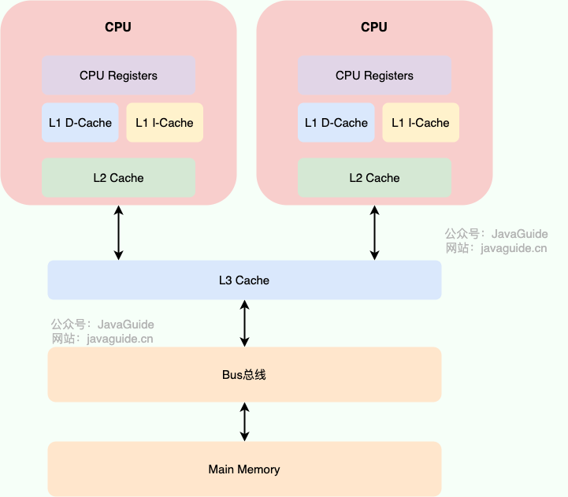

再比如，为了提高虚拟地址到物理地址的转换速度，操作系统在页表方案基础之上引入了转址旁路缓存(Translation Lookasjde Buffer，**TLB，也被称为快表**)

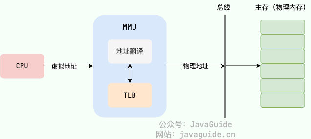

## 缓存的分类

### 本地缓存

本地缓存位于应用内部，其最大的优点是**应用存在于同一个进程内部**，\*\*请求本地缓存的速度非常快，****<font style="color:#DF2A3F;">不存在额外的网络开销</font>****。\*\*常见的单体架构图如下，使用 Nginx 来做负载均衡，部署两个相同的应用到服务器，两个服务使用同一个数据库，并且使用的是本地缓存。

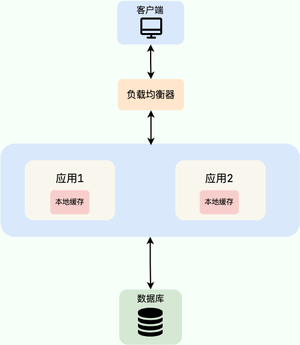

**本地缓存的方案有哪些？**

1、**JDK 自带的 HashMap 和 ConcurrentHashMap**

***

大部分场景来说不会使用这两者当做缓存，只提供了缓存的功能，并没有提供其他诸如过期时间之类的功能。缓存框架至少要提供：**过期时间、淘汰机制、命中率统计**这三点。

2、**Ehcache 、 Guava Cache 、 Spring Cache** **这三者是使用的比较多的本地缓存框架。**

* Ehcache 相比于其他两者更加重量。相比于 Guava Cache 、 Spring Cache 来说， Ehcache 支持可以嵌入到 hibernate 和 mybatis 作为多级缓存，并且可以将缓存的数据持久化到本地磁盘中、同时也提供了集群方案（比较鸡肋，可忽略）。
* Guava Cache 和 Spring Cache 两者比较像。**Guava 相比于 Spring Cache 的使用的更多一点**，它提供了 API 非常方便我们使用，同时也提供了设置缓存有效时间等功能。它的内部实现也比较干净，很多地方都和 ConcurrentHashMap 的思想有异曲同工之妙。
* 使用 Spring Cache 的注解实现缓存的话，代码会看着很干净和优雅，但是很容易出现问题比如缓存穿透、内存溢出。

3、后起之秀 Caffeine。

本地的缓存的优势非常明显：低依赖、轻量、简单、成本低。

但是，本地缓存存在下面这些缺陷：

* 本地缓存**应用耦合，对分布式架构支持不友好**，比如同一个相同的服务部署在多台机器上的时候，各个服务之间的缓存是无法共享的，因为本地缓存只在当前机器上有。
* 本地缓存容量受服务部署所在的机器限制明显。 如果当前系统服务所耗费的内存多，那么本地缓存可用的容量就很少。

### 分布式缓存

可以把分布式缓存（Distributed Cache） 看作是一种内存数据库的服务，最终作用就是**提供缓存数据的服务**。

分布式缓存脱离于应用独立存在，多个应用可直接的共同使用同一个分布式缓存服务。

如下图所示，就是一个简单的使用分布式缓存的架构图。我们使用 Nginx 来做负载均衡，部署两个相同的应用到服务器，两个服务使用同一个数据库和缓存。

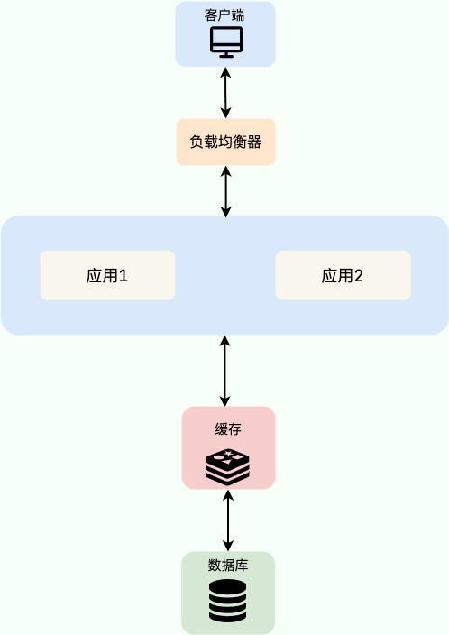

使用分布式缓存之后，缓存服务可以部署在一台单独的服务器上，即使同一个相同的服务部署在多台机器上，也是使用的同一份缓存。 并且，单独的分布式缓存服务的性能、容量和提供的功能都要更加强大。

为系统引入分布式缓存之后往往会带来下面这些问题

* 系统复杂性增加 ：引入缓存之后，你要**维护缓存和数据库的数据一致性、维护热点缓存、保证缓存服务的高可用**等等。
* 系统开发成本往往会增加 ：引入缓存意味着系统需要一个单独的缓存服务，这是需要花费相应的成本的，并且这个成本还是很贵的，毕竟耗费的是宝贵的内存。

**分布式缓存的方案有哪些？**

分布式缓存的话，比较老牌同时也是使用的比较多的还是 **Memcached** 和 **Redis**。不过，现在基本没有看过还有项目使用 Memcached 来做缓存，都是直接用 Redis。

Memcached 是分布式缓存最开始兴起的那会，比较常用的。后来，随着 Redis 的发展，大家慢慢都转而使用更加强大的 Redis 了。

有一些大厂也开源了类似于 Redis 的分布式高性能 KV 存储数据库，例如，腾讯开源的 [Tendis](https://github.com/Tencent/Tendis) 。Tendis 基于知名开源项目 [RocksDB](https://github.com/facebook/rocksdb) 作为存储引擎 ，100% 兼容 Redis 协议和 Redis4.0 所有数据模型。关于 Redis 和 Tendis 的对比，腾讯官方曾经发过一篇文章：[Redis vs Tendis：冷热混合存储版架构揭秘](https://mp.weixin.qq.com/s/MeYkfOIdnU6LYlsGb24KjQ)

### 多级缓存

**本地缓存 + 分布式缓存** 的多级缓存方案，最常用的多级缓存实现方式。本地缓存的访问速度要远大于分布式缓存

**简单总结一下适合多级缓存的两种业务场景：**

* **缓存的数据不会频繁修改，比较稳定；**
* **数据访问量特别大比如秒杀场景。**

多级缓存方案中，第一级缓存（L1）使用本地内存（比如 Caffeine)），第二级缓存（L2）使用分布式缓存（比如 Redis）。

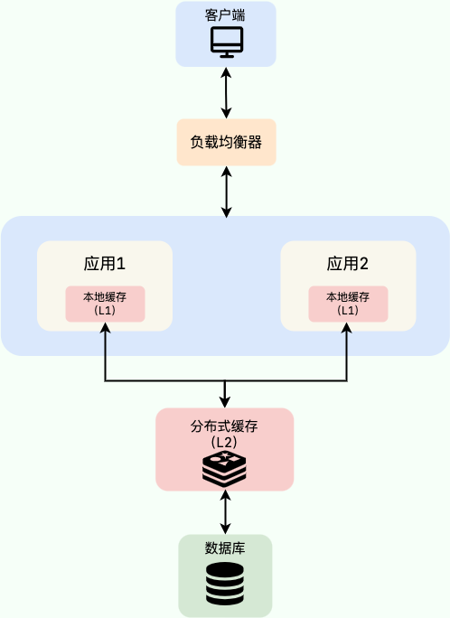

读取缓存数据的时候，我们先从 L1 中读取，读取不到的时候再去 L2 读取。这样可以降低 L2 的压力，减少 L2 的读次数。如果 L2 也没有此数据的话，再去数据库查询，数据查询成功后再将数据写入到 L1 和 L2 中。

# Redis 常见面试 - 上

## Redis 基础

### 什么是 Redis？

[Redis](https://redis.io/)（**RE**mote **DI**ctionary **S**erver）是一个**基于 C 语言开发的开源 NoSQL 数据库**（BSD 许可）。与传统数据库不同的是，Redis 的数据是保存在内存中的（内存数据库，支持持久化），因此读写速度非常快，被广泛应用于分布式缓存方向。并且，**Redis 存储的是 KV 键值对数据。**

为了满足不同的业务场景，Redis 内置了多种数据类型实现（比如 String、Hash、Sorted Set、Bitmap、HyperLogLog、GEO）。并且，Redis 还支持事务、持久化、Lua 脚本、多种开箱即用的集群方案（Redis Sentinel、Redis Cluster）。

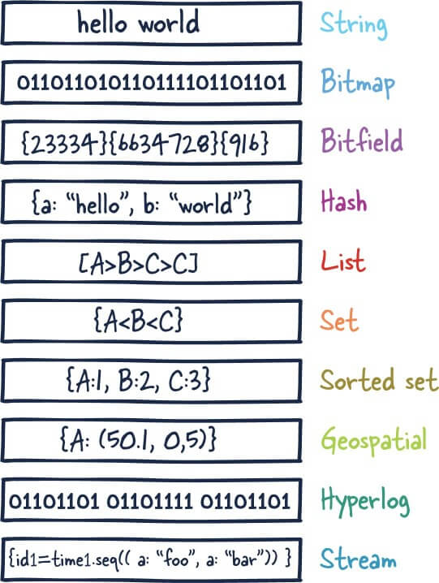

### Redis 为什么这么快？♥♥♥♥

Redis 内部做了非常多的性能优化，比较重要的有下面 3 点：

1. **Redis 基于内存**，内存的访问速度是磁盘的上千倍；
2. **Redis 基于 Reactor 模式设计开发了一套高效的事件处理模型**，主要是单线程事件循环和 IO 多路复用
3. Redis 内置了多种**优化过后的数据类型/结构实现**，性能非常高。

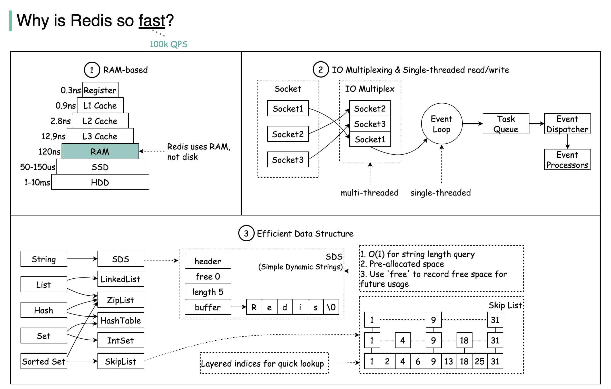

### 分布式缓存常见的技术选型方案有哪些？

比较老牌同时也是使用的比较多的还是 **Memcached** 和 **Redis**。

**共同点**：

1. **基于内存数据库，一般做缓存**。
2. **有过期策略**。
3. **性能都非常高**。

**区别**：

1. **Redis 支持更丰富的数据类型（支持更复杂的应用场景）** 。Redis 不仅仅支持简单的 k/v 类型的数据，同时还提供 list，set，zset，hash 等数据结构的存储。Memcached 只支持最简单的 k/v 数据类型。
2. **Redis 支持数据的持久化，可以将内存中的数据保持在磁盘中，重启的时候可以再次加载进行使用,而 Memcached 把数据全部存在内存之中。**
3. **Redis 有灾难恢复机制。**  因为可以把缓存中的数据持久化到磁盘上。
4. **Redis 在服务器内存使用完之后，可以将不用的数据放到磁盘上。但是，Memcached 在服务器内存使用完之后，就会直接报异常。**
5. **Memcached 没有原生的集群模式，需要依靠客户端来实现往集群中分片写入数据；但是 Redis 目前是原生支持 cluster 模式的。**
6. \*\*Memcached 是多线程，非阻塞 IO 复用的网络模型；\*\***Redis 使用单线程的多路 IO 复用模型** **。**  （Redis 6.0 针对网络数据的读写引入了多线程）
7. **Redis 支持发布订阅模型、Lua 脚本、事务等功能，而 Memcached 不支持。并且，Redis 支持更多的编程语言。**
8. **Memcached 过期数据的删除策略只用了惰性删除，而 Redis 同时使用了惰性删除与定期删除。**

### 为什么要用 Redis/为什么要用缓存？

**1、高性能**

第一次访问数据库中的某些数据比较慢，是从硬盘中读取的。但是，访问的数据属于高频数据并且不会经常改变的话，那么就可以将该访问的数据存在缓存中。

**这样有什么好处呢？**保证下一次再访问这些数据就可以直接从缓存中获取。操作缓存就是直接操作内存，所以**速度相当快**。

**2、高并发**

MySQL 这类的数据库的 QPS 大概都在 1w 左右（4 核 8g） ，但是使用 Redis 缓存之后很容易达到 10w+，甚至最高能达到 30w+（就单机 Redis 的情况，Redis 集群的话会更高）。

> QPS（Query Per Second）：服务器每秒可以执行的查询次数；

由此可见，直接操作缓存能够承受的数据库请求数量是远远大于直接访问数据库的，所以我们可以考虑把数据库中的部分数据转移到缓存中去，这样用户的一部分请求会直接到缓存这里而不用经过数据库。进而，我们也就提高了系统整体的并发。

> **1.缓存响应速度快很多**
>
> **2.QPS 高，能够承受压力大，同时提高系统并发度**

### 什么是 Redis Module？有什么用？

通过 Module 来扩展其功能以满足特殊的需求。这些 Module 以动态链接库（so 文件）的形式被加载到 Redis 中，这是一种非常灵活的动态扩展功能的实现方式

**可以基于 Redis 去定制化开发自己的 Module，比如实现搜索引擎功能、自定义分布式锁和分布式限流。**

目前，被 Redis 官方推荐的 Module 有：

* [RediSearch](https://github.com/RediSearch/RediSearch)：用于实现搜索引擎的模块。
* [RedisJSON](https://github.com/RedisJSON/RedisJSON)：用于处理 JSON 数据的模块。
* [RedisGraph](https://github.com/RedisGraph/RedisGraph)：用于实现图形数据库的模块。
* [RedisTimeSeries](https://github.com/RedisTimeSeries/RedisTimeSeries)：用于处理时间序列数据的模块。
* [RedisBloom](https://github.com/RedisBloom/RedisBloom)：用于实现布隆过滤器的模块。
* [RedisAI](https://github.com/RedisAI/RedisAI)：用于执行深度学习/机器学习模型并管理其数据的模块。
* [RedisCell](https://github.com/brandur/redis-cell)：用于实现分布式限流的模块。

## Redis 应用

### Redis 除了做缓存，还能做什么？

* **分布式锁**：通过 Redis 来做分布式锁是一种比较常见的方式。通常情况下基于 Redisson 来实现分布式锁。
* **限流**：一般是通过 Redis + Lua 脚本的方式来实现限流。相关阅读：[《我司用了 6 年的 Redis 分布式限流器，可以说是非常厉害了！》](https://mp.weixin.qq.com/s/kyFAWH3mVNJvurQDt4vchA)
* **消息队列**：Redis 自带的 List 数据结构可以作为一个简单的队列使用。Redis 5.0 中增加的 Stream 类型的数据结构更加适合用来做消息队列。它比较类似于 Kafka，有主题和消费组的概念，支持消息持久化以及 ACK 机制。
* **延时队列**：Redisson 内置了延时队列（基于 Sorted Set 实现的）。
* **分布式 Session** ：利用 String 或者 Hash 数据类型保存 Session 数据，所有的服务器都可以访问。
* **复杂业务场景**：通过 Redis 以及 Redis 扩展（比如 Redisson）提供的数据结构，我们可以很方便地完成很多复杂的业务场景比如通过 Bitmap 统计活跃用户、通过 Sorted Set 维护排行榜。

### 如何基于 Redis 实现分布式锁？

[分布式锁](https://www.yuque.com/nibiwanxiamei/yrd6t1/cb2f774f8c71e1114d55936312fe1611)

### Redis 可以做消息队列么？

**可以是可以，但不建议使用 Redis 来做消息队列。和专业的消息队列相比，还是有很多欠缺的地方。**

Redis 5.0 新增加的一个数据结构 `Stream` 来做消息队列。`Stream` 支持：

* 发布 / 订阅模式
* 按照消费者组进行消费（借鉴了 Kafka 消费者组的概念）
* 消息持久化（ RDB 和 AOF）
* ACK 机制（通过确认机制来告知已经成功处理了消息）
* 阻塞式获取消息

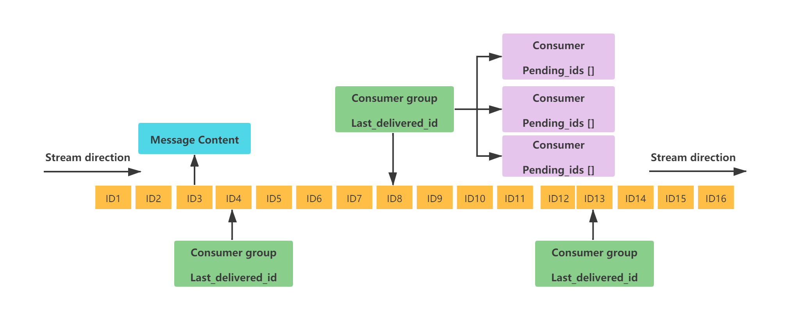

这是一个有序的消息链表，每个消息都有一个唯一的 ID 和对应的内容。ID 是一个时间戳和序列号的组合，用来保证消息的唯一性和递增性。内容是一个或多个键值对（类似 Hash 基本数据类型），用来存储消息的数据。

这里再对图中涉及到的一些概念：

* `Consumer Group`：消费者组用于组织和管理多个消费者。消费者组本身不处理消息，而是再将消息分发给消费者，由消费者进行真正的消费
* `last_delivered_id`：标识消费者组当前消费位置的游标，消费者组中任意一个消费者读取了消息都会使 last\_delivered\_id 往前移动。
* `pending_ids`：记录已经被客户端消费但没有 ack 的消息的 ID。

### Redis 可以做搜索引擎么？

**Redis 是可以实现全文搜索引擎功能的**，需要借助 **RediSearch** ，这是一个基于 Redis 的搜索引擎模块。

RediSearch 支持中文分词、聚合统计、停用词、同义词、拼写检查、标签查询、向量相似度查询、多关键词搜索、分页搜索等功能，算是一个功能比较完善的全文搜索引擎了。

**相比较于 Elasticsearch 来说，RediSearch 主要在下面两点上表现更优异一些**：

1. 性能更优秀：**依赖 Redis 自身的高性能**，**基于内存操作**（**Elasticsearch 基于磁盘**）。
2. 较低内存占用实现快速索引：**RediSearch 内部使用压缩的倒排索引，所以可以用较低的内存占用来实现索引的快速构建。**

对于**小型项目**的简单搜索场景来说，使用 RediSearch 来作为搜索引擎还是没有问题的（搭配 RedisJSON 使用）。

对于比较复杂或者数据规模较大的搜索场景还是不太建议使用 RediSearch 来作为搜索引擎，主要是因为下面这些限制和问题：

1. 数据量限制：**Elasticsearch 可以支持 PB 级别的数据量**，可以轻松扩展到多个节点，利用分片机制提高可用性和性能。RedisSearch 是基于 Redis 实现的，其能存储的数据量受限于 Redis 的内存容量，不太适合存储大规模的数据（**内存昂贵，扩展能力较差**）。
2. 分布式能力较差：**Elasticsearch 是为分布式环境设计的**，可以轻松扩展到多个节点。虽然 RedisSearch 支持分布式部署，但在实际应用中可能会面临一些挑战，如数据分片、节点间通信、数据一致性等问题。
3. 聚合功能较弱：**Elasticsearch 提供了丰富的聚合功能**，而 RediSearch 的聚合功能相对较弱，只支持简单的聚合操作。
4. 生态较差：Elasticsearch 可以轻松和常见的一些系统/软件集成比如 Hadoop、Spark、Kibana，而 RedisSearch 则不具备该优势。

**Elasticsearch 适用于全文搜索、复杂查询、实时数据分析和聚合的场景，而 RediSearch 适用于快速数据存储、缓存和简单查询的场景。**

## Redis 数据类型

[Redis 常见数据类型和应用场景](https://xiaolincoding.com/redis/data_struct/command.html#%E5%BA%94%E7%94%A8%E5%9C%BA%E6%99%AF-9)

Redis 5 种基础数据类型和 3 种特殊数据类型 [Redis 官方文档](https://redis.io/docs/data-types/)

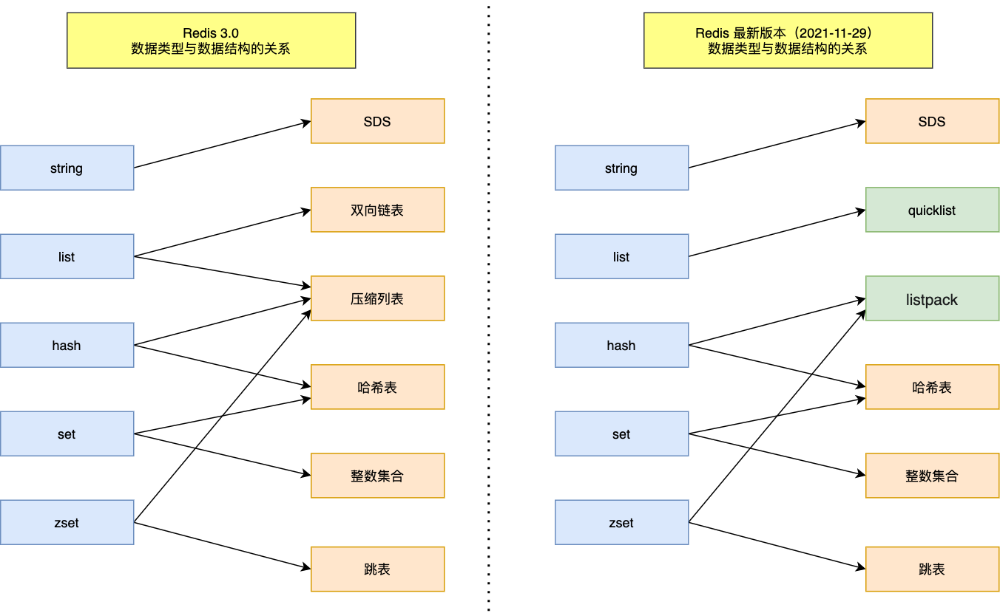

### Redis 5 种基本数据类型详解

Redis 共有 5 种基本数据类型：**String（字符串）、List（列表）、Set（集合）、Hash（散列）、Zset（有序集合）**。这 5 种数据类型是直接提供给用户使用的，是数据的保存形式，其底层实现主要依赖这 8 种数据结构：**简单动态字符串（SDS）、LinkedList（双向链表）、Dict（哈希表/字典）、SkipList（跳跃表）、Intset（整数集合）、ZipList（压缩列表）、QuickList（快速列表）。**

Redis 5 种基本数据类型对应的底层数据结构实现如下表所示：

| String | List | Hash | Set | Zset |
| --- | --- | --- | --- | --- |
| SDS | LinkedList/ZipList/QuickList | Dict、ZipList | Dict、Intset | ZipList、SkipList |

> Redis 3.2 之前，List 底层实现是 LinkedList 或者 ZipList。 Redis 3.2 之后，引入了 LinkedList 和 ZipList 的结合 **QuickList**，List 的底层实现变为 QuickList。从 Redis 7.0 开始， ZipList 被 **ListPack** 取代。

<https://redis.com/redis-enterprise/data-structures/>

#### String（字符串）

String 是 Redis 中最简单同时也是最常用的一个数据类型。

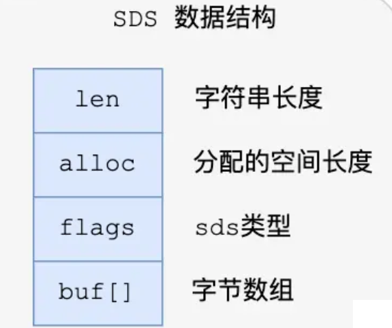

**String 是一种二进制安全的数据类型，可以用来存储任何类型的数据比如字符串、整数、浮点数、图片（图片的 base64 编码或者解码或者图片的路径）、序列化后的对象。**

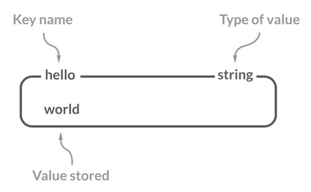

虽然 Redis 是用 C 语言写的，但是 Redis 并没有使用 C 的字符串表示，而是自己构建了一种\*\*<font style="color:#DF2A3F;">简单动态字符串</font>**<font style="color:#DF2A3F;">（Simple Dynamic String，</font>**<font style="color:#DF2A3F;">SDS</font>\*\*<font style="color:#DF2A3F;">）</font>。**相比于 C 的原生字符串，Redis 的 SDS 不光可以保存文本数据还可以保存二进制数据，并且获取字符串长度复杂度为 O(1)（C 字符串为 O(N)）,除此之外，Redis 的 SDS API 是安全的，不会造成缓冲区溢出。**

Redis 官网对应的介绍：<https://redis.io/commands/?group=string> 。

应用场景

**需要存储常规数据的场景**

* 举例：缓存 Session、Token、图片地址、序列化后的对象(相比较于 Hash 存储更节省内存)。
* 相关命令：`SET`、`GET`。

**需要计数的场景**

* 举例：用户单位时间的请求数（简单限流可以用到）、页面单位时间的访问数。
* 相关命令：`SET`、`GET`、 `INCR`、`DECR` 。

**分布式锁**

利用 `SETNX key value` 命令可以实现一个最简易的分布式锁（存在一些缺陷，通常不建议这样实现分布式锁）。

#### List

Redis 中的 List 其实就是链表数据结构的实现。

Java 的 `LinkedList`，但是 C 语言并没有实现链表，所以 **Redis 实现了自己的链表数据结构**。Redis 的 List 的实现为一个 **双向链表**，即可以支持反向查找和遍历，更方便操作，不过带来了部分额外的内存开销。

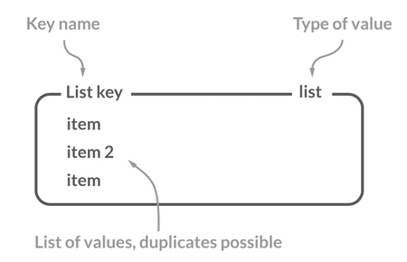

| 命令 | 介绍 |
| --- | --- |
| RPUSH key value1 value2 ... | 在指定列表的尾部（右边）添加一个或多个元素 |
| LPUSH key value1 value2 ... | 在指定列表的头部（左边）添加一个或多个元素 |
| LSET key index value | 将指定列表索引 index 位置的值设置为 value |
| LPOP key | 移除并获取指定列表的第一个元素(最左边) |
| RPOP key | 移除并获取指定列表的最后一个元素(最右边) |
| LLEN key | 获取列表元素数量 |
| LRANGE key start end | 获取列表 start 和 end 之间 的元素 |

Redis 官网对应的介绍：<https://redis.io/commands/?group=list>。

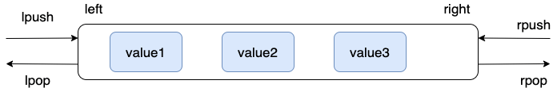

通过 `LRANGE` 命令，你可以基于 List 实现分页查询，性能非常高！

```shell
RPUSH myList value1 value2 value3
(integer) 3
LRANGE myList 0 1
1) "value1"
2) "value2"
LRANGE myList 0 -1
1) "value1"
2) "value2"
3) "value3"
```

应用场景

**信息流展示**

***

* 举例：最新文章、最新动态。
* 相关命令：`LPUSH`、`LRANGE`。

**消息队列**

`List` **可以用来做消息队列，只是功能过于简单且存在很多缺陷，不建议这样做**。

相对来说，Redis 5.0 新增加的一个数据结构 `Stream` 更适合做消息队列一些，只是功能依然非常简陋。和专业的消息队列相比，还是有很多欠缺的地方比如消息丢失和堆积问题不好解决。

#### Hash（哈希）

Redis 中的 Hash 是一个 \*\*String 类型的 field-value（键值对）\*\*的映射表，特别适合用于存储对象，后续操作的时候，你可以直接修改这个对象中的某些字段的值。

Hash 类似于 JDK1.8 前的 `HashMap`，内部实现也差不多(数组 + 链表)。不过，Redis 的 Hash 做了更多优化。

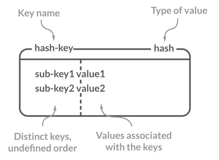

| 命令 | 介绍 |
| --- | --- |
| HSET key field value | 设置指定哈希表中指定字段的值 |
| HSETNX key field value | 只有指定字段不存在时设置指定字段的值 |
| HMSET key field1 value1 field2 value2 ... | 同时将一个或多个 field-value (域-值)对设置到指定哈希表中 |
| HGET key field | 获取指定哈希表中指定字段的值 |
| HMGET key field1 field2 ... | 获取指定哈希表中一个或者多个指定字段的值 |
| HGETALL key | 获取指定哈希表中所有的键值对 |
| HEXISTS key field | 查看指定哈希表中指定的字段是否存在 |
| HDEL key field1 field2 ... | 删除一个或多个哈希表字段 |
| HLEN key | 获取指定哈希表中字段的数量 |
| HINCRBY key field increment | 对指定哈希中的指定字段做运算操作（正数为加，负数为减） |

Redis 官网对应的介绍：<https://redis.io/commands/?group=hash>

**对象数据存储场景**

* 举例：用户信息、商品信息、文章信息、购物车信息。
* 相关命令：`HSET` （设置单个字段的值）、`HMSET`（设置多个字段的值）、`HGET`（获取单个字段的值）、`HMGET`（获取多个字段的值）。

#### Set（集合）

set无序集合

Redis 中的 Set 类型是一种**无序集合**，集合中的元素没有先后顺序但都唯一，有点类似于 Java 中的 `HashSet` 。当你需要存储一个列表数据，又不希望出现重复数据时，Set 是一个很好的选择，并且 Set 提供了**判断某个元素是否在一个 Set 集合内**的重要接口，这个也是 List 所不能提供的。

你可以基于 Set 轻易实现**交集、并集、差集**的操作，比如你可以将一个用户所有的关注人存在一个集合中，将其所有粉丝存在一个集合。这样的话，Set 可以非常方便的实现如**共同关注、共同粉丝、共同喜好**等功能。这个过程也就是求交集的过程。

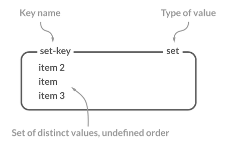

| 命令 | 介绍 |
| --- | --- |
| SADD key member1 member2 ... | 向指定集合添加一个或多个元素 |
| SMEMBERS key | 获取指定集合中的所有元素 |
| SCARD key | 获取指定集合的元素数量 |
| SISMEMBER key member | 判断指定元素是否在指定集合中 |
| SINTER key1 key2 ... | 获取给定所有集合的交集 |
| SINTERSTORE destination key1 key2 ... | 将给定所有集合的交集存储在 destination 中 |
| SUNION key1 key2 ... | 获取给定所有集合的并集 |
| SUNIONSTORE destination key1 key2 ... | 将给定所有集合的并集存储在 destination 中 |
| SDIFF key1 key2 ... | 获取给定所有集合的差集 |
| SDIFFSTORE destination key1 key2 ... | 将给定所有集合的差集存储在 destination 中 |
| SPOP key count | 随机移除并获取指定集合中一个或多个元素 |
| SRANDMEMBER key count | 随机获取指定集合中指定数量的元素 |

Redis 官网对应的介绍：<https://redis.io/commands/?group=set>

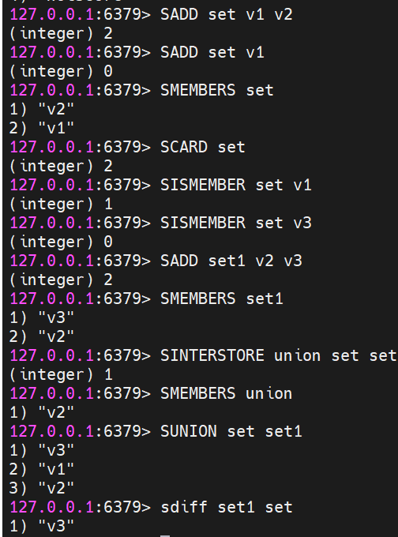

**需要存放的数据不能重复的场景**

* 举例：网站 UV 统计（数据量巨大的场景还是 `HyperLogLog` 更适合一些）、文章点赞、动态点赞等场景。
* 相关命令：`SCARD`（获取集合数量） 。


**需要获取多个数据源交集、并集和差集的场景**

* 举例：共同好友(交集)、共同粉丝(交集)、共同关注(交集)、好友推荐（差集）、音乐推荐（差集）、订阅号推荐（差集 + 交集） 等场景。
* 相关命令：`SINTER`（交集）、`SINTERSTORE` （交集）、`SUNION` （并集）、`SUNIONSTORE`（并集）、`SDIFF`（差集）、`SDIFFSTORE` （差集）。


**需要随机获取数据源中的元素的场景**

* 举例：抽奖系统、随机点名等场景。
* 相关命令：`SPOP`（随机获取集合中的元素并移除，适合不允许重复中奖的场景）、`SRANDMEMBER`（随机获取集合中的元素，适合允许重复中奖的场景）。

#### Sorted Set (Zset)

Sorted Set 类似于 Set，但和 Set 相比，**Sorted Set 增加了一个权重参数** `score` **，使得集合中的元素能够按** `score` **进行有序排列**，**还可以通过** `score` **的范围来获取元素的列表。** 有点像是 Java 中 `HashMap` 和 `TreeSet` 的结合体。

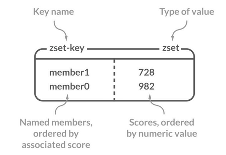

<font style="color:rgb(44, 62, 80);"></font>

<font style="color:rgb(44, 62, 80);">Zset 类型的底层数据结构是由</font>**<font style="color:rgb(48, 79, 254);">压缩列表或跳表</font>**<font style="color:rgb(44, 62, 80);">实现的：</font>

* <font style="color:rgb(44, 62, 80);">如果有序集合的元素个数小于 128 个，并且每个元素的值小于 64 字节时，Redis 会使用</font>**<font style="color:rgb(48, 79, 254);">压缩列表</font>**<font style="color:rgb(44, 62, 80);">作为 Zset 类型的底层数据结构；</font>
* <font style="color:rgb(44, 62, 80);">如果有序集合的元素不满足上面的条件，Redis 会使用</font>**<font style="color:rgb(48, 79, 254);">跳表</font>**<font style="color:rgb(44, 62, 80);">作为 Zset 类型的底层数据结构；</font>

**<font style="color:rgb(48, 79, 254);">在 Redis 7.0 中，压缩列表数据结构已经废弃了，交由 listpack 数据结构来实现了。</font>**

| 命令 | 介绍 |
| --- | --- |
| ZADD key score1 member1 score2 member2 ... | 向指定有序集合添加一个或多个元素 |
| ZCARD KEY | 获取指定有序集合的元素数量 |
| ZSCORE key member | 获取指定有序集合中指定元素的 score 值 |
| ZINTERSTORE destination numkeys key1 key2 ... | 将给定所有有序集合的交集存储在 destination 中，对相同元素对应的 score 值进行 SUM 聚合操作，numkeys 为集合数量 |
| ZUNIONSTORE destination numkeys key1 key2 ... | 求并集，其它和 ZINTERSTORE 类似 |
| ZDIFFSTORE destination numkeys key1 key2 ... | 求差集，其它和 ZINTERSTORE 类似 |
| ZRANGE key start end | 获取指定有序集合 start 和 end 之间的元素（score 从低到高） |
| ZREVRANGE key start end | 获取指定有序集合 start 和 end 之间的元素（score 从高到底） |
| ZREVRANK key member | 获取指定有序集合中指定元素的排名(score 从大到小排序) |

应用场景

**需要随机获取数据源中的元素根据某个权重进行排序的场景**

* 举例：各种排行榜比如直播间送礼物的排行榜、朋友圈的微信步数排行榜、王者荣耀中的段位排行榜、话题热度排行榜等等。
* 相关命令：`ZRANGE` (从小到大排序)、 `ZREVRANGE` （从大到小排序）、`ZREVRANK` (指定元素排名)。

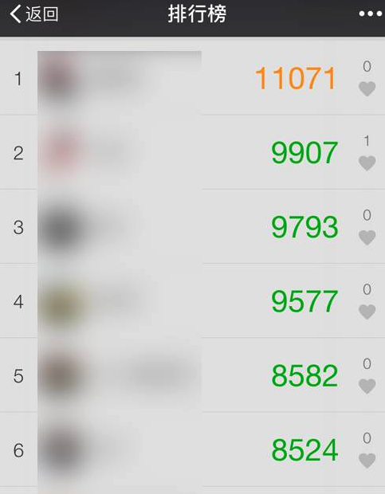

**需要存储的数据有优先级或者重要程度的场景** 比如优先级任务队列。

* 举例：优先级任务队列。
* 相关命令：`ZRANGE` (从小到大排序)、 `ZREVRANGE` （从大到小排序）、`ZREVRANK` (指定元素排名)。

#### 总结

| 数据类型 | 说明 |
| --- | --- |
| String | 一种二进制安全的数据类型，可以用来存储任何类型的数据比如字符串、整数、浮点数、图片（图片的 base64 编码或者解码或者图片的路径）、序列化后的对象。 |
| List | Redis 的 List 的实现为一个双向链表，即可以支持反向查找和遍历，更方便操作，不过带来了部分额外的内存开销。 |
| Hash | 一个 String 类型的 field-value（键值对） 的映射表，特别适合用于存储对象，后续操作的时候，你可以直接修改这个对象中的某些字段的值。 |
| Set | 无序集合，集合中的元素没有先后顺序但都唯一，有点类似于 Java 中的 `HashSet`<br/> 。 |
| Zset | 和 Set 相比，Sorted Set 增加了一个权重参数 `score`<br/>，使得集合中的元素能够按 `score`<br/> 进行有序排列，还可以通过 `score`<br/> 的范围来获取元素的列表。有点像是 Java 中 `HashMap`<br/> 和 `TreeSet`<br/> 的结合体。 |

### Redis 3 种特殊数据类型

除了 5 种基本的数据类型之外，Redis 还支持 3 种特殊的数据类型：**Bitmap、HyperLogLog、GEO。**

#### Bitmap

Bitmap 不是 Redis 中的实际数据类型，而是**在**  **String 类型上定义的一组面向位的操作**，将其视为位向量。由于字符串是二进制安全的块，且最大长度为 512 MB，它们适合用于设置最多 2^32 个不同的位。

Bitmap 存储的是连续的二进制数字（0 和 1），通过 Bitmap, 只需要一个 bit 位来表示某个元素对应的值或者状态，key 就是对应元素本身 。我们知道 8 个 bit 可以组成一个 byte，所以 Bitmap 本身会极大的节省储存空间。

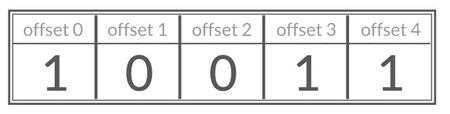

| 命令 | 介绍 |
| --- | --- |
| SETBIT key offset value | 设置指定 offset 位置的值 |
| GETBIT key offset | 获取指定 offset 位置的值 |
| BITCOUNT key start end | 获取 start 和 end 之前值为 1 的元素个数 |
| BITOP operation destkey key1 key2 ... | 对一个或多个 Bitmap 进行运算，可用运算符有 AND, OR, XOR 以及 NOT |

应用场景

**需要保存状态信息（0/1 即可表示）的场景**

* 举例：用户签到情况、活跃用户情况、用户行为统计（比如是否点赞过某个视频）。
* 相关命令：`SETBIT`、`GETBIT`、`BITCOUNT`、`BITOP`。

#### HyperLogLog（基数统计）

HyperLogLog 是一种有名的基数计数概率算法 ，基于 LogLog Counting(LLC)优化改进得来，并不是 Redis 特有的，Redis 只是实现了这个算法并提供了一些开箱即用的 API。

Redis 提供的 HyperLogLog 占用空间非常非常小，只需要 12k 的空间就能存储接近 `2^64` 个不同元素。！并且，Redis 对 HyperLogLog 的存储结构做了优化，采用两种方式计数：

* **稀疏矩阵**：计数较少的时候，占用空间很小。
* **稠密矩阵**：计数达到某个阈值的时候，占用 12k 的空间。

基数计数概率算法为了节省内存并不会直接存储元数据，而是通过一定的概率统计方法预估基数值（集合中包含元素的个数）。因此， HyperLogLog 的计数结果并不是一个精确值，存在一定的误差（标准误差为 `0.81%` ）。

HyperLogLog 相关的命令非常少，最常用的也就 3 个。

| 命令 | 介绍 |
| --- | --- |
| PFADD key element1 element2 ... | 添加一个或多个元素到 HyperLogLog 中 |
| PFCOUNT key1 key2 | 获取一个或者多个 HyperLogLog 的唯一计数。 |
| PFMERGE destkey sourcekey1 sourcekey2 ... | 将多个 HyperLogLog 合并到 destkey 中，destkey 会结合多个源，算出对应的唯一计数。 |

应用场景

**数量量巨大（百万、千万级别以上）的计数场景**

* 举例：热门网站每日/每周/每月访问 ip 数统计、热门帖子 uv 统计、
* 相关命令：`PFADD`、`PFCOUNT` 。

#### Geospatial (地理位置)

Geospatial index（地理空间索引，简称 GEO） 主要用于存储地理位置信息，**基于 Sorted Set**  实现。

通过 GEO 我们可以轻松实现两个位置距离的计算、获取指定位置附近的元素等功能。

| 命令 | 介绍 |
| --- | --- |
| GEOADD key longitude1 latitude1 member1 ... | 添加一个或多个元素对应的经纬度信息到 GEO 中 |
| GEOPOS key member1 member2 ... | 返回给定元素的经纬度信息 |
| GEODIST key member1 member2 M/KM/FT/MI | 返回两个给定元素之间的距离 |
| GEORADIUS key longitude latitude radius distance | 获取指定位置附近 distance 范围内的其他元素，支持 ASC(由近到远)、DESC（由远到近）、Count(数量) 等参数 |
| GEORADIUSBYMEMBER key member radius distance | 类似于 GEORADIUS 命令，只是参照的中心点是 GEO 中的元素 |

基本操作

```shell
GEOADD personLocation 116.33 39.89 user1 116.34 39.90 user2 116.35 39.88 user3
	3
GEOPOS personLocation user1
	116.3299986720085144
	39.89000061669732844
GEODIST personLocation user1 user2 km
	1.4018
```

通过 Redis 可视化工具查看 `personLocation` ，**底层就是 Sorted Set**。

GEO 中存储的地理位置信息的经纬度数据通过 GeoHash 算法转换成了一个整数，这个整数作为 Sorted Set 的 score(权重参数)使用。

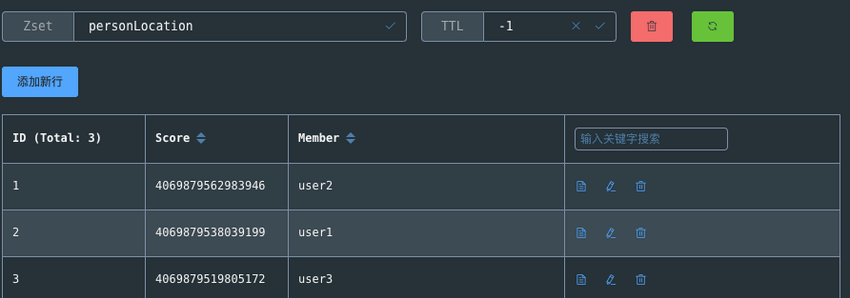

**需要管理使用地理空间数据的场景**

* 举例：附近的人。
* 相关命令: `GEOADD`、`GEORADIUS`、`GEORADIUSBYMEMBER` 。

#### 总结

| 数据类型 | 说明 |
| --- | --- |
| Bitmap | 你可以将 Bitmap 看作是一个存储二进制数字（0 和 1）的数组，数组中每个元素的下标叫做 offset（偏移量）。通过 Bitmap, 只需要一个 bit 位来表示某个元素对应的值或者状态，key 就是对应元素本身 。我们知道 8 个 bit 可以组成一个 byte，所以 Bitmap 本身会极大的节省储存空间。 |
| HyperLogLog | Redis 提供的 HyperLogLog 占用空间非常非常小，只需要 12k 的空间就能存储接近 `2^64`<br/> 个不同元素。不过，HyperLogLog 的计数结果并不是一个精确值，存在一定的误差（标准误差为 `0.81%`<br/> ）。 |
| Geospatial index | Geospatial index（地理空间索引，简称 GEO） 主要用于存储地理位置信息，基于 Sorted Set 实现。 |

### Redis底层数据结构

Redis 的键值对中的 key 就是字符串对象，而 value 可以是字符串对象，也可以是集合数据类型的对象。

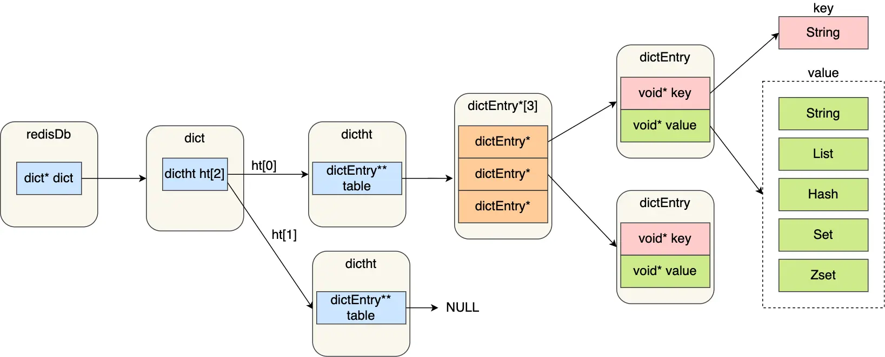

void \* key 和 void \* value 指针指向的是 Redis 对象，Redis 中的每个对象都由 redisObject 结构表示

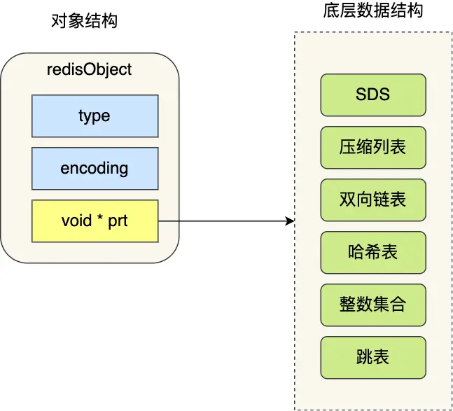

对象结构里包含的成员变量：

* type，标识该对象是什么类型的对象（String 对象、 List 对象、Hash 对象、Set 对象和 Zset 对象）；
* encoding，标识该对象使用了哪种底层的数据结构；
* **ptr，指向底层数据结构的指针**。

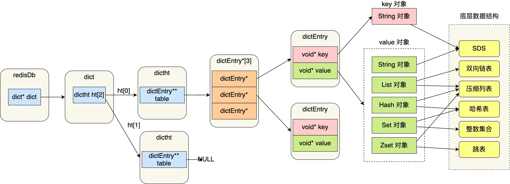

#### SDS

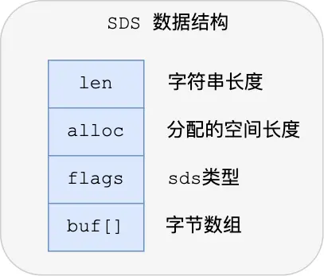

* **len，记录了字符串长度**。这样获取字符串长度的时候，只需要返回这个成员变量值就行，时间复杂度只需要 O（1）。
* **alloc，分配给字符数组的空间长度**。这样在修改字符串的时候，可以通过 `alloc - len` 计算出剩余的空间大小，可以用来判断空间是否满足修改需求，如果不满足的话，就会自动将 SDS 的空间扩展至执行修改所需的大小，然后才执行实际的修改操作， **SDS 既不需要手动修改 SDS 的空间大小，也不会出现缓冲区溢出的问题。**
  * **在扩容 SDS 空间之前，SDS API 会优先检查未使用空间是否足够，如果不够的话，API 不仅会为 SDS 分配修改所必须要的空间，还会给 SDS 分配额外的「未使用空间」,有效的减少内存分配次数**。
  * 如果所需的 sds 长度**小于 1 MB**，那么最后的扩容是按照**翻倍扩容**来执行的，即 2 倍的newlen
  * 如果所需的 sds 长度**超过 1 MB**，那么最后的扩容长度应该是 newlen  **+ 1MB**。
* **flags，用来表示不同类型的 SDS**。一共设计了 5 种类型，分别是 sdshdr5、sdshdr8、sdshdr16、sdshdr32 和 sdshdr64。
* **buf\[]，字符数组，用来保存实际数据**。**不仅可以保存字符串，也可以保存二进制数据**。

**SDS 相比于 C 语言中的字符串有如下提升：**

1. **可以避免缓冲区溢出**：C 语言中的字符串被修改（比如拼接）时，一旦没有分配足够长度的内存空间，就会造成缓冲区溢出。SDS 被修改时，会先根据 len 属性检查空间大小是否满足要求，如果不满足，则先扩展至所需大小再进行修改操作。
2. **获取字符串长度的复杂度较低**：C 语言中的字符串的长度通常是经过遍历计数来实现的，时间复杂度为 O(n)。SDS 的长度获取直接读取 len 属性即可，时间复杂度为 O(1)。
3. **减少内存分配次数**：为了避免修改（增加/减少）字符串时，每次都需要重新分配内存（C 语言的字符串是这样的），SDS 实现了空间预分配和惰性空间释放两种优化策略。当 SDS 需要增加字符串时，Redis 会为 SDS 分配好内存，并且根据特定的算法分配多余的内存，这样可以减少连续执行字符串增长操作所需的内存重分配次数。当 SDS 需要减少字符串时，这部分内存不会立即被回收，会被记录下来，等待后续使用（支持手动释放，有对应的 API）。
4. **二进制安全**：C 语言中的字符串以空字符 `\0` 作为字符串结束的标识，这存在一些问题，像一些二进制文件（比如图片、视频、音频）就可能包括空字符，C 字符串无法正确保存。SDS 使用 len 属性判断字符串是否结束，不存在这个问题。

#### 链表

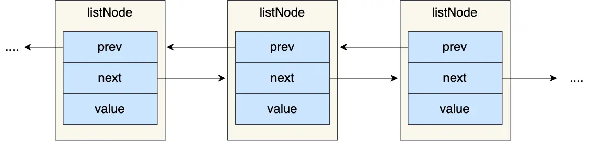

Redis 的链表实现优点如下：

* listNode 链表节点的结构里带有 prev 和 next 指针，**获取某个节点的前置节点或后置节点的时间复杂度只需O(1)，而且这两个指针都可以指向 NULL，所以链表是无环链表**；
* list 结构因为提供了表头指针 head 和表尾节点 tail，所以**获取链表的表头节点和表尾节点的时间复杂度只需O(1)** ；
* list 结构因为提供了链表节点数量 len，所以**获取链表中的节点数量的时间复杂度只需O(1)** ；
* listNode 链表节使用 void\* 指针保存节点值，并且可以通过 list 结构的 dup、free、match 函数指针为节点设置该节点类型特定的函数，因此**链表节点可以保存各种不同类型的值**；

链表的缺陷也是有的：

* 链表每个节点之间的内存都是不连续的，意味着**无法很好利用 CPU 缓存**。能很好利用 CPU 缓存的数据结构就是数组，因为数组的内存是连续的，这样就可以充分利用 CPU 缓存来加速访问。
* 还有一点，保存一个链表节点的值都需要一个链表节点结构头的分配，**内存开销较大**。

#### 压缩链表

压缩列表是 Redis 为了节约内存而开发的，**由连续内存块组成的顺序型数据结构**，有点类似于数组。


压缩列表在表头有三个字段：

* ***zlbytes***，记录整个压缩列表占用对内存字节数；
* ***zltail***，记录压缩列表「尾部」节点距离起始地址由多少字节，也就是列表尾的偏移量；
* ***zllen***，记录压缩列表包含的节点数量；
* ***zlend***，标记压缩列表的结束点，固定值 0xFF（十进制255）。

查找定位第一个元素和最后一个元素，可以通过表头三个字段（zllen）的长度直接定位，复杂度是 O(1)。而**查找其他元素时，就没有这么高效了，只能逐个查找，此时的复杂度就是 O(N) 了，因此压缩列表不适合保存过多的元素**。

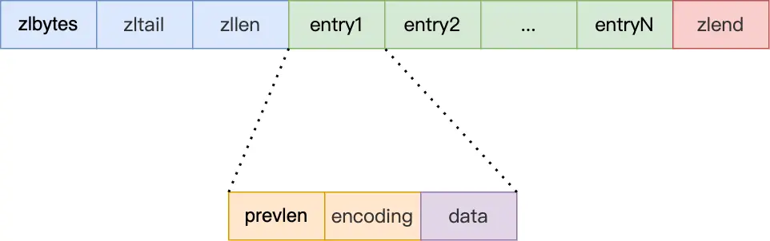

压缩列表节点包含三部分内容：

* ***prevlen***，记录了「前一个节点」的长度，目的是为了实现从后向前遍历；
* ***encoding***，记录了当前节点实际数据的「类型和长度」，类型主要有两种：字符串和整数。
* ***data***，记录了当前节点的实际数据，类型和长度都由 `encoding` 决定；

压缩列表中插入数据时，会根据数据类型是字符串还是整数，以及数据的大小，会使用不同空间大小的 prevlen 和 encoding 这两个元素里保存的信息，**这种根据数据大小和类型进行不同的空间大小分配的设计思想，正是 Redis 为了节省内存而采用的**。

* **前一个节点的长度小于 254 字节**，那么 prevlen 属性需要用 **1 字节的空间**来保存这个长度值；
* **前一个节点的长度大于等于 254 字节**，那么 prevlen 属性需要用 **5 字节的空间**来保存这个长度值；

**压缩列表新增某个元素或修改某个元素时，如果空间不不够，压缩列表占用的内存空间就需要重新分配。而当新插入的元素较大时，可能会导致后续元素的 prevlen 占用空间都发生变化，从而引起「****<font style="color:#DF2A3F;">连锁更新</font>****」问题，导致每个元素的空间都要重新分配，造成访问压缩列表性能的下降**。

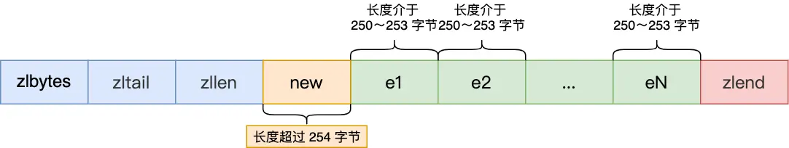

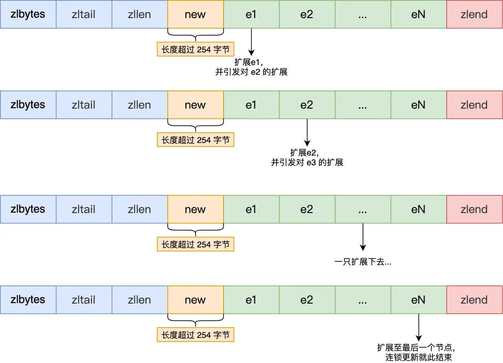

这种在特殊情况下产生的连续多次空间扩展操作就叫做「连锁更新」。连锁更新一旦发生，就会导致压缩列表占用的内存空间要多次重新分配，这就会直接影响到压缩列表的访问性能。

<font style="color:rgb(44, 62, 80);">因此，</font>**<font style="color:rgb(48, 79, 254);">压缩列表只会用于保存的节点数量不多的场景</font>**<font style="color:rgb(44, 62, 80);">，只要节点数量足够小，即使发生连锁更新，也是能接受的。</font>

#### 整数集合

整数集合是 Set 对象的底层实现之一。当一个 Set 对象只包含整数值元素，并且元素数量不大时，就会使用整数集这个数据结构作为底层实现。

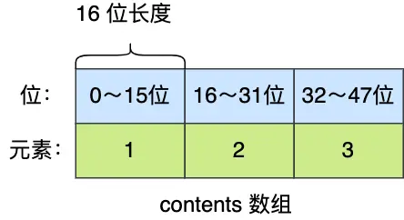

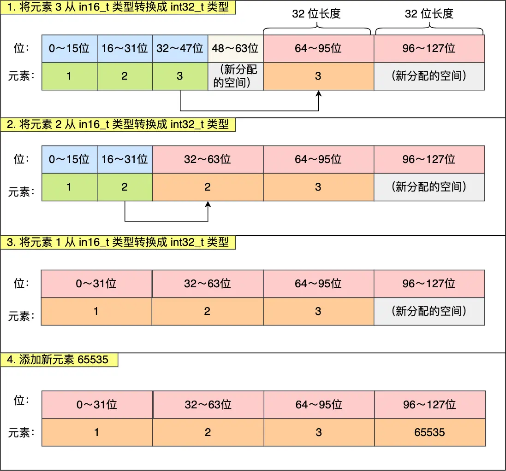

#### 跳表

<font style="color:rgb(36, 41, 46);">跳表是一种采用了用空间换时间思想的数据结构。跳表会随机地将一些节点提升到更高的层次，以创建一种逐层的数据结构，以提高操作的速度。</font><font style="color:rgb(36, 41, 46);">跳表的做法就是给链表做索引，而且是分层索引，</font><font style="color:rgb(36, 41, 46);">单层跳表, 可以退化到一个链表。查找的时间复杂度是 O（N）</font>

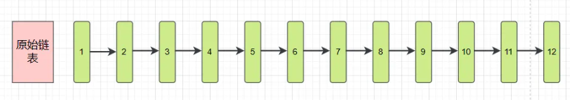

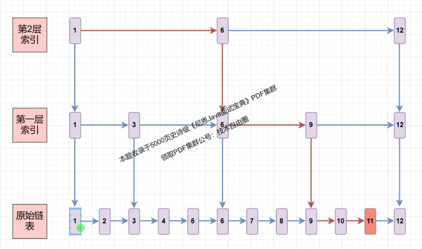

<font style="color:rgb(44, 62, 80);">Redis</font><font style="color:rgb(44, 62, 80);"> </font>**<font style="color:rgb(48, 79, 254);">跳表在创建节点的时候，随机生成每个节点的层数</font>**<font style="color:rgb(44, 62, 80);">，并没有严格维持相邻两层的节点数量比例为 2 : 1 的情况。</font>

<font style="color:rgb(44, 62, 80);">具体的做法是，</font>**<font style="color:rgb(48, 79, 254);">跳表在创建节点时候，会生成范围为\[0-1]的一个随机数，如果这个随机数小于 0.25（相当于概率 25%），那么层数就增加 1 层，然后继续生成下一个随机数，直到随机数的结果大于 0.25 结束，最终确定该节点的层数</font>**<font style="color:rgb(44, 62, 80);">。</font>

<font style="color:rgb(44, 62, 80);">这样的做法，相当于每增加一层的概率不超过 25%，层数越高，概率越低，层高最大限制是 64。</font>

**<font style="color:rgb(48, 79, 254);">如果层高最大限制是 64，那么在创建跳表「头节点」的时候，就会直接创建 64 层高的头节点</font>**<font style="color:rgb(44, 62, 80);">。</font>

**<font style="color:rgb(36, 41, 46);">跳表(Skip List)的优点</font>**

* <font style="color:rgb(36, 41, 46);">平均</font>**<font style="color:rgb(36, 41, 46);">查找时间较低</font>**<font style="color:rgb(36, 41, 46);">：跳表的查询时间复杂度为O(log n)，与平衡树结构相似，但实现起来较为简单。</font>
* **<font style="color:rgb(36, 41, 46);">插入和删除操作相对较快</font>**<font style="color:rgb(36, 41, 46);">：由于跳表不需要进行节点的频繁平衡调整，插入和删除操作的性能较好。</font>

**<font style="color:rgb(36, 41, 46);">跳表(Skip List)的缺点</font>**

* <font style="color:rgb(36, 41, 46);">难实现</font>**<font style="color:rgb(36, 41, 46);">事务和数据持久性</font>**<font style="color:rgb(36, 41, 46);">：跳表的更新操作可能涉及多个层级，实现事务和数据持久性要求更复杂。</font>
* <font style="color:rgb(36, 41, 46);">空间开销较大：跳表需要额外的指针来连接不同层级，占用的内存空间较多。</font>

<font style="color:rgb(36, 41, 46);"></font>

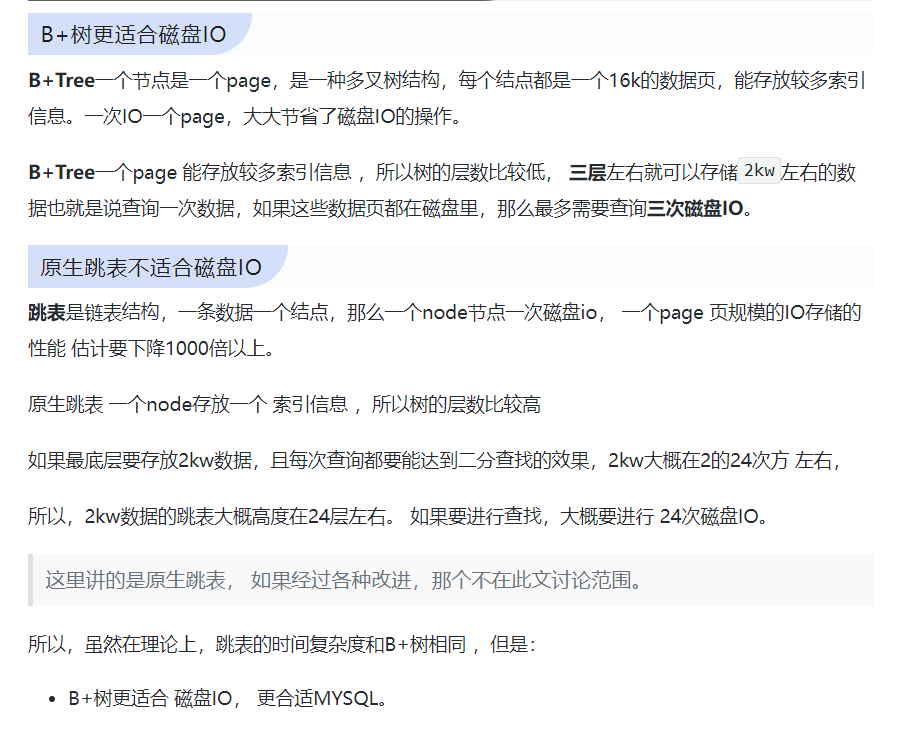

#### quickList

quicklist 就是「双向链表 + 压缩列表」组合，因为一个 quicklist 就是一个链表，而链表中的每个元素又是一个压缩列表。

通过控制每个链表节点中的压缩列表的大小或者元素个数，来规避连锁更新的问题。因为压缩列表元素越少或越小，连锁更新带来的影响就越小，从而提供了更好的访问性能。

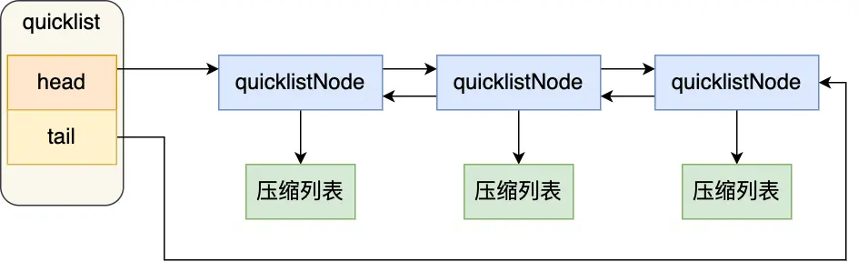

在向 quicklist 添加一个元素的时候，不会像普通的链表那样，直接新建一个链表节点。而是会检查插入位置的压缩列表是否能容纳该元素，如果能容纳就直接保存到 quicklistNode 结构里的压缩列表，如果不能容纳，才会新建一个新的 quicklistNode 结构。

#### ListPack

quicklist 虽然通过控制 quicklistNode 结构里的压缩列表的大小或者元素个数，来减少连锁更新带来的性能影响，但是并没有完全解决连锁更新的问题。

listpack 采用了压缩列表的很多优秀的设计，比如还是用一块连续的内存空间来紧凑地保存数据，并且为了节省内存的开销，listpack 节点会采用不同的编码方式保存不同大小的数据。

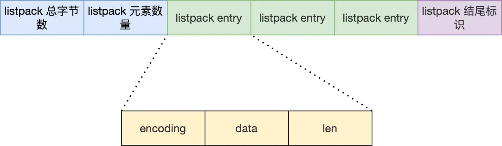

主要包含三个方面内容：

* encoding，定义该元素的编码类型，会对不同长度的整数和字符串进行编码；
* data，实际存放的数据；
* len，encoding+data的总长度；

**<font style="color:rgb(48, 79, 254);">listpack 没有压缩列表中记录前一个节点长度的字段了，listpack 只记录当前节点的长度，当我们向 listpack 加入一个新元素的时候，不会影响其他节点的长度字段的变化，从而避免了压缩列表的连锁更新问题</font>**<font style="color:rgb(44, 62, 80);">。</font>

### Redis 常用的数据类型有哪些？

Redis 中比较常见的数据类型有下面这些：

* **5 种基础数据类型**：String（字符串）、List（列表）、Set（集合）、Hash（散列）、Zset（有序集合）。
* **3 种特殊数据类型**：HyperLogLog（基数统计）、Bitmap （位图）、Geospatial (地理位置)。

除了上面提到的之外，还有一些其他的比如 [Bloom filter（布隆过滤器）](f4d04da967512a8a63ea8478cb55f6f7)、Bitfield（位域）。

### String 的应用场景有哪些？

String 是 Redis 中最简单同时也是最常用的一个数据类型。它是一种二进制安全的数据类型，可以用来存储任何类型的数据比如字符串、整数、浮点数、图片（图片的 base64 编码或者解码或者图片的路径）、序列化后的对象。

String 的常见应用场景如下：

* 常规数据（比如 Session、Token、序列化后的对象、图片的路径）的缓存；
* 计数比如用户单位时间的请求数（简单限流可以用到）、页面单位时间的访问数；
* **分布式锁**(利用 `SETNX` `key value` 命令可以实现一个最简易的分布式锁)；

### String 还是 Hash 存储对象数据更好呢？

* **String 存储的是序列化后的对象数据，存放的是整个对象。Hash 是对对象的每个字段单独存储，可以获取部分字段的信息，也可以修改或者添加部分字段，节省网络流量**。**如果对象中某些字段需要经常变动或者经常需要单独查询对象中的个别字段信息，Hash 就非常适合。**
* **String 存储相对来说更加节省内存**，缓存相同数量的对象数据，String 消耗的内存约是 Hash 的一半。并且，存储具有多层嵌套的对象时也方便很多。如果系统对性能和资源消耗非常敏感的话，String 就非常适合。

在绝大部分情况，我们建议使用 String 来存储对象数据即可！

> Hash 更加灵活，可以针对某个属性进行修改。String 更加节约内存

### 购物车信息用 String 还是 Hash 存储更好呢?

由于购物车中的**商品频繁修改和变动**，购物车信息建议使用 **Hash 存储**：

* 用户 id 为 key
* 商品 id 为 field，商品数量为 value

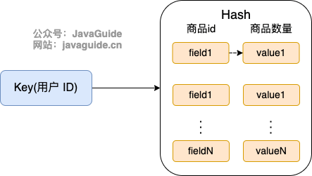

用户购物车信息的维护具体怎么操作呢？

* 用户添加商品就是往 Hash 里面增加新的 field 与 value；
* 查询购物车信息就是遍历对应的 Hash；
* 更改商品数量直接修改对应的 value 值（直接 set 或者做运算皆可）；
* 删除商品就是删除 Hash 中对应的 field；
* 清空购物车直接删除对应的 key 即可。

这里只是以业务比较简单的购物车场景举例，实际电商场景下，field 只保存一个商品 id 是没办法满足需求的。

### Hash扩容原理

<font style="color:rgb(44, 62, 80);">Hash进行 rehash 的时候，用上第 2 个哈希表。开始申请时，就会申请两个Hash，一个使用，一个空闲。</font>

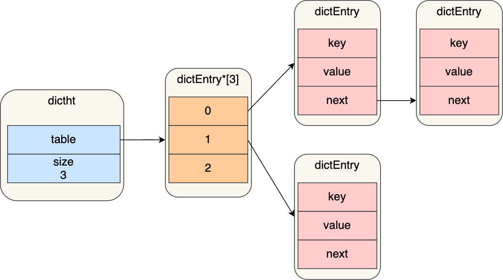

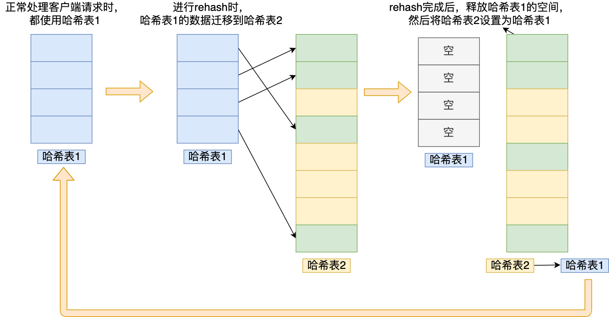

**<font style="color:rgb(48, 79, 254);">如果「哈希表 1 」的数据量非常大，那么在迁移至「哈希表 2 」的时候，因为会涉及大量的数据拷贝，此时可能会对 Redis 造成阻塞，无法服务其他请求</font>**<font style="color:rgb(44, 62, 80);">，所以需要使用渐进式ReHash</font>

<font style="color:rgb(44, 62, 80);">渐进式 rehash 步骤如下：</font>

* <font style="color:rgb(44, 62, 80);">给「哈希表 2」 分配空间；</font>
* **<font style="color:rgb(48, 79, 254);">在 rehash 进行期间，每次哈希表元素进行新增、删除、查找或者更新操作时，Redis 除了会执行对应的操作之外，还会顺序将「哈希表 1 」中索引位置上的所有 key-value 迁移到「哈希表 2」 上</font>**<font style="color:rgb(44, 62, 80);">；</font>
* <font style="color:rgb(44, 62, 80);">随着处理客户端发起的哈希表操作请求数量越多，最终在某个时间点会把「哈希表 1 」的所有 key-value 迁移到「哈希表 2」，从而完成 rehash 操作。	</font>

<font style="color:rgb(44, 62, 80);">触发 rehash 操作的条件，主要有两个：</font>

* **<font style="color:rgb(48, 79, 254);">当负载因子大于等于 1 ，并且 Redis 没有在执行 bgsave 命令或者 bgrewiteaof 命令，也就是没有执行 RDB 快照或没有进行 AOF 重写的时候，就会进行 rehash 操作。</font>**
* **<font style="color:rgb(48, 79, 254);">当负载因子大于等于 5 时，此时说明哈希冲突非常严重了，不管有没有有在执行 RDB 快照或 AOF 重写，都会强制进行 rehash 操作。</font>**

### 使用 Redis 实现一个排行榜怎么做？

Redis 中有一个叫做 `Sorted Set` （有序集合）的数据类型经常被用在各种排行榜的场景，比如直播间送礼物的排行榜、朋友圈的微信步数排行榜、王者荣耀中的段位排行榜、话题热度排行榜等等。

相关的一些 Redis 命令: `ZRANGE` (从小到大排序)、 `ZREVRANGE` （从大到小排序）、`ZREVRANK` (指定元素排名)。

### Redis 的有序集合底层为什么要用跳表，而不用平衡树、红黑树或者 B+ 树？

* 平衡树 vs 跳表：平衡树的插入、删除和查询的时间复杂度和跳表一样都是 **O(log n)** 。对于范围查询来说，平衡树也可以通过中序遍历的方式达到和跳表一样的效果。但是它的每一次插入或者删除操作都需要保证整颗树左右节点的绝对平衡，只要不平衡就要通过旋转操作来保持平衡，这个过程是比较耗时的。跳表诞生的初衷就是为了克服平衡树的一些缺点。**跳表使用概率平衡而不是严格强制的平衡**，因此，**跳表中的插入和删除算法比平衡树的等效算法简单得多，速度也快得多**。
* 红黑树 vs 跳表：相比较于红黑树来说，**跳表的实现也更简单一些，不需要通过旋转和染色**（红黑变换）来保证黑平衡。并且，按照区间来查找数据这个操作，红黑树的效率没有跳表高。
* B+ 树 vs 跳表：**B+ 树更适合作为数据库和文件系统中常用的索引结构之一，它的核心思想是通过可能少的 IO 定位到尽可能多的索引来获得查询数据。** 对于 Redis 这种内存数据库来说，它对这些并不感冒，因为 Redis 作为内存数据库它不可能存储大量的数据，所以对于索引不需要通过 B+ 树这种方式进行维护，只需按照概率进行随机维护即可，节约内存。而且使用跳表实现 zset 时相较前者来说更简单一些，在进行插入时只需通过索引将数据插入到链表中合适的位置再随机维护一定高度的索引即可，也不需要像 B+ 树那样插入时发现失衡时还需要对节点分裂与合并。

Redis 的有序集合底层实现 ：[Redis 为什么用跳表实现有序集合](48c3ad989a2801b94804c442a83a49fc)。

Redis为什么使用跳表,mysql为什么使用B+树: <https://mp.weixin.qq.com/s?__biz=MjM5NTY1MjY0MQ==&mid=2650859196&idx=4&sn=f6efd3974617fdeb89aab197eeede7fd&chksm=bd0173f28a76fae45e4873821548db9399a6775412ecf07c4184451b9c85525f0a3d70c6bfee&scene=27>

:::info

* <font style="color:#DF2A3F;background-color:#FBDE28;">B+树是多叉平衡搜索树，扇出高，只需要3层左右就能存放2kw左右的数据，同样情况下跳表则需要24层左右，假设层高对应</font>**<font style="color:#DF2A3F;background-color:#FBDE28;">磁盘IO</font>**<font style="color:#DF2A3F;background-color:#FBDE28;">，那么B+树的读性能会比跳表要好，因此mysql选了B+树做索引。</font>
* <font style="color:#DF2A3F;background-color:#FBDE28;">redis的读写全在内存里进行操作，不涉及磁盘IO，同时跳表实现简单，相比B+树、AVL树、少了旋转树结构的开销，因此redis使用跳表来实现ZSET，而不是树结构。</font>
* <font style="color:#DF2A3F;background-color:#FBDE28;">存储引擎RocksDB内部使用了跳表，对比使用B+树的innodb，虽然写性能更好，但读性能属实差了些。在读多写少的场景下，B+树依旧YYDS。</font>

:::

### Set 的应用场景是什么？

`Set` 的常见应用场景如下：

* **存放的数据不能重复**的场景：网站 UV 统计（数据量巨大的场景还是 `HyperLogLog` 更适合一些）、文章点赞、动态点赞等等。
* **获取多个数据源交集、并集和差集的场景**：共同好友(交集)、共同粉丝(交集)、共同关注(交集)、好友推荐（差集）、音乐推荐（差集）、订阅号推荐（差集 + 交集） 等等。
* **随机获取数据源中的元素的场景**：抽奖系统、随机点名等等

### 使用 Set 实现抽奖系统怎么做？

如果想要使用 `Set` 实现一个简单的抽奖系统的话，直接使用下面这几个命令就可以了：

* `SADD key member1 member2 ...`：向指定集合添加一个或多个元素。
* `SPOP key count`：随机移除并获取指定集合中一个或多个元素，适合不允许重复中奖的场景。
* `SRANDMEMBER key count` : 随机获取指定集合中指定数量的元素，适合允许重复中奖的场景

### 使用 Bitmap 统计活跃用户怎么做？

Bitmap 存储的是连续的二进制数字（0 和 1），通过 Bitmap, 只需要一个 bit 位来表示某个元素对应的值或者状态，key 就是对应元素本身 。我们知道 8 个 bit 可以组成一个 byte，所以 Bitmap 本身会极大的节省储存空间。

你可以将 Bitmap 看作是一个存储二进制数字（0 和 1）的数组，数组中每个元素的下标叫做 offset（偏移量）。


如果想要使用 Bitmap 统计活跃用户的话，可以使用日期（精确到天）作为 key，然后用户 ID 为 offset，如果当日活跃过就设置为 1。

## **<font style="color:#DF2A3F;">Redis 持久化机制（重要）</font>**

[Redis重要知识点](https://www.yuque.com/nibiwanxiamei/yrd6t1/774b3ed96ccf00c673c0564262d8c039)

## **Redis 线程模型（重要）**

### Redis为什么那么快

**<font style="color:rgb(48, 79, 254);">单线程的 Redis 吞吐量可以达到 10W/每秒</font>**

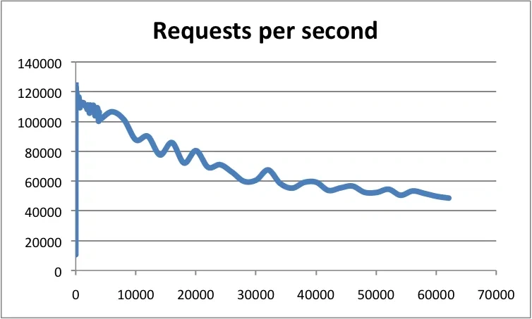

* <font style="color:rgb(44, 62, 80);">Redis 的大部分操作</font>**<font style="color:rgb(48, 79, 254);">都在内存中完成</font>**<font style="color:rgb(44, 62, 80);">，并且采用了</font>**<font style="color:#DF2A3F;">高效的数据结构</font>**<font style="color:rgb(44, 62, 80);">，因此 Redis 瓶颈可能是机器的内存或者网络带宽，而并非 CPU，既然 CPU 不是瓶颈，那么自然就采用单线程的解决方案了；</font>
* <font style="color:rgb(44, 62, 80);">Redis 采用单线程模型可以</font>**<font style="color:rgb(48, 79, 254);">避免了多线程之间的竞争</font>**<font style="color:rgb(44, 62, 80);">，省去了多线程切换带来的时间和性能上的开销，而且也</font>**<font style="color:#DF2A3F;">不会导致死锁问题</font>**<font style="color:rgb(44, 62, 80);">。</font>
* <font style="color:rgb(44, 62, 80);">Redis 采用了 </font>**<font style="color:rgb(48, 79, 254);">I/O 多路复用机制</font>**<font style="color:rgb(44, 62, 80);">处理大量的客户端 Socket 请求，IO 多路复用机制是指一个线程处理多个 IO 流 -  select/epoll 机制。在 Redis 只运行单线程的情况下，该机制允许内核中，同时存在多个监听 Socket 和已连接 Socket。内核会一直监听这些 Socket 上的连接请求或数据请求。一旦有请求到达，就会交给 Redis 线程处理，这就实现了一个 Redis 线程处理多个 IO 流的效果。</font>

[9.2 I/O 多路复用：select/poll/epoll](https://xiaolincoding.com/os/8_network_system/selete_poll_epoll.html)

### Redis 单线程模型了解吗？

**Redis 基于** **Reactor 模式设计开发了一套高效的事件处理模型** （Netty 的线程模型也基于 Reactor 模式，Reactor 模式不愧是高性能 IO 的基石），这套事件处理模型对应的是 Redis 中的文件事件处理器（file event handler）。由于文件事件处理器（file event handler）是单线程方式运行的，所以我们一般都说 Redis 是单线程模型。

> * 文件事件处理器使用 <font style="color:#DF2A3F;"> </font>**<font style="color:#DF2A3F;">I/O 多路复用（multiplexing）</font>**<font style="color:#DF2A3F;"> </font>程序来同时监听多个套接字，并根据套接字目前执行的任务来为套接字关联不同的事件处理器。
> * 当被监听的套接字准备好执行连接应答（accept）、读取（read）、写入（write）、关 闭（close）等操作时，与操作相对应的文件事件就会产生，这时文件事件处理器就会调用套接字之前关联好的事件处理器来处理这些事件。
>
> **虽然文件事件处理器以单线程方式运行，但通过使用 I/O 多路复用程序来监听多个套接字**，文件事件处理器既实现了高性能的网络通信模型，又可以很好地与 Redis 服务器中其他同样以单线程方式运行的模块进行对接，这保持了 Redis 内部单线程设计的简单性。

Redis 通过 **IO 多路复用程序** 来监听来自客户端的大量连接（或者说是监听多个 socket），它会将感兴趣的事件及类型（读、写）注册到内核中并监听每个事件是否发生。

好处：**I/O 多路复用技术让 Redis 不需要额外创建多余的线程来监听客户端的大量连接，降低了资源的消耗**（和 NIO 中的 `Selector` 组件很像）。**一个select监听多个channal，一个buffer对应一个channal。**

文件事件处理器（file event handler）主要是包含 4 个部分：

* 多个 socket（客户端连接）
* IO 多路复用程序（支持多个客户端连接的关键）
* 文件事件分派器（将 socket 关联到相应的事件处理器）
* 事件处理器（连接应答处理器、命令请求处理器、命令回复处理器）

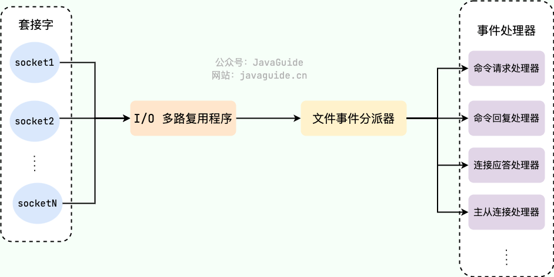

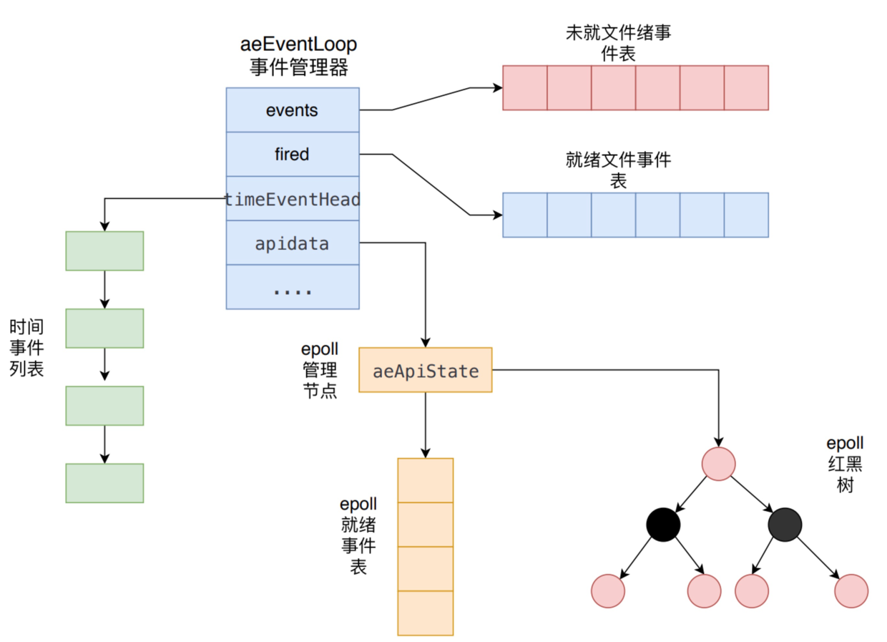

相关阅读：[Redis 事件机制详解](http://remcarpediem.net/article/1aa2da89/)

### Redis6.0 之前为什么不使用多线程？

虽然说 Redis 是单线程模型，但是，实际上，**Redis 在 4.0 之后的版本中就已经加入了对多线程的支持。**

Redis 4.0 增加的多线程主要是针对一些\*\*<font style="color:#DF2A3F;">大键值对的删除操作的命令</font>\*\*，使用这些命令就会使用主线程之外的其他线程来“**异步处理**”。

为此，Redis 4.0 之后新增了 `UNLINK`（可以看作是 `DEL` 的异步版本）、`FLUSHALL ASYNC`（清空所有数据库的所有 key，不仅仅是当前 `SELECT` 的数据库）、`FLUSHDB ASYNC`（清空当前 `SELECT` 数据库中的所有 key）等异步命令。

* 单线程编程容易并且更容易维护；
* **<font style="color:#DF2A3F;">Redis 的性能瓶颈不在 CPU ，主要在内存和网络</font>**；
* 多线程就会存在死锁、线程上下文切换等问题，甚至会影响性能。

相关阅读：[为什么 Redis 选择单线程模型？](https://draveness.me/whys-the-design-redis-single-thread/)

### Redis6.0 之后为何引入了多线程？

**<font style="color:rgb(48, 79, 254);">Redis 单线程指的是「接收客户端请求->解析请求 ->进行数据读写等操作->发送数据给客户端」这个过程是由一个线程（主线程）来完成的</font>**

**Redis6.0 引入多线程主要是为了**\*\*<font style="color:#DF2A3F;">提高网络 IO 读写性能</font>\*\*（Redis 的瓶颈主要受限于内存和网络）。

**<font style="color:rgb(48, 79, 254);">Redis 程序并不是单线程的</font>**<font style="color:rgb(44, 62, 80);">，Redis 在启动的时候，是会</font>**<font style="color:rgb(48, 79, 254);">启动后台线程</font>**<font style="color:rgb(44, 62, 80);">（BIO）的：</font>

* **<font style="color:rgb(48, 79, 254);">Redis 在 2.6 版本</font>**<font style="color:rgb(44, 62, 80);">，会启动 2 个后台线程，分别处理</font>**<font style="color:#DF2A3F;">关闭文件、AOF 刷盘</font>**<font style="color:rgb(44, 62, 80);">这两个任务；</font>
* **<font style="color:rgb(48, 79, 254);">Redis 在 4.0 版本之后</font>**<font style="color:rgb(44, 62, 80);">，新增了一个新的后台线程，用来</font>**<font style="color:#DF2A3F;">异步释放 Redis 内存</font>**<font style="color:rgb(44, 62, 80);">，也就是 lazy\_free 线程。</font>

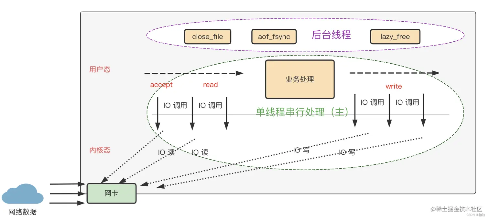

**后台线程**用于执行一些比较耗时的操作：

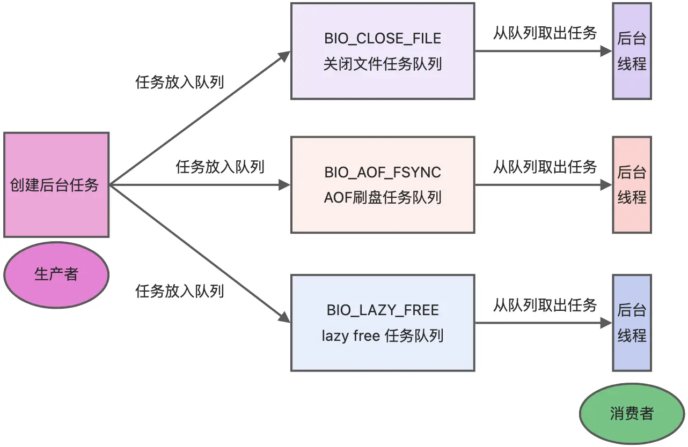

* <font style="color:rgb(44, 62, 80);">Redis 6.0 版本后，默认情况下会</font>**<font style="color:rgb(48, 79, 254);">额外创建 6 个线程</font>**<font style="color:rgb(44, 62, 80);">（</font>*<font style="color:rgb(200, 73, 255);">这里的线程数不包括主线程</font>*<font style="color:rgb(44, 62, 80);">）：</font>
* <font style="color:rgb(44, 62, 80);">Redis-server ： Redis的主线程，主要负责执行命令；</font>
* <font style="color:rgb(44, 62, 80);">bio\_close\_file、bio\_aof\_fsync、bio\_lazy\_free：三个后台线程，分别异步处理关闭文件任务、AOF刷盘任务、释放内存任务；</font>
* <font style="color:rgb(44, 62, 80);">io\_thd\_1、io\_thd\_2、io\_thd\_3：三个 I/O 线程，io-threads 默认是 4 ，所以会启动 3（4-1）个 I/O 多线程，用来分担 Redis 网络 I/O 的压力</font>

Redis 后台线程的详细介绍 ：

<https://juejin.cn/post/7102780434739626014>

## Redis 内存管理

### Redis 给缓存数据设置过期时间有啥用？

**内存是有限的**，如果缓存中的所有数据都是一直保存的话，有可能导致 **Out of memory**。

```shell
127.0.0.1:6379> expire key 60 # 数据在 60s 后过期
(integer) 1
127.0.0.1:6379> setex key 60 value # 数据在 60s 后过期 (setex:[set] + [ex]pire)
OK
127.0.0.1:6379> ttl key # 查看数据还有多久过期
(integer) 56
```

注意：**<font style="color:#DF2A3F;">Redis 中除了字符串类型有自己独有设置过期时间的命令</font>**<font style="color:#DF2A3F;"> </font><code>**<font style="color:#DF2A3F;">setex</font>**</code><font style="color:#DF2A3F;"> </font>**<font style="color:#DF2A3F;">外，其他方法都需要依靠</font>**<font style="color:#DF2A3F;"> </font><code>**<font style="color:#DF2A3F;">expire</font>**</code><font style="color:#DF2A3F;"> </font>**<font style="color:#DF2A3F;">命令来设置过期时间 。另外，</font>**<font style="color:#DF2A3F;">  </font><code>**<font style="color:#DF2A3F;">persist</font>**</code><font style="color:#DF2A3F;"> </font>**<font style="color:#DF2A3F;">命令可以移除一个键的过期时间。</font>**

* <code><font style="color:rgb(71, 101, 130);">expire <key> <n></font></code><font style="color:rgb(44, 62, 80);">：设置 key 在 n 秒后过期，expire key 100 表示设置 key 在 100 秒后过期；</font>
* <code><font style="color:rgb(71, 101, 130);">pexpire <key> <n></font></code><font style="color:rgb(44, 62, 80);">：设置 key 在 n 毫秒后过期，pexpire key2 100000 表示设置 key2 在 100000 毫秒（100 秒）后过期。</font>
* <code><font style="color:rgb(71, 101, 130);">expireat <key> <n></font></code><font style="color:rgb(44, 62, 80);">：设置 key 在某个时间戳（精确到秒）之后过期，比如 expireat key3 1655654400 表示 key3 在时间戳 1655654400 后过期（精确到秒）；</font>
* <code><font style="color:rgb(71, 101, 130);">pexpireat <key> <n></font></code><font style="color:rgb(44, 62, 80);">：设置 key 在某个时间戳（精确到毫秒）之后过期，比如 pexpireat key4 1655654400000 表示 key4 在时间戳 1655654400000 后过期（精确到毫秒）</font>

<font style="color:rgb(44, 62, 80);">当然，在设置字符串时，也可以同时对 key 设置过期时间，共有 3 种命令：</font>

* <code><font style="color:rgb(71, 101, 130);">set <key> <value> ex <n></font></code><font style="color:rgb(44, 62, 80);"> </font><font style="color:rgb(44, 62, 80);">：设置键值对的时候，同时指定过期时间（精确到秒）；</font>
* <code><font style="color:rgb(71, 101, 130);">set <key> <value> px <n></font></code><font style="color:rgb(44, 62, 80);"> </font><font style="color:rgb(44, 62, 80);">：设置键值对的时候，同时指定过期时间（精确到毫秒）；</font>
* <code><font style="color:rgb(71, 101, 130);">setex <key> <n> <valule></font></code><font style="color:rgb(44, 62, 80);"> ：设置键值对的时候，同时指定过期时间（精确到秒）。</font>

### Redis 判断数据是否过期？♥♥♥

Redis 通过一个叫做\*\*<font style="color:#DF2A3F;">过期字典(expires)</font>\*\* （可以看作是 hash 表）来保存数据过期的时间。过期字典的键指向 Redis 数据库中的某个 key(键)，过期字典的值是一个 **long long** 类型的整数，这个整数保存了 key 所指向的数据库键的过期时间（毫秒精度的 UNIX 时间戳）

```cpp
typedef struct redisDb {
    dict *dict;    /* 数据库键空间，存放着所有的键值对 */
    dict *expires; /* 键的过期时间 */
    ....
} redisDb;
```

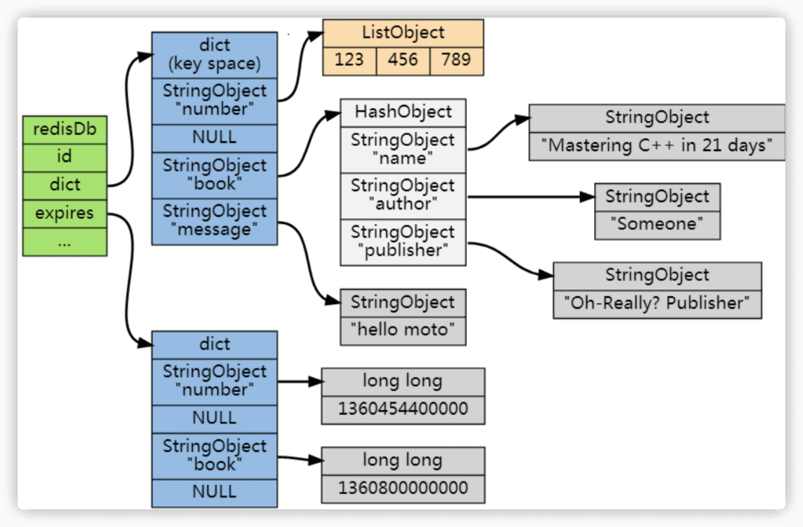

### 过期数据的删除策略？♥♥♥

1. **惰性删除**：**取出 key** 的时候才对数据进行过期检查。这样对 CPU 最友好，但是可能会造成太多过期 key 没有被删除。
2. **定期删除**：每隔一段时间**抽取一批** key 执行删除过期 key 操作。并且，Redis 底层会通过限制删除操作执行的时长和频率来减少删除操作对 CPU 时间的影响。

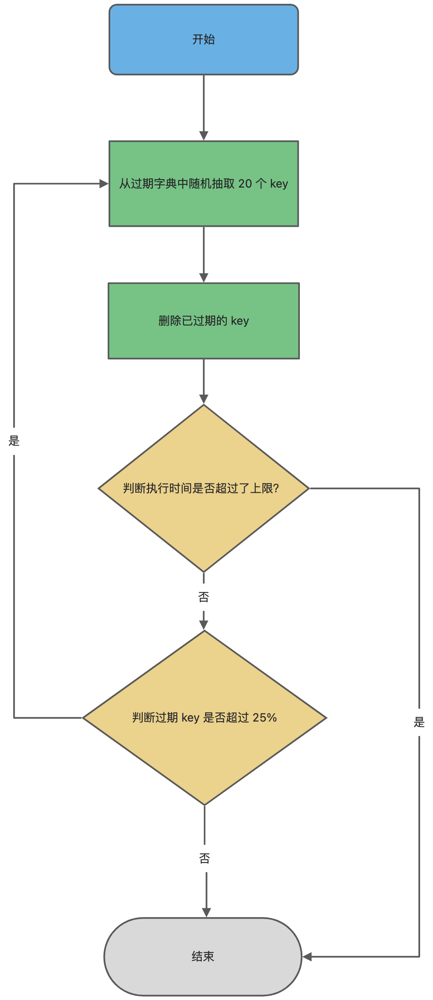

**<font style="color:#DF2A3F;">定期删除对内存更加友好，惰性删除对 CPU 更加友好</font>\*\*\*\*。** Redis 采用的是 **定期删除 + 惰性/懒汉式删除** 。

仅仅通过给 key 设置过期时间还是有问题的。因为还是可能存在定期删除和惰性删除漏掉了很多过期 key 的情况。这样就导致大量过期 key 堆积在内存里，然后就 Out of memory 了。

怎么解决这个问题：**Redis 内存淘汰机制** **。**

### Redis 内存淘汰机制？♥♥♥

> \*\*MySQL 里有 2000w 数据，Redis 中只存 20w 的数据，如何保证 Redis 中的数据都是热点数据？\*\*类似于 cache 替换策略，需要把热点数据放入 redis

<font style="color:rgb(44, 62, 80);">Redis 内存淘汰策略共有八种，这八种策略大体分为「不进行数据淘汰」和「进行数据淘汰」两类策略。</font>

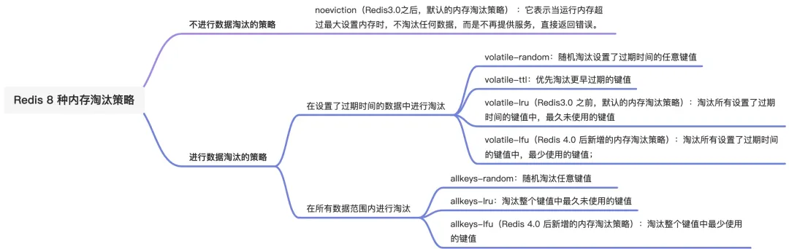

*<font style="color:rgb(200, 73, 255);">1、不进行数据淘汰的策略：</font>*

* **<font style="color:rgb(48, 79, 254);">noeviction</font>**<font style="color:rgb(44, 62, 80);">（Redis3.0之后，默认的内存淘汰策略） ：它表示当运行内存超过最大设置内存时，不淘汰任何数据，这时如果有新的数据写入，会报错通知禁止写入，不淘汰任何数据，但是如果没用数据写入的话，只是单纯的查询或者删除操作的话，还是可以正常工作。</font>

*<font style="color:rgb(200, 73, 255);">2、进行数据淘汰的策略：</font>*

<font style="color:rgb(44, 62, 80);">针对「进行数据淘汰」这一类策略，又可以细分为「在设置了过期时间的数据中进行淘汰」和「在所有数据范围内进行淘汰」这两类策略。</font>

* <font style="color:rgb(44, 62, 80);">在设置了过期时间的数据中进行淘汰：</font>
* **<font style="color:rgb(48, 79, 254);">volatile-random</font>**<font style="color:rgb(44, 62, 80);">：随机淘汰设置了过期时间的任意键值；</font>
* **<font style="color:rgb(48, 79, 254);">volatile-ttl</font>**<font style="color:rgb(44, 62, 80);">：优先淘汰更早过期的键值。</font>
* **<font style="color:rgb(48, 79, 254);">volatile-lru</font>**<font style="color:rgb(44, 62, 80);">（Redis3.0 之前，默认的内存淘汰策略）：淘汰所有设置了过期时间的键值中，最久未使用的键值；</font>
* **<font style="color:rgb(48, 79, 254);">volatile-lfu</font>**<font style="color:rgb(44, 62, 80);">（Redis 4.0 后新增的内存淘汰策略）：淘汰所有设置了过期时间的键值中，最少使用的键值；</font>
* <font style="color:rgb(44, 62, 80);">在所有数据范围内进行淘汰：</font>
* **<font style="color:rgb(48, 79, 254);">allkeys-random</font>**<font style="color:rgb(44, 62, 80);">：随机淘汰任意键值;</font>
* **<font style="color:rgb(48, 79, 254);">allkeys-lru</font>**<font style="color:rgb(44, 62, 80);">：淘汰整个键值中最久未使用的键值；</font>
* **<font style="color:rgb(48, 79, 254);">allkeys-lfu</font>**<font style="color:rgb(44, 62, 80);">（Redis 4.0 后新增的内存淘汰策略）：淘汰整个键值中最少使用的键值</font>

### <font style="color:rgb(44, 62, 80);">LRU VS LFU</font>

**<font style="color:rgb(48, 79, 254);">LRU</font>**<font style="color:rgb(44, 62, 80);"> 全称是 Least Recently Used 翻译为</font>**<font style="color:rgb(48, 79, 254);">最近最少使用</font>**<font style="color:rgb(44, 62, 80);">，会选择淘汰最近最少使用的数据。传统的LRU实现无非就是Map + 链表，最新操作的键会被移动到表头，当需要内存淘汰时，只需要删除链表尾部的元素即可。Redis 实现的是一种</font>**<font style="color:rgb(48, 79, 254);">近似 LRU 算法</font>**<font style="color:rgb(44, 62, 80);">，目的是为了更好的节约内存，</font>**<font style="color:rgb(48, 79, 254);">实现方式是在 Redis 的对象结构体中添加一个额外的字段，用于记录此数据的最后一次访问时间</font>**<font style="color:rgb(44, 62, 80);">。</font>

<font style="color:rgb(44, 62, 80);">当 Redis 进行内存淘汰时，会使用</font>**<font style="color:rgb(48, 79, 254);">随机采样的方式来淘汰数据</font>**<font style="color:rgb(44, 62, 80);">，它是随机取 5 个值（此值可配置），然后</font>**<font style="color:rgb(48, 79, 254);">淘汰最久没有使用的那个</font>**<font style="color:rgb(44, 62, 80);">。</font>

<font style="color:rgb(44, 62, 80);">Redis 实现的 LRU 算法的优点：</font>

* <font style="color:rgb(44, 62, 80);">不用为所有的数据维护一个大链表，节省了空间占用；</font>
* <font style="color:rgb(44, 62, 80);">不用在每次数据访问时都移动链表项，提升了缓存的性能；</font>

<font style="color:rgb(44, 62, 80);">但是 LRU 算法有一个问题，</font>**<font style="color:rgb(48, 79, 254);">无法解决缓存污染问题</font>**<font style="color:rgb(44, 62, 80);">，比如应用一次读取了大量的数据，而这些数据只会被读取这一次，那么这些数据会留存在 Redis 缓存中很长一段时间，造成缓存污染。</font>

<font style="color:rgb(44, 62, 80);"></font>

<font style="color:rgb(44, 62, 80);">LFU 全称是 Least Frequently Used 翻译为</font>**<font style="color:rgb(48, 79, 254);">最近最不常用</font>**<font style="color:rgb(44, 62, 80);">，LFU 算法是根据数据访问次数来淘汰数据的，它的核心思想是“如果数据过去被访问多次，那么将来被访问的频率也更高”。</font>

* **<font style="color:rgb(48, 79, 254);">在 LRU 算法中</font>**<font style="color:rgb(44, 62, 80);">，Redis 对象头的 24 bits 的 lru 字段是用来记录 key 的访问时间戳，因此在 LRU 模式下，Redis可以根据对象头中的 lru 字段记录的值，来比较最后一次 key 的访问时间长，从而淘汰最久未被使用的 key。</font>
* **<font style="color:rgb(48, 79, 254);">在 LFU 算法中</font>**<font style="color:rgb(44, 62, 80);">，Redis对象头的 24 bits 的 lru 字段被分成两段来存储，高 16bit 存储 ldt(Last Decrement Time)，低 8bit 存储 logc(Logistic Counter)。</font>
* 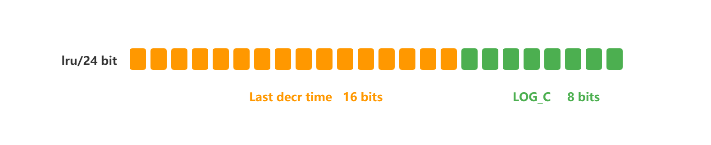

<font style="color:rgb(44, 62, 80);">logc 并不是单纯的访问次数，而是访问频次（访问频率），因为 </font>**<font style="color:rgb(48, 79, 254);">logc 会随时间推移而衰减的</font>**<font style="color:rgb(44, 62, 80);">。</font>

# Redis 常见面试 - 下

## Redis 事务

### 什么是 Redis 事务？

**Redis 事务提供了一种将多个命令请求打包的功能。然后，再按顺序执行打包的所有命令，并且不会被中途打断。Redis 事务是不建议在日常开发中使用的。**

Redis 可以通过 <code>**MULTI**</code> **，** <code>**EXEC**</code> **，** <code>**DISCARD**</code> **和** <code>**WATCH**</code> 等命令来实现事务(Transaction)功能。

```shell
MULTI
	OK
SET PROJECT "JavaGuide"
	QUEUED
GET PROJECT
	QUEUED
EXEC
	1) OK
	2) "JavaGuide"
```

`[MULTI](https://redis.io/commands/multi)` 命令后可以输入多个命令，Redis 不会立即执行这些命令，而是将它们放到队列，当调用了 `[EXEC](https://redis.io/commands/exec)` 命令后，再执行所有的命令。

1. 开始事务（`MULTI`）；
2. 命令入队(批量操作 Redis 的命令，先进先出（FIFO）的顺序执行)；
3. 执行事务(`EXEC`)。

可以通过 `[DISCARD](https://redis.io/commands/discard)` 命令取消一个事务，它会清空事务队列中保存的所有命令。

可以通过 `[WATCH](https://redis.io/commands/watch)` 命令监听指定的 Key，当调用 `EXEC` 命令执行事务时，如果一个被 `WATCH` 命令监视的 Key 被 **其他客户端/Session** 修改的话，整个事务都不会被执行。

不过，如果 **WATCH** 与 **事务** 在同一个 Session 里，并且被 **WATCH** 监视的 Key 被修改的操作发生在事务内部，这个事务是可以被执行成功的

### Redis 事务支持原子性吗？

事务具有四大特性：

1. **原子性（Atomicity）：**  事务是最小的执行单位，不允许分割。事务的原子性确保动作要么全部完成，要么完全不起作用；
2. **隔离性（Isolation）：**  并发访问数据库时，一个用户的事务不被其他事务所干扰，各并发事务之间数据库是独立的；
3. **持久性（Durability）：**  一个事务被提交之后。它对数据库中数据的改变是持久的，即使数据库发生故障也不应该对其有任何影响。
4. **一致性（Consistency）：**  执行事务前后，数据保持一致，多个事务对同一个数据读取的结果是相同的；

Redis 事务在运行错误的情况下，除了执行过程中出现错误的命令外，其他命令都能正常执行。并且，**Redis 事务不支持回滚（roll back）操作**。**Redis 事务是不满足原子性的**。

[External Player - 哔哩哔哩嵌入式外链播放器](https://player.bilibili.com/player.html?bvid=BV13R4y1v7sP\&p=48\&page=48\&autoplay=0)

### Redis 事务支持持久性吗？

Redis 不同于 Memcached 的很重要一点就是，**Redis 支持持久化**，而且支持 3 种持久化方式:

* 快照（snapshotting，RDB）
* 只追加文件（append-only file, AOF）
* RDB 和 AOF 的混合持久化(Redis 4.0 新增)

## **Redis 性能优化（重要）**

[你的Redis真的变慢了吗？性能优化如何做](https://mp.weixin.qq.com/s/nNEuYw0NlYGhuKKKKoWfcQ)

### 使用批量操作减少网络传输

一个 Redis 命令的执行可以简化为以下 4 步：

1. 发送命令
2. 命令排队
3. 命令执行
4. 返回结果

其中，第 1 步和第 4 步耗费时间之和称为 **Round Trip Time (RTT-往返时间)** 使用批量操作可以减少网络传输次数，进而有效减小网络开销，大幅减少 RTT。

另外，除了能减少 RTT 之外，发送一次命令的 socket I/O 成本也比较高（涉及上下文切换，存在 `read()` 和 `write()` 系统调用），批量操作还可以减少 socket I/O 成本。

#### 原生批量操作命令

Redis 中有一些原生支持批量操作的命令，比如：

* `MGET`(获取一个或多个指定 key 的值)、`MSET`(设置一个或多个指定 key 的值)、
* `HMGET`(获取指定哈希表中一个或者多个指定字段的值)、`HMSET`(同时将一个或多个 field-value 对设置到指定哈希表中)、
* `SADD`（向指定集合添加一个或多个元素）
* ……

不过，在 Redis 官方提供的分片集群解决方案 Redis Cluster 下，使用这些原生批量操作命令可能会存在一些小问题需要解决。就比如说 `MGET` 无法保证所有的 key 都在同一个 **hash slot**（哈希槽）上，`MGET` 可能还是需要多次网络传输，原子操作也无法保证了。不过，相较于非批量操作，还是可以节省不少网络传输次数。

整个步骤的简化版如下：

1. 找到 key 对应的所有 hash slot；
2. 分别向对应的 Redis 节点发起 `MGET` 请求获取数据；
3. 等待所有请求执行结束，重新组装结果数据，保持跟入参 key 的顺序一致，然后返回结果。

如果想要解决这个多次网络传输的问题，比较常用的办法是自己维护 key 与 slot 的关系。不过这样不太灵活，虽然带来了性能提升，但同样让系统复杂性提升。

> Redis Cluster 并没有使用一致性哈希，采用的是 **<font style="color:#DF2A3F;">哈希槽分区</font>** ，每一个键值对都属于一个 **hash slot**（哈希槽） 。当客户端发送命令请求的时候，需要先根据 key 通过上面的计算公示找到的对应的哈希槽，然后再查询哈希槽和节点的映射关系，即可找到目标 Redis 节点。

#### pipeline ♥♥

对于不支持批量操作的命令，利用 **pipeline（流水线)**  将一批 Redis 命令封装成一组，一次性提交到 Redis 服务器，只需要一次网络传输。不过，需要注意控制一次批量操作的 **元素个数**(例如 500 以内，实际也和元素字节数有关)，**避免网络传输的数据量过大**。

与 `MGET`、`MSET` 等原生批量操作命令一样，pipeline 同样在 **Redis Cluster** 上使用会存在一些小问题。原因类似，无法保证所有的 key 都在同一个 **hash slot**（哈希槽）上。如果想要使用的话，客户端需要自己维护 key 与 slot 的关系。

**原生批量操作命令和 pipeline** 区别：

* 原生批量操作命令是原子操作，pipeline 是非原子操作。
* pipeline 可以打包不同的命令，原生批量操作命令不可以。
* 原生批量操作命令是 Redis 服务端支持实现的，而 pipeline 需要服务端和客户端的共同实现。

**pipeline 和 Redis 事务**：

* 事务是原子操作，pipeline 是非原子操作。两个不同的事务不会同时运行，而 pipeline 可以同时以交错方式执行。
* Redis 事务中每个命令都需要发送到服务端，而 Pipeline 只需要发送一次，请求次数更少。

> 事务可以看作是一个原子操作，但其实并不满足原子性。当我们提到 Redis 中的原子操作时，主要指的是这个操作（比如事务、Lua 脚本）不会被其他操作（比如其他事务、Lua 脚本）打扰，并不能完全保证这个操作中的所有写命令要么都执行要么都不执行。这主要也是因为 Redis 是不支持回滚操作。

> 主要区分 pipeline 和原生批操作的区别，对比 pipeline 和 redis 事务的区别

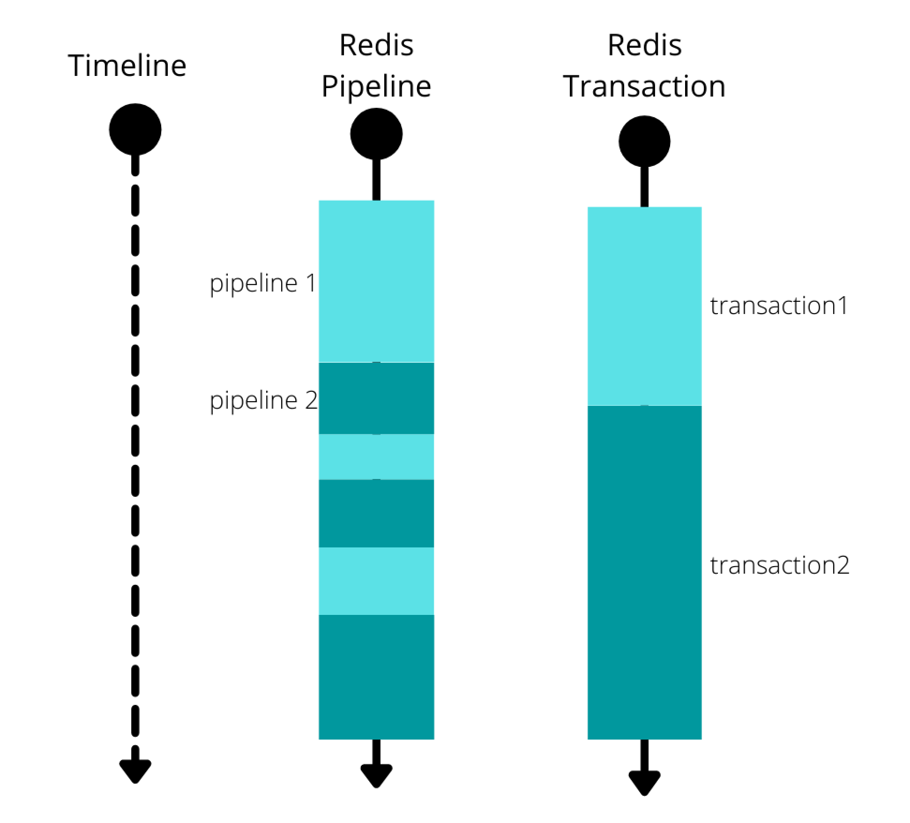

pipeline 不适用于执行顺序有依赖关系的一批命令。就比如说，你需要将前一个命令的结果给后续的命令使用，pipeline 就没办法满足你的需求了。对于这种需求，我们可以使用 **Lua 脚本** 。

#### Lua 脚本 ♥♥

Lua 脚本同样支持批量操作多条命令。一段 Lua 脚本可以视作一条命令执行，可以看作是 **原子操作** 。也就是说，**一段 Lua 脚本执行过程中不会有其他脚本或 Redis 命令同时执行，保证了操作不会被其他指令插入或打扰**，这是 pipeline 所不具备的。

并且，Lua 脚本中支持一些简单的逻辑处理比如使用命令读取值并在 Lua 脚本中进行处理，这同样是 pipeline 所不具备的。

不过， Lua 脚本依然存在下面这些缺陷：

* 如果 Lua 脚本运行时出错并中途结束，之后的操作不会进行，但是之前已经发生的写操作不会撤销，所以即使使用了 Lua 脚本，也不能实现类似数据库回滚的原子性。
* Redis Cluster 下 Lua 脚本的原子操作也无法保证了，原因同样是无法保证所有的 key 都在同一个 **hash slot**（哈希槽）上。

### 大量 key 集中过期问题

对于过期 key，Redis 采用的是 **定期删除 + 惰性/懒汉式删除** 策略。

1. 给 key 设置随机过期时间。
2. 开启 lazy-free（惰性删除/延迟释放） 。lazy-free 特性是 Redis 4.0 开始引入的，指的是让 **Redis 采用异步方式延迟释放 key** ，将该操作交给\_\*\*单独的子线程 \*\*\_处理，避免阻塞主线程。

### Redis bigkey ♥♥♥

如果一个 **key 对应的 value 所占用的内存比较大**，那这个 key 就可以看作是 bigkey。

* String 类型的 value 超过 1MB
* 复合类型（List、Hash、Set、Sorted Set 等）的 value 包含的元素超过 5000 个（不过，对于复合类型的 value 来说，不一定包含的元素越多，占用的内存就越多）。

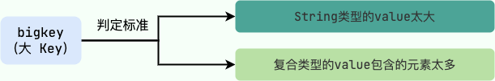

bigkey 产生原因：

* 程序设计不当，直接使用 String 类型存储较大的文件对应的二进制数据。
* 对于业务的数据规模考虑不周到，比如使用集合类型的时候没有考虑到数据量的快速增长。
* 未及时清理垃圾数据，比如哈希中冗余了大量的无用键值对。

bigkey 除了会消耗更多的内存空间和带宽，还会对性能造成比较大的影响。

1. **客户端超时阻塞**：由于 Redis 执行命令是单线程处理，然后在操作大 key 时会比较耗时，那么就会阻塞 Redis，从客户端这一视角看，就是很久很久都没有响应。
2. **网络阻塞**：每次获取大 key 产生的网络流量较大，如果一个 key 的大小是 1 MB，每秒访问量为 1000，那么每秒会产生 1000MB 的流量，这对于普通千兆网卡的服务器来说是灾难性的。
3. **工作线程阻塞**：如果使用 del 删除大 key 时，会阻塞工作线程，这样就没办法处理后续的命令。
4. **数据倾斜**：大key占据某个节点，其余节点可能是热key，大量请求偏向某一方

#### 如何发现 bigkey？

* **使用 Redis 自带的**  <code>**--bigkeys**</code> **参数来查找。**
  * 命令会扫描(Scan) Redis 中的所有 key ，会对 Redis 的性能有一点影响。这种方式只能找出每种数据结构 top 1 bigkey
* **使用 Redis 自带的 SCAN 命令**
  * `SCAN` 命令可以按照一定的模式和数量返回匹配的 key。获取了 key 之后，可以利用 `STRLEN`、`HLEN`、`LLEN` 等命令返回其长度或成员数量。
* **借助开源工具分析 RDB 文件。**
* **借助公有云的 Redis 分析服务。**

#### <font style="color:#DF2A3F;">如何处理 bigkey？</font>

bigkey 的常见处理以及优化办法如下：

* **分割 bigkey**：将一个 bigkey 分割为多个小 key。例如，将一个含有上万字段数量的 Hash 按照一定策略（比如二次哈希）拆分为多个 Hash。
* **手动清理**：Redis 4.0+ 可以使用 <code><font style="color:#DF2A3F;">UNLINK</font></code> <font style="color:#DF2A3F;">异步删除</font>一个或多个指定的 key。Redis 4.0 以下可以考虑使用 `SCAN` 命令结合 `DEL` 命令来分批次删除。
* **采用合适的数据结构**：例如，文件二进制数据不使用 String 保存、使用 HyperLogLog 统计页面 UV、Bitmap 保存状态信息（0/1）。
* **开启 lazy-free（惰性删除/延迟释放）**  ：lazy-free 特性是 Redis 4.0 开始引入的，指的是让 Redis 采用异步方式延迟释放 key 使用的内存，将该操作交给单独的子线程处理，避免阻塞主线程。

### Redis hotkey ♥♥♥

如果一个 key 的访问次数比较多且明显多于其他 key 的话，那这个 key 就可以看作是 **hotkey（热 Key）** 。

处理 hotkey 会**占用大量的 CPU 和带宽**，可能会影响 Redis 实例对其他请求的正常处理。此外，如果突然访问 hotkey 的请求超出了 Redis 的处理能力，Redis 就会直接宕机。这种情况下，大量请求将落到后面的数据库上，可能会导致数据库崩溃。

因此，hotkey 很可能成为系统性能的瓶颈点，需要单独对其进行优化，以确保系统的高可用性和稳定性。

#### 如何发现 hotkey？

1.**使用 Redis 自带的**  <code>**--hotkeys**</code> **参数来查找。** 参数能够返回所有 key 的被访问次数。

前提条件是 Redis Server 的 `maxmemory-policy` 参数设置为 **LFU** 算法

Redis 中有两种 LFU 算法：

1. **volatile-lfu（least frequently used）** ：从已设置过期时间的数据集（`server.db[i].expires`）中挑选最不经常使用的数据淘汰。
2. **allkeys-lfu（least frequently used）** ：当内存不足以容纳新写入数据时，在键空间中，移除最不经常使用的 key。

```yaml
# 使用 volatile-lfu 策略
maxmemory-policy volatile-lfu

# 或者使用 allkeys-lfu 策略
maxmemory-policy allkeys-lfu
```

`hotkeys` **参数命令也会增加 Redis 实例的 CPU 和内存消耗（全局扫描）**

2.**使用** <code>**MONITOR**</code> **命令。**

`MONITOR` 命令是 Redis 提供的一种实时查看 Redis 的所有操作的方式，可以用于临时监控 Redis 实例的操作情况，包括读写、删除等操作。

3.**借助开源项目。**

京东零售的 [hotkey](https://gitee.com/jd-platform-opensource/hotkey) 这个项目不光支持 hotkey 的发现，还支持 hotkey 的处理。

#### <font style="color:#DF2A3F;">如何解决 hotkey？</font>

hotkey 的常见处理以及优化办法如下（这些方法可以配合起来使用）：

* **读写分离**：主节点处理写请求，从节点处理读请求。
* **使用 Redis Cluster**：将热点数据分散存储在多个 Redis 节点上。
* **二级缓存(redis + Caffeine)**：hotkey 采用二级缓存的方式进行处理，将 hotkey 存放一份到 JVM 本地内存中

### Redis 内存碎片

[Redis重要知识点](https://www.yuque.com/nibiwanxiamei/yrd6t1/774b3ed96ccf00c673c0564262d8c039)

## **Redis 生产问题（重要）**

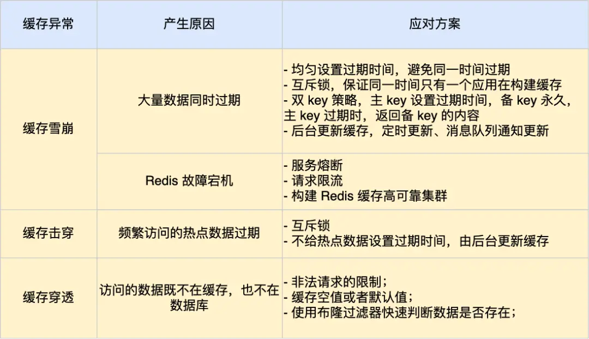

### 缓存穿透 ♥♥♥♥

缓存穿透：大量请求的 key 是不合理的，**<font style="color:#DF2A3F;">根本不存在于缓存中，也不存在于数据库中</font>**<font style="color:#DF2A3F;"> </font>。这就导致这些请求直接到了数据库上，根本没有经过缓存这一层，对数据库造成了巨大的压力，可能直接就被这么多请求弄宕机了。


解决方法：最基本的就是首先做好**参数校验**，一些不合法的参数请求直接抛出异常信息返回给客户端。

**1.缓存无效 key**

如果缓存和数据库都查不到某个 key 的数据就写一个到 Redis 中去并设置过期时间，具体命令如下：`SET key value EX 10086` 。这种方式**可以解决请求的 key 变化不频繁**的情况。

如果黑客恶意攻击，每次构建不同的请求 key，会导致 Redis 中缓存大量无效的 key 。很明显，这种方案并不能从根本上解决此问题。如果非要用这种方式来解决穿透问题的话，尽量将无效的 key 的过期时间设置短一点比如 1 分钟。

**<font style="color:#DF2A3F;">2.布隆过滤器</font>**

布隆过滤器是一个数据结构，可以非常方便地判断一个给定数据是否存在于海量数据中。可以把它看作由**二进制向量（或者说\*\*\*\*<font style="color:#DF2A3F;">位数组</font>\*\*\*\*）和一系列随机映射函数（哈希函数）** 两部分组成的数据结构。相比于我们平时常用的 List、Map、Set 等数据结构，它**占用空间更少并且效率更高，但是缺点是其返回的结果是概率性的**，而不是非常准确的。理论情况下添加到集合中的元素越多，误报的可能性就越大。并且，存放在布隆过滤器的数据不容易删除。(**<font style="color:#DF2A3F;background-color:#FBDE28;">不存在一定不存在,存在不一定存在</font>**)


Bloom Filter 会使用一个较大的 bit 数组来保存所有的数据，数组中的每个元素都只占用 1 bit ，并且每个元素只能是 0 或者 1（代表 false 或者 true），这也是 Bloom Filter 节省内存的核心所在。**这样来算的话，申请一个 100w 个元素的位数组只占用 1000000Bit / 8 = 125000 Byte = 125000/1024 KB ≈ 122KB 的空间。**

**把所有可能存在的请求的值都存放在布隆过滤器中，当用户请求过来，先判断用户发来的请求的值是否存在于布隆过滤器中。不存在的话，直接返回请求参数错误信息给客户端，存在的话才会走下面的流程。**


**3.接口限流**

根据用户或者 IP 对接口进行限流，对于异常频繁的访问行为，还可以采取黑名单机制，将异常 IP 列入黑名单。

### 缓存击穿 ♥♥♥♥

缓存击穿中，请求的 key 对应的是 **热点数据** ，该数据 **存在于数据库中，但不存在于缓存中** **（通常是因为缓存中的那份数据已经过期）**  。这就可能会导致瞬时大量的请求直接打到了数据库上，对数据库造成了巨大的压力，可能直接就被这么多请求弄宕机了。


**秒杀进行过程中，缓存中的某个秒杀商品的数据突然过期，这就导致瞬时大量对该商品的请求直接落到数据库上，对数据库造成了巨大的压力**

解决办法

1. 设置热点数据永不过期或者过期时间比较长。
2. 针对热点数据提前预热，存入缓存中并设置合理的过期时间比如秒杀场景下的数据在秒杀结束之前不过期。
3. **请求数据库写数据到缓存之前，先获取互斥锁，保证只有一个请求会落到数据库上，减少数据库的压力。**

最终方案:**<font style="color:#DF2A3F;background-color:#FBDE28;">双重校验锁 - 获取锁后先查询缓存是否有数据,有则无需请求数据库.</font>**

<font style="color:#DF2A3F;background-color:#FBDE28;"></font>

**缓存预热如何实现？**

***

1. 使用定时任务，比如 xxl-job，来定时触发缓存预热的逻辑，将数据库中的热点数据查询出来并存入缓存中。
2. 使用消息队列，比如 RocketMQ，来异步地进行缓存预热，将数据库中的热点数据的主键或者 ID 发送到消息队列中，然后由缓存服务消费消息队列中的数据，根据主键或者 ID 查询数据库并更新缓存。

**缓存穿透和缓存击穿有什么区别？**

* 缓存穿透中，请求的 key 既不存在于缓存中，也不存在于数据库中。
* 缓存击穿中，请求的 key 对应的是 **热点数据** ，该数据 **存在于数据库中，但不存在于缓存中（通常是因为缓存中的那份数据已经过期）**  。

### 缓存雪崩 ♥♥♥♥

缓存雪崩描述：**缓存在同一时间大面积的失效** **，导致大量的请求都直接落到了数据库上，对数据库造成了巨大的压力。**  **缓存服务宕机**也会导致缓存雪崩现象，导致所有的请求都落到了数据库上。


**针对 Redis故障宕机导致服务不可用的情况：**

1. **Redis 集群**，避免单机出现问题整个缓存服务都没办法使用。（预防）
2. 服务熔断 | **限流**：暂停缓存服务 | **将少部分请求发送到数据库进行处理，再多的请求就在入口直接拒绝服务**
3. **多级缓存**，例如本地缓存+Redis 缓存的组合，当 Redis 缓存出现问题时，还可以从本地缓存中获取到部分数据。

**缓存雪崩和缓存击穿有什么区别？**

缓存雪崩和缓存击穿比较像，但缓存雪崩导致的原因是**缓存中的大量或者所有数据失效**，缓存击穿导致的原因主要是某个**热点数据不存在与缓存中**（通常是因为缓存中的那份数据已经过期）。

解决方案：

* <font style="color:rgb(44, 62, 80);">均匀设置过期时间：如果要给缓存数据设置过期时间，应该避免将大量的数据设置成同一个过期时间。可以在对缓存数据设置过期时间时，</font>**<font style="color:rgb(48, 79, 254);">给这些数据的过期时间加上一个随机数</font>**<font style="color:rgb(44, 62, 80);">，这样就保证数据不会在同一时间过期。</font>
* <font style="color:rgb(44, 62, 80);">互斥锁：当业务线程在处理用户请求时，</font>**<font style="color:rgb(48, 79, 254);">如果发现访问的数据不在 Redis 里，就加个互斥锁，保证同一时间内只有一个请求来构建缓存</font>**<font style="color:rgb(44, 62, 80);">（从数据库读取数据，再将数据更新到 Redis 里），当缓存构建完成后，再释放锁。未能获取互斥锁的请求，要么等待锁释放后重新读取缓存，要么就返回空值或者默认值。实现互斥锁的时候，最好设置</font>**<font style="color:rgb(48, 79, 254);">超时时间</font>**<font style="color:rgb(44, 62, 80);">，不然第一个请求拿到了锁，然后这个请求发生了某种意外而一直阻塞，一直不释放锁，这时其他请求也一直拿不到锁，整个系统就会出现无响应的现象。</font>
* <font style="color:rgb(44, 62, 80);">后台更新缓存：业务线程不再负责更新缓存，缓存也不设置有效期，而是</font>**<font style="color:rgb(48, 79, 254);">让缓存“永久有效”，并将更新缓存的工作交由后台线程定时更新</font>**<font style="color:rgb(44, 62, 80);">。</font>

### <font style="color:rgb(44, 62, 80);">布隆过滤器</font>

<font style="color:rgb(44, 62, 80);"></font>

**布隆过滤器是一种数据结构，用于快速判断一个元素是否存在于一个集合中。具体来说，布隆过滤器包含一个位数组和一组哈希函数。位数组的初始值全部置为 0。在插入一个元素时，将该元素经过多个哈希函数映射到位数组上的多个位置，并将这些位置的值置为 1。**


**在查询一个元素是否存在时，会将该元素经过多个哈希函数映射到位数组上的多个位置，如果所有位置的值都为 1，则认为元素存在；如果存在任一位置的值为 0，则认为元素不存在。**

```java
/**
 * 布隆过滤器配置
 */
@Configuration(value = "rBloomFilterConfigurationByAdmin")
public class RBloomFilterConfiguration {
    @Bean
    public RBloomFilter<String> userRegisterCachePenetrationBloomFilter(RedissonClient redissonClient) {
        RBloomFilter<String> cachePenetrationBloomFilter = redissonClient.getBloomFilter("userRegisterCachePenetrationBloomFilter");
        //预估元素大小，允许的误判率
        cachePenetrationBloomFilter.tryInit(100000000L, 0.001);
        return cachePenetrationBloomFilter;
    }
}
```

### 布隆过滤器容量考虑因素 ♥♥♥

<font style="color:rgb(79, 79, 79);">布隆过滤器的初始化，一次性给够容量，不要让实际数量大于初始化数量，避免重构布隆过滤器。</font>

<font style="color:rgb(79, 79, 79);">考虑因素：已有数据量，阶段增长数据量，允许误判率。</font>

<font style="color:rgb(79, 79, 79);">散列函数的个数不是固定的，</font><font style="color:rgb(25, 27, 31);">给定预期数据量n和误判率p，然后动态生成需要的布隆过滤器</font>

**布隆过滤器占用空间：\*\*\*\*<font style="color:#DF2A3F;">一亿个元素，1/1000的误判率，需要的内存大小是170多MB，bitMap长度大概是1.43亿</font>**


### 布隆过滤器扩容方案

<font style="color:rgb(79, 79, 79);"></font>

<font style="color:rgb(79, 79, 79);">如果实际数量大于初始化数量，这个时候就需要进行重构了，重新分配一个更大数量的过滤器，再将所有旧数据重新初始化进过滤器。</font>

<font style="color:rgb(79, 79, 79);">快速将旧数据初始化进入新的布隆过滤器：</font>

* <font style="color:rgb(79, 79, 79);">评判新的过滤器容量，统计近期增长量是多少，然后设计2-3倍；</font>
* **<font style="color:#DF2A3F;">利用多线程分批次去mysql读取需要存储的数据，每次读取不要太多数据</font>**<font style="color:rgb(79, 79, 79);">（防止时间过长 - 大数据量的迁移，场景题）</font>
* <font style="color:rgb(79, 79, 79);">利用生产者消费者模型保证分批次读取不重复，按照顺序读取</font>
* <font style="color:rgb(79, 79, 79);">向Redis中添加数据，一条条加入肯定对网络IO负载大，可以采用pipleline管道批量处理</font>

### <font style="color:rgb(79, 79, 79);">布谷鸟过滤器</font>

<font style="color:rgb(85, 86, 102);background-color:rgb(238, 240, 244);">布谷鸟过滤器可以说是一个增强版的布隆过滤器，</font>**<font style="color:#DF2A3F;background-color:rgb(238, 240, 244);">可以删除元素</font>**<font style="color:rgb(85, 86, 102);background-color:rgb(238, 240, 244);">，查询效率更高，空间利用率更高。</font>

<details class="lake-collapse"><summary id="u395baa0a"><span class="ne-text" style="color: rgb(85, 86, 102); background-color: #FFFFFF; font-size: 16px">布谷鸟不会自己筑巢，下蛋后会将自己的蛋放入别的鸟类巢穴中，由其他鸟代为抚育，而幼鸟则会将其他未出生的鸟蛋推出鸟巢，自己独享食物。</span></summary></details>
布谷鸟过滤器不同于布隆过滤器主要有两点改动：

* hash算法：在谷鸟过滤器数组中存储的是每个元素的"指纹信息"，也就是hash运算之后的几个bit位。查询数据的时候，就是看对应的位置上有没有对应的“指纹”信息，删除数据的时候，也只是抹掉该位置上的“指纹”而已。
* 由于指纹是对元素进行 hash 计算得出的，那么必然会出现 hash 碰撞的问题，也就是会出现误判的情况，所以这点和布隆过滤器一样。

布谷鸟过滤器的hash算法是基于布谷鸟哈希算法做了改进，计算公式如下

```java
fp = fingerprint(x)
h1 = hash(x)
h2 = h1 ^ hash(fp)  // 异或
```

布谷鸟过滤器的一个限制条件：**<font style="color:#DF2A3F;">强制数组的长度必须是 2 的指数倍</font>**


布谷鸟过滤器添加元素的流程：

布谷鸟过滤器会先计算出元素对应的指纹信息，然后对元素进行hash运算，计算出元素的第一个存储坐标，该坐标下存在四个空位，如果四个空位中有空闲的，就将该元素的指纹信息存进去；如果没有空位，就会根据指纹和第一个hash坐标进行异或运算，计算出第二个坐标，如果第二个坐标下有空位，就将该元素的指纹信息存进去；如果还没有空位，那么该元素就会随机将一个空位中的指纹信息挤出，然后自己存进去，被挤出的指纹信息会计算出自己的第二个坐标，然后判断是否有空位，重复上述操作，直到达到一个阀值，布谷鸟过滤器返回false或进行扩容处理。


### \*\*如何保证缓存和数据库数据的一致性？ \*\*♥♥♥♥

如果更新数据库成功，而删除缓存这一步失败的情况的话，简单说两个解决方案：

1. **缓存失效时间变短（不推荐，治标不治本）** ：我们让缓存数据的过期时间变短，这样的话缓存就会从数据库中加载数据。另外，这种解决办法对于先操作缓存后操作数据库的场景不适用。
2. **删除redis的操作放入消息队列中，由消息队列发送删除操作，异步解耦，删除失败还会重试。**

[缓存和数据库一致性问题，看这篇就够了](https://mp.weixin.qq.com/s?__biz=MzIyOTYxNDI5OA==\&mid=2247487312\&idx=1\&sn=fa19566f5729d6598155b5c676eee62d\&chksm=e8beb8e5dfc931f3e35655da9da0b61c79f2843101c130cf38996446975014f958a6481aacf1\&scene=178\&cur_album_id=1699766580538032128#rd)

**<font style="color:#DF2A3F;background-color:#FBDE28;">有效方案:先更新mysql,在删除redis;延迟双删;canel监听binlog配合rocketmq异步更新</font>**

### 哪些情况可能会导致 Redis 阻塞？

[Redis常见阻塞原因总结](https://javaguide.cn/database/redis/redis-common-blocking-problems-summary.html)

### Redis无法连接如何排查问题

1. **<font style="color:rgb(94, 109, 129);">检查网络连接</font>**<font style="color:rgb(94, 109, 129);">：确保Redis服务器和客户端之间的网络连接正常。可以尝试使用telnet命令测试是否可以连接到Redis服务器的端口。</font>
2. **<font style="color:rgb(94, 109, 129);">检查Redis配置文件</font>**<font style="color:rgb(94, 109, 129);">：确保Redis服务器的配置文件中的bind参数配置正确，允许客户端连接到服务器。</font>
3. **<font style="color:rgb(94, 109, 129);">检查Redis服务是否启动</font>**<font style="color:rgb(94, 109, 129);">：确保Redis服务器已经启动并且正常运行。可以使用ps命令或者service命令检查Redis服务的运行状态。</font>
4. **<font style="color:rgb(94, 109, 129);">检查Redis端口是否被占用</font>**<font style="color:rgb(94, 109, 129);">：确保Redis服务器监听的端口没有被其他程序占用。可以使用netstat命令查看端口的占用情况。</font>
5. **<font style="color:rgb(94, 109, 129);">检查防火墙设置</font>**<font style="color:rgb(94, 109, 129);">：确保防火墙没有阻止Redis客户端连接到服务器。可以尝试关闭防火墙或者添加相应的规则允许Redis客户端连接。</font>

<font style="color:rgb(94, 109, 129);">如果以上方法都无法解决问题，可以尝试重启Redis服务器或者重启客户端程序来尝试解决连接问题。如果仍然无法解决，可能需要进一步调试或者查看Redis服务器的日志文件来排查问题。</font>

### Redis内存不足的原因

[Redis内存满了的几种原因和最佳解决方案\_Redis\_脚本之家](https://www.jb51.net/database/3038103qs.htm)


解决方案：

* 设置更大的内存空间。
* 设置过期的时间。
* 使用内存回收算法 - LRU LFU等。
* 将数据持久化到磁盘中释放内存空间。
* 将数据分片，缓解单机的压力
* 优化数据结构，采用适合业务场景的数据结构
* 对redis进行监控调优

## Redis 集群，Sentinel哨兵，Cluster♥♥♥♥

[Redis重要知识点](https://www.yuque.com/nibiwanxiamei/yrd6t1/774b3ed96ccf00c673c0564262d8c039)


**Redis Sentinel**：

1. 什么是 Sentinel？ 有什么用？
2. Sentinel 如何检测节点是否下线？主观下线与客观下线的区别?
3. Sentinel 是如何实现故障转移的？
4. 为什么建议部署多个 sentinel 节点（哨兵集群）？
5. Sentinel 如何选择出新的 master（选举机制）?
6. 如何从 Sentinel 集群中选择出 Leader ？
7. Sentinel 可以防止脑裂吗？

Redis Sentinel

**Redis Cluster**：

1. 为什么需要 Redis Cluster？解决了什么问题？有什么优势？
2. Redis Cluster 是如何分片的？
3. 为什么 Redis Cluster 的哈希槽是 16384 个?
4. 如何确定给定 key 的应该分布到哪个哈希槽中？
5. Redis Cluster 支持重新分配哈希槽吗？
6. Redis Cluster 扩容缩容期间可以提供服务吗？
7. Redis Cluster 中的节点是怎么进行通信的？

Redis Cluster集群

## Redis分布式锁

[分布式锁](https://www.yuque.com/nibiwanxiamei/yrd6t1/cb2f774f8c71e1114d55936312fe1611)

## Redis 使用规范

实际使用 Redis 的过程中，我们尽量要准守一些常见的规范，比如：

1. 使用连接池：避免频繁创建关闭客户端连接。
2. 尽量不使用 O(n)指令，使用 O(n) 命令时要关注 n 的数量：像 `KEYS *`、`HGETALL`、`LRANGE`、`SMEMBERS`、`SINTER`/`SUNION`/`SDIFF`等 O(n) 命令并非不能使用，但是需要明确 n 的值。另外，有遍历的需求可以使用 `HSCAN`、`SSCAN`、`ZSCAN` 代替。
3. 使用批量操作减少网络传输：原生批量操作命令（比如 `MGET`、`MSET`等等）、pipeline、Lua 脚本。
4. 尽量不用 Redis 事务：Redis 事务实现的功能比较鸡肋，可以使用 Lua 脚本代替。
5. 禁止长时间开启 monitor：对性能影响比较大。
6. 控制 key 的生命周期：避免 Redis 中存放了太多不经常被访问的数据。

‍


> 更新: 2024-09-24 11:47:08  
> 原文: <https://www.yuque.com/nibiwanxiamei/yrd6t1/76ffb5da40f53854f93631d9e57dc765>