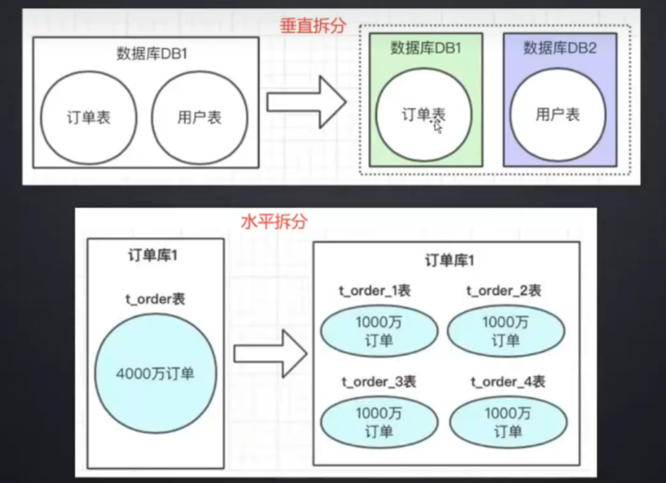
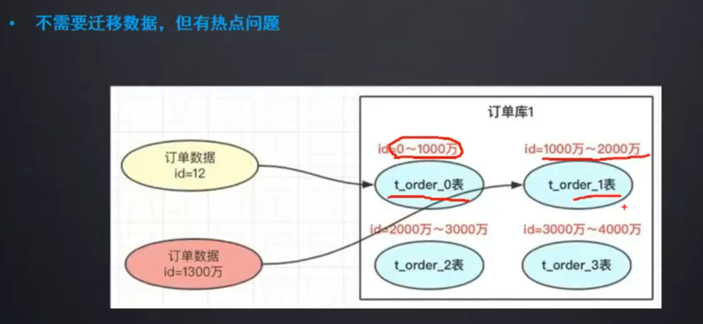
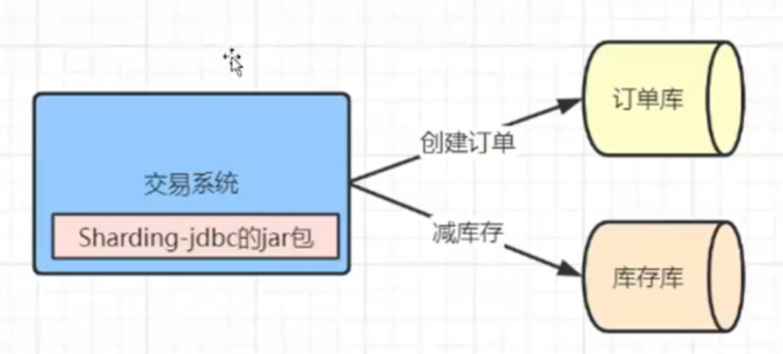
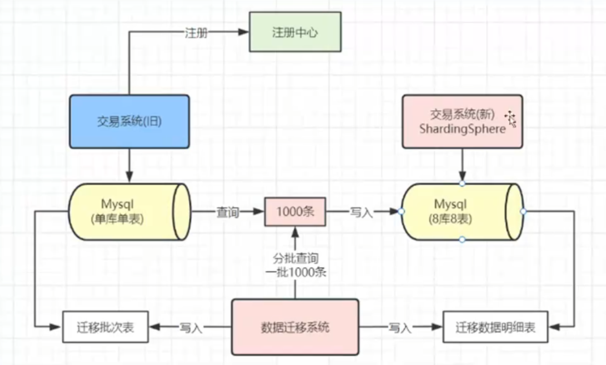
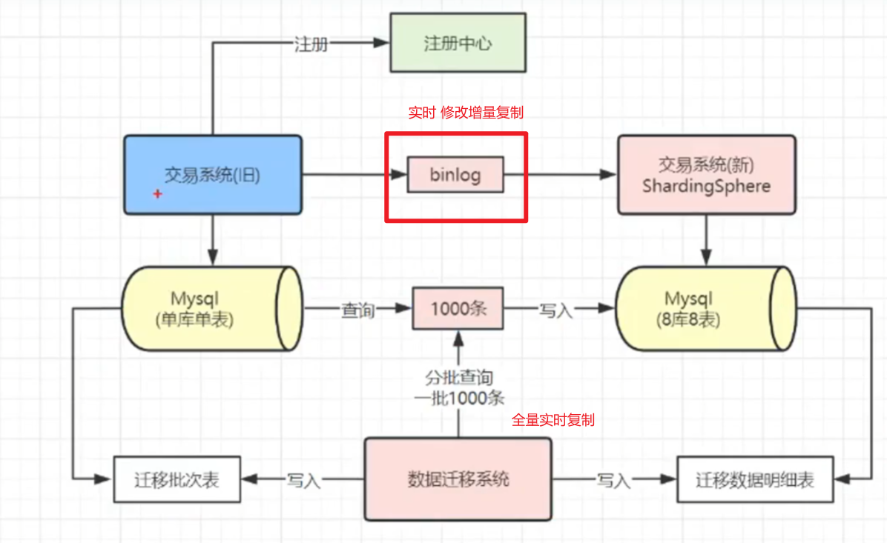
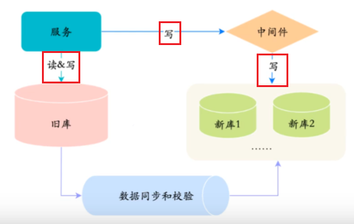
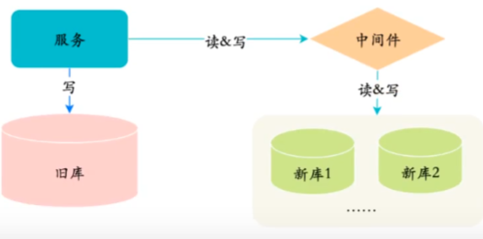

# SHARDINGSPHERE分库分表

# 什么是分库分表

**水平分库：⼀个数据库分成多个数据库，部署到不同机器。**

\*\*垂直分库： 是根据数据的不同属性将表拆分成多张表或多个数据库。这种方式可以减少单表的宽度（即列的数量），从而提高查询性能和写入性能，适用于单表列数较多、且列间访问频率差异较大的场景。  \*\*

***

**水平分表：⼀个数据库表分成多个表。分表后可能是在同⼀个数据库，也可能不是在同⼀个数据库。**

**垂直分表：是根据数据的不同属性将表拆分成多张表**

**总结：水平按照行切分，垂直按照列切分。**

***

## 为什么要分库

* **减小单库压力**：随着数据量和访问量的增加，单个数据库的查询、插入、更新和删除操作的性能会逐渐下降，**单个库连接数是有限的**。分库可以将数据和访问压力分散到多个数据库，提高整体系统的性能。
* **减少锁竞争**：在高并发环境下，单个数据库的锁竞争会影响性能。将数据分散到多个数据库可以减少锁竞争，提高并发处理能力。
* **水平扩展**：当数据量和访问量增加时，可以通过增加数据库节点的方式进行水平扩展，从而支持更大的数据量和更高的并发访问
* **隔离故障**：单个数据库的故障会导致整个系统的不可用。分库可以将不同的数据分布到不同的数据库中，某个数据库出现问题时，不会影响其他数据库的正常运行，提高系统的可用性和容灾能力。

## 为什么要分表

* **减少单表数据量**：当一张表的数据量过大时，查询性能会显著下降。分表可以将数据分散到多张表中，减少单表的数据量，从而提高查询性能。
* **优化索引使用**：数据量过大的表，其索引的大小也会相应增加，导致索引的维护和使用成本提高。分表可以优化索引的使用，提高查询效率。
* **分散写入压力**：大表的插入、更新和删除操作的性能会受到数据量的影响。分表可以将写入压力分散到多张表中，提高写入性能。
* **减少锁竞争**：单表的并发写操作容易导致锁竞争，影响性能。分表可以将并发操作分散到多张表中，减少锁竞争，提高并发处理能力。

## MYSQL默认连接数是多少

在MySQL 5.5、5.6和5.7版本中，这个默认最⼤连接数均为151，且上限可以达到100000。

# SHARDINGSPHERE分库分表

**高性能数据库集群的**`第一种方式是“读写分离”`，`第二种方式是“数据库分片”`。

一般来说垂直拆库，水平拆表。

# 分表

分库还是简单一点的，微服务本身就可以直接分库。分表需要一定的规则映射才能找到对应的表位置

## hash分表

直接用Id对表数目hash运算。

优点：映射速度快

缺点：阔表需要重新hash

## range分表

直接按照范围分表，但是会有热点偏向问题

## ShardingSphere分库分表

### 单库单表迁移到多库多表

上述过程会有几个问题：因为binlog增量是实时的，全量也是实时的，难免发生冲突和混乱；

插入语句，如果binlog监听到后先插入到分库分表，然后再插入到单裤，最后从单裤同步到分库，就有主键冲突问题。

update语句，假设binlog监听到，同时老的数据已经被数据迁移系统读取准备迁移，此时update先更新空数据，然后老数据传输到分库，最后更新了单库，就会造成单库是新数据而分库是老数据

# 分库分表不停机扩容

[美团太狠：100亿级分库分表，不停机迁移，如何处理？ - 技术自由圈 - 博客园](https://www.cnblogs.com/crazymakercircle/p/17531894.html#autoid-h3-7-5-0)

[MySQL 亿级数据平滑迁移实战 - vivo互联网技术 - 博客园](https://www.cnblogs.com/vivotech/p/18373623)

<https://zhuanlan.zhihu.com/p/410721716>

<https://jordanzheng.github.io/mysql-sharding/>

## 双写方案

第一阶段：在线双写，查询走老库

* 建立好新的库表结构，数据写入老库的同时，也写入拆分的新库
* 数据迁移，使用数据迁移程序，将旧库中的历史数据迁移到新库
* 使用定时任务，新旧库的数据对比，把差异补齐

第二阶段：在线双写，查询走新库

* 完成了历史数据的同步和校验
* 把对数据的读切换到新库

第三阶段：旧库下线

## 一致性hash

[一致性hash](https://www.yuque.com/nibiwanxiamei/yrd6t1/cdwhd0syi4tzc2pm)

# 实战分库分表

项目实战中：

根据userId进行分库分表，这样同一个用户的文章，评论，点赞信息都会在一个库内

‍

> 更新: 2025-11-17 18:57:11  
> 原文: <https://www.yuque.com/nibiwanxiamei/yrd6t1/9d9c82f73ee8a691516c3d3882c44754>