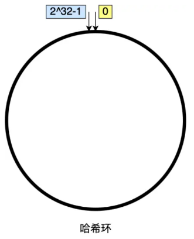
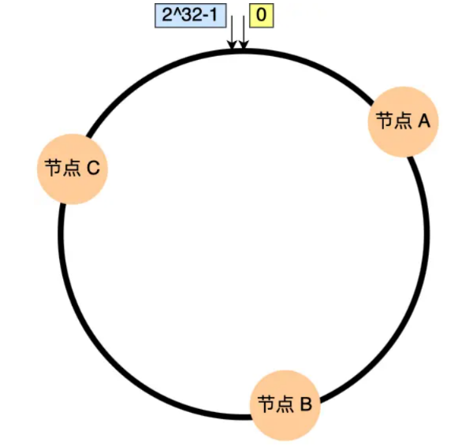
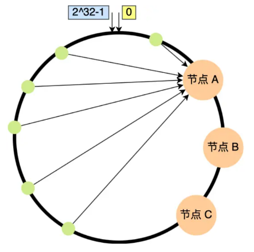
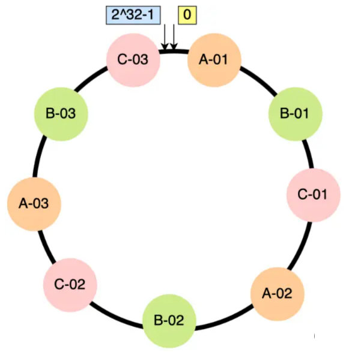

# 一致性hash

原文：

[9.4 什么是一致性哈希？](https://xiaolincoding.com/os/8_network_system/hash.html)

一致性哈希算法就很好地解决了分布式系统在扩容或者缩容时，发生过多的数据迁移的问题。

一致哈希算法也用了取模运算，但与哈希算法不同的是，哈希算法是对节点的数量进行取模运算，而**一致哈希算法是对 2^32 进行取模运算，是一个固定的值**。可以把一致哈希算法是对 2^32 进行取模运算的结果值组织成一个圆环 - hash环。

**一致性哈希是指将「存储节点」和「数据」都映射到一个首尾相连的哈希环上。顺时针的方向的找到第一个节点**，就是存储该数据的节点。

**在一致哈希算法中，如果增加或者移除一个节点，仅影响该节点在哈希环上顺时针相邻的后继节点，其它数据也不会受到影响**。但是**一致性哈希算法并不保证节点能够在哈希环上分布均匀**，这样就会带来一个问题，会有大量的请求集中在一个节点上。

要想解决节点能在哈希环上分配不均匀的问题，就要有大量的节点，节点数越多，哈希环上的节点分布的就越均匀。采用加入**虚拟节点**，也就是对一个真实节点做多个副本。引入虚拟节点后，原本哈希环上只有 3 个节点的情况，就会变成有 9 个虚拟节点映射到哈希环上，哈希环的节点数量多了 3 倍。

> 更新: 2024-08-07 09:40:59  
> 原文: <https://www.yuque.com/nibiwanxiamei/yrd6t1/cdwhd0syi4tzc2pm>