# onecoupon - Mq消息队列

***

# Mq消息队列

## AMQP 是什么?

**AMQP 协议的三层**：

* **Module Layer**:协议最高层，主要定义了一些客户端调用的命令，客户端可以用这些命令实现自己的业务逻辑。
* **Session Layer**:中间层，主要负责客户端命令发送给服务器，再将服务端应答返回客户端，提供可靠性同步机制和错误处理。
* **TransportLayer**:最底层，主要传输二进制数据流，提供帧的处理、信道服用、错误检测和数据表示等。

**AMQP 模型的三大组件**：

* **交换器 (Exchange)** ：消息代理服务器中用于把消息路由到队列的组件。
* **队列 (Queue)** ：用来存储消息的数据结构，位于硬盘或内存中。
* **绑定 (Binding)** ：一套规则，告知交换器消息应该将消息投递给哪个队列。

# RocketMq

**<font style="color:#DF2A3F;">异步、解耦、削峰、限流是消息队列的主要作用；在项目中，采用mq异步解耦和削峰；</font>**

## RocketMQ 是什么？

`RocketMQ` 是一个消息 **队列模型** 的中间件，具有**高性能、高可靠、高实时、分布式** 的特点。它采用 `Java` 语言开发的分布式的消息系统，由阿里巴巴团队开发，在 2016 年底贡献给 `Apache`，成为了 `Apache` 的一个顶级项目。

## 队列模型和主题模型(发布订阅)是什么？

就像我们理解队列一样，消息中间件的队列模型就真的只是一个队列。

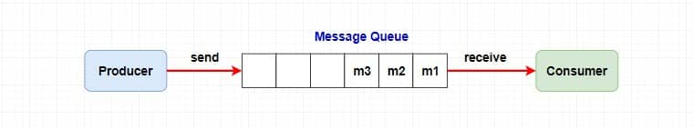

**主题模型** 或者可以称为 \*\*发布订阅模型。\*\*在主题模型中，消息的生产者称为 **发布者(Publisher)**  ，消息的消费者称为 **订阅者(Subscriber)**  ，存放消息的容器称为 **主题(Topic)**  。

发布者将消息发送到指定主题中，订阅者需要 **提前订阅主题** 才能接受特定主题的消息。

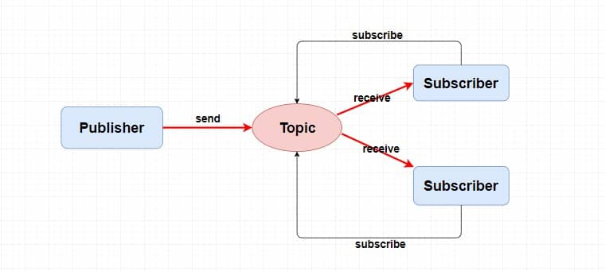

## RocketMQ 中的消息模型

`RocketMQ` 中的消息模型就是按照 **主题模型** 所实现的。对于主题模型的实现来说每个消息中间件的底层设计都是不一样的，就比如 `Kafka` 中的 **分区** ，`RocketMQ` 中的 **队列** ，`RabbitMQ` 中的 `Exchange` 。我们可以理解为 **主题模型/发布订阅模型** 就是一个标准，那些中间件只不过照着这个标准去实现而已。

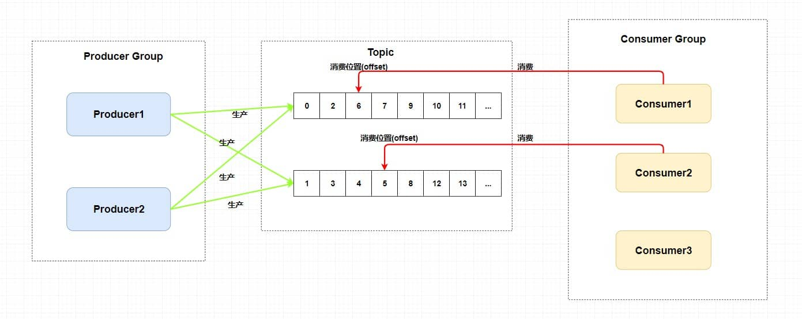

图中有 `Producer Group`、`Topic`、`Consumer Group` 三个角色

* `Producer Group` 生产者组：代表某一类的生产者，比如有多个秒杀系统作为生产者，这多个合在一起就是一个 `Producer Group` 生产者组，它们一般生产相同的消息。
* `Consumer Group` 消费者组：代表某一类的消费者，比如有多个短信系统作为消费者，这多个合在一起就是一个 `Consumer Group` 消费者组，它们一般消费相同的消息。
* `Topic` 主题：代表一类消息，比如订单消息，物流消息等等。

生产者组中的生产者会向主题发送消息，而 **主题中存在多个队列**，生产者每次生产消息之后是指定主题中的某个队列发送消息的。

每个主题中都有多个队列(分布在不同的 `Broker`中，如果是集群的话，`Broker`又分布在不同的服务器中)，集群消费模式下，一个消费者集群多台机器共同消费一个 `topic` 的多个队列，**一个队列只会被一个消费者消费**。如果某个消费者挂掉，分组内其它消费者会接替挂掉的消费者继续消费。就像上图中 `Consumer1` 和 `Consumer2` 分别对应着两个队列，而 `Consumer3` 是没有队列对应的，所以一般来讲要控制**消费者组中的消费者个数和主题中队列个数相同** 。

\*\*<font style="color:#DF2A3F;">每个消费组在每个队列上维护一个消费位置。</font>\*\*发布订阅模式中一般会涉及到多个消费者组，**而每个消费者组在每个队列中的消费位置都是不同的**。**如果此时有多个消费者组，那么消息被一个消费者组消费完之后是不会删除的，它仅仅是为每个消费者组维护一个 \*\*\*\*<font style="color:#DF2A3F;">消费位移(offset)</font>**<font style="color:#DF2A3F;"> </font> ，每次消费者组消费完会返回一个成功的响应，然后队列再把维护的消费位移加一，这样就不会出现刚刚消费过的消息再一次被消费了。

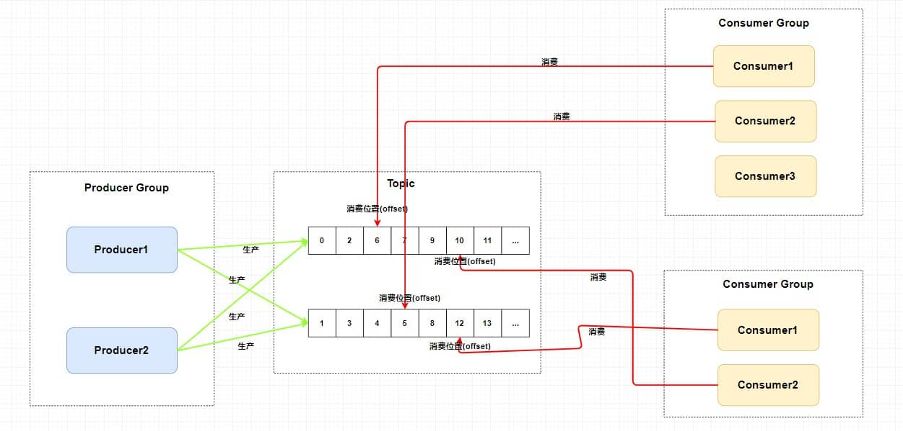

`RocketMQ` 通过**使用在一个** <code>**Topic**</code> **中配置多个队列并且每个队列维护每个消费者组的消费位置实现主题模式/发布订阅模式** 。

## RocketMQ 的架构图

[图解RocketMQ架构](https://mp.weixin.qq.com/s/muZd3xsKnFkfnEjBfOW2mA)

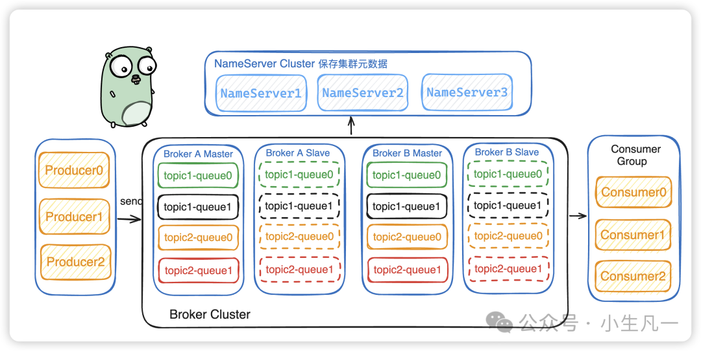

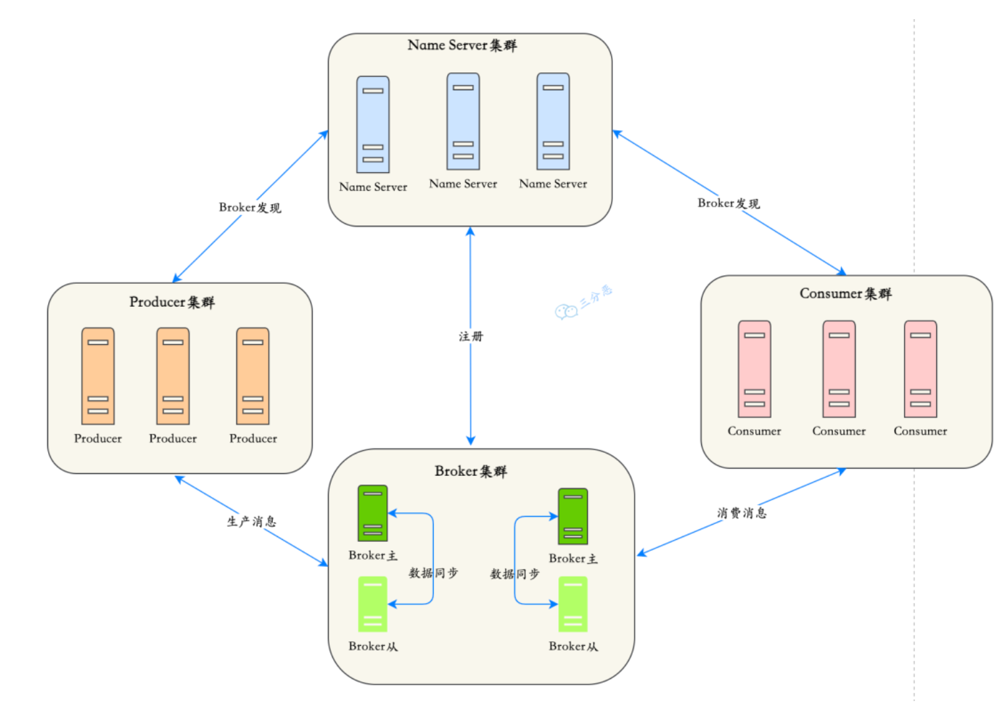

<code>**RocketMQ**</code>\*\* 技术架构中有四大角色 **<code>**NameServer**</code>** 、**<code>**Broker**</code>** 、**<code>**Producer**</code>** 、**<code>**Consumer**</code>** 。\*\*

### Broker

<font style="color:rgb(0, 0, 0);">Broker 启动，跟所有的 NameServer 保持长连接，每 30s 发送一次发送心跳包（像心跳一样持续稳定的发送请求）。心跳包中包含当前 Broker 信息 ( IP+ 端口等）以及存储所有 Topic 信息。</font><code><font style="color:rgb(30, 107, 184);">注册成功后，NameServer 集群中就有 Topic 跟 Broker 的映射关系。</font></code>

<code>**Broker**</code>**：主要负责消息的存储、投递和查询以及\*\*\*\*<font style="color:#DF2A3F;">服务高可用保证</font>**。说白了就是消息队列服务器，**生产者生产消息到** `Broker`  **，消费者从** `Broker` **拉取消息并消费**。

**<font style="color:#DF2A3F;">一个</font>**<font style="color:#DF2A3F;"> </font><code>**<font style="color:#DF2A3F;">Topic</font>**</code><font style="color:#DF2A3F;"> </font>**<font style="color:#DF2A3F;">分布在多个</font>**<font style="color:#DF2A3F;"> </font><code>**<font style="color:#DF2A3F;">Broker</font>**</code>**<font style="color:#DF2A3F;">上，一个</font>**<font style="color:#DF2A3F;"> </font><code>**<font style="color:#DF2A3F;">Broker</font>**</code><font style="color:#DF2A3F;"> </font>**<font style="color:#DF2A3F;">可以配置多个</font>**<font style="color:#DF2A3F;"> </font><code>**<font style="color:#DF2A3F;">Topic</font>**</code><font style="color:#DF2A3F;">  </font>**<font style="color:#DF2A3F;">，它们是多对多的关系</font>**<font style="color:#DF2A3F;">。</font>

<font style="color:rgb(30, 107, 184);">如果某个 </font><code><font style="color:rgb(30, 107, 184);">Topic</font></code><font style="color:rgb(30, 107, 184);"> 消息量很大，应该给它多配置几个队列(上文中提到了提高并发能力)，并且 </font>**尽量多分布在不同**<font style="color:rgb(30, 107, 184);"> </font><code>**Broker**</code><font style="color:rgb(30, 107, 184);"> </font>**上，以减轻某个**<font style="color:rgb(30, 107, 184);"> </font><code>**Broker**</code><font style="color:rgb(30, 107, 184);"> </font>**的压力**<font style="color:rgb(30, 107, 184);"> 。</font>

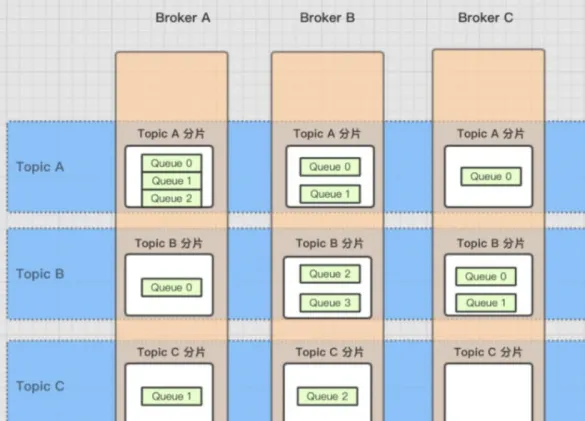

### <font style="color:rgb(0, 0, 0);">Broker 是如何存储消息的</font>

<font style="color:rgb(0, 0, 0);">Broker接受消息，会顺序写入消息到 CommitLog 中。Broker里面的两个存储介质：</font>**<font style="color:rgb(0, 0, 0);">Commit log 和 Message queue：</font>**

1. <font style="color:rgb(1, 1, 1);">Commit log 存储消息实体。顺序写，随机读。虽然是随机读，但是利用package机制，可以批量地从磁盘读取，作为cache存到内存中，加速后续的读取速度。</font>
2. <font style="color:rgb(1, 1, 1);">Message queue 存储消息的</font><code><font style="color:rgb(30, 107, 184);">偏移量</font></code><font style="color:rgb(1, 1, 1);">。读消息先读 message queue，根据偏移量到 commit log 读消息本身。</font>

<font style="color:rgb(0, 0, 0);">所以其实我们的消息不是存放在queue中，而是存放在commit log中，这就是为什么queue会被称为</font><code><font style="color:rgb(30, 107, 184);">逻辑队列</font></code>

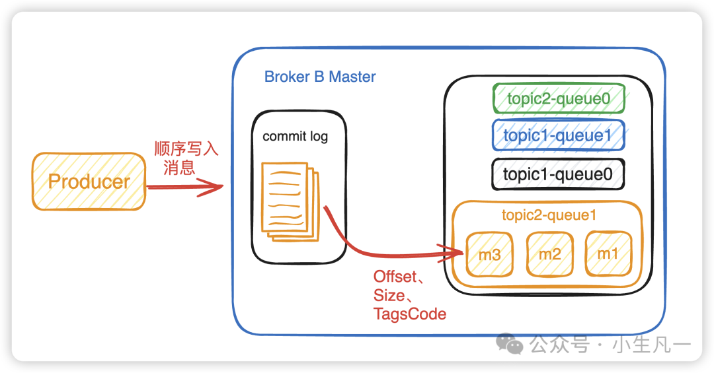

<font style="color:rgb(0, 0, 0);">所有的消息都存在CommitLog中，如果要实现</font>**<font style="color:rgb(0, 0, 0);">根据 key 查询消息</font>**<font style="color:rgb(0, 0, 0);">的方法，就会变得非常困难，所以为了解决这种业务需求，有了</font>IndexFile<font style="color:rgb(0, 0, 0);">的存在。用于为生成的索引文件提供访问服务，通过消息 Key 值查询消息真正的实体内容。</font>

**<font style="color:rgb(0, 0, 0);">IndexFile 如何创建？以创建的时间戳命名。参数：phyOffset物理偏移量（也就是commitLogOffset）、keys。</font>**

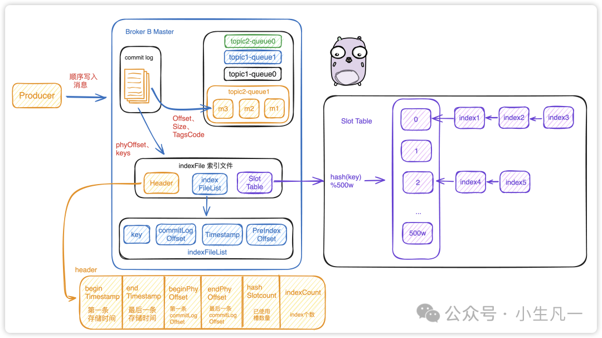

##### <font style="color:rgb(0, 0, 0);">Broker查询消息</font>

按照MessageId直接去CommitLog中查询消息

<font style="color:rgb(0, 0, 0);">RocketMQ中的MessageId的长度总共有16字节，其中包含了消息存储</font>主机地址<font style="color:rgb(0, 0, 0);">（IP地址和端口），消息Commit Log offset。</font>

1. <font style="color:rgb(1, 1, 1);">Client 端从 MessageId 中解析出 Broker 的地址（IP地址和端口）和Commit Log的偏移地址发送一个</font>RPC<font style="color:rgb(1, 1, 1);">请求。</font>
2. <font style="color:rgb(1, 1, 1);">Broker 端读取消息的过程用其中的 commitLog offset 和 size 去 commitLog 中找到真正的记录并解析成一个完整的消息返回。</font>

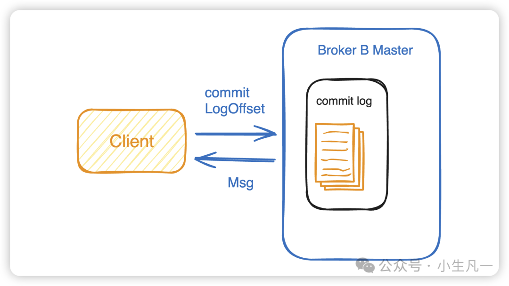

<font style="color:rgb(0, 0, 0);">按照Message Key 查询</font>

<font style="color:rgb(0, 0, 0);"></font>

1. <font style="color:rgb(1, 1, 1);">找槽位：slotKey =</font><font style="color:rgb(1, 1, 1);"> </font><code><font style="color:rgb(30, 107, 184);">40 byte + hash(topic + "#" + key) % 500W * 4byte</font></code><font style="color:rgb(1, 1, 1);">。</font>
2. <font style="color:rgb(1, 1, 1);">计算槽位：slotValue = 最新插入 index 的位置。</font>
3. <font style="color:rgb(1, 1, 1);">遍历单向链表：从 slotValue 找到最新 index 在整个索引文件中位置 =</font><font style="color:rgb(1, 1, 1);"> </font><code><font style="color:rgb(30, 107, 184);">40byte +500w*4byte + slotValue*20byte</font></code><font style="color:rgb(1, 1, 1);">，然后根据单个索引文件的 pre index 值找到前一个索引，一直遍历下去，</font><code><font style="color:rgb(30, 107, 184);">直到index数据中key hash和时间区间都满足即可</font></code><font style="color:rgb(1, 1, 1);">。添加到 commitLogOffset 的 list) 中。</font>
4. <font style="color:rgb(1, 1, 1);">最终根据其中的 </font><code><font style="color:rgb(30, 107, 184);">commitLogOffset</font></code><font style="color:rgb(1, 1, 1);"> 从 CommitLog 文件中读取消息的实体内容。</font>

<font style="color:rgb(0, 0, 0);"></font>

<font style="color:rgb(0, 0, 0);"></font>

### NameServer，Producer，Consumer

* `NameServer`：**Broker 管理** 和 **路由信息管理** 。`Broker` 会将自己的信息注册到 `NameServer` 中，此时 `NameServer` 就存放了很多 `Broker` 的信息(Broker 的路由表)，消费者和生产者就从 `NameServer` 中获取路由表然后照着路由表的信息和对应的 `Broker` 进行通信(**生产者和消费者定期会向** `NameServer` **去查询相关的** `Broker ` **的信息**)。 -- **类似于nacos注册中心，rabbitmq的exchange交换机，kafka使用的zookeeper。**
* 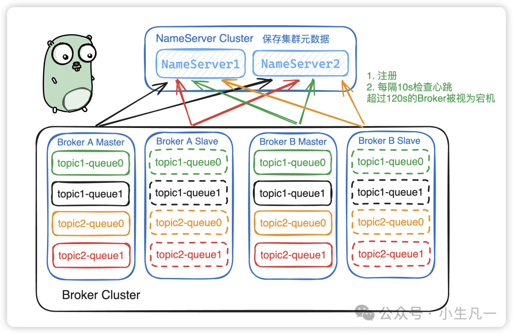
* `Producer`：消息发布的角色，支持分布式集群方式部署。
* `Consumer`：消息消费的角色，支持分布式集群方式部署。支持以 **push 推，pull 拉**两种模式对消息进行消费。同时也支持集群方式和广播方式的消费，它提供实时消息订阅机制。

### producer消息发送方式

1. **同步发送：要注意处理响应结果和异常。返回响应OK，成功发送到了Broker，响应失败，或者发生其它异常，都应该重试。**
2. **异步发送：应该&#x5728;****回调方法****&#xF9E9;检查，如果发送失败或者异常，都应该进行重试。**
3. **单向发送：不建议使用，单项发送不会有返回和回调**

***

### consumer是怎么消费消息的

:::success
**<font style="color:rgb(36, 41, 47);background-color:rgb(244, 246, 248);">在 RocketMQ 的消息消费模型中，消费者会向消息服务器（Broker）发送拉取消息的请求。当消费者发起拉取请求时，Broker 不会立即返回，而是会在一定时间内等待，直到有新消息到达或者等待时间到达为止。这种机制叫做长轮询。通过长轮询，消费者能够更及时地获取到新消息，避免了频繁的轮询请求，从而减少了网络流量和系统负载。</font>**

:::

<font style="color:rgb(149, 111, 231);">消费者从Broker中获取消息的方式</font><font style="color:rgb(77, 77, 77);">有两种：</font>

* <font style="color:rgb(51, 51, 51);">pull拉取方式：</font><font style="color:rgb(254, 44, 36);">Consumer主动从Broker中拉取消息。</font><font style="color:rgb(77, 77, 77);">获取了批量消息，就会启动消费过程。不过，该方式的</font><font style="color:rgb(149, 111, 231);">实时性较弱</font><font style="color:rgb(77, 77, 77);">，即Broker中有了新的消息时消费者并不能及时发现并消费。</font>
* <font style="color:rgb(51, 51, 51);">push推送方式：</font><font style="color:rgb(254, 44, 36);">Broker收到数据后会主动推送给Consumer。</font><font style="color:rgb(77, 77, 77);">该获取方式是典型的</font><font style="color:rgb(149, 111, 231);">发布-订阅模式</font><font style="color:rgb(77, 77, 77);">，即Consumer向其关联的Queue注册了</font>[监听器](https://so.csdn.net/so/search?q=%E7%9B%91%E5%90%AC%E5%99%A8\&spm=1001.2101.3001.7020)<font style="color:rgb(77, 77, 77);">，一旦发现有新的消息到来就会触发回调的执行，回调方法是Consumer取Queue拉取消息。</font>

:::success
**<font style="color:#DF2A3F;background-color:rgb(238, 240, 244);">而这些都是基于Consumer与Broker间的</font>****<font style="color:#DF2A3F;">长连接</font>****<font style="color:#DF2A3F;background-color:rgb(238, 240, 244);">。长连接的维护是需要消耗系统资源的。</font>**

:::

<font style="color:rgb(149, 111, 231);"></font>

<font style="color:rgb(149, 111, 231);">消费者组对于消息消费的模式</font><font style="color:rgb(77, 77, 77);">又分为两种：</font>

* <font style="color:rgb(51, 51, 51);">集群消费Clustering：</font><font style="color:rgb(77, 77, 77);"></font><font style="color:rgb(149, 111, 231);">相同Consumer Group的每个Consumer实例</font>**<font style="color:rgb(254, 44, 36);">平均分摊</font>**<font style="color:rgb(149, 111, 231);">到同一个Topic的消息。即每条消息只会被发送到Consumer Group 中的</font>**<font style="color:rgb(254, 44, 36);">某个Consumer</font>**

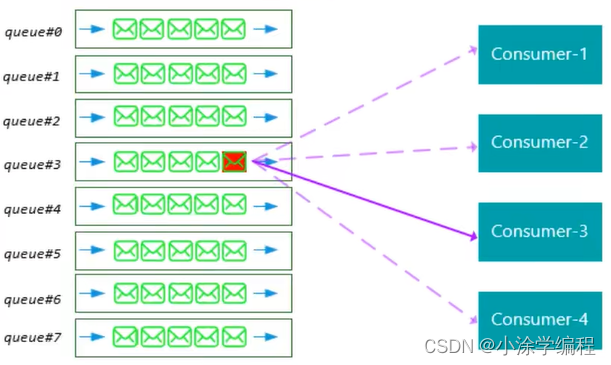

* <font style="color:rgb(51, 51, 51);">广播消费Broadcasting：</font><font style="color:rgb(149, 111, 231);">相同Consumer Group的每个Consumer实例都接受同一个Topic的全量消息。一条消息会发给所有订阅了对应主题的消费者，不管消费者是不是同一个消费者组。</font>

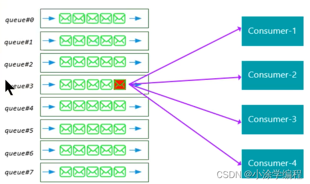

* **<font style="color:rgb(51, 51, 51);">广播模式：消费进度保存在consumer端。</font>**<font style="color:rgb(51, 51, 51);">因为广播模式下consumer group中每个consumer都会消费所有的消息，但他们的消费进度是不同。所以consumer各自保存各自的消费进度。</font>
* **<font style="color:rgb(51, 51, 51);">集群模式：消费进度保存在broker中。</font>**<font style="color:rgb(51, 51, 51);">consumer group中的所有consumer共同消费同一个Topic中的消息，同一条消息只能被消费一次，消费进度会参与到了消费的负载均衡中，故消费进度是需要共享的。</font>

## 整体概述

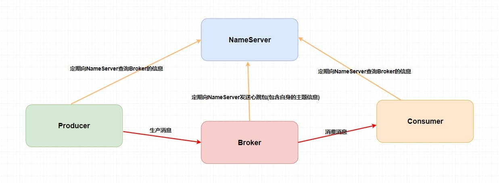

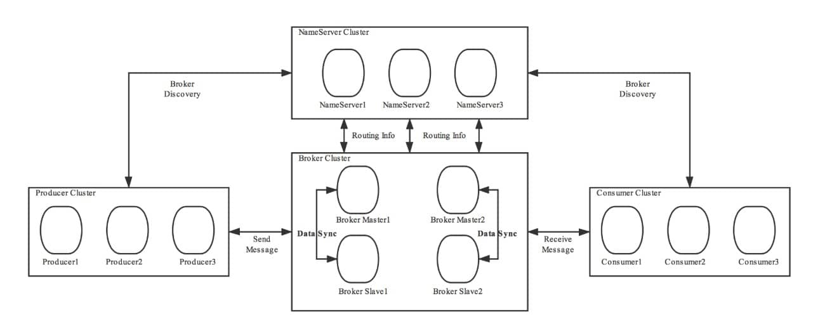

**第一、我们的 **<code>**Broker**</code>** ****<font style="color:#DF2A3F;">做了集群并且还进行了主从部署 </font>****，由于消息分布在各个 **<code>**Broker**</code>** 上，一旦某个 **<code>**Broker**</code>** 宕机，则该**<code>**Broker**</code>\*\* 上的消息读写都会受到影响。所以 **<code>**Rocketmq**</code>** 提供了 **<code>**master/slave**</code>** 的结构，**<code>**salve**</code>** 定时从 **<code>**master**</code>** 同步数据(****<font style="color:#DF2A3F;">同步刷盘或者异步刷盘</font>****)，如果 **<code>**master**</code>** 宕机，则 **<code>**slave**</code>** 提供消费服务，但是不能写入消息 。\*\*

第二、为了保证 `HA` ，我们的 `NameServer` 也做了集群部署，但是请注意它是 **<font style="color:#DF2A3F;">去中心化</font>** 的。也就意味着它没有主节点，你可以很明显地看出 `NameServer` 的所有节点是没有进行 `Info Replicate` 的，在 `RocketMQ` 中是通过 **<font style="color:#DF2A3F;">单个 Broker 和所有 NameServer 保持长连接</font>**<font style="color:#DF2A3F;"> </font>，**<font style="color:#DF2A3F;">并且在每隔 30 秒 </font>**<code>**<font style="color:#DF2A3F;">Broker</font>**</code>**<font style="color:#DF2A3F;"> 会向所有 </font>**<code>**<font style="color:#DF2A3F;">Nameserver</font>**</code>**<font style="color:#DF2A3F;"> 发送心跳，心跳包含了自身的 </font>**<code>**<font style="color:#DF2A3F;">Topic</font>**</code>**<font style="color:#DF2A3F;"> 配置信息，这个步骤就对应这上面的 </font>**<code>**<font style="color:#DF2A3F;">Routing Info</font>**</code>**<font style="color:#DF2A3F;"> 。</font>**

第三、在生产者需要向 `Broker` 发送消息的时候，**需要先从** <code>**NameServer**</code> **获取关于** <code>**Broker**</code> **的路由信息**，然后通过 **轮询** 的方法去向每个队列中生产数据以达到 **负载均衡** 的效果。

第四、消费者通过 `NameServer` 获取所有 `Broker` 的路由信息后，向 `Broker` 发送 `Pull` 请求来获取消息数据。`Consumer` 可以以两种模式启动—— **广播（Broadcast）和集群（Cluster）** 。广播模式下，一条消息会发送给 **同一个消费组中的所有消费者** ，集群模式下消息只会发送给一个消费者。

### 基本读写流程

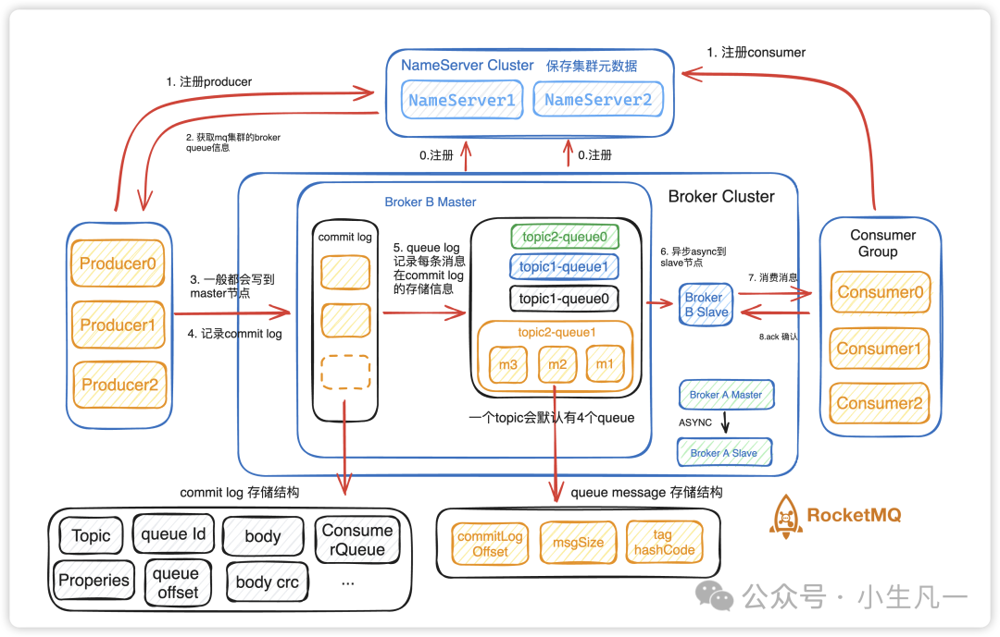

1. <font style="color:rgb(1, 1, 1);">注册 Broker Cluster 到 NameServer。</font>
2. <font style="color:rgb(1, 1, 1);">注册 Producer、Consumer 到 NameServer。</font>
3. <font style="color:rgb(1, 1, 1);">Producer 获取MQ集群的Broker、Queue等信息。</font>
4. <font style="color:rgb(1, 1, 1);">Producer 发消息，一般消息都会选择master进行写入，而slave进行读取。</font>
5. <font style="color:rgb(1, 1, 1);">顺序写入消息到 commit log 中。</font>
6. <font style="color:rgb(1, 1, 1);">queue log会记录每条commit log的存储信息，当然不会记录所有，只记录一些重要的，commitLogOffset等等。</font>
7. <font style="color:rgb(1, 1, 1);">master 将消息异步给slave。</font>
8. <font style="color:rgb(1, 1, 1);">Consumer读取slave的消息。</font>
9. <font style="color:rgb(1, 1, 1);">Consumer返回ACK作为确认消息消费成功。</font>

## 消费者分组和生产者分组

### 生产者分组

RocketMQ 服务端 5.x 版本开始，**生产者是匿名的**，无需管理生产者分组（ProducerGroup）

### 消费者分组

**<font style="color:#DF2A3F;">消费者分组是多个消费行为一致的消费者的负载均衡分组</font>\*\*\*\*。** 消费者分组不是具体实体而是一个逻辑资源。通过消费者分组实现消费性能的水平扩展以及高可用容灾。

消费者分组中的订阅关系、投递顺序性、消费重试策略是一致的。

* 订阅关系：Apache RocketMQ 以消费者分组的粒度管理订阅关系，实现订阅关系的管理和追溯。
* 投递顺序性：Apache RocketMQ 的服务端将消息投递给消费者消费时，支持顺序投递和并发投递，投递方式在消费者分组中统一配置。
* 消费重试策略： 消费者消费消息失败时的重试策略，包括重试次数、死信队列设置等。

RocketMQ 服务端 5.x 版本：上述消费者的消费行为从关联的消费者分组中统一获取，因此，同一分组内所有消费者的消费行为必然是一致的，客户端无需关注。

RocketMQ 服务端 3.x/4.x 历史版本：上述消费逻辑由消费者客户端接口定义，因此，您需要自己在消费者客户端设置时保证同一分组下的消费者的消费行为一致。(来自官方网站)

## 如何解决顺序消费和重复消费？

### 顺序消费

**<font style="color:#DF2A3F;">默认topic有16个队列，单个队列是有序的。</font>**<code>**<font style="color:#DF2A3F;">RocketMQ</font>**</code><font style="color:#DF2A3F;"> </font>**<font style="color:#DF2A3F;">在主题上是无序的、它只有在队列层面才是保证有序</font>**<font style="color:#DF2A3F;"> 。</font>**<font style="color:#DF2A3F;">普通顺序</font>**<font style="color:#DF2A3F;"> 和 </font>**<font style="color:#DF2A3F;">严格顺序</font>**<font style="color:#DF2A3F;"> 。</font>

* 普通顺序是指消费者通过 **同一个消费队列收到的消息是有顺序的** ，不同消息队列收到的消息则可能是无顺序的。普通顺序消息在 `Broker` **重启情况下不会保证消息顺序性** (短暂时间) 。
* 严格顺序是指 消费者收到的 **所有消息** 均是有顺序的。严格顺序消息 **即使在异常情况下也会保证消息的顺序性** 。如果你使用严格顺序模式，`Broker` 集群中只要有一台机器不可用，则整个集群都不可用。

**一般而言，**`MQ` **都是能容忍短暂的乱序，所以推荐使用普通顺序模式。**

**普通顺序模式** ，`Producer` 生产消息的时候会进行轮询(取决你的负载均衡策略)来向同一主题的不同消息队列发送消息。那么如果此时我有几个消息分别是同一个订单的创建、支付、发货，**在轮询的策略下这** **三个消息会被发送到不同队列** ，因为在不同的队列此时就无法使用 `RocketMQ` 带来的队列有序特性来保证消息有序性了。

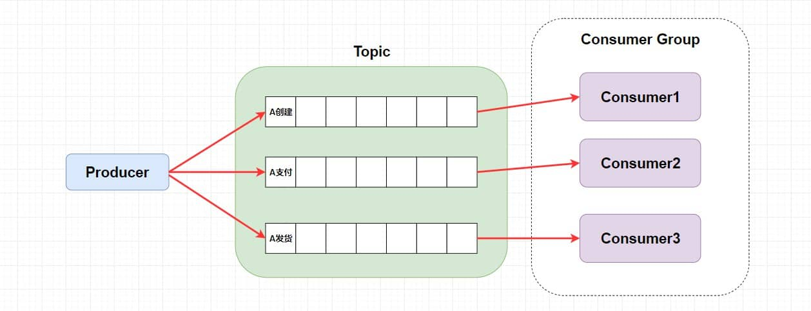

需要处理的仅仅是\*\*<font style="color:#DF2A3F;">将同一语义下的消息放入同一个队列</font>\*\*(比如这里是同一个订单)，那我们就可以使用 **Hash 取模法** 来保证同一个订单在同一个队列中就行了。

RocketMQ 实现了两种队列选择算法，也可以自己实现

* 轮询算法
  * 轮询算法就是向消息指定的 topic 所在队列中依次发送消息，保证消息均匀分布
  * 是 RocketMQ 默认队列选择算法
* 最小投递延迟算法
  * 每次消息投递的时候统计消息投递的延迟，**选择队列时优先选择消息延时小的队列**，导致消息分布不均匀 -- producer.setSendLatencyFaultEnable(true);

### 重复消费

**幂等 。在编程中一个*****幂等***  **操作的特点是其**\*\*<font style="color:#DF2A3F;">任意多次执行所产生的影响均与一次执行的影响相同。</font>\*\*

\*\*<font style="color:#DF2A3F;">为什么会重复消费</font>\*\*\*\*：业务上没有去重；消息队列必须保证消息被消费一次（网络波动, Broker 意外重启）导致没有收到ack确认，就会重发导致重复消费。 - \*\***<font style="color:#DF2A3F;background-color:#FBDE28;">类似TCP重传机制</font>**

***

比如说，有一个订单的处理积分的系统，每当来一个消息的时候它就负责为创建这个订单的用户的积分加上相应的数值。可是有一次，消息队列发送给订单系统 FrancisQ 的订单信息，其要求是给 FrancisQ 的积分加上 500。但是积分系统在收到 FrancisQ 的订单信息处理完成之后**返回给消息队列处理成功的信息的时候出现了网络波动(当然还有很多种情况，比如 Broker 意外重启等等)，这条回应没有发送成功。**

那么，消息队列没收到积分系统的回应会不会尝试重发这个消息？问题就来了，我再发这个消息，万一它又给 FrancisQ 的账户加上 500 积分怎么办呢？所以我们需要给我们的消费者实现 **幂等** ，也就是对同一个消息的处理结果，执行多少次都不变。那么如何给业务实现幂等呢？这个还是需要结合具体的业务的。

* 可以使用 **<font style="color:#DF2A3F;">写入</font>**<font style="color:#DF2A3F;"> </font><code>**<font style="color:#DF2A3F;">Redis</font>**</code><font style="color:#DF2A3F;"> </font>来保证，因为 `Redis` 的 `key` 和 `value` 就是天然支持幂等的。
* 当然还有使用 **<font style="color:#DF2A3F;">数据库插入法</font>** ，基于数据库的唯一键来保证重复数据不会被插入多条。
* 请求唯一token保证幂等性（请求先请求一个唯一的token，写入redis；之后请求带上token，redis存在就删除请求成功，不存在就说明重复）

### 优雅实现防重复提交 + 防重复消费（AOP + Redis）

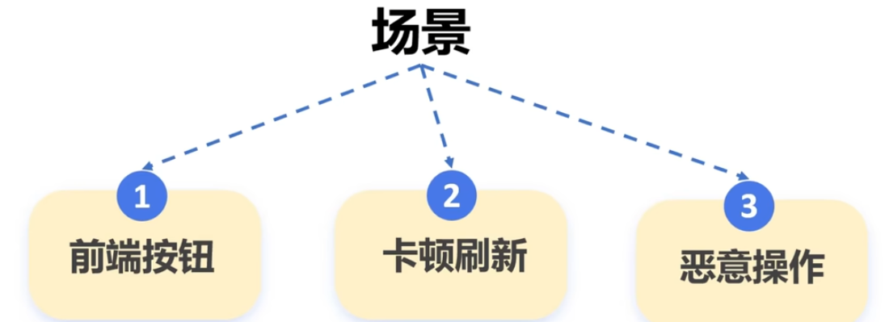

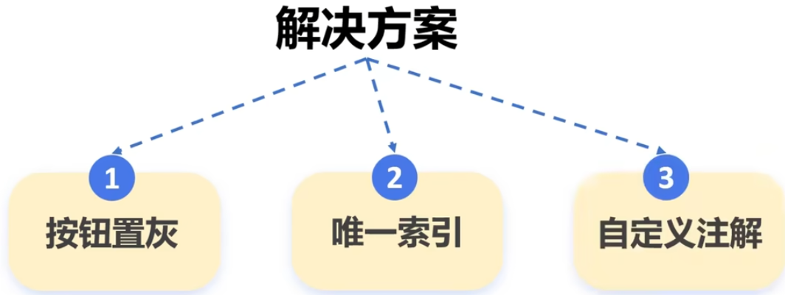

#### 防止重复提交AOP实现

```java
public @interface NoRepeatSubmit {
    /**
     * 触发幂等失败逻辑时，返回的错误提示信息
     */
    String message() default "您操作太快，请稍后再试";
}
```

```java
@Aspect
@RequiredArgsConstructor
public final class NoRepeatSubmitAspect {

    private final RedissonClient redissonClient;

    /**
     * 增强方法标记 {@link NoRepeatSubmit} 注解逻辑
     */
    @Around("@annotation(com.jcy.onecoupon.framework.idempotent.NoRepeatSubmit)")
    public Object noRepeatSubmit(ProceedingJoinPoint joinPoint) throws Throwable {
        NoRepeatSubmit noRepeatSubmit = getNoRepeatSubmitAnnotation(joinPoint);
        // 获取分布式锁标识
        String lockKey = String.format("no-repeat-submit:path:%s:currentUserId:%s:md5:%s", getServletPath(), getCurrentUserId(), calcArgsMD5(joinPoint));
        RLock lock = redissonClient.getLock(lockKey);
        // 尝试获取锁，获取锁失败就意味着已经重复提交，直接抛出异常
        if (!lock.tryLock()) {
            throw new ClientException(noRepeatSubmit.message());
        }
        Object result;
        try {
            // 执行标记了防重复提交注解的方法原逻辑
            result = joinPoint.proceed();
        } finally {
            lock.unlock();
        }
        return result;
    }

    /**
     * @return 返回自定义防重复提交注解
     */
    public static NoRepeatSubmit getNoRepeatSubmitAnnotation(ProceedingJoinPoint joinPoint) throws NoSuchMethodException {
        MethodSignature methodSignature = (MethodSignature) joinPoint.getSignature();
        Method targetMethod = joinPoint.getTarget().getClass().getDeclaredMethod(methodSignature.getName(), methodSignature.getMethod().getParameterTypes());
        return targetMethod.getAnnotation(NoRepeatSubmit.class);
    }

    /**
     * @return 获取当前线程上下文 ServletPath
     */
    private String getServletPath() {
        ServletRequestAttributes sra = (ServletRequestAttributes) RequestContextHolder.getRequestAttributes();
        return sra.getRequest().getServletPath();
    }

    /**
     * @return 当前操作用户 ID
     */
    private String getCurrentUserId() {
        // 用户属于非核心功能，这里先通过模拟的形式代替。后续如果需要后管展示，会重构该代码
        return "1810518709471555585";
    }

    /**
     * @return joinPoint md5
     */
    private String calcArgsMD5(ProceedingJoinPoint joinPoint) {
        return DigestUtil.md5Hex(JSON.toJSONBytes(joinPoint.getArgs()));
    }
}
```

```java
    @Operation(summary = "商家创建优惠券推送任务")
    @NoRepeatSubmit(message = "请勿短时间内重复提交优惠券推送任务")
    @PostMapping("/api/merchant-admin/coupon-task/create")
    public Result<Void> createCouponTask(@RequestBody CouponTaskCreateReqDTO requestParam) {
        couponTaskService.createCouponTask(requestParam);
        return Results.success();
    }
```

#### 防止重复消费AOP实现

```java
@Target({ElementType.TYPE, ElementType.METHOD})
@Retention(RetentionPolicy.RUNTIME)
@Documented
public @interface NoMQRepeatConsume {

    /**
     * 通过 SpEL 表达式生成的唯一 Key
     */
    String key();

    /**
     * 设置防重令牌 Key 过期时间，单位秒，默认 1 小时
     */
    long keyTimeout() default 3600L;
}
```

```java
@Aspect
@RequiredArgsConstructor
public final class NoMQRepeatConsumeAspect {

    private final StringRedisTemplate stringRedisTemplate;

    /**
     * 增强方法标记 {@link NoMQRepeatConsume} 注解逻辑
     */
    @Around("@annotation(com.jcy.onecoupon.framework.idempotent.NoMQRepeatConsume)")
    public Object noMQRepeatConsume(ProceedingJoinPoint joinPoint) throws Throwable {
        NoMQRepeatConsume noMQRepeatConsume = getNoMQRepeatConsumeAnnotation(joinPoint);
        String uniqueKey = (String) SpELUtil.parseKey(noMQRepeatConsume.key(), ((MethodSignature) joinPoint.getSignature()).getMethod(), joinPoint.getArgs());
        Boolean setIfAbsent = stringRedisTemplate.opsForValue()
                .setIfAbsent(uniqueKey, StrUtil.EMPTY, noMQRepeatConsume.keyTimeout(), TimeUnit.SECONDS);
        // 设置失败意味着已经有这个 Key，我们直接返回空即可
        if (!setIfAbsent) {
            return null;
        }
        Object result;
        try {
            // 执行标记了消息队列防重复消费注解的方法原逻辑
            result = joinPoint.proceed();
        } catch (Throwable ex) {
            // 删除幂等 Key，让消息队列消费者重试逻辑进行重新消费
            stringRedisTemplate.delete(uniqueKey);
            throw ex;
        }
        return result;
    }

    /**
     * @return 返回自定义防重复消费注解
     */
    public static NoMQRepeatConsume getNoMQRepeatConsumeAnnotation(ProceedingJoinPoint joinPoint) throws NoSuchMethodException {
        MethodSignature methodSignature = (MethodSignature) joinPoint.getSignature();
        Method targetMethod = joinPoint.getTarget().getClass().getDeclaredMethod(methodSignature.getName(), methodSignature.getMethod().getParameterTypes());
        return targetMethod.getAnnotation(NoMQRepeatConsume.class);
    }
}
```

# 面试题

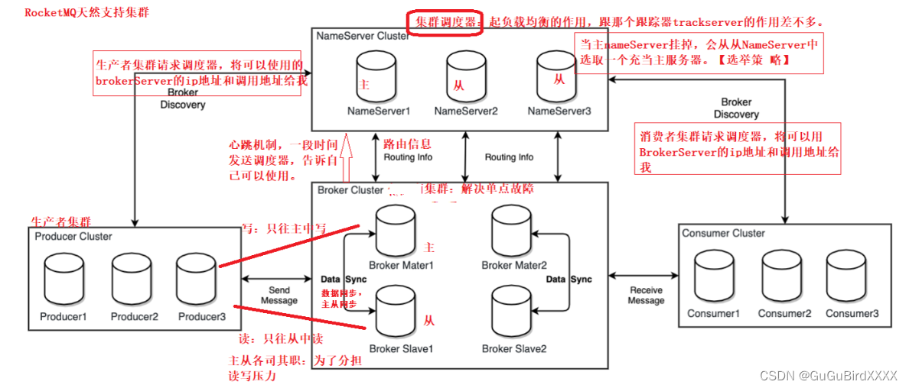

## <font style="color:rgb(28, 30, 33);background-color:rgb(250, 250, 250);">RocketMQ4 和 5的区别</font>

架构区别

* **<font style="color:rgb(5, 7, 59);background-color:rgb(253, 253, 254);">RocketMQ 4</font>**<font style="color:rgb(5, 7, 59);background-color:rgb(253, 253, 254);">：采用基于主从的架构，其中有一个Master节点和多个Slave节点。Master节点负责消息的写入和转发，而Slave节点则负责消息的存储和消费者的拉取。这种架构方案在保证高可用性的同时，也限制了系统的扩展性和容错性。</font>
* **<font style="color:rgb(5, 7, 59);background-color:rgb(253, 253, 254);">RocketMQ 5</font>**<font style="color:rgb(5, 7, 59);background-color:rgb(253, 253, 254);">：采用了更加先进的架构，包括多个Broker节点和一个NameServer节点。每个Broker节点都是独立的，负责消息的存储、转发和消费者的拉取。这种架构使得系统具有更高的扩展性和容错性。</font>

<font style="color:rgb(5, 7, 59);background-color:rgb(253, 253, 254);">事务消息支持</font>

* <font style="color:rgb(23, 35, 63);">RocketMQ5对事务消息进行了改进，引入了两阶段提交协议，以确保事务消息的可靠性。</font>
* <font style="color:rgb(23, 35, 63);">RocketMQ4中，事务消息的可靠性通过业务方的回查机制来实现，而在RocketMQ5中，事务消息的提交和回滚由RocketMQ内部自动完成。</font>

## RocketMQ对比kafka和RabbitMQ有什么优势

**适用于大规模数据处理和高吞吐量的场景**

* **分布式事务**：RocketMQ支持分布式事务消息，适用于涉及多个业务系统的分布式事务场景，确保消息的一致性和可靠性，同时提供高吞吐量的消息传递能力。
* **延迟队列支持**：RocketMQ延迟队列支持很好，5.0版本延迟队列得到优化，性能和吞吐量都增加。
* **性能强大可靠**：RocketMQ吞吐量高，阿里认证
* **java开发**：方便二次开发

## RocketMQ为什么这么快？

:::color4

* \*\*存储机制方面：****<font style="color:#DF2A3F;">顺序写磁盘</font>****（commitlog - 类似redo log）+ \*\*\*\*<font style="color:#DF2A3F;">零拷贝</font>\*\***网络传输**
* **异步刷盘策略：先写入内存缓冲区，后续再异步刷盘增加吞吐量**
* **多队列多消费：并发处理大量消息**
* \*\*网络IO通信：异步网络IO + \*\***<font style="color:#DF2A3F;">IO多路复用</font>**
* **缓存机制：类比mysql也有缓存机制 + 预读**
* **高并发设计：多主多从，主从**\*\*<font style="color:#DF2A3F;">同步复制 + 异步刷盘</font>\*\*\*\*，保证高可用 + 高性能\*\*

:::

1. 高效的存储机制
   1. **<font style="color:#DF2A3F;">顺序写磁盘</font>**：RocketMQ 使用顺序写的方式将消息持久化到磁盘。相较于随机写，顺序写能极大地减少磁盘寻址时间，从而提升磁盘写入性能。
   2. **<font style="color:#DF2A3F;">零拷贝</font>**：RocketMQ 利用了操作系统的零拷贝（Zero-copy）技术，在消息从磁盘读取到网络发送的过程中，避免了不必要的内存拷贝，减少了 CPU 的开销。
   3. 内存映射文件：RocketMQ 使用了内存映射文件（Memory-Mapped Files），通过将文件映射到虚拟内存中，进一步加速了文件的读写操作。
2. 异步刷盘机制
   1. RocketMQ 提供了\*\*<font style="color:#DF2A3F;">同步和异步刷盘</font>\*\*两种模式。在高性能需求场景中，异步刷盘能够进一步提高消息写入的吞吐量。消息先写入内存，然后异步刷入磁盘，从而降低了写入延迟。
3. 多队列设计
   1. **<font style="color:#DF2A3F;">多队列并发</font>**：RocketMQ 允许一个主题（Topic）划分为多个消息队列，这样多个消息队列可以同时处理消息的发送和消费操作，实现了并发操作，从而提高了整体吞吐量。
   2. **<font style="color:#DF2A3F;">消费者分配机制</font>**：消费者通过负载均衡的方式分配到不同的队列，从而实现并发消费，这进一步加快了消息的处理速度。
4. 高效的网络通信
   1. **<font style="color:#DF2A3F;">异步网络 I/O</font>**：RocketMQ 使用了 Netty 框架进行网络通信，支持高效的异步 I/O 操作。异步 I/O 能够减少网络操作的阻塞时间，从而提升通信速度。
   2. **<font style="color:#DF2A3F;">批量消息发送</font>**：RocketMQ 支持批量消息发送，可以在一次网络请求中发送多条消息，减少网络请求的次数和开销。
5. 良好的索引机制
   1. RocketMQ **<font style="color:#DF2A3F;">在消息存储时，为每条消息都建立了高效的索引</font>**（例如消息的偏移量、消息ID等）。这种索引机制使得消息的查找和消费变得非常迅速，尤其在消息堆积时，索引的作用尤为明显。
6. 高并发设计
   1. 多线程架构：RocketMQ 内部使用了多线程设计，各个模块如网络 I/O、消息存储、消费处理等都可以独立并发执行，这种设计能够充分利用多核 CPU 的资源，提高并发处理能力。
   2. 集群模型，降低单机风险，提高吞吐量，分散单机压力。
7. 丰富的缓存和预读取机制
   1. RocketMQ 利用了\*\*<font style="color:#DF2A3F;">缓存机制</font>\*\*，将频繁访问的消息或数据保存在内存中，从而减少磁盘 I/O 操作。另外
   2. RocketMQ 还会进行\*\*<font style="color:#DF2A3F;">预读取操作</font>\*\*，将即将被消费的消息提前加载到内存中，进一步加快消息的处理速度。
8. 异步消息处理
   1. RocketMQ 支持异步消息处理模式，消费者可以异步处理接收到的消息，从而减少了消息处理的阻塞时间，提高了整体的吞吐量。

## ♥♥♥ RocketMQ高可用

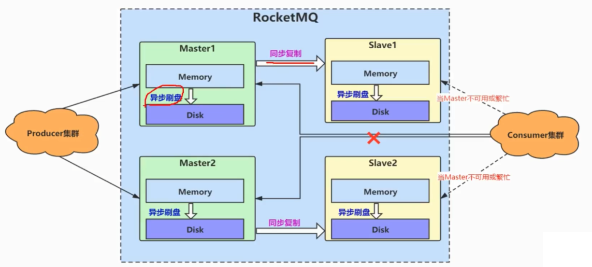

<code>**Broker**</code>\*\* ****<font style="color:#DF2A3F;">采用集群模式 + 主从复制实现高可用</font>****， **<code>**Rocketmq**</code>** 提供了 **<code>**master/slave**</code>** 的结构，**<code>**salve**</code>** 定时从 **<code>**master**</code>** 同步数据(****<font style="color:#DF2A3F;">同步刷盘或者异步刷盘</font>****)，如果 **<code>**master**</code>** 宕机，则 **<code>**slave**</code>** 提供消费服务，但是不能写入消息 。\*\*

**<font style="color:#DF2A3F;">一般采用多主多从 + 同步复制（slave复制成功才算成功） + 异步刷盘（缓存后就发送ack给生产者）。</font>**

为了保证 `HA` ，`NameServer` 也做了集群部署，但是请注意它是 **去中心化** 的。也就意味着它没有主节点， `NameServer` 的所有节点是没有进行 `Info Replicate` 的，在 `RocketMQ` 中是通过 **单个 Broker 和所有 NameServer 保持长连接** ，并且在每隔 30 秒 `Broker` 会向所有 `Nameserver` 发送心跳，心跳包含了自身的 `Topic` 配置信息，这个步骤就对应这上面的 `Routing Info` 。

## RocketMQ集群Broker挂了，会造成什么影响？

### <font style="color:rgb(25, 27, 31);">如果 RocketMQ 集群中的一个 Broker 挂了，会造成什么影响呢？</font>

**<font style="color:rgb(25, 27, 31);">Broker 挂了，首先会导致 Producer 发送消息失败。对于普通消息，Producer </font>****<font style="color:#DF2A3F;">同步发送的情况下会有重试机制</font>****<font style="color:rgb(25, 27, 31);">，重试时把消息发送到其他 Broker。如下图，Broker1 宕机了，把消息发送到了 Broker2：</font>**

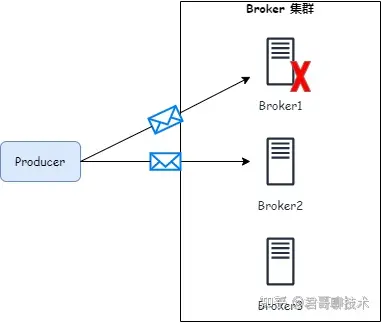

**<font style="color:rgb(25, 27, 31);">对于</font>****<font style="color:#DF2A3F;">异步发送和单向消息是不会重试</font>****<font style="color:rgb(25, 27, 31);">的，因此对于异步和单边消息，就只能发送失败了。而对于同步消息，可以通过重试的方式发送到其他的 Broker 上</font>**

### <font style="color:rgb(25, 27, 31);">在同步的情况下，Producer 重试时怎么保证不把消息发送到挂掉的 Broker 上呢？</font>

**<font style="color:rgb(25, 27, 31);">Producer 默认采用 round-robin 的方式，重试前会记录上一次发送消息的 Broker，然后选择下一个 Broker。</font>**

### <font style="color:rgb(25, 27, 31);">在大流量的场景下，可能会有大量消费发送到失败的 Broker，这样导致大量的消息需要重试，对性能影响会很大，有什么解决方法吗？</font>

**<font style="color:rgb(25, 27, 31);">RocketMQ 有</font>****<font style="color:#DF2A3F;">延迟隔离策略</font>****<font style="color:rgb(25, 27, 31);">，如果发送某一个 Broker 失败了，会将其隔离，优先选择正常的 Broker 发送消息。需要注意的是，这个策略默认是不开启的。</font>**

### <font style="color:rgb(25, 27, 31);">对顺序消息有什么影响呢？</font>

**<font style="color:rgb(25, 27, 31);"></font>**

<font style="color:rgb(25, 27, 31);">对于</font>**<font style="color:rgb(25, 27, 31);">全局顺序消息</font>**<font style="color:rgb(25, 27, 31);">，如果设置了所有消息要发送到同一个 Broker 的同一个 MessageQueue 中的情况，恰好是这个 Broker 挂了，那就只能等 Broker 重启后再发送了。而对于</font>**<font style="color:rgb(25, 27, 31);">局部顺序消息</font>**<font style="color:rgb(25, 27, 31);">，比如同一个订单相关的消息要发送到同一个 Broker 的同一个 MessageQueue 中的情况，如果这个 Broker 挂了，那 MessageQueueSelector 会选择其他 Broker 上的 MessageQueue 进行发送，这会影响当前这笔订单消费的顺序性。</font>**<font style="color:rgb(25, 27, 31);">而其他订单可以被 Producer 发送到其他的队列中，不受影响。</font>**

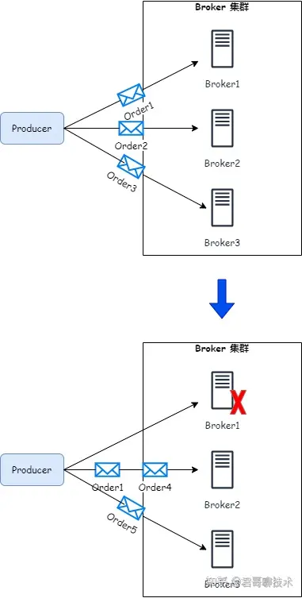

### Broker挂了对消费者有影响吗

<font style="color:rgb(25, 27, 31);">如果 Broker 没有设置主从集群，消费者会继续从挂掉的 Broker 上拉取，这会导致拉取失败，直到 NameServer 更新了 Broker 列表。	</font>

<font style="color:rgb(25, 27, 31);"></font>

### <font style="color:rgb(25, 27, 31);">NameServer 什么时候会更新 Broker 列表呢？</font>

**<font style="color:rgb(25, 27, 31);">NameServer 会有每 </font>****<font style="color:#DF2A3F;">10s </font>****<font style="color:rgb(25, 27, 31);">一次的定时任务检查 Broker 是否下线了，如果 </font>****<font style="color:#DF2A3F;">120s </font>****<font style="color:rgb(25, 27, 31);">内有没有收到 Broker 心跳，则关闭 channel，把 Broker 信息从本地缓存移除，Broker会30s向nameserver发送自己的topic信息。消费者则默认每隔 30s 向 NameServer 拉取路由信息来刷新本地缓存的 Broker 列表。也就是说可能会有最多 150s 的时间消费者拉取消息失败。</font>**

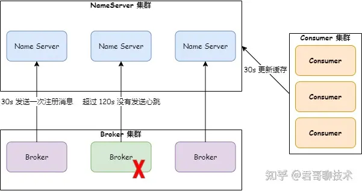

### <font style="color:rgb(25, 27, 31);">如果 Broker 集群配置了从节点，还会有上面的影响吗？</font>

**<font style="color:rgb(25, 27, 31);">有从节点， Broker 主节点恢复前，生产者是不能往从节点发送消息的，但是消费者可以去从节点拉取消息。</font>**

**<font style="color:rgb(25, 27, 31);">Broker 挂了以后，消费组会通过向 Name Server 拉取订阅关系来</font>****<font style="color:#DF2A3F;">更新本地缓存的 Broker 列表</font>****<font style="color:rgb(25, 27, 31);">，因为主节点已经不在列表中了，所以会从从节点列表中选择一个 Broker 进项消息拉取。</font>**

### <font style="color:rgb(25, 27, 31);">如果主节点没有挂，消费者会去从节点拉取消息吗？</font>

**<font style="color:rgb(25, 27, 31);">在主节点系统压力较大的时候，消费者也会去从节点拉取消息。当未处理的消息超出物理内存 40% 时就会去从节点拉取。</font>**

### <font style="color:rgb(25, 27, 31);">Broker 主节点挂了，如果成功从节点拉取消息，可能会重复消费吗？</font>

**<font style="color:rgb(25, 27, 31);">消费者消费完一批消息后，会向 Broker 发送请求更新 Broker 内存中保存的偏移量，内存中的偏移量会定时（每 5s 一次）更新到上面文件中。如果 Broker 主节点不挂，无论消费者从主节点还是从节点拉取消息，更新偏移量的请求都会发送到主节点，从节点会每隔 10s 从主节点同步偏移量，如下图：</font>**

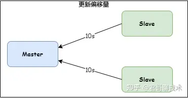

**<font style="color:rgb(25, 27, 31);">也就是说，如果主节点挂了，去从节点拉取消息，可能因为偏移量没有同步到主节点，从节点保存的偏移量不正确。不过只要消费者不宕机，就会根据消费者本地保存的偏移量去拉取，并不会拉取到重复消息。</font>**

### <font style="color:rgb(25, 27, 31);">如果 Broker 主节点重启了，主节点并不能同步从节点的最新偏移量，那消费者从主节点读取会读到重复消息吗？</font>

**<font style="color:rgb(25, 27, 31);">如果主节点重启了，如果消费者会用本地保存的偏移量去主节点拉取消息，主节点会更新本地的偏移量，同时从节点也会去主节点同步偏移量，所以并不会拉取到重复消息。如果消费者也挂了，消费者重启后 Broker 主节点的偏移量还没有被其他消费者更新过，那确实会拉取到重复消息。</font>**

## 如何保证消息的可用性、可靠性、不丢失

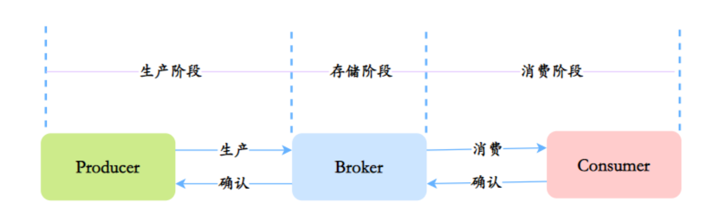

**可能会在这三个阶段发生丢失：生产阶段、存储阶段、消费阶段。**

**生产阶段**：**通过请求确认机制保证消息的可靠传递**

1. **同步发送：要注意处理响应结果和异常。返回响应OK，成功发送到了Broker，响应失败，或者发生其它异常，都应该重试。**
2. **异步发送：应该&#x5728;****回调方法****&#xF9E9;检查，如果发送失败或者异常，都应该进行重试。**
3. **单向发送：不建议使用，单项发送不会有返回和回调**
4. **发生超时：通过查询日志的API，来检查是否在Broker存储成功**

**存储阶段：配置可靠性优先的Broker参数来避免因为宕机丢消息**，**可靠性优先的场景都应该\*\*\*\*使用同步** **。**

1. **采用同步刷盘机制持久化到**\*\*<font style="color:#DF2A3F;">CommitLog</font>\*\***中，收到Product发送的消息后，持久化到磁盘中再相应ACK给Product**
2. **Broker采用主从模式保证高可用，Master和Slaver可以采用同步复制保证消息不丢失。\*\*\*\*<font style="color:#DF2A3F;">同步复制 + 异步刷盘</font>**

**消费阶段：保证消费后在发送确认消息，若消费失败则重新拉取信息**

## 消息重复

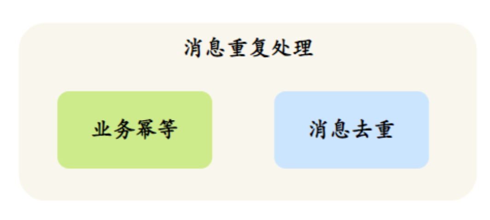

## 消息积压如何处理

**原因：生产者大量生产消息，消费者数目太少不协调；**

**影响：服务消费不及时，broker存储压力增大；**

1. 消费者
   1. 如果消息队列数大于消费者数，增加消费者的数目
   2. 优化消费逻辑，提高消费能力
   3. 消息过滤，无效消息不处理
   4. 超时后对消息补偿或者重试
2. 消息队列
   1. 新建临时Topic，增加更多的队列，把多的信息放到此队列消费
3. 生产者
   1. 去除冗余消息
   2. 分级发送消息

## **RocketMQ**怎么实现延时消息的？

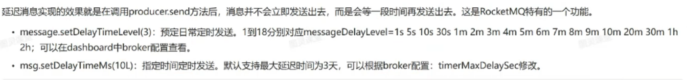

[场景设计](https://www.yuque.com/nibiwanxiamei/yrd6t1/sih4k0q1twymt1eu)

**临时存储 + 定时任务；Broker收到延迟消息，先发送到主题对应的延迟队列中；**

## 死信队列

**死信队列用于处理无法被正常消费的消息，即死信消息。**

**当消息消费失败（重试很多次）或者没被消费，RocketMq将此消息放入死信队列中。**

## ♥♥♥ 事务消息

[分布式事务](https://www.yuque.com/nibiwanxiamei/yrd6t1/xc06wnmds4xpaknn)

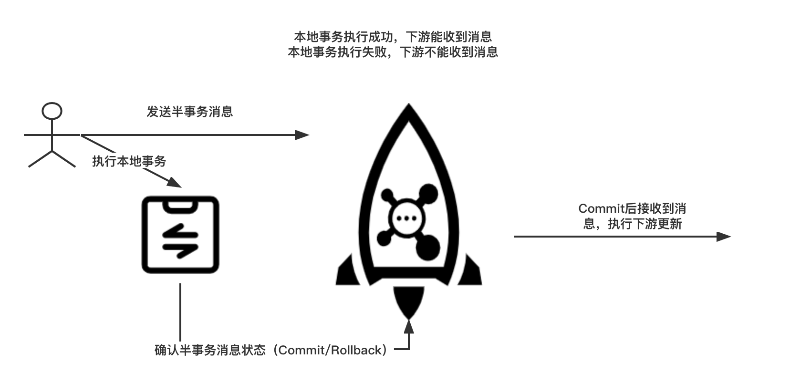

<font style="color:rgb(28, 30, 33);background-color:rgb(250, 250, 250);">以电商交易场景为例，用户支付订单这一核心操作的同时会涉及到下游物流发货、积分变更、购物车状态清空等多个子系统的变更。当前业务的处理分支包括：</font>

* <font style="color:rgb(28, 30, 33);background-color:rgb(250, 250, 250);">主分支订单系统状态更新：由未支付变更为支付成功。</font>
* <font style="color:rgb(28, 30, 33);background-color:rgb(250, 250, 250);">物流系统状态新增：新增待发货物流记录，创建订单物流记录。</font>
* <font style="color:rgb(28, 30, 33);background-color:rgb(250, 250, 250);">积分系统状态变更：变更用户积分，更新用户积分表。</font>
* <font style="color:rgb(28, 30, 33);background-color:rgb(250, 250, 250);">购物车系统状态变更：清空购物车，更新用户购物车记录。</font>

**<font style="color:rgb(28, 30, 33);background-color:rgb(250, 250, 250);">基于Apache RocketMQ分布式事务消息：支持最终一致性</font>**

<font style="color:rgb(28, 30, 33);background-color:rgb(250, 250, 250);">普通消息无法像单机数据库事务一样，具备提交、回滚和统一协调的能力。RocketMQ实现的</font>**<font style="color:rgb(28, 30, 33);background-color:rgb(250, 250, 250);">分布式事务消息</font>**<font style="color:rgb(28, 30, 33);background-color:rgb(250, 250, 250);">，在普通消息基础上，支持二阶段的提交能力。将二阶段提交和本地事务绑定，实现全局提交结果的一致性。</font>

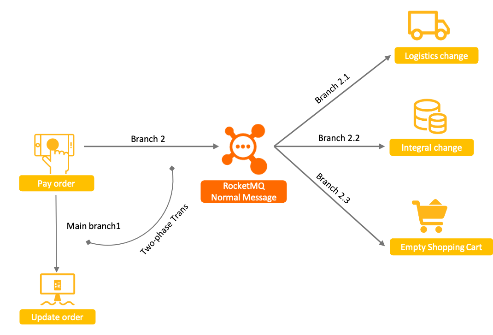

### 事务消息处理流程

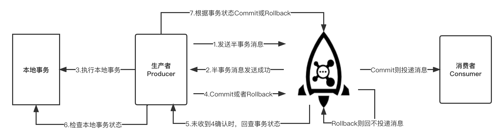

1. <font style="color:rgb(28, 30, 33);background-color:rgb(250, 250, 250);">生产者将消息发送至RocketMQ服务端。</font>
2. <font style="color:rgb(28, 30, 33);background-color:rgb(250, 250, 250);">RocketMQ服务端将消息持久化成功之后，向生产者返回Ack确认消息已经发送成功，此时消息被标记为"暂不能投递"，这种状态下的消息即为半事务消息。</font>
3. <font style="color:rgb(28, 30, 33);background-color:rgb(250, 250, 250);">生产者开始执行本地事务逻辑。</font>
4. <font style="color:rgb(28, 30, 33);background-color:rgb(250, 250, 250);">生产者根据本地事务执行结果向服务端提交二次确认结果（Commit或是Rollback），服务端收到确认结果后处理逻辑如下：</font>
   * <font style="color:rgb(28, 30, 33);background-color:rgb(250, 250, 250);">二次确认结果为Commit：服务端将半事务消息标记为可投递，并投递给消费者。</font>
   * <font style="color:rgb(28, 30, 33);background-color:rgb(250, 250, 250);">二次确认结果为Rollback：服务端将回滚事务，不会将半事务消息投递给消费者。</font>
5. <font style="color:rgb(28, 30, 33);background-color:rgb(250, 250, 250);">在断网或者是生产者应用重启的特殊情况下，若服务端未收到发送者提交的二次确认结果，或服务端收到的二次确认结果为Unknown未知状态，经过固定时间后，服务端将对消息生产者即生产者集群中任一生产者实例发起消息回查。</font><font style="color:rgb(28, 30, 33);background-color:rgb(250, 250, 250);"> </font>**<font style="color:rgb(28, 30, 33);background-color:rgb(250, 250, 250);">说明</font>**<font style="color:rgb(28, 30, 33);background-color:rgb(250, 250, 250);"> </font><font style="color:rgb(28, 30, 33);background-color:rgb(250, 250, 250);">服务端回查的间隔时间和最大回查次数，请参见</font>[<font style="color:rgb(28, 30, 33);background-color:rgb(250, 250, 250);">参数限制</font>](https://rocketmq.apache.org/zh/docs/introduction/03limits)<font style="color:rgb(28, 30, 33);background-color:rgb(250, 250, 250);">。</font>
6. <font style="color:rgb(28, 30, 33);background-color:rgb(250, 250, 250);">生产者收到消息回查后，需要检查对应消息的本地事务执行的最终结果。</font>
7. <font style="color:rgb(28, 30, 33);background-color:rgb(250, 250, 250);">生产者根据检查到的本地事务的最终状态再次提交二次确认，服务端仍按照步骤4对半事务消息进行处理。</font>

<font style="color:rgb(28, 30, 33);background-color:rgb(250, 250, 250);"></font>

##

‍


> 更新: 2025-08-28 11:54:57  
> 原文: <https://www.yuque.com/nibiwanxiamei/yrd6t1/0762d3f7456a51dee928a917a485ae3a>