# onecoupon系统设计

# 秒杀下单支付场景

<font style="color:rgb(38, 38, 38);">秒杀系统的业务逻辑非常简单，一般就是</font>**<font style="color:rgb(38, 38, 38);">下订单减库存</font>**<font style="color:rgb(38, 38, 38);">，难点在于我们如何保障秒杀能够顺利进行。</font>**<font style="color:rgb(38, 38, 38);">同时下单后，用户延迟付款，延迟操作处理逻辑。</font>**

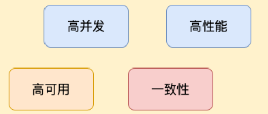

秒杀需要处理的事情：

* 热点数据提前预热
* 高并发量如何处理
* 防止超卖保证数据一致性
* 保证系统高可用

## 热点数据处理

* **<font style="color:rgb(38, 38, 38);">静态热点数据</font>**<font style="color:rgb(38, 38, 38);"> ：可以提前预测到的热点数据比如要秒杀的商品。</font>
* **<font style="color:rgb(38, 38, 38);">动态热点数据</font>**<font style="color:rgb(38, 38, 38);"> ： 不能够提前预测到的热点数据，需要通过一些手段动态检测系统运行情况产生。</font>

<font style="color:rgb(38, 38, 38);"> 对于并发量非常一般的系统直接将热点数据存放进缓存比如 Redis 中就可以了，不过像淘宝、京东这种级别的并发量，如果把某些热点数据放在 Redis 中，直接可能就将整个 Redis 集群给干掉了。</font>

## 高可用

### 集群化

<font style="color:rgb(38, 38, 38);">保证系统中某一个组件的高可用，往往需要搭建集群来避免单点风险。</font>

<font style="color:rgb(38, 38, 38);">例如redis的集群模式：主从复制 - 哨兵模式 - 集群模式</font>

### <font style="color:rgb(38, 38, 38);">限流</font>

**<font style="color:#DF2A3F;">限流是从用户访问压力的角度来考虑如何应对系统故障。</font>**

<font style="color:rgb(38, 38, 38);">接口限流：接口限流是为了对服务端的接口接受请求的频率进行限制，防止服务挂掉。</font>

<font style="color:rgb(38, 38, 38);">接口限流的话可以直接用</font>**<font style="color:rgb(38, 38, 38);"> Redis 来做（建议基于 Lua 脚本）</font>**<font style="color:rgb(38, 38, 38);">，也可以使用现成的流量控制组件比如 </font>**<font style="color:rgb(38, 38, 38);">Sentinel</font>**<font style="color:rgb(38, 38, 38);"> 、Hystrix 、Resilience4J 。（Redis的Lua脚本可以针对单个用户限流）</font>

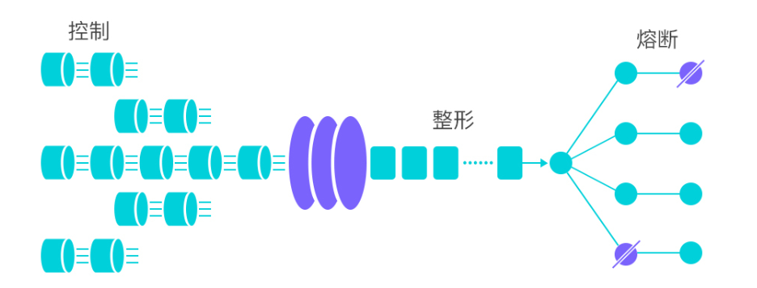

除了针对接口，用户，IP限流之外，还可以使用一些其他方案辅助限流：

* <font style="color:rgb(38, 38, 38);">在用户发起秒杀请求之前让其进行答题或者输入验证码。</font>
* <font style="color:rgb(38, 38, 38);">前端控制点击请求时间间隔，点击后按钮灰，等待倒计时后才能再次请求</font>

### 流量削峰

<font style="color:rgb(38, 38, 38);">突发的大流量还可以使用</font>**<font style="color:rgb(38, 38, 38);">消息队列</font>**<font style="color:rgb(38, 38, 38);">进行流量削峰。</font>**<font style="color:rgb(38, 38, 38);">用户发送秒杀请求之后先存到消息队列中，然后再慢慢去消费。消息队列还能进行解耦操作，比如下单和付款操作。</font>**

## <font style="color:rgb(38, 38, 38);">一致性</font>

* <font style="color:rgb(38, 38, 38);">常见的减库存方案有：\ </font>**<font style="color:rgb(38, 38, 38);">下单即减库存</font>**<font style="color:rgb(38, 38, 38);"> ：只要用户下单了，即使不付款，我们就扣库存。\ </font>**<font style="color:rgb(38, 38, 38);">付款再减库存</font>**<font style="color:rgb(38, 38, 38);"> ：当用户付款了之后，我们再减库存。不过， 这种情况可能会造成用户下订单成功，但是付款失败。</font>

<font style="color:rgb(38, 38, 38);">一般情况下都是</font>**<font style="color:#DF2A3F;">下单减扣库存</font>**<font style="color:rgb(38, 38, 38);"> ，像现在的购物网站比如京东都是这样来做的。</font>**<font style="color:rgb(38, 38, 38);">对超过一定时间不付款的订单特殊处理，释放库存。</font>**

**<font style="color:rgb(38, 38, 38);">提前将秒杀商品的信息放到缓存中去。通过  Lua 脚本对库存进行原子操作。</font>**

```lua
-- 第一步：先检查 库存是否充足，库存不足，返回 0
local stockNum=tonumber(redis.call("get",key);
if stockNum<1 then
  	return 0;
-- 第二步：如果库存充足，减少库存（假设只能购买一件）,返回 1
else
	redis.call('DECRBY',key,1);
  return 1;
end
```

<font style="color:rgb(38, 38, 38);">在 Redis 中扣减库存成功后，需要将库存同步到 MySQL 。MySQL 的库存并不需要去实时进行更新，只需要库存达到最终一致性即可，即先对 Redis 的库存进行更新，然后再异步同步（MQ）到 MySQL 的库存。</font>

# <font style="color:rgb(38, 38, 38);">订单超时自动取消</font>

:::color4
将付款任务丢入延迟队列，若用户在规定时间付款，redis可以删除key，mq不删除。付款成功后付款模块会发货，可以让付款模块mq发送消息到下单模块，修改订单状态为已付款。若延迟时间到达，则删除订单状态，并且恢复库存。

:::

<font style="color:rgb(38, 38, 38);">单机延时任务方案有 Timer、ScheduledExecutorService、DelayQueue、Spring Task 和</font>**<font style="color:rgb(38, 38, 38);">时间轮</font>**<font style="color:rgb(38, 38, 38);">，其中最常用也是比较推荐使用的是</font>**<font style="color:#DF2A3F;">时间轮</font>**<font style="color:rgb(38, 38, 38);">。分布式延时任务的解决方案有</font>**<font style="color:rgb(38, 38, 38);"> </font>\*\*\*\*<font style="color:#DF2A3F;">Redis 和 MQ。</font>**

## <font style="color:rgb(38, 38, 38);">Redis实现延迟任务</font>

* **<font style="color:#DF2A3F;">Redis 过期事件监听</font>**
* **<font style="color:#DF2A3F;">Redisson 内置的延时队列</font>**

### Redis过期事件监听

<font style="color:rgb(38, 38, 38);">Redis 2.0 引入了发布订阅 (pub/sub) 功能。在 pub/sub 中，引入了一个叫做 </font>**<font style="color:rgb(38, 38, 38);">channel（频道）</font>**<font style="color:rgb(38, 38, 38);"> 的概念，有点类似于消息队列中的 </font>**<font style="color:rgb(38, 38, 38);">topic（主题）</font>**<font style="color:rgb(38, 38, 38);">。\ </font><font style="color:rgb(38, 38, 38);">pub/sub 涉及发布者（publisher）和订阅者（subscriber，也叫消费者）两个角色：</font>

* <font style="color:rgb(38, 38, 38);">发布者通过 PUBLISH 投递消息给指定 channel。</font>
* <font style="color:rgb(38, 38, 38);">订阅者通过SUBSCRIBE订阅它关心的 channel。并且，订阅者可以订阅一个或者多个 channel。</font>

**<font style="color:#DF2A3F;background-color:#FBDE28;">**keyevent@0**:expired</font>**<font style="color:rgb(38, 38, 38);"> 就是一个默认的 channel，负责监听 key 的过期事件。也就是说，当一个 key 过期之后，Redis 会发布一个 key 过期的事件到\_\_keyevent@<db>\_\_:expired这个 channel 中。</font>

<font style="color:rgb(38, 38, 38);">缺点：</font>

* **<font style="color:rgb(38, 38, 38);">过期事件消息是在 Redis 服务器删除 key（惰性删除 + 定期删除） 时发布的，而不是一个 key 过期之后就会就会直接发布。</font>**
* **<font style="color:rgb(38, 38, 38);">Redis 的 pub/sub 模式中的消息并不支持持久化。</font>**
* **<font style="color:rgb(38, 38, 38);">多服务实例下存在消息重复消息的问题。</font>**

### <font style="color:rgb(38, 38, 38);">Redission内置延迟队列</font>

<font style="color:rgb(38, 38, 38);">Redisson的延迟队列 </font>**<font style="color:rgb(38, 38, 38);">RDelayedQueue</font>**<font style="color:rgb(38, 38, 38);"> 是基于Redis的</font>**<font style="color:rgb(38, 38, 38);">SortedSet</font>**<font style="color:rgb(38, 38, 38);">来实现的。SortedSet是一个有序集合，其中的每个元素都可以设置一个分数，代表该元素的权重。</font>**<font style="color:rgb(38, 38, 38);">Redisson利用这一特性，将需要延迟执行的任务插入到SortedSet中，并给它们设置相应的过期时间作为分数。</font>**

<font style="color:rgb(38, 38, 38);">Redisson使用 </font>**<font style="color:rgb(38, 38, 38);">zrangebyscore</font>**<font style="color:rgb(38, 38, 38);"> 命令扫描SortedSet中过期的元素，然后将这些过期元素从 SortedSet 中移除，并将它们加入到就绪消息列表中。就绪消息列表是一个阻塞队列，有消息进入就会被监听到。这样做可以避免对整个SortedSet进行轮询，提高了执行效率。</font>

* **<font style="color:rgb(38, 38, 38);">减少了丢消息的可能</font>**<font style="color:rgb(38, 38, 38);">：DelayedQueue 中的消息会被持久化，即使Redis宕机了，根据持久化机制，也只可能丢失一点消息，影响不大。当然了，你也可以使用扫描数据库的方法作为补偿机制。</font>
* **<font style="color:rgb(38, 38, 38);">消息不存在重复消费问题</font>**<font style="color:rgb(38, 38, 38);">：每个客户端是从同一个目标队列中获取任务，不存在重复消费的问题。</font>

## <font style="color:rgb(38, 38, 38);">RocketMQ</font>

原本RocketMQ都是基于轮询算法的，不断轮询会增加网络带宽和负担，所以原本RocketMQ采用了长轮询的机制。

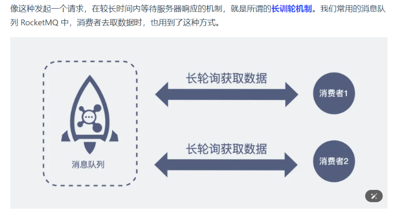

<font style="color:rgb(38, 38, 38);">RocketMQ 5.0 基于</font>**<font style="color:#DF2A3F;">时间轮算法</font>**<font style="color:rgb(38, 38, 38);">引入了</font>**<font style="color:#DF2A3F;">定时消息</font>**<font style="color:rgb(38, 38, 38);">，解决了延时级别只有 18 个、延时时间不准确等问题</font>

```java
Message message = new Message("TestTopic", ("Hello scheduled message " + i).getBytes());
//第 3 个级别，10s
message.setDelayTimeLevel(3);
producer.send(message);
```

RocketMQ在5.0之前总共有18个延迟级别

```java
private String messageDelayLevel = "1s 5s 10s 30s 1m 2m 3m 4m 5m 6m 7m 8m 9m 10m 20m 30m 1h 2h";
```

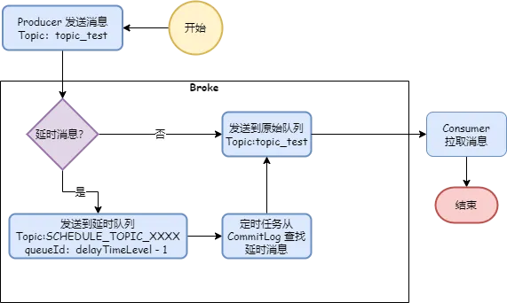

为了解决定时任务队列遍历任务导致的性能开销，RocketMQ 定时消息引入了秒级的时间轮算法。

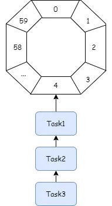

图中是一个 60s 的时间轮，时间轮上会有一个指向当前时间的指针定时地移动到下一个时间。**时间轮算法的优势是不用去遍历所有的任务，每一个时间节点上的任务用链表串起来，当时间轮上的指针移动到当前的时间时，这个时间节点上的全部任务都执行。**

**虽然上面只是一个 60s 的时间轮，但是对于所有的时间延时，都是支持的。可以在每个时间节点增加一个 round 字段，记录时间轮转动的圈数，比如对于延时 130s 的任务，round 就是 2，放在第 10 个时间刻度的链表中。这样当时间轮转到一个节点，执行节点上的任务时，首先判断 round 是否等于 0，如果等于 0，则把这个任务从任务链表中移出交给异步线程执行，否则将 round 减 1 继续检查后面的任务。**

```java
org.apache.rocketmq.common.message.Message messageExt = this.sendMessageActivity.buildMessage(null,
 Lists.newArrayList(
  Message.newBuilder()
   .setTopic(Resource.newBuilder()
    .setName(TOPIC)
    .build())
   .setSystemProperties(SystemProperties.newBuilder()
    .setMessageId(msgId)
    .setQueueId(0)
    .setMessageType(MessageType.DELAY)
    .setDeliveryTimestamp(Timestamps.fromMillis(deliveryTime))
    //定义消息投递时间
    .setBornTimestamp(Timestamps.fromMillis(System.currentTimeMillis()))
    .setBornHost(StringUtils.defaultString(RemotingUtil.getLocalAddress(), "127.0.0.1:1234"))
    .build())
   .setBody(ByteString.copyFromUtf8("123"))
   .build()
 ),
Resource.newBuilder().setName(TOPIC).build()).get(0);
```

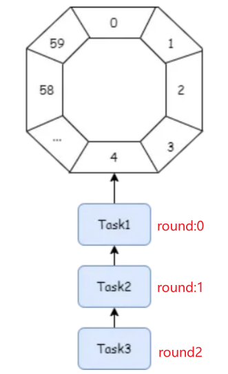

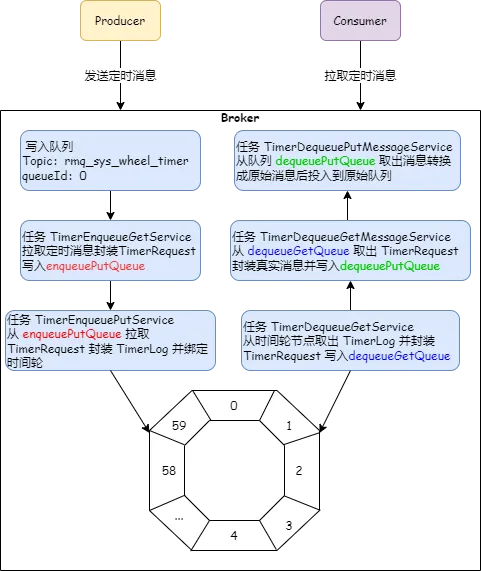

# 高并发抢券场景

## 定时预热

利用XXLJob定时从数据库中查询已经开始或者还有30天以内开始的活动，写入到Redis提前预热

* 进行中还未到结束的优惠券活动。
* 1个月内待开始的优惠券活动。

后续前端做定时器，到时间开放请求按钮，后端收到请求判断redis状态和当前时间，可以开始抢券就进入抢券。

## 解决超卖

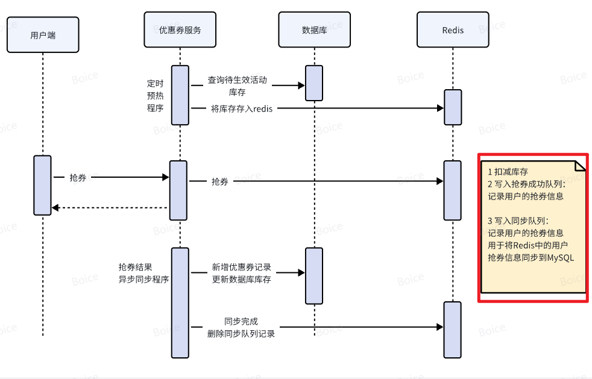

根据整体方案分析，用户抢券要在Redis扣减库存，所以需要提前将优惠券活动的库存同步到Redis。

可以通过定时预热程序中将优惠券活动的库存同步到Redis，同步规则如下：

* 对于待生效的活动更新库存。
* 对于已生效的活动如果库存已经同步则不再同步，只更新没有同步库存的活动。

做第二点的原因是为了避免时间差问题，活动状态更改为进行中了但是库存还没有同步到Redis。

# 大文件上传

<font style="color:rgb(38, 38, 38);">先将文件切分成多个文件分片，然后再上传这些小的文件分片。</font>

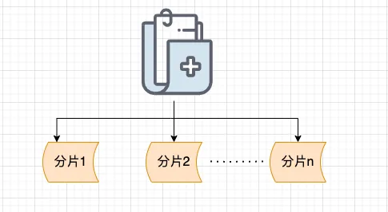

<font style="color:rgb(38, 38, 38);">大致流程如下：</font>

1. <font style="color:rgb(38, 38, 38);">生成要上传文件的唯一标识（如SHA-256）；</font>
2. <font style="color:rgb(38, 38, 38);">将需要上传的文件按照一定的分割规则，分割成相同大小的分片；</font>
3. <font style="color:rgb(38, 38, 38);">初始化一个分片上传任务，返回本次分片上传的唯一标识；</font>
4. <font style="color:rgb(38, 38, 38);">每个分片在发送前，客户端会计算其哈希值（如SHA-256），并将这个哈希值与分片一起发送给服务器；\ </font><font style="color:rgb(38, 38, 38);">按照一定的策略（串行或并行）发送各个分片；</font>
5. <font style="color:rgb(38, 38, 38);">服务器接收到分片后，会重新计算分片的哈希值，并与客户端发送的哈希值进行比对；</font>
6. <font style="color:rgb(38, 38, 38);">如果哈希值匹配，则认为该分片有效，服务器会存储该分片并等待其他分片的到来；如果哈希值不匹配，服务器会通知客户端重新发送该分片；</font>
7. <font style="color:rgb(38, 38, 38);">所有分片发送完成后，服务端会根据判断数据上传是否完整。如果数据完整，服务端则进行分片的合成，以得到原始文件。</font>
8. <font style="color:rgb(38, 38, 38);">再计算合并后的文件的唯一标识，两者进行对比，一致则说明没问题。</font>

<font style="color:rgb(38, 38, 38);">使用分片上传主要有下面 2 点好处：</font>

1. **<font style="color:#DF2A3F;">断点续传</font>**<font style="color:rgb(38, 38, 38);"> ：上传文件中途暂停或失败（比如遇到网络问题）之后，不需要重新上传，只需要上传那些未成功上传的文件分片即可。所以，分片上传是断点续传的基础。</font>
2. **<font style="color:#DF2A3F;">多线程上传</font>**<font style="color:rgb(38, 38, 38);"> ：我们可以通过多线程同时对一个文件的多个文件分片进行上传，这样的话就大大加快的文件上传的速度</font>

<font style="color:rgb(38, 38, 38);"></font>

# 网盘如何限速

## 应用层限速

* **分块传输数据**：通过分块传输数据，在每次发送数据块后加上`sleep`延迟，来控制传输速率；
* **<font style="color:rgb(24, 25, 28);">限制写入缓冲区大小，一次读取到缓冲区的大小就是传输的速度</font>**
* **动态限速**：根据用户是否是会员，动态调整限速；
* 设置线程：多线程环境下，若是非会员减少读取线程数；

**<font style="color:rgb(77, 77, 77);">具体过程是，客户端程序访问 API 服务器，请求上传、下载文件的时候，API 服务器可以根据用户类型，决定分配的 Block 服务器数目和 Block 服务器内的服务线程数，以及每个线程的上传、下载速率。</font>**

**<font style="color:rgb(77, 77, 77);">Block 服务器会根据 API 服务器的返回值，来控制客户端能够同时上传、下载的 Block 数量以及传输速率，以此对不同用户进行限速。</font>**

## WEB层限速

**Nginx限速**: 如果你使用Nginx作为Web服务器，你可以通过配置Nginx的`limit_rate`和`limit_rate_after`指令来限制下载速度。`limit_rate`指令可以控制每个连接的下载速率。

[实现秒传与限速！深度解析万亿GB网盘系统架构\_如何设计一个支持万亿gb网盘实现秒传与限速的系统-CSDN博客](https://blog.csdn.net/feiying101/article/details/139454124)

# 扫码登录场景

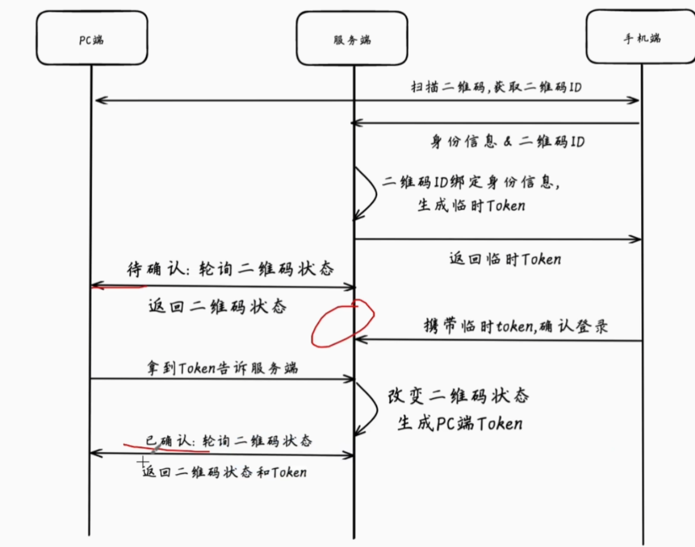

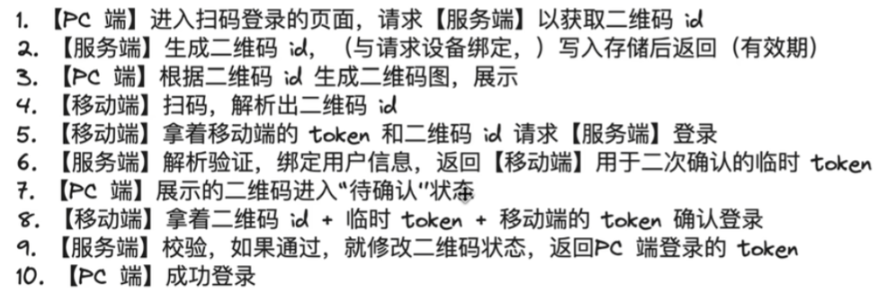

等待确认的状态：此处PC需要判断用户是否确认了登录，也就是是否扫码成功。有一下几个方案

1.轮询：不断轮询，直到用户完成扫码

2.长连接：简历一个长连接，定期轮询查看是否完成

3.webSocket，双向的通信，服务端收到用户确认后，返回信息给PC，完成登录。

[3.9 既然有 HTTP 协议，为什么还要有 WebSocket？](https://xiaolincoding.com/network/2_http/http_websocket.html#%E4%BD%BF%E7%94%A8-http-%E4%B8%8D%E6%96%AD%E8%BD%AE%E8%AF%A2)

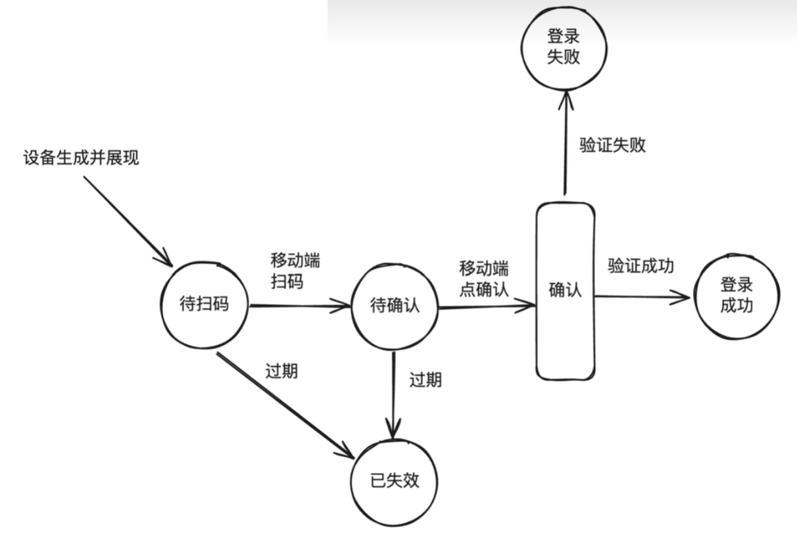

# 一亿数据表如何迁移

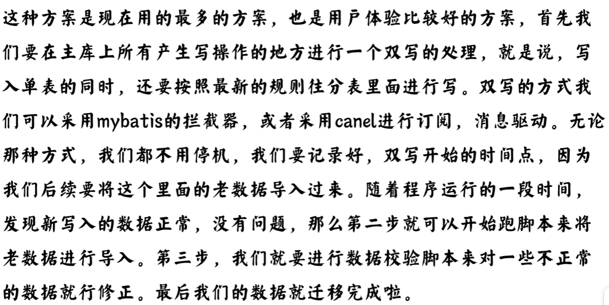

第二步老数据导入新库，可以采用多线程的方式来处理。

1. 设计一张任务表，包括任务ID，名称，数据范围，开始时间，结束时间，任务状态
2. 做好数据范围分配，用多线程的方式执行任务表的任务，并行处理数据
3. 执行异常的错误可以做增量或者全量处理，只需要部分范围处理

# 一千亿数据如何去重

# 抽奖系统设计

# 排行榜怎么设计？

* 数据量少 直接order by 或者前端排序
* 数据量大 redis zset

类似：如何实现微信步数排行榜？如何实现网站热度排行榜？

[输入密码 · 语雀](https://www.yuque.com/snailclimb/mf2z3k/hbsnl8#b60f75be)

[我错了，打我可以，别打脸。](https://mp.weixin.qq.com/s/2p84utXldMaeR4wU5guK1Q)

[亿级用户游戏排行榜设计方案](https://mp.weixin.qq.com/s/jWozyJ9vk9vM6u5_1WLGdw)

# 点赞私信评论实时推送

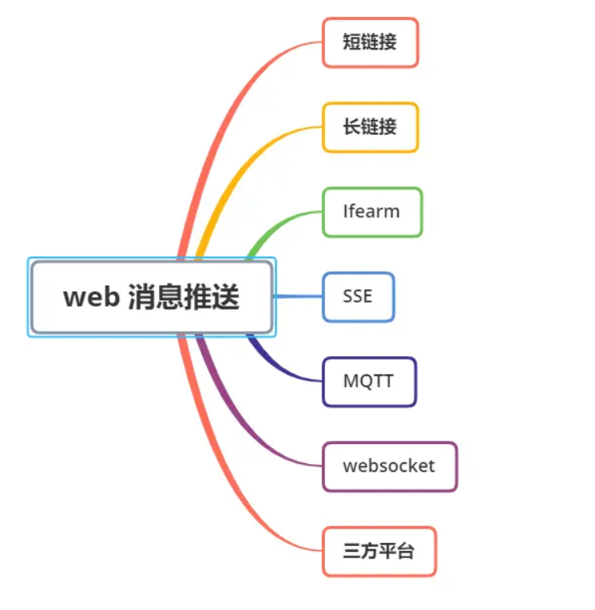

## 短轮询

<font style="color:rgb(77, 77, 77);">指定的时间间隔，由浏览器向服务器发出HTTP请求，服务器实时返回未读消息数据给客户端，浏览器再做渲染显示。每秒发送一次请求轮询。</font>

```javascript
setInterval(() => {
  // 方法请求
  messageCount().then((res) => {
      if (res.code === 200) {
          this.messageCount = res.data
      }
  })
}, 1000);
```

## 长轮询

<font style="color:rgb(77, 77, 77);">长轮询是对上边短轮询的一种改进版本，在尽可能减少对服务器资源浪费的同时，保证消息的相对实时性。长轮询在中间件中应用的很广泛，</font>**<font style="color:rgb(77, 77, 77);">比如Nacos配置中心，消息队列kafka、RocketMQ</font>**<font style="color:rgb(77, 77, 77);">中都有用到长轮询。</font>

**<font style="color:rgb(77, 77, 77);">长轮询相比于短轮询在性能上提升了很多，但依然会产生较多的请求，这是它的一点不完美的地方</font>**

## <font style="color:rgb(77, 77, 77);">SSE</font>

<font style="color:rgb(77, 77, 77);">服务器发送事件(Server-sent events)，简称SSE。SSE它是基于HTTP协议的</font>

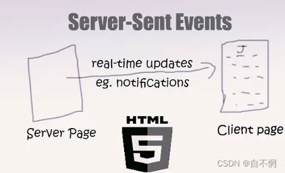

**<font style="color:rgb(77, 77, 77);">SSE在服务器和客户端之间打开一个单向通道，服务端响应的不再是一次性的数据包而是text/event-stream类型的数据流信息，在有数据变更时从服务器流式传输到客户端。</font>**

<font style="color:rgb(77, 77, 77);">SSE与WebSocket作用相似，都可以建立服务端与浏览器之间的通信，实现服务端向客户端推送消息，但还是有些许不同：</font>

* <font style="color:rgba(0, 0, 0, 0.75);">SSE 是基于HTTP协议的，不需要特殊的协议或服务器实现；WebSocket需单独服务器来处理协议。</font>
* <font style="color:rgba(0, 0, 0, 0.75);">SSE 单向通信，由服务端向客户端单向通信；webSocket全双工通信，通信的双方可以同时发送和接受信息。</font>
* <font style="color:rgba(0, 0, 0, 0.75);">SSE 实现简单开发成本低，无需引入其他组件；WebSocket传输数据需做二次解析。</font>
* <font style="color:rgba(0, 0, 0, 0.75);">SSE 默认支持断线重连；WebSocket则需要自己实现。</font>
* <font style="color:rgba(0, 0, 0, 0.75);">SSE 只能传送文本消息，二进制数据需要经过编码后传送；WebSocket默认支持传送二进制数据。</font>
* <font style="color:rgba(0, 0, 0, 0.75);">SSE 与 WebSocket 该如何选择？</font>

## <font style="color:rgba(0, 0, 0, 0.75);">MQTT</font>

<font style="color:rgb(77, 77, 77);">MQTT 全称(Message Queue Telemetry Transport)：一种基于发布/订阅（publish/subscribe）模式的轻量级通讯协议，通过订阅相应的主题来获取消息，是</font>**<font style="color:rgb(77, 77, 77);">物联网</font>**<font style="color:rgb(77, 77, 77);">（Internet of Thing）中的一个标准传输协议。</font>


<font style="color:rgb(77, 77, 77);">TCP协议位于传输层，MQTT 协议位于应用层，MQTT 协议构建于TCP/IP协议上，也就是说只要支持TCP/IP协议栈的地方，都可以使用MQTT协议。</font>

* <font style="color:rgba(0, 0, 0, 0.75);">首先HTTP协议它是一种同步协议，客户端请求后需要等待服务器的响应。而在物联网（IOT）环境中，设备会很受制于环境的影响，比如带宽低、网络延迟高、网络通信不稳定等，显然异步消息协议更为适合IOT应用程序。</font>
* <font style="color:rgba(0, 0, 0, 0.75);">HTTP是单向的，如果要获取消息客户端必须发起连接，而在物联网（IOT）应用程序中，设备或传感器往往都是客户端，这意味着它们无法被动地接收来自网络的命令。\ </font><font style="color:rgba(0, 0, 0, 0.75);">通常需要将一条命令或者消息，发送到网络上的所有设备上。HTTP要实现这样的功能不但很困难，而且成本极高。</font>

## WebSocket

<font style="color:rgb(77, 77, 77);">WebSocket是一种在TCP连接上进行全双工通信的协议，建立客户端和服务器之间的通信渠道。浏览器和服务器仅需一次握手，两者之间就直接可以创建持久性的连接，并进行双向数据传输。</font>

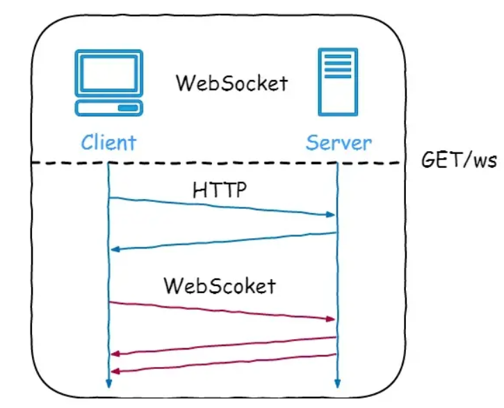

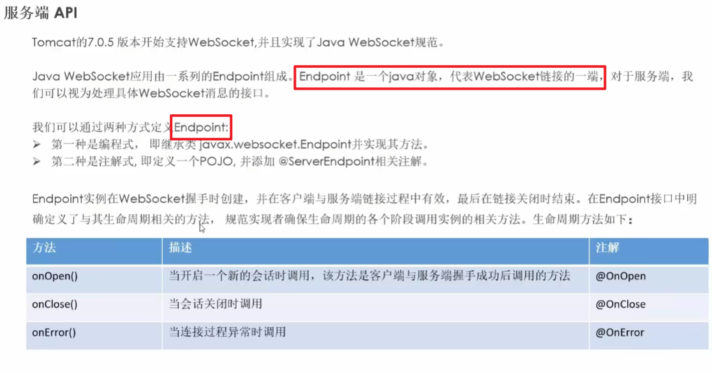

# Jstack命令

<font style="color:rgb(34, 34, 34);">jstack用于生成java虚拟机当前时刻的线程快照。一般直接jstack java线程ID即可输出</font>

<font style="color:rgb(34, 34, 34);">输出主要有几个部分</font>

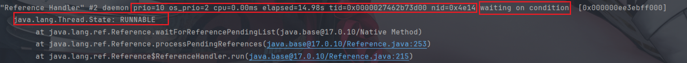

<font style="color:rgb(34, 34, 34);">prio：线程的优先级</font>

<font style="color:rgb(34, 34, 34);">tid：线程id</font>

<font style="color:rgb(34, 34, 34);">nid：操作系统映射的线程id</font>

<font style="color:rgb(34, 34, 34);">1103e9000和106692000 ：表示线程栈的起始地址。</font>

<font style="color:rgb(34, 34, 34);">线程等待状态：</font>

* <font style="color:rgb(34, 34, 34);">Deadlock：表示有死锁</font>
* <font style="color:rgb(34, 34, 34);">Waiting on condition：等待某个资源或条件发生来唤醒自己。具体需要结合jstacktrace来分析，比如线程正在sleep，网络读写繁忙而等待</font>
* <font style="color:rgb(34, 34, 34);">Blocked：阻塞</font>
* <font style="color:rgb(34, 34, 34);">Waiting on monitor entry：在等待获取锁</font>

<font style="color:rgb(34, 34, 34);">线程状态：运行 | 就绪，阻塞，等待，超时等待</font>

# CPU飙升排查

1. <font style="color:rgb(51, 51, 51);">流量激增：</font>**<font style="color:rgb(254, 44, 36);">开源节流，削峰填谷	</font>**
2. <font style="color:rgb(51, 51, 51);">程序代码存在问题</font>
   1. <font style="color:rgb(51, 51, 51);">top查看CPU，内存等占用情况</font>
   2. **<font style="color:rgb(254, 44, 36);">top -Hp</font>**<font style="color:rgb(77, 77, 77);"> 来查看对应 Java 进程的线程详情</font>
   3. <font style="color:rgb(77, 77, 77);">找到CPU占用最高的Java线程ID，将线程ID转换成16进制，</font><font style="color:rgb(193, 132, 1);">printf</font><font style="color:rgb(80, 161, 79);">'%x\n'</font><font style="color:rgb(56, 58, 66);background-color:rgb(250, 250, 250);"> 线程ID</font>
   4. <font style="color:rgb(77, 77, 77);">使用 </font>**<font style="color:rgb(254, 44, 36);">jstack + grep </font>**<font style="color:rgb(77, 77, 77);">输出该线程的详细栈信息</font>
   5. <font style="color:rgb(77, 77, 77);">jstack Java进程ID | grep -A 200 Java线程ID十六进制</font>
3. <font style="color:rgb(51, 51, 51);">针对Java程序，频繁Full GC</font>
   1. <font style="color:rgb(77, 77, 77);">存在</font>**<font style="color:rgb(254, 44, 36);">内存泄漏</font>**<font style="color:rgb(77, 77, 77);">，老年代有效空间变小，每次Full GC 后释放的空间也有限，所以频繁Full GC</font>
   2. <font style="color:rgb(77, 77, 77);">运行中</font>**<font style="color:rgb(254, 44, 36);">创建了很多大对象</font>**<font style="color:rgb(77, 77, 77);">，新生代放不下，直接在老年代进行分配空间，导致老年代一下子就满了需要进行 Full GC</font>
   3. <font style="color:rgb(77, 77, 77);">使用 </font>**<font style="color:rgb(254, 44, 36);">jstate </font>**<font style="color:rgb(77, 77, 77);">来查看 Java 应用程序 GC 情况：</font><font style="color:rgb(56, 58, 66);background-color:rgb(250, 250, 250);">jstat -gc Java进程ID</font>
   4. <font style="color:rgb(77, 77, 77);">使用 </font>**<font style="color:rgb(254, 44, 36);">jmap </font>**<font style="color:rgb(77, 77, 77);">来导出堆栈信息：</font><font style="color:rgb(56, 58, 66);background-color:rgb(250, 250, 250);">jmap dump:format=b,file=dump.hprof Java进程ID</font>
   5. <font style="color:rgb(56, 58, 66);background-color:rgb(250, 250, 250);">使用JConsole、Jprofile、JVisualVm等专业工具分析使用情况</font>

# 内存泄漏如何排查

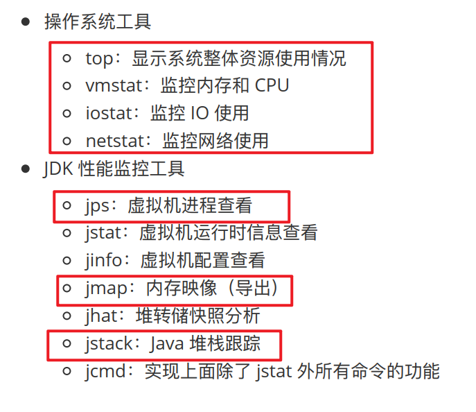

* 应用程序长时间连续运行时性能严重下降
* CPU使用率飙升，甚至到100%
* 频繁FuGC,各种报警，例如接口超时报警等
* 应用程序抛出OutofMemoryError错误
* 应用程序偶尔会耗尽连接对象

# 死锁如何排查

可以使用idk自带的命令行工具排查：

* 使用jps查找运行的java进程：jps -l
* 使用jstack查看线程堆栈信息：jstack -I进程id

基本就可以看到死锁的信息。

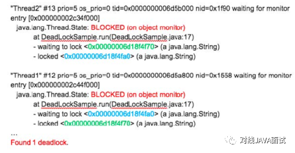

**还可以利用图形化工具，比如JConsole。出现线程死锁以后，点击JConsole线程面板的检测到死锁按钮，将会看到线程的死锁信息。**

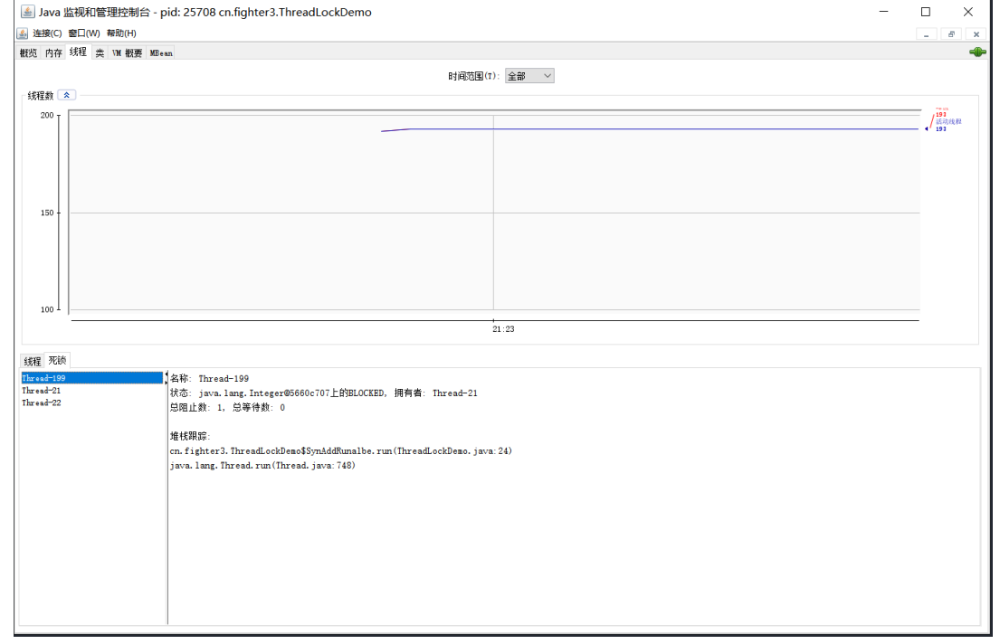

# OOM如何排查

* **<font style="color:rgb(51, 51, 51);">内存泄露</font>**<font style="color:rgb(51, 51, 51);">：申请使用完的内存没有释放，导致虚拟机不能再次使用该内存，此时这段内存就泄露了，因为申请者不用了，而又不能被虚拟机分配给别人用。</font>
* **<font style="color:rgb(51, 51, 51);">内存溢出</font>**<font style="color:rgb(51, 51, 51);">：申请的内存超出了JVM能提供的内存大小，此时称之为溢出。</font>

<font style="color:rgb(51, 51, 51);">一般手段是：</font>**<font style="color:rgb(51, 51, 51);">先通过内存映像工具对</font>****<font style="color:#DF2A3F;">Dump</font>****<font style="color:rgb(51, 51, 51);">出来的</font>****<font style="color:#DF2A3F;">堆转储快照进行分析</font>****<font style="color:rgb(51, 51, 51);">，重点是确认内存中的对象是否是必要的，也就是要先分清楚到底是出现了内存泄漏还是内存溢出。</font>**

* <font style="color:rgb(51, 51, 51);">如果是内存泄漏，可进一步通过工具查看泄漏对象到GC Roots的引用链。这样就能够找到泄漏的对象是通过怎么样的路径与GC Roots相关联的导致垃圾回收机制无法将其回收。掌握了泄漏对象的类信息和GC Roots引用链的信息，就可以比较准确地定位泄漏代码的位置。</font>
* <font style="color:rgb(51, 51, 51);">如果不存在泄漏，那么就是内存中的对象确实必须存活着，那么此时就需要通过虚拟机的堆参数（ -Xmx和-Xms）来适当调大参数；从代码上检查是否存在某些对象存活时间过长、持有时间过长的情况，尝试减少运行时内存的消耗。</font>

<font style="color:rgb(51, 51, 51);"></font>

# <font style="color:rgb(51, 51, 51);">Redis宕机怎么处理</font>

1. 诊断问题
   * **检查Redis进程状态**：首先确认Redis进程是否还在运行。可以使用系统命令（如ps、top或systemctl status redis等，具体取决于你的系统和Redis安装方式）来检查Redis服务的状态。
   * **查看日志文件**：检查Redis的日志文件，通常位于Redis安装目录下的logs文件夹中。
   * **使用redis-cli检查状态**：通过redis-cli命令连接到Redis，尝试执行一些基本的命令（如PING）来检查Redis服务是否响应。
2. 尝试恢复
   * **重启Redis服务**：如果宕机的原因是临时性的（如内存不足、网络问题等），尝试重新启动Redis服务可能会解决问题。
   * **从备份恢复**：如果有最近的Redis数据备份，可以尝试将数据备份恢复到新的Redis实例中。
   * **使用持久化文件恢复：**
     * AOF恢复：如果启用了AOF（Append Only File）持久化，Redis可以将数据从AOF文件中恢复。
     * RDB恢复：如果启用了RDB（Redis Database）持久化，Redis可以将数据从RDB快照文件中恢复。
3. 优化配置和性能
   * **优化内存使用**：调整Redis的配置参数，如最大内存限制、过期时间等，以减少内存的使用并避免内存溢出导致的宕机。
   * **优化持久化策略**：根据实际情况选择合适的持久化方式（AOF或RDB），并调整相关配置以优化性能。
   * **调整其他配置参数**：如增加最大连接数、调整并发策略等，以提高Redis的性能和稳定性。
4. 预防措施
   * **启用持久化**：确保Redis配置了AOF或RDB持久化，以防止数据丢失。
   * **定期备份**：定期对Redis的数据进行备份，并验证备份数据的完整性和可恢复性。
   * **使用高可用性架构**：如Redis Sentinel、Redis Cluster或使用主从复制等方式来搭建Redis环境，确保在主节点宕机时能够自动切换到备用节点，保证服务的连续性。
   * **监控与报警**：配置监控系统对Redis进行实时监控，包括内存使用情况、连接数、命令执行时间等指标。当出现异常情况时，及时发送报警通知以便及时处理问题。
   * **升级Redis版本**：定期更新Redis到最新版本以修复已知的错误并增强稳定性。


> 更新: 2024-09-25 10:03:49  
> 原文: <https://www.yuque.com/nibiwanxiamei/yrd6t1/sih4k0q1twymt1eu>