# 麻将社区 -- 黑马头条改版

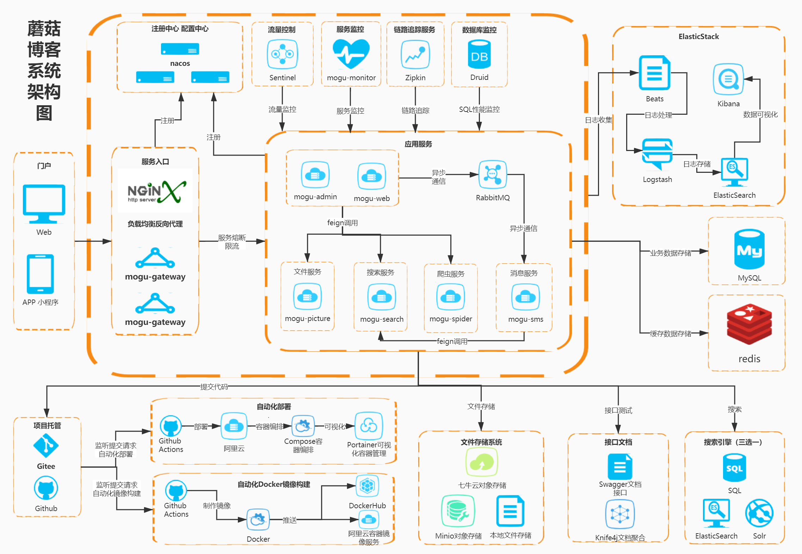

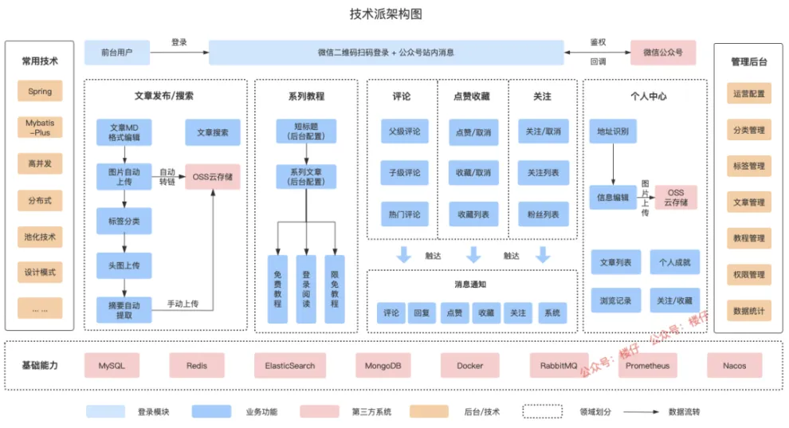

技术栈：SpringBoot，SpringCloud，Mybatis，MySql，Redis，RabbitMQ，知识图谱

> 本项目旨在设计一个麻将社区，供给给麻将爱好者们的一个社交资讯平台。
>
> 本项目实现了：文章发布，个人管理，用户登录，私信通知，点赞关注，热点推荐等功能

[基本内容](https://mp.weixin.qq.com/s/iiukwRNW1-my1q6UjYl4iw)

> * 项目是专门为各类麻将用户提供交流的社区平台，用户可以在平台发布、查看和搜索文章，也可以使用智能问答咨询麻将相关问题。管理员可以管理文章和用户。
> * 技术栈: SpringBoot、SpringCloud、MySQL、Redis、MyBatis、RabbitMQ等
> * 功能实现:
>   * 使用MySQL数据库存储系统的业务数据，利用索引提高访问速度
>   * 设计版本号+盐值的MD5加密算法，优化传统MD5算法冲突问题
>   * 基于 ThreadLocal 在登录校验拦截器中封装线程隔离的全局上下文，以便在线程内部存储用户信息，减少用户信息的数据库查询次数
>   * 引入了Redis数据库来提升网站的整体性能：存储验证码、登陆凭证、用户信息等，解决缓存击穿，穿透，雪崩问题
>   * 借助 Redis 的 zset 数据结构实现文章热度排行榜、用户活跃排行榜
>   * 基于RabbitMQ实现系统通知，用户获得点赞、评论、关注后得到通知，实现消息的异步解耦，提升系统效率和稳定性
>   * 基于Redis的Hash数据类型保存点赞信息，通过定时任务将缓存数据同步到数据库，实现高性能点赞
>   * 采用先更新数据库在删除Redis的方式保证mysql和redis数据一致性
>   * 引入xxl jobb定时任务定时刷新文章热度、用户活跃榜单、缓存数据同步
>   * 调用麻将AI问答系统的接口，用户可以进行关于麻将知识的提问并获得相应的回答

# 数据库表格设计

## User表

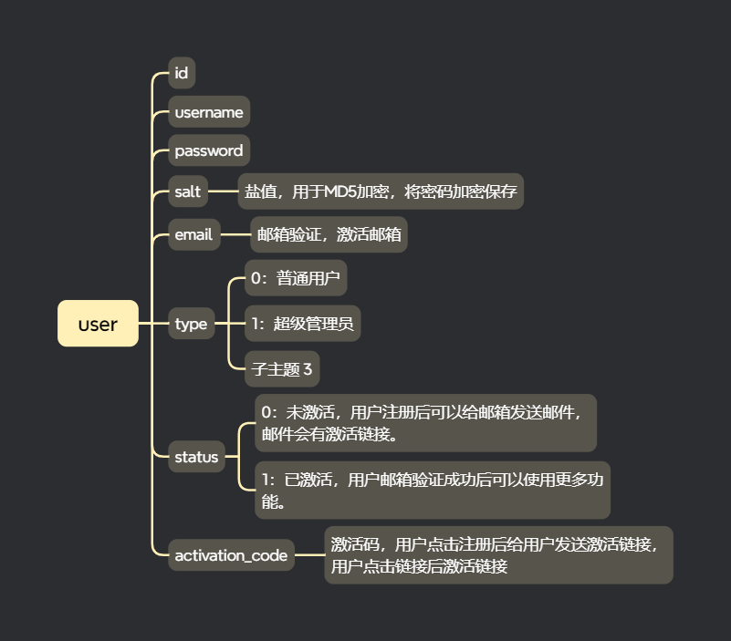

加入用户类型，用户雪花ID

为什么需要邮箱激活码？

1. 对用户客户端而言,激活是操作了数据库的某一状态,使账号处于开放状态,获得使用权。 也是对身份一种核查,绑定了你的邮箱,方便通知你,或者密码找回等操作。
2. 对服务器而言,**防止了机器注册**(大量生产无意义的注册),根据你的CPU和MAC地址生成一个激活码,确保了唯一性和真实性,从而减轻了服务器的压力。
3. 对于游戏或者软件,可以**用于购买使用权(激活码)来盈利**,限制使用人数,保障服务器运行等。

## discuss\_post表

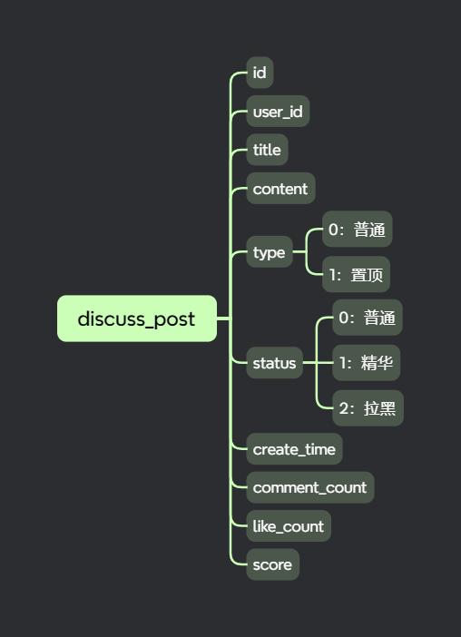

## comment表

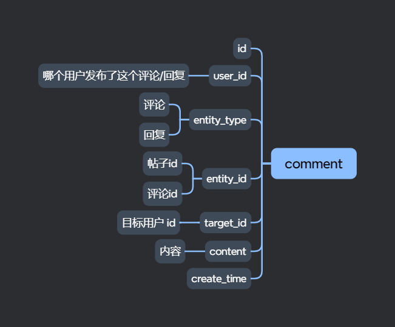

## like表

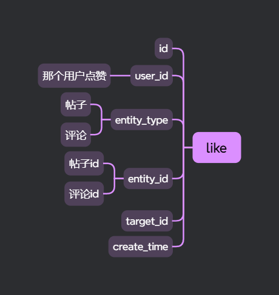

## content表

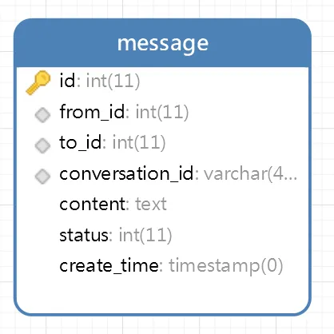

## Dto，Vo

前端请求参数对象是Dto，返回给前端是Vo

利用MD5对密码加密，同时加上盐值（salt）

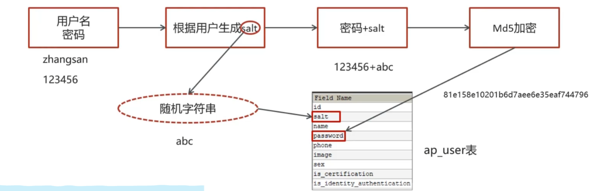

# 登录模块  -  短信验证码 + 密码

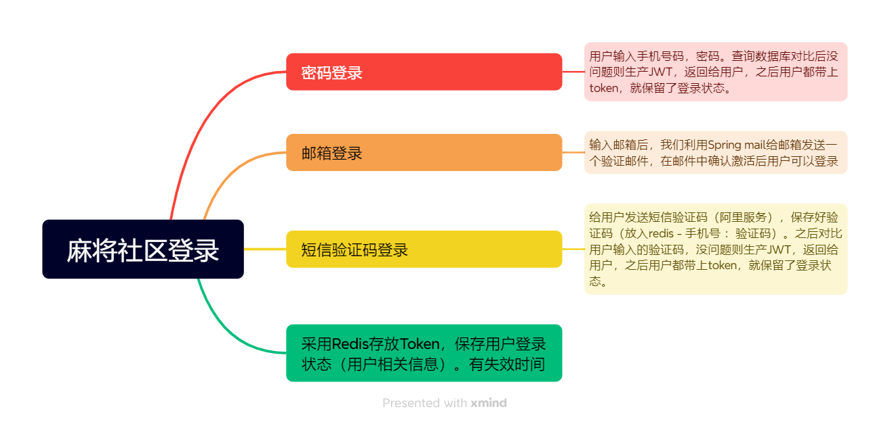

基本思维导图 : **最终选择密码登录 + 短信验证码登录**

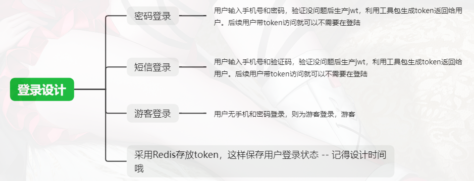

## 注册流程

**用户在提交手机号后，会校验手机号是否合法，如果不合法，则要求用户重新输入手机号。**

合法手机号，则发送一个短信验证码（此时**手机号：验证码存入Redis中**），生成用户基本信息

## 登录流程

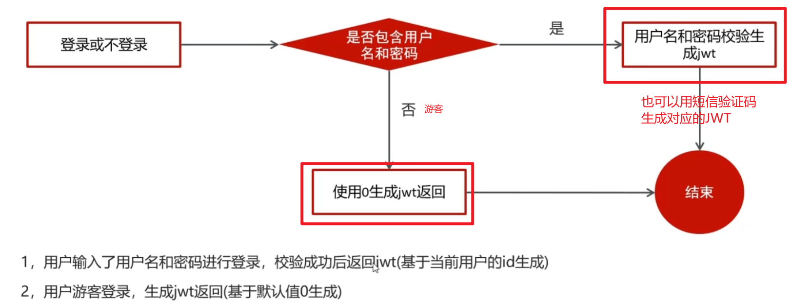

## 短信验证码基本登录流程

1.**发送验证码：**

* **用户在提交手机号后，会校验手机号是否合法，如果不合法（不存在），则要求用户重新输入手机号。**
* **如果手机号合法，后台此时生成对应的验证码，同时将验证码进行保存，然后再通过短信的方式将验证码发送给用户。**

2.**短信验证码登录、注册：**

**用户将验证码和手机号进行输入，后台\*\*\*\*从Redis中拿到当前验证码（以手机号为key，code为value）**  **，然后和用户输入的验证码进行校验，如果不一致，则无法通过校验，如果一致，则后台根据手机号查询用户，如果用户不存在，则为用户创建账号信息，保存到数据库，无论是否存在，都会将用户信息（利用JWT Token生成key）保存到Redis中，方便后续获得当前登录信息**

3.**校验登录状态:**

**用户在请求时候，会从cookie中携带者JsessionId到后台，后台通过JsessionId从session中拿到用户信息，如果没有session信息，则进行拦截，如果有session信息，则\*\*\*\*将用户信息保存到threadLocal中**（方便后续服务使用） **，并且放行**

### JWT Token

**我们要将用户相关信息放入Redis，但是直接用敏感信息作为key不好。在后台生成一个随机串token，然后让前端带来这个token。**

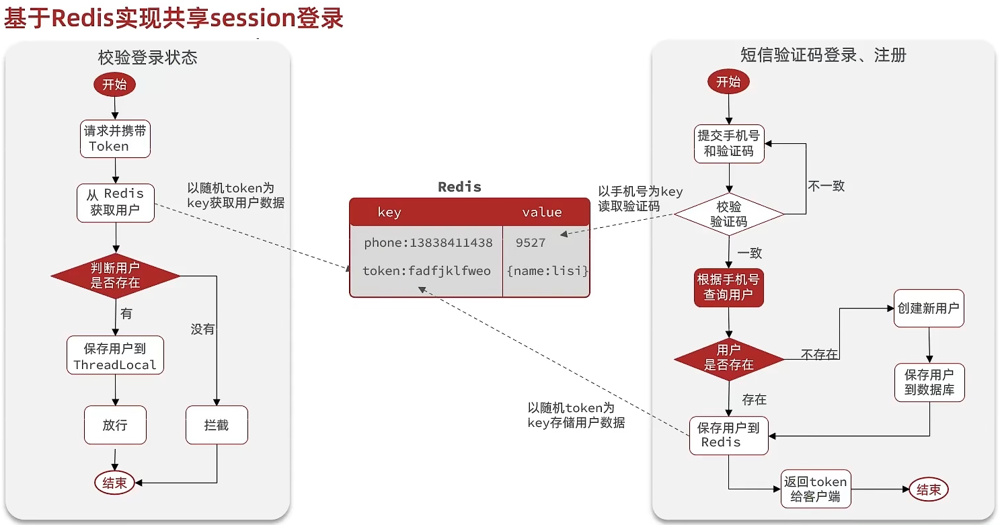

**从请求头中获取token，然后比对redis中存放的token，同时把用户相关信息放入threadLocal中**

### 登录状态保存

* 用户登录 —> **生成登录凭证存入 Redis**，Cookie 中存一份 key
* 每次执行请求都会通过 Cookie **去 Redis 中查询该用户的登陆凭证是否过期和是否有效**。点击记住我可以延长登录凭证的过期时间，用户退出则其登录凭证变为无效状态
* 根据这个登录凭证对应的用户 id，去数据库中查询这个用户信息
* **使用 ThreadLocal 在本次请求中一直持有这个用户信息（拦截器+threadlocal实现保存用户信息）**
* **redis中存储jwt对应用户信息，多次直接查询redis减轻后端服务器压力**
* **优化点**：每次请求前都需要去数据库查询这个用户信息，访问频率比较高，所以我们考虑**把登录成功的用户信息在 Redis 中保存一会，拦截器每次查询前先去 Redis 中查询**，**缓存和数据库的一致性问题的话，使用的是旁路缓存模式：也就是先更新MYSQL，然后直接删除缓存中的数据。**

## 密码登录 -- 密码加密算法

使用MD5加密方式，但是MD5也不是很安全，并且MD5加密算法存在碰撞问题（简单密码生成的密码都一样）在MD5的基础上加盐值，这样不容易产生碰撞问题

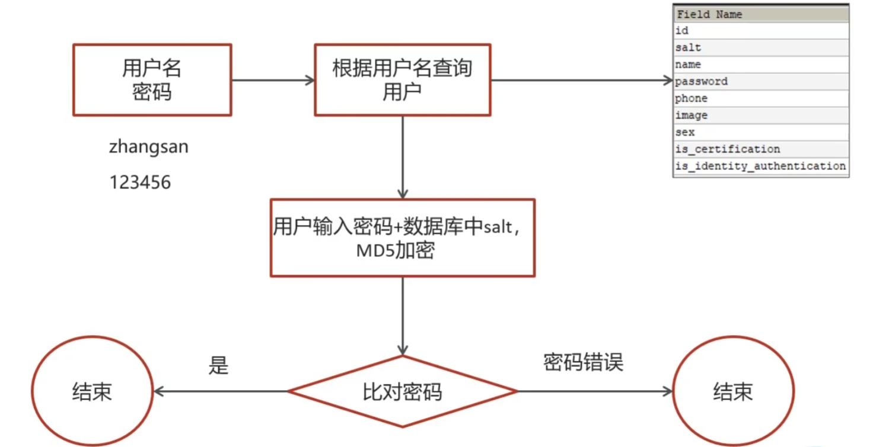

**存入数据库：salt** `**$ version $**` **加密密码；通过salt + version 版本找到算法，然后找到加密算法**

# 发帖操作

[发文章操作](https://mp.weixin.qq.com/s/OsCd3Pcl6iq-0znh7PL3lg)

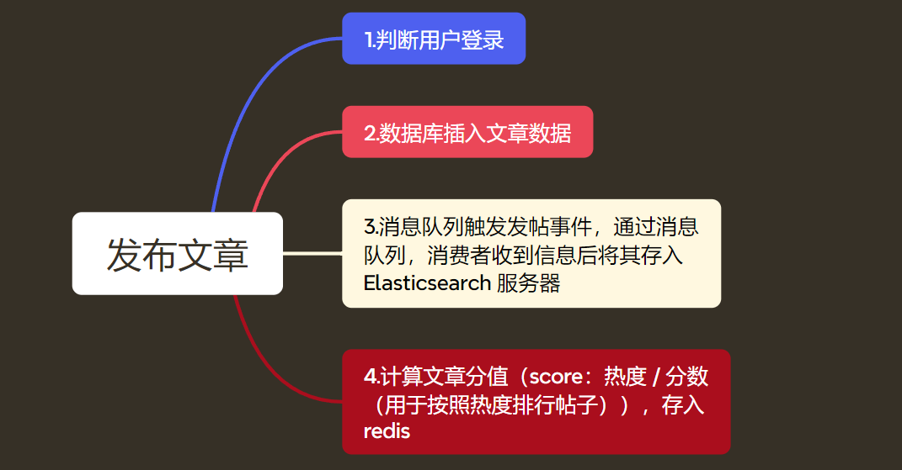

## 文章查询ElasticSearch

文章除了存储在数据库中，还存放在Es中，Es查询速度会比数据库SQL查询更快。

Es部署采用Docker实现的。Redis，Mq这些也全是docker实现的。

**根据用户输入的关键词查询文章。从Es中查询出相关的数据库ID，再根据ID去数据库中查询数据。**

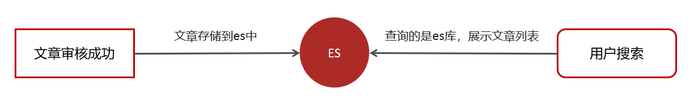

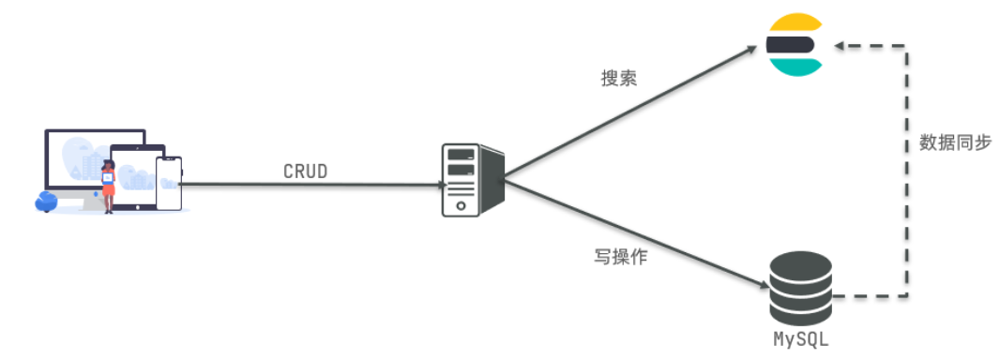

### MySQL向ES(elasticsearch)做数据同步

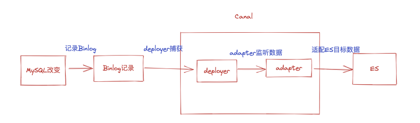

## 延迟发送文章任务

实现方案：Redis，Mq延迟队列，定时任务

RabbitMq的死信队列实现延迟队列作用。死信队列中的消息变成死信后就会发给他需要的真实队列。

什么是死信队列？如何导致的？

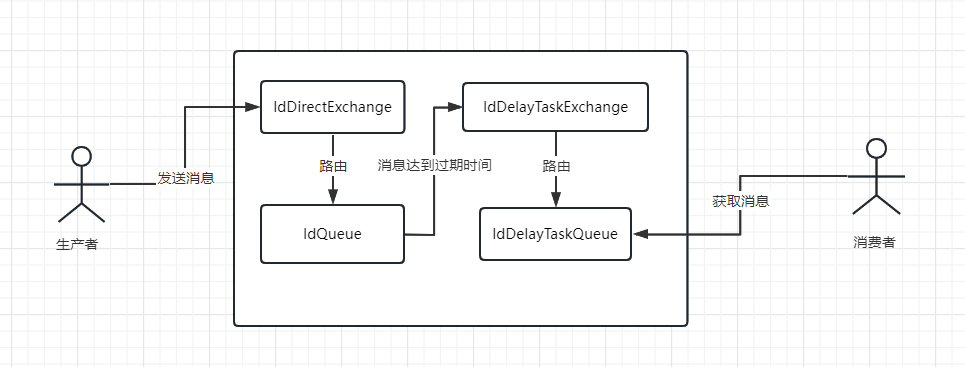

采用Redis实现：ZSet -- （key，score），score作为时间戳 -- 定时轮询查询。但是无法顺序执行相同score的任务。

采用任务调度框架实现 -- 基于当时的时间戳设置定时任务（数据量大的时候使用）。

# 点赞，评论，关注，热榜  --  redis实现

论坛内用户发布自己的文章：（麻将局面讨论，麻将牌型选择 ，介绍麻将种类，麻将相关内容询问）

## 点赞排行

[点赞](https://mp.weixin.qq.com/s/lzPp5XeATTlHOCc8p5MF_w)

**防止重复点赞：把点赞数据放入redis，以文章为key，点赞用户ID集合作为value。**

**某个用户的获赞数量对应的存储在 Redis 中的 key 是** `**like:user:userId**` **，value 就是这个用户的获赞数量**

> 方法2：**将点赞相关信息存入 Redis 的数据结构 set 中。其中，key 命名为**  `**like:entity:entityType:entityId**` **，value 即点赞用户的 id。比如 key =**   `**like:entity:2:246**`  **value =**   `**11**` **表示用户 11 对实体类型 2 即评论进行了点赞，该评论的 id 是 246**

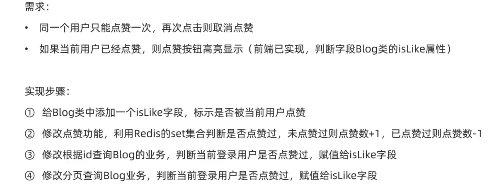

**中间的消息发送可以利用RabbitMq实现。这样可以减轻压力。**

点赞的流程用redis解决了，消息传递用mq解决了。

采用sortedSet作为保存用户ID集合，可以对用户ID进行排序，这样可以获取前面点赞的用户排名

## 发布评论 -- **事务管理**

* 步骤 1：增加评论数据（向评论表 `comment` 中添加记录行）
* 步骤 2：修改帖子的评论数量（帖子表 `discuss_post` 中内置了 comment\_count 字段）

Spring 中支持两种方式事务管理：

1）基于 `TransactionTemplate` 的编程式事务，实际中很少使用

2）基于 xml 配置或者注解 `@Transactional` 的声明式事务。

**我们是一个分布式微服务项目，那么肯定需要用到分布式事务吧**

### **分布式事务框架seata**

利用的是分布式事务框架Seata，配置好seata之后，**把@Transactional改为@GlobalTransactional即可**

## 共同关注

利用redis的set 求交集，就可以求出共同关注。

[关注](https://mp.weixin.qq.com/s/dx2jBqlUnhep7O6oknR5cg)

## 关注推送

可以用rabbitMq推送消息；具体做法就是发布文章后，就给关注自己的用户推送文章。采用mq异步发送

## 热点文章计算 -- xxljob | quartz

**采用定时任务，固定监测文章热度变化，更新热点文章**

batch定时调度

可以采用quartz，当然用的多的还是xxl-job

**Quartz 是一个强大的、成熟的任务调度框架，主要支持 Java 语言，而** **xxl-job 则是一个专注&#x4E8E;****分布式任务调度****&#x7684;平台** **，支持多种语言，并提供了任务调度中心和监控功能。**

**xxl-job 提供了多语言的任务执行器，并且专注于\*\*\*\*分布式任务调度** **，可以很好地满足微服务架构下的任务调度需求。** 编写XXL-JOB定时刷新文章热度。

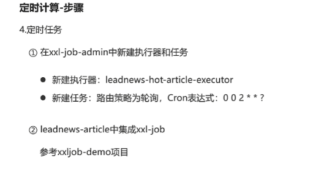

> **每次点赞，发帖，评论文章，都会把文章放入Redis，xxljob定时去redis中取出这些数据进行热度重新计算。**
>
> **key：value = （post:score） : （帖子ID）**

## redis实现用户活跃排行榜

**基于redis的zset数据结构来实现** -- 其实就是上

## redis实现白名单

用set集合把某些用户加入白名单，无需审核直接发文

# 高并发 - 抢VIP兑换券

社区平台抢购的是券（兑换课程使用 ） -》 券就需要抢，抢了就可以兑换VIP，可以查看所有的文章和教程。当然这个VIP是有期限限制的。也就是要设计会员信息，抢购到了去兑换限时VIP，读取限定文章。

## VIP兑换券查询分析

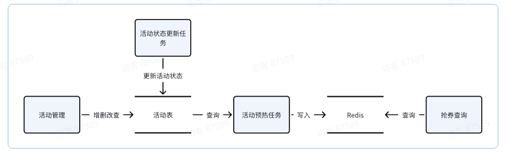

优惠券：ID，所有者，用户名称，手机号，有效期，状态，订单ID

**通过定时任务\*\*\*\*定时提前预热优惠券信息** -- 将数据库信息写入Redis，设置不过期，定期排除redis失效的数据

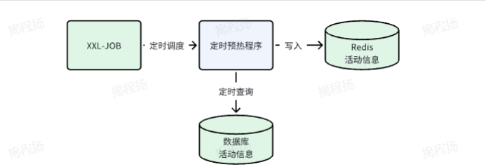

优惠券核销过程就是将用户的权限增加，可以查看对应的vip文章，限时 | 永久都可以。

## 数据结构设计

redis结构：String类型

**key: "ACTIVITY:LIST"**

**value: 符合条件的优惠券活动列表JSON数据。**

过期时间：永不过期

缓存一致性方案：通过预热程序保证缓存一致性

## 定时更新优惠券状态

```java
@Component
public class XxlJobHandler {

/**
 * 活动状态修改，
 * 1.活动进行中状态修改
 * 2.活动已失效状态修改
 * 1分钟一次
 */
@XxlJob("updateActivityStatus")
public void updateActivitySatus(){
    log.info("定时修改活动状态...");
    try {
        activityService.updateStatus();
    } catch (Exception e) {
        e.printStackTrace();
    }
}
...
```

```java
@Override
public void updateStatus() {
    LocalDateTime now = DateUtils.now();
    // 1.更新已经进行中的状态
    lambdaUpdate()
            .set(Activity::getStatus, ActivityStatusEnum.DISTRIBUTING.getStatus())//更新活动状态为进行中
            .eq(Activity::getStatus, NO_DISTRIBUTE.getStatus())//检索待生效的活动
            .le(Activity::getDistributeStartTime, now)//活动开始时间小于等于当前时间
            .gt(Activity::getDistributeEndTime,now)//活动结束时间大于当前时间
            .update();
    // 2.更新已经结束的
    lambdaUpdate()
            .set(Activity::getStatus, LOSE_EFFICACY.getStatus())//更新活动状态为已失效
            .in(Activity::getStatus, Arrays.asList(DISTRIBUTING.getStatus(), NO_DISTRIBUTE.getStatus()))//检索待生效及进行中的活动
            .lt(Activity::getDistributeEndTime, now)//活动结束时间小于当前时间
            .update();
}
```

‍

## 抢券

### **解决超卖问题**

**造成超卖问题的原因是在高并发场景下对库存这个共享资源进行操作存在线程不安全所导致。**

共享数据放入redis加快访问速度，**使用Redis原子操作控制超卖问题**

使用分布式锁解决超卖问题

### 抢券步骤

**将库存保存在Redis，避免抢券操作请求数据库，通过异步任务将Redis中的抢券结果同步到数据库。**

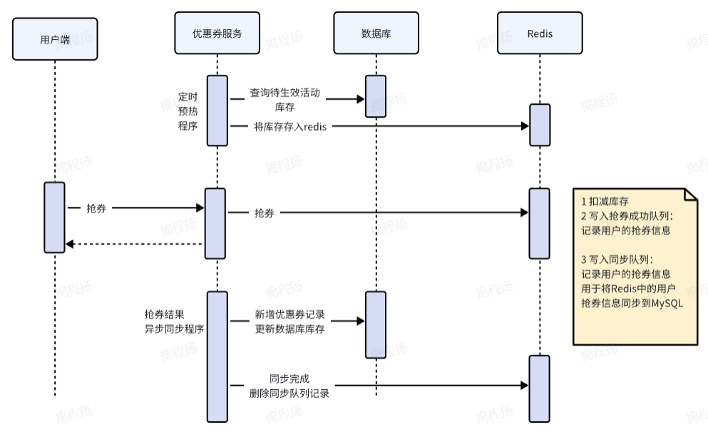

1、**由预热程序将待生效库存同步到redis(活动开始将不允许更改库存)**

2、活动开始后，抢券程序请求Redis扣减库存，扣减库存成功向抢券成功队列和抢券同步队列写入记录

Redis中两个队列的作用如下：

```plain
**抢券成功队列：为了校验用户是否抢过该优惠券。**

**抢券同步队列：将抢券结果同步到数据库。**
```

3、通过定时任务程序根据Redis中同步队列记录的用户抢券结果信息将数据同步到MySQL，具体操作如下：

* 向优惠券表插入用户抢券记录。
* 更新优惠券活动表的库存。
* 写入数据库完成后删除Redis中同步队列的相应记录，删除后表示同步完成，如果同步过程失败将保留Redis同步队列的相应记录。

**缓存一致性方案：通过预热程序保证缓存一致性**

### redis结果同步到mysql

遍历Redis中的抢券结果同步队列，拿到一个元素就向数据库的优惠券表插入记录，插入完成后删除Redis中的这条记录。

# 面试

## Redis缓存问题

### 缓存击穿

**缓存的热点key失效，大量请求同时访问数据库，击穿缓存。**

解决方法：

* **主动更新热点key的缓存时间（定时任务），设置永不过期**（采用）
* **限制查询数据库的请求，采用分布式锁，只有一个用户可以查询数据库，没有锁则失败**

### 缓存穿透

**查询redis和数据库中都没有的数据。穿透redis。**

解决方法：

* **限制查询数据库的请求，采用分布式锁，只有一个用户可以查询数据库，没有锁则失败**
* **查询是空的，也放入key到redis中，存储特殊值或者空值（采用方案）**
* 布隆过滤器

### 缓存雪崩

大量的key同时失效，导致大量请求都访问数据库

解决方法：

**失效时间不固定，随机失效，打散key的失效时间。（采用方案）**

## 如何保证redis和mysql数据一致性

**使用先写 MySQL，再删除 Redis 的方式**

> **优化点**：每次请求前都需要去数据库查询这个用户信息，访问频率比较高，所以我们考虑**把登录成功的用户信息在 Redis 中保存一会，拦截器每次查询前先去 Redis 中查询**，然后缓存和数据库的一致性问题的话，使用的是旁路缓存模式，也就是先更新数据库，然后直接删除缓存中的数据。

其他解决方案：

\*\*延迟双删：\*\*******先删除redis，再更新数据库，延迟N秒后再删除一次redis。** 延迟N秒的时间**一定要大于请求2将数据库旧数据写入redis的时间**，这个时间短则几百毫秒，长则几秒，具体根据自己的业务而定。

原因：如果延迟时间小于请求2写入redis的时间，会导致请求1清除缓存的时机过早，请求2又会将旧的数据写入redis。

## mysql和es同步数据


## redis分布式锁使用

使用Redis分布式锁的背景是当**用户根据articleId去查询文章详情页，然后查询出结果后返回**

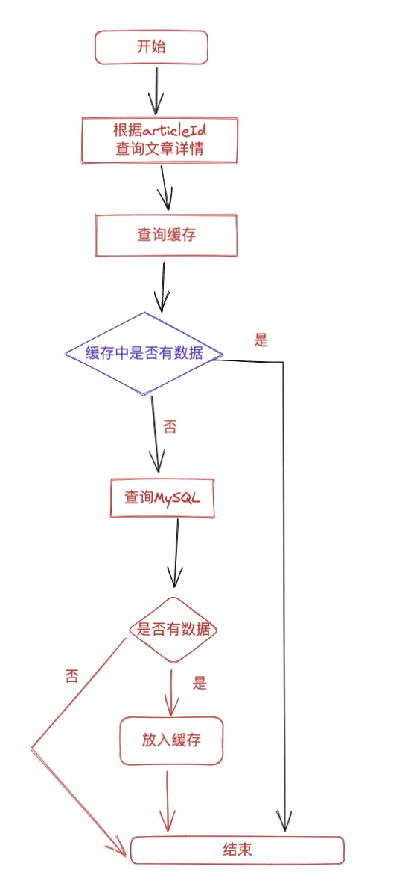

并发量高的时候就会出现问题，缓存中没有数据，然后到MySQL中查询（类似缓存击穿）。

**将用户同时访问同一个文章时，只允许一个用户去MySQL中获取数据，由于我们服务是集群化部署，那么就开始用到了Redis分布式锁。**

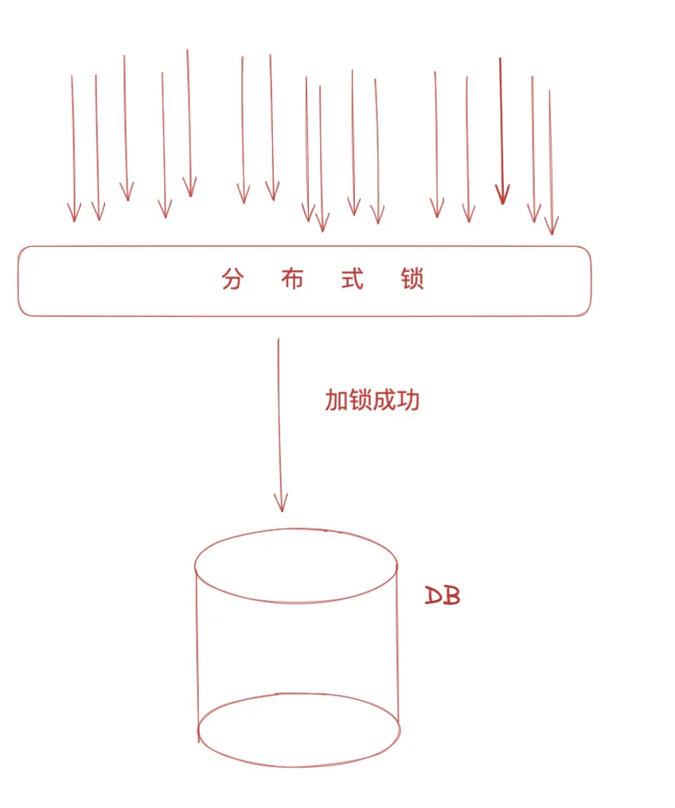

### 实现方案

#### 1.普通方案：**set key value EX time NX**

**当缓存中没有数据时，就开始加锁，加锁成功则允许访问数据库，加锁失败则自旋重新访问。**

**在setIfAbsent中虽然设置了过期时间，但是会出现一种情况：当我们业务执行完之后，但是我们的锁还被持有着，虽然有过期时间，且Redis中有淘汰策略，但是还是不建议这么做，因为Redis缓存资源是非常重要的；正确的做法应该是当业务执行完之后，直接释放锁。**

#### 2.**进化方案：set key value EX time NX**，**执行完毕之后删除key值**

但是这种还是存在问题：\
释放别人的锁：线程A已经获取到锁，在执行业务，但是还没有执行完成，过期时间到了，那么该锁就会被释放；此时线程B能够获取该锁，且执行业务逻辑，但是此时线程A执行完成需要释放锁，但是此时释放的锁是线程B的，也就是释放别人的锁。

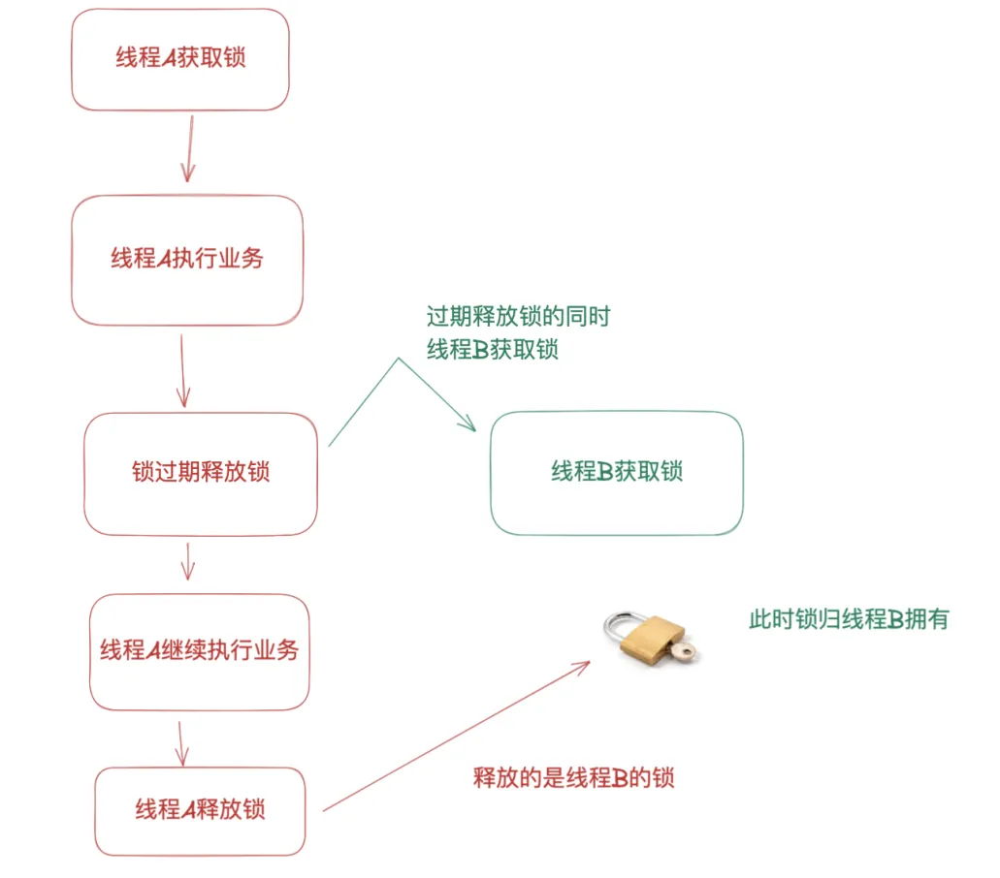

#### 3.进阶方案：**在加锁的时候去设置个value身份值**

**在释放锁前判断下给key的value是否和前面设置的value值相等，相等则说明是自己的锁可以删除，否则是别人的锁不能删除。**

此方案还是不行，无法知道设置多长的过期时间比较好

#### **究极方案：Redission看门狗机制**

\*\*4.\*\*\*\*\*\***究极方案：采用写一个守护线程，然后每隔固定时间去查看业务是否执行完毕，如果没有的话就延长其过期时间，也就是为其锁续期；-看门狗机制，上述逻辑已经有技术实现——Redission。**

**redission解决了redis实现分布式锁中出现的锁过期问题，还有释放他人的锁，它还是可重入锁：它的内部机制是默认锁过期时间是30s，然后会有一个定时任务在每10s去扫描一下该锁是否被释放，如果没有释放那么就延长至30s，这个机制就是看门狗机制(watch dog)。**

redission实际还存在一个问题，就是当redis是主从架构时，线程A刚刚成功的加锁在了master节点，还没有同步到slave节点，此时master节点给挂了，然后线程B这时过来是可以加锁的，但是实际上它已经加锁过了，这就是所出现的问题，这个问题涉及了高一致性 ，也就是C原则了；redission是无法解决高一致性问题的。\
如果想要解决高一致性可以使用**RedLock**，或者zk锁；他们保证了高一致性，但是不建议使用，因为为了保证高一致性，它丢失了高可用性，对用户体验感不好，且出现上述问题出现几率不大，不能因为这种很小的问题出现几率而舍弃其高可用性。


> 更新: 2024-08-09 10:54:53  
> 原文: <https://www.yuque.com/nibiwanxiamei/yrd6t1/b08a4ef5f971867bcc9ce12460b00f52>