# 操作系统

# 硬件架构

## 程序执行的基本过程

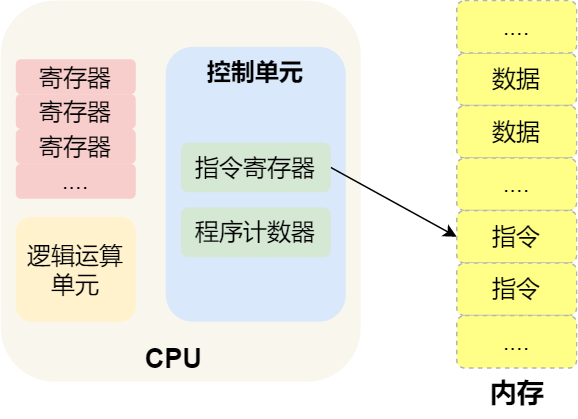

那 CPU 执行程序的过程如下：

* 第一步，**CPU 读取「程序计数器」的值**，这个值是指令的内存地址，然后 CPU 的\*\*「控制单元」**操作「地址总线」指定需要访问的**内存地址\*\*，接着通知内存设备准备数据，数据准备好后通过\*\*「数据总线」将指令数据传给 CPU\*\*，CPU 收到内存传来的数据后，**将这个指令数据存入到「指令寄存器」**。
* 第二步，「程序计数器」的值自增，表示指向下一条指令。这个自增的大小，由 CPU 的位宽决定，比如 32 位的 CPU，指令是 4 个字节，需要 4 个内存地址存放，因此「程序计数器」的值会自增 4；
* 第三步，CPU 分析\*\*「指令寄存器」中的指令\*\*，确定**指令的类型和参数**，如果是计算类型的指令，就把指令交给「逻辑运算单元」运算；如果是存储类型的指令，则交由「控制单元」执行；

简单总结一下就是，一个程序执行的时候，CPU 会根据程序计数器里的内存地址，从内存里面把需要执行的指令读取到指令寄存器里面执行，然后根据指令长度自增，开始顺序读取下一条指令。

CPU 从程序计数器读取指令、到执行、再到下一条指令，这个过程会不断循环，直到程序执行结束，这个不断循环的过程被称为 CPU 的指令周期。

## 指令流水线

<font style="color:rgb(44, 62, 80);">现代大多数 CPU 都使用来流水线的方式来执行指令，所谓的流水线就是把一个任务拆分成多个小任务，于是一条指令通常分为 4 个阶段，称为 4 级流水线，如下图：</font>

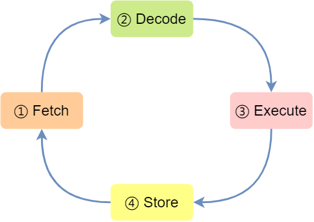

<font style="color:rgb(44, 62, 80);">四个阶段的具体含义：</font>

1. <font style="color:rgb(44, 62, 80);">CPU 通过程序计数器读取对应内存地址的指令，这个部分称为</font><font style="color:rgb(44, 62, 80);"> </font>**<font style="color:rgb(48, 79, 254);">Fetch（取得指令）</font>**<font style="color:rgb(44, 62, 80);">；</font>
2. <font style="color:rgb(44, 62, 80);">CPU 对指令进行解码，这个部分称为</font><font style="color:rgb(44, 62, 80);"> </font>**<font style="color:rgb(48, 79, 254);">Decode（指令译码）</font>**<font style="color:rgb(44, 62, 80);">；</font>
3. <font style="color:rgb(44, 62, 80);">CPU 执行指令，这个部分称为</font><font style="color:rgb(44, 62, 80);"> </font>**<font style="color:rgb(48, 79, 254);">Execution（执行指令）</font>**<font style="color:rgb(44, 62, 80);">；</font>
4. <font style="color:rgb(44, 62, 80);">CPU 将计算结果存回寄存器或者将寄存器的值存入内存，这个部分称为</font><font style="color:rgb(44, 62, 80);"> </font>**<font style="color:rgb(48, 79, 254);">Store（数据回写）</font>**<font style="color:rgb(44, 62, 80);">；</font>

<font style="color:rgb(44, 62, 80);">上面这 4 个阶段，我们称为</font>**<font style="color:rgb(48, 79, 254);">指令周期（</font>*****<font style="color:rgb(200, 73, 255);">Instrution Cycle</font>*****<font style="color:rgb(48, 79, 254);">）</font>**<font style="color:rgb(44, 62, 80);">，CPU 的工作就是一个周期接着一个周期，周而复始。事实上，不同的阶段其实是由计算机中的不同组件完成的：</font>

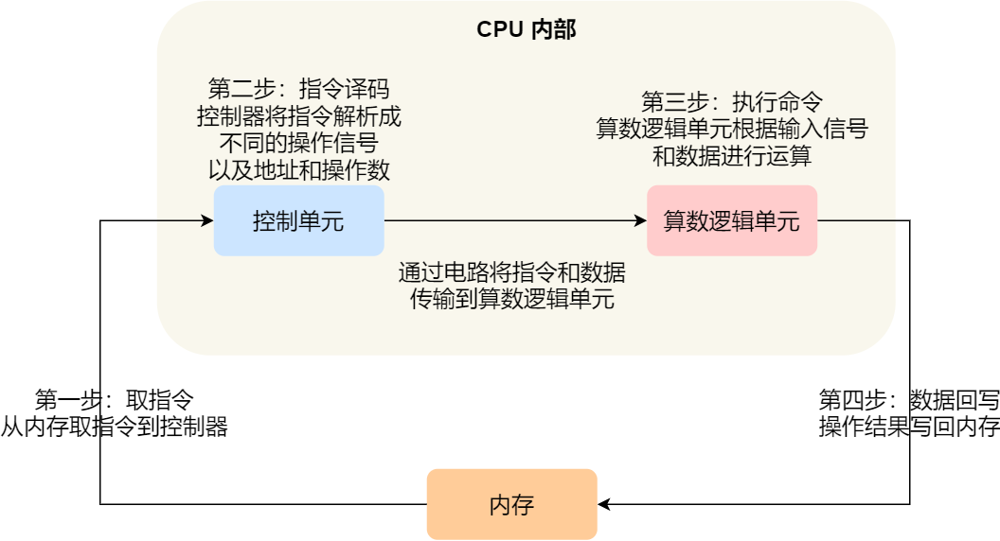

* <font style="color:rgb(44, 62, 80);">取指令的阶段，我们的指令是存放在</font>**<font style="color:rgb(48, 79, 254);">存储器</font>**<font style="color:rgb(44, 62, 80);">里的，实际上，通过程序计数器和指令寄存器取出指令的过程，是由</font>**<font style="color:rgb(48, 79, 254);">控制器</font>**<font style="color:rgb(44, 62, 80);">操作的；</font>
* <font style="color:rgb(44, 62, 80);">指令的译码过程，也是由</font>**<font style="color:rgb(48, 79, 254);">控制器</font>**<font style="color:rgb(44, 62, 80);">进行的；</font>
* <font style="color:rgb(44, 62, 80);">指令执行的过程，无论是进行算术操作、逻辑操作，还是进行数据传输、条件分支操作，都是由</font>**<font style="color:rgb(48, 79, 254);">算术逻辑单元</font>**<font style="color:rgb(44, 62, 80);">操作的，也就是由</font>**<font style="color:rgb(48, 79, 254);">运算器</font>**<font style="color:rgb(44, 62, 80);">处理的。但是如果是一个简单的无条件地址跳转，则是直接在</font>**<font style="color:rgb(48, 79, 254);">控制器</font>**<font style="color:rgb(44, 62, 80);">里面完成的，不需要用到运算器。</font>

## <font style="color:rgb(44, 62, 80);">存储器</font>

### 寄存器

寄存器的数量通常在几十到几百之间，每个寄存器可以用来存储一定的字节（byte）的数据。比如：

* 32 位 CPU 中大多数寄存器可以存储 4 个字节；
* 64 位 CPU 中大多数寄存器可以存储 8 个字节。

寄存器的访问速度非常快，一般要求在半个 CPU 时钟周期内完成读写，CPU 时钟周期跟 CPU 主频息息相关，比如 2 GHz 主频的 CPU，那么它的时钟周期就是 1/2G，也就是 0.5ns（纳秒）。

### Cpu Cache

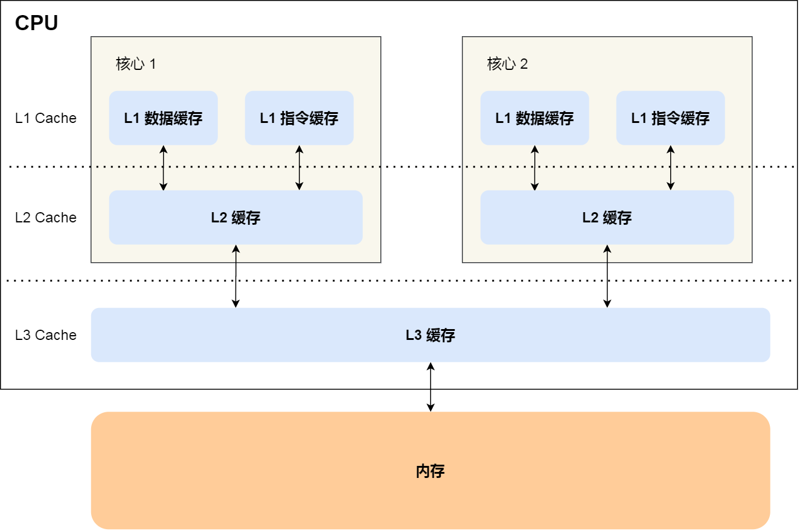

CPU Cache 用的是一种叫\*\* SRAM\*\*（Static Random-Access Memory，静态随机存储器） 的芯片。

每个 CPU 核心都有一块属于自己的 L1 高速缓存，**指令和数据在 L1** 是分开存放的，所以 L1 高速缓存通常分成**指令缓存**和**数据缓存**。

程序执行时，会先将**内存**中的数据加载到**共享的 L3 Cache 中**，再加载到**每个核心独有的 L2 Cache**，最后进入到**最快的 L1 Cache**，之后才会被 CPU 读取。越靠近核心其访问速度越快，访问速度如图所示：

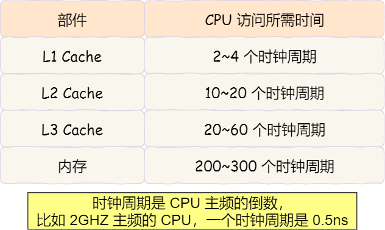

### 内存

内存用的芯片和 CPU Cache 有所不同，它使用的是一种叫作 **DRAM **（Dynamic Random Access Memory，动态随机存取存储器） 的芯片**。DRAM 存储一个 bit 数据，只需要一个晶体管和一个电容就能存储**，但是因为数据会被存储在电容里，电容会不断漏电，所以需要\*\*「定时刷新」\*\*电容，才能保证数据不会被丢失，这就是 DRAM 之所以被称为「动态」存储器的原因，只有不断刷新，数据才能被存储起来。

## Cpu cache 的数据结构和读取的过程

<font style="color:#DF2A3F;">注意：我们谈到cache size的时候并不考虑 cache 中 tag占用的内存部分</font>

cpu cache	line 包括以下信息：

* 组标记：这个组标记会记录当前 CPU Cache Line 中存储的数据对应的内存块，我们可以用这个组标记来区分不同的内存块。
* 数据：从内存加载过来的实际存放数据（Data）
* 有效位：它是用来标记对应的 CPU Cache Line 中的数据是否是有效的，如果有效位是 0，无论 CPU Cache Line 中是否有数据，CPU 都会直接访问内存，重新加载数据。

CPU 在从 CPU Cache 读取数据的时候，**并不是读取 CPU Cache Line 中的整个数据块，而是读取 CPU 所需要的一个数据片段**，这样的数据统称为一个字（Word）。那怎么在对应的 CPU Cache Line 中数据块中找到所需的字呢？答案是，需要一个偏移量（Offset）。

因此，一个内存的访问地址，包括组标记、CPU Cache Line 索引、偏移量这三种信息，于是 CPU 就能通过这些信息，在 CPU Cache 中找到缓存的数据。而对于 CPU Cache 里的数据结构，则是由索引 + 有效位 + 组标记 + 数据块组成。

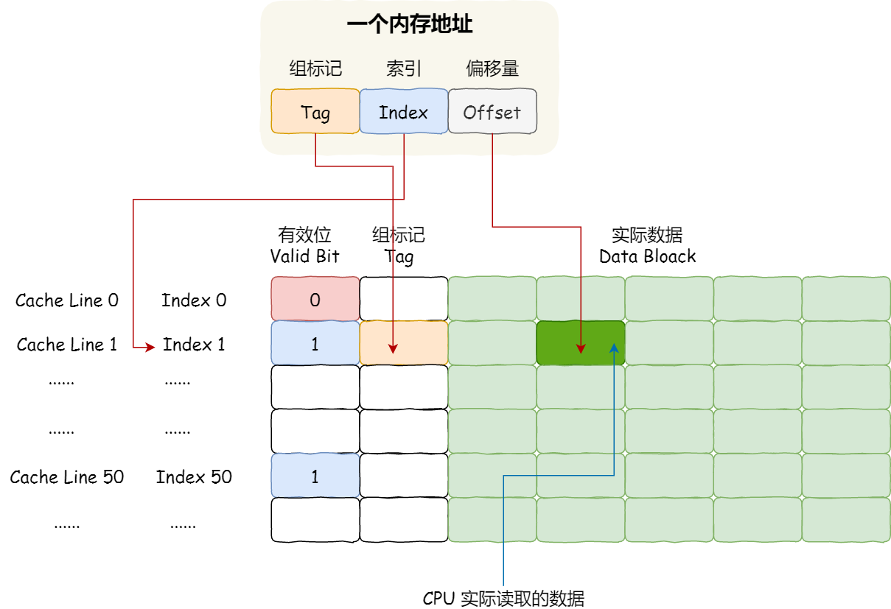

如果内存中的数据已经在 CPU Cache 中了，那 CPU 访问一个内存地址的时候，会经历这 4 个步骤：

1. 根据内存地址中索引信息（**Index 字段**），**根据访问方式（直接映射、组相联、全相联）计算在 CPU Cache 中的索引**，也就是找出对应的 CPU Cache Line 的地址；
2. 找到对应 CPU Cache Line 后，判断 CPU Cache Line 中的**有效位**，确认 CPU Cache Line 中数据是否是有效的，如果是无效的，CPU 就会直接访问内存，并重新加载数据，如果数据有效，则往下执行；
3. **对比内存地址中组标记和 CPU Cache Line 中的组标记**，确认 CPU Cache Line 中的数据是我们要访问的内存数据，如果不是的话，CPU 就会直接访问内存，并重新加载数据，如果是的话，则往下执行；
4. 根据**内存地址中偏移量信息**，从 CPU Cache Line 的数据块中，**读取对应的字**。

## 如何提高缓存的命中率

### 提高数据缓存的命中率

**遇到这种遍历数组的情况时，按照内存布局顺序访问，将可以有效的利用 CPU Cache 带来的好处，这样我们代码的性能就会得到很大的提升，**

### 提高指令缓存的命中率

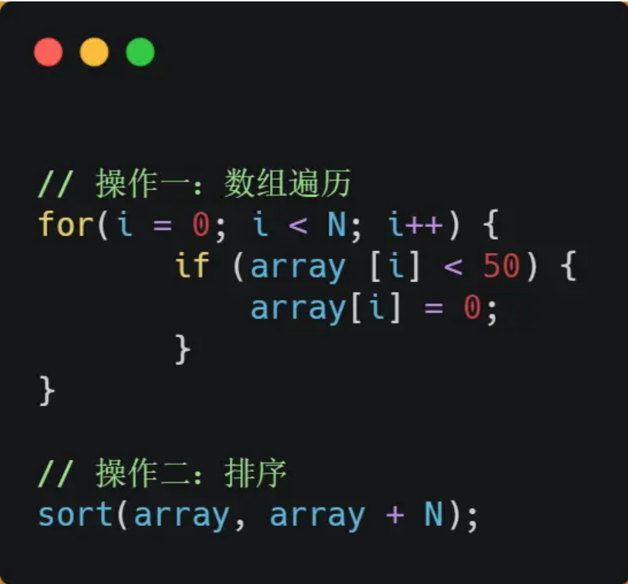

在回答这个问题之前，我们先了解 CPU 的**分支预测器**。对于 if 条件语句，意味着此时至少可以选择跳转到两段不同的指令执行，**也就是 if 还是 else 中的指令**。那么，如果分支预测可以预测到接下来要执行 if 里的指令，还是 else 指令的话，就可以<font style="color:#DF2A3F;">「提前」把这些指令放在指令缓存中（也就是 if 条件中的语句）</font>，这样 CPU 可以直接从 Cache 读取到指令，于是执行速度就会很快。

当数组中的元素是随机的，分支预测就无法有效工作，而当数组元素都是是顺序的，分支预测器会动态地根据历史命中数据对未来进行预测，这样命中率就会很高。

因此，**先排序再遍历速度会更快**，这是因为排序之后，数字是从小到大的，那么前几次循环命中 if < 50 的次数会比较多，于是**分支预测就会缓存 if 里的 array\[i] = 0 指令到 Cache 中**，后续 CPU 执行该指令就只需要从 Cache 读取就好了。

## 数据写入

### 写直达

保持内存与 Cache 一致性最简单的方式是，把数据**同时写入内存和 Cache 中**，这种方法称为写直达（Write Through）。

### 写回

在写回机制中，当发生写操作时，新的数据仅仅被写入 Cache Block 里，只有当修改过的 Cache Block「被替换」时才需要写到内存中，减少了数据写回内存的频率，这样便可以提高系统的性能。

那具体如何做到的呢？下面来详细说一下：

* 如果当发生写操作时，数据已经在 CPU Cache 里的话，则把数据更新到 CPU Cache 里，同时标记 CPU Cache 里的这个 Cache Block 为脏（Dirty）的，这个**脏的标记** 表示**CPU Cache 里面的这个 Cache Block 的数据和内存是不一致的**；
* 如果当发生写操作时，数据所对应的 Cache Block 里存放的是<font style="color:#DF2A3F;">「别的内存地址的数据」</font>的话，就要检查这个 Cache Block 里的数据有没有被标记为脏的：
  * **如果是脏的话，我们就要把这个 Cache Block 里的数据写回到内存，然后再把当前要写入的数据，先**\*\*<font style="color:#DF2A3F;">从内存读入到 Cache Block 里</font>**（注意，这一步不是没用的，具体为什么要这一步，可以看这个「[回答](https://stackoverflow.com/questions/26672661/for-write-back-cache-policy-why-data-should-first-be-read-from-memory-before-w)[(opens new window)](https://stackoverflow.com/questions/26672661/for-write-back-cache-policy-why-data-should-first-be-read-from-memory-before-w)」），然后**再把当前要写入的数据写入到 Cache Block\*\*，**<font style="color:#DF2A3F;">最后也把它标记为脏的</font>**。

> 当新写入的数据在缓存中未命中时（即该数据当前不在缓存中），系统需要从主存（RAM）中读取数据到缓存中，主要是出于以下几个原因的考虑：
>
> 1. 数据一致性：在多处理器或多核系统中，同一份数据可能在多个缓存副本中存在。如果某个处理器**直接写入一个缓存未命中的数据**而**不先读取主存中的值**，那么其他处理器缓存中的副本可能仍然是旧的、未更新的数据（直接从主存读取数据可以确保它获取到的是最新的、已经修改过的数据版本）。这会导致数据不一致的问题。
> 2. 缓存行填充：缓存是以缓存行（Cache Line）为单位进行操作的。当发生缓存未命中时，系统通常会读取一个完整的缓存行（例如64字节）到缓存中，而不仅仅是写入单个数据项。这是为了提高效率，\*\*因为缓存行的其他数据可能随后也会被访问。\*\*读取整个缓存行到缓存中称为“缓存行填充”（Cache Line Fill）。

```
- 如果不是脏的话，把当前要写入的数据先从内存读入到 Cache Block 里，接着将数据写入到这个 Cache Block 里，然后再把这个 Cache Block 标记为脏的就好了。
```

**为什么缓存没命中时，还要定位 Cache Block？**

这是因为此时是要判断数据即将写入到 cache block 里的位置，是否被「其他数据」占用了此位置，如果这个「其他数据」是脏数据，那么就要帮忙把它写回到内存。

## Cpu缓存一致性

现在 CPU 都是多核的，由于 L1/L2 Cache 是多个核心各自独有的，那么会带来多核心的缓存一致性（Cache Coherence） 的问题，如果不能保证缓存一致性的问题，就可能造成结果错误。

那么，要解决这一问题，就需要一种机制，来同步两个不同核心里面的缓存数据。要实现的这个机制的话，要保证做到下面这 2 点：

* 第一点，某个 CPU 核心里的 Cache 数据更新时，必须要传播到其他核心的 Cache，这个称为<font style="color:#DF2A3F;">写传播</font>（Write Propagation）；
* 第二点，某个 CPU 核心里对数据的操作顺序，必须在其他核心看起来顺序是一样的，这个称为<font style="color:#DF2A3F;">事务的串行化</font>（Transaction Serialization）。

> 比如说我们有双核 cpu，对于 i 变量而言，我们要保证 A 号核心和 B 号核心都能看到相同顺序的数据变化，比如变量 i 都是先变成 100，再变成 200，这样的过程就是事务的串行化。

要实现事务串行化，要做到 2 点：

* CPU 核心对于 Cache 中数据的操作，**需要同步给其他 CPU 核心**；
* 要引入「锁」的概念，如果两个 CPU 核心里有相同数据的 Cache，那么**对于这个 Cache 数据的更新，只有拿到了「锁」，才能进行对应的数据更新**。

### 总线嗅探

写传播的原则就是**当某个 CPU 核心更新了 Cache 中的数据，要把该事件广播通知到其他核心**。最常见实现的方式是**总线嗅探**（Bus Snooping）。

CPU 需要每时每刻监听总线上的一切活动，但是不管别的核心的 Cache 是否缓存相同的数据，都需要发出一个广播事件，这无疑会加重总线的负载。另外，总线嗅探只是保证了某个 CPU 核心的 Cache 更新数据这个事件能被其他 CPU 核心知道，但是并不能保证事务串行化。

于是，有一个协议基于总线嗅探机制实现了事务串行化，也用状态机机制降低了总线带宽压力，这个协议就是 MESI 协议，这个协议就做到了 CPU 缓存一致性。

### MESI协议

MESI 协议其实是 4 个状态单词的开头字母缩写，分别是：

* **Modified，已修改**
* **Exclusive，独占**
* **Shared，共享**
* **Invalidated，已失效**

**「已修改」状态**就是我们前面提到的**脏标记**，代表该 Cache Block 上的数据已经被更新过，但是还没有写到内存里。

**「已失效」状态**，表示的是这个 Cache Block 里的数据已经失效了，不可以读取该状态的数据。

**「独占」和「共享」状态**都代表 Cache Block 里的数据和内存里面的数据是**一致**的。

「独占」和「共享」的差别在于，独占状态的时候，**数据只存储在一个 CPU 核心的 Cache 里**，而其他 CPU 核心的 Cache 没有该数据。这个时候，如果要**向独占的 Cache 写数据**，就可以直接**自由地写入**，而不需要通知其他 CPU 核心，因为只有你这有这个数据，就不存在缓存一致性的问题了，于是就可以随便操作该数据。

在\*\*「独占」状态**下的数据，**如果有其他核心从内存读取了相同的数据到各自的 Cache** ，那么这个时候，独占状态下的数据就会变成**共享状态\*\*。

那么，**「共享」状态代表着相同的数据在多个 CPU 核心的 Cache 里都有**，所以当我们要更新 Cache 里面的数据的时候，**不能直接修改，而是要先向所有的其他 CPU 核心广播一个请求**，**要求先把其他核心的 Cache 中对应的 Cache Line 标记为「无效」状态，然后再更新当前 Cache 里面的数据**。

当 Cache Line 状态是\*\*「已修改」或者「独占」状态\*\*时，**修改更新其数据不需要发送广播给其他 CPU 核心**，这在一定程度上减少了总线带宽压力。

事实上，整个 MESI 的状态可以用一个有限状态机来表示它的状态流转。还有一点，对于不同状态触发的事件操作，可能是来自本地 CPU 核心发出的广播事件，也可以是来自其他 CPU 核心通过总线发出的广播事件。

**具体查看状态的流转以及详细介绍可看**:[小林 coding 图解系统](https://www.xiaolincoding.com/os/1_hardware/cpu_mesi.html#mesi-%E5%8D%8F%E8%AE%AE)

## ♥♥♥ cpu如何避免伪共享

对于多个线程共享的热点数据，即经常会修改的数据，应该避免这些数据刚好在同一个 Cache Line 中在 Linux 。这种因为多个线程同时读写同一个 Cache Line 的不同变量时，而导致 CPU Cache 失效的现象。

内核中存在 \_\_cacheline\_aligned\_in\_smp 宏定义，是用于解决伪共享的问题。

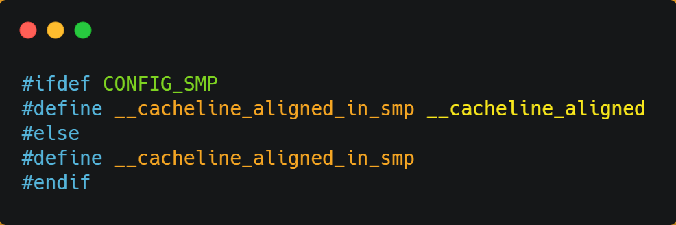

从上面的宏定义，我们可以看到：

* 如果在**多核（MP）系统**里，该宏定义是 \_\_cacheline\_aligned，也就是 Cache Line 的大小；
* 而如果在**单核系统**里，该宏定义是空的；

因此，针对在同一个 Cache Line 中的共享的数据，如果在多核之间竞争比较严重，为了防止伪共享现象的发生，可以采用上面的宏定义使得**变量在 Cache Line 里是对齐的**。

## cpu如何选择线程

在 Linux 内核中，进程和线程都是用\*\* task\_struct 结构体**表示的，区别在于**线程的 task\_struct 结构体里部分资源是共享了进程已创建的资源\*\*，比如内存地址空间、代码段、文件描述符等，所以 Linux 中的线程也被称为轻量级进程，因为线程的 task\_struct 相比进程的 task\_struct 承载的 资源比较少，因此以「轻」得名。

> <font style="color:rgb(77, 77, 77);">进程和线程在task\_struct结构体中是否有标识上的不同?</font>
>
> <font style="color:rgb(77, 77, 77);">实际上，在struct task\_struct中并没有明确的标识（枚举类型），区分该task是线程还是进程，不过可以通过pid和tgid简单判断当前task是哪种类型。</font>
>
> * **<font style="color:rgb(77, 77, 77);">pid</font>**<font style="color:rgb(77, 77, 77);">用于标识</font>**<font style="color:rgb(77, 77, 77);">不同进程和线程</font>**<font style="color:rgb(77, 77, 77);">。</font>
> * **<font style="color:rgb(77, 77, 77);">tgid</font>**<font style="color:rgb(77, 77, 77);">用于标识</font>**<font style="color:rgb(77, 77, 77);">线程组id</font>**<font style="color:rgb(77, 77, 77);">，在同一进程中的所有线程具有同一tgid。tgid值等于进程第一个线程（主线程）的pid值。接着以CLONE\_THREAD来调用clone建立的线程，都具有同样的tgid。</font>

Linux 内核里的调度器，调度的对象就是 task\_struct，接下来我们就把这个数据结构统称为任务。

在 Linux 系统中，根据任务的优先级以及响应要求，主要分为两种，其中优先级的数值越小，优先级越高：

* 实时任务，对系统的响应时间要求很高，也就是要尽可能快的执行实时任务，优先级在 0~99 范围内的就算实时任务；
* 普通任务，响应时间没有很高的要求，优先级在 **100~139** 范围内都是普通任务级别；

### 调度类

由于任务有优先级之分，Linux 系统为了保障高优先级的任务能够尽可能早的被执行，于是分为了这几种调度类，如下图：

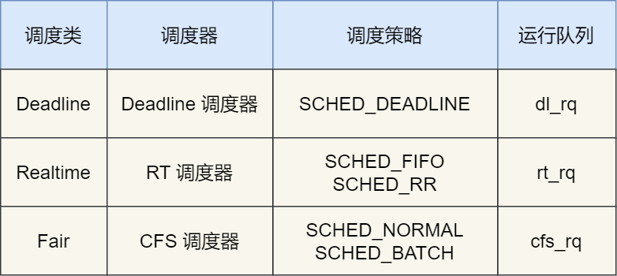

**Deadline 和 Realtime 这两个调度类，都是应用于实时任务的**，这两个调度类的调度策略合起来共有这三种，它们的作用如下：

* **SCHED\_DEADLINE**：是按照 **deadline 进行调度**的，距离当前时间点最近的 deadline 的任务会被优先调度；
* **SCHED\_FIFO**：对于相同优先级的任务，按**先来先服务**的原则，但是优先级更高的任务，可以抢占低优先级的任务，也就是**优先级高的可以「插队」**；
* **SCHED\_RR**：对于相同优先级的任务，轮流着运行，每个任务都有一定的时间片，当用完时间片的任务会被放到队列尾部，以保证相同优先级任务的公平性，但是**高优先级的任务依然可以抢占低优先级的任务**；

而 Fair 调度类是应用于普通任务，都是由 CFS 调度器管理的，分为两种调度策略：

* SCHED\_NORMAL：普通任务使用的调度策略；
* SCHED\_BATCH：后台任务的调度策略，不和终端进行交互，因此在不影响其他需要交互的任务，可以适当降低它的优先级。

在 CFS 算法调度的时候，会优先选择 vruntime 少的任务，以保证每个任务的公平性。计算 vruntime 的公式如下所示:


你可以不用管 NICE\_0\_LOAD 是什么，你就认为它是一个常量，那么在「同样的实际运行时间」里，高权重任务的 vruntime 比低权重任务的 vruntime 少，所以 CFS 调度会优先选择 vruntime 少的任务进行调度，所以高权重的任务就会被优先调度了，于是高权重的获得的实际运行时间自然就多了。

### cpu 运行队列

每个 CPU 都有自己的运行队列（Run Queue, rq），用于描述在此 CPU 上所运行的所有进程，其队列包含三个运行队列，Deadline 运行队列 dl\_rq、实时任务运行队列 rt\_rq 和 CFS 运行队列 cfs\_rq，其中 cfs\_rq 是用红黑树来描述的，按 vruntime 大小来排序的，最左侧的叶子节点，就是下次会被调度的任务。

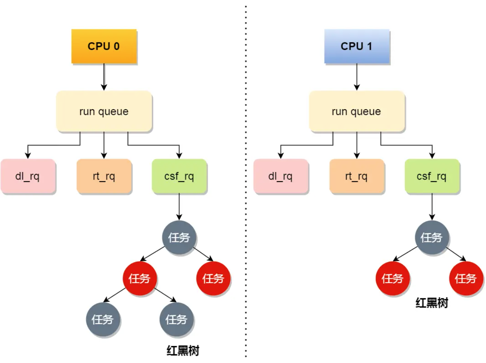

优先级如下：<font style="color:#DF2A3F;">Deadline > Realtime > Fair</font>，这意味着 Linux 选择下一个任务执行的时候，会按照此优先级顺序进行选择，也就是说先从 dl\_rq 里选择任务，然后从 rt\_rq 里选择任务，最后从 cfs\_rq 里选择任务。因此，实时任务总是会比普通任务优先被执行。

### 调整优先级

如果你想让某个普通任务有更多的执行时间，可以调整任务的 nice 值，从而让优先级高一些的任务执行更多时间。nice 的值能设置的范围是\*\* -20～19\*\*， 值越低，表明优先级越高，因此 -20 是最高优先级，19 则是最低优先级，默认优先级是 0。nice 值通过以下公式调整的是普通任务的优先级,nice 值越低,即权重越大,计算出来的vruntime 越少.这样 CFS 算法调度的时候会更优先选择该任务。

`priority(new) = priority(old) + nice`

## 什么是软中断

中断处理程序的上部分和下半部可以理解为：

* 上半部**直接处理硬件请求**，也就是硬中断，主要是负责耗时短的工作，特点是**快速执行**,一般会暂时关闭中断请求，主要负责处理跟硬件紧密相关或者时间敏感的事情。
* 下半部是由**内核触发**，也就说软中断，主要是负责上半部未完成的工作，通常都是耗时比较长的事情，特点是延迟执行；

举一个计算机中的例子，常见的**网卡接收网络包**的例子:网卡收到网络包后，通过 DMA 方式将接收到的数据写入内存，接着会通过硬件中断通知内核有新的数据到了，于是内核就会调用对应的中断处理程序来处理该事件，这个事件的处理也是会分成上半部和下半部。

上部分要做的事情很少，**会先禁止网卡中断，避免频繁硬中断，而降低内核的工作效率**。接着，内核会触发一个软中断，把一些处理比较耗时且复杂的事情，交给「软中断处理程序」去做，也就是中断的下半部，其主要是**需要从内存中找到网络数据，再按照网络协议栈，对网络数据进行逐层解析和处理，最后把数据送给应用程序**。

# Linux虚拟内存管理

## 进程虚拟内存空间

1. 我们将程序代码事先编写好，然后编译成二进制文件存放在磁盘中，CPU 会执行二进制文件中的机器码来驱动进程的运行。所以在进程运行之前，这些存放在**二进制文件中的机器码**需要被加载进内存中，而用于存放这些机器码的虚拟内存空间叫做代码段。
2. 在虚拟内存空间中需要一段区域来**存储全局变量**。

* 那些在代码中被我们**指定了初始值的全局变量和静态变量**在虚拟内存空间中的存储区域我们叫做**数据段**。
* 那些**没有指定初始值的全局变量和静态变量**在虚拟内存空间中的存储区域我们叫做 **BSS 段**。这些未初始化的全局变量被加载进内存之后会被初始化为 0 值。

3. 我们程序在运行期间往往需要**动态的申请内存**，所以在虚拟内存空间中也需要一块区域来存放这些**动态申请的内存**，这块区域就叫做堆。**注意这里的堆指的是 OS 堆并不是 JVM 中的堆**。
4. 我们的程序在运行过程中还需要**依赖动态链接库**，这些动态链接库以 **.so** 文件的形式存放在磁盘中，比如 C 程序中的 glibc，里边对系统调用进行了封装,glibc 库里提供的用于动态申请堆内存的 malloc 函数就是对系统调用 sbrk 和 mmap 的封装。**这些动态链接库中的代码段，数据段，BSS 段，以及通过 mmap 系统调用映射的共享内存区，在虚拟内存空间的存储区域叫做\*\*\*\*文件映射与匿名映射区**
5. 最后我们在程序运行的时候要调用各种函数，**调用函数**过程中使用到的**局部变量和函数参数**也需要一块内存区域来保存,这一块区域在虚拟内存空间中叫做栈。

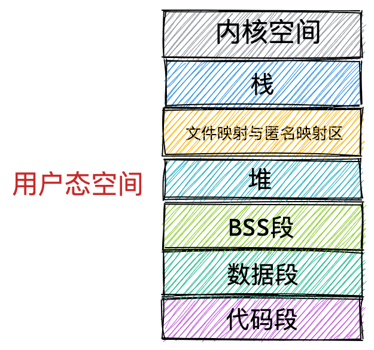

现在进程的虚拟内存空间所包含的主要区域，我就为大家介绍完了，我们看到内核根据进程运行的过程中所需要不同种类的数据而为其开辟了对应的地址空间。分别为：

* 用于**存放进程程序二进制文件中的机器指令**的代码段
* 用于**存放程序二进制文件中定义的全局变量和静态变量**的**数据段和 BSS 段**。
* 用于在程序运行过程中**动态申请内存的堆**。
* 用于存放**动态链接库以及内存映射区域的文件映射与匿名映射区**。
* 用于存放**函数调用过程中的局部变量和函数参数**的栈。

# 内存管理

## 虚拟内存的作用

1. 虚拟内存可以使得**进程对运行内存超过物理内存大小**，因为程序运行符合局部性原理，CPU 访问内存会有很明显的重复访问的倾向性，对于那些没有被经常使用到的内存，我们可以把它换出到物理内存之外，比如硬盘上的 swap 区域。
2. 由于每个进程都有自己的页表，所以**每个进程的虚拟内存空间就是相互独立的**。进程也没有办法访问其他进程的页表，所以这些页表是私有的，这就解决了多进程之间地址冲突的问题。
3. 页表里的页表项中除了物理地址之外，还有一些**标记属性**的比特，比如控制一个页的读写权限，标记该页是否存在等。在内存访问方面，操作系统提供了更好的安全性。

## 内存分配的过程是怎样的

应用程序通过 **malloc 函数**申请内存的时候，实际上申请的是虚拟内存，此时并不会分配物理内存。**当应用程序读写了这块虚拟内存**，CPU 就会去访问这个虚拟内存， 这时会发现这个虚拟内存没有物理内存与之对应， CPU 就会产生**缺页中断**，进程会从用户态切换到内核态，并将缺页中断交给内核的 \*\*Page Fault Handler （缺页中断函数）\*\*处理。缺页中断处理函数会看是否有空闲的物理内存：

* 如果有，就**直接分配物理内存**，并建立虚拟内存与物理内存之间的映射关系。
* 如果没有空闲的物理内存，那么**内核**就会开始进行**回收内存**的工作，回收的方式主要是两种：直接内存回收和后台内存回收。
  * **后台内存回收**（kswapd）：在物理内存紧张的时候，会唤醒\*\* kswapd 内核线程来回收内存\*\*，这个回收内存的过程异步的，不会阻塞进程的执行。
  * **直接内存回收**（direct reclaim）：如果后台异步回收跟不上进程内存申请的速度，就会开始直接回收，这个回收内存的过程是同步的，会阻塞进程的执行。

如果直接内存回收后，**空闲的物理内存仍然无法满足此次物理内存的申请**，那么内核就会放最后的大招了 ——触发\*\* OOM \*\*（Out of Memory）机制。

OOM Killer 机制会根据算法选择**一个占用物理内存较高**的进程，然后将其杀死，以便释放内存资源，如果物理内存依然不足，OOM Killer 会继续杀死占用物理内存较高的进程，直到释放足够的内存位置。

## 什么条件下才能触发 kswapd 内核线程回收内存呢？

这三个内存阈值会划分为四种内存使用情况，如下图：

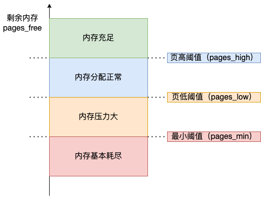

kswapd 会定期扫描内存的使用情况，根据剩余内存（pages\_free）的情况来进行内存回收的工作。

* 图中**绿色部分**：如果剩余内存（pages\_free）大于 页高阈值（pages\_high），说明剩余内存是充足的；
* 图中**蓝色部分**：如果剩余内存（pages\_free）在页高阈值（pages\_high）和页低阈值（pages\_low）之间，说明**内存有一定压力，但还可以满足应用程序申请内存的请求**；
* 图中**橙色部分**：如果剩余内存（pages\_free）在页低阈值（pages\_low）和页最小阈值（pages\_min）之间，说明内存压力比较大，剩余内存不多了。**这时 kswapd0 会执行内存回收，直到剩余内存大于**\*\*<font style="color:#DF2A3F;">高阈值（pages\_high）</font>\*\***为止。**虽然会触发内存回收，但是**不会阻塞应用程序**，因为两者关系是异步的。
* 图中**红色部分**：如果剩余内存（pages\_free）小于页最小阈值（pages\_min），说明**用户可用内存都耗尽了**，此时就**会触发直接内存回收**，这时应用程序就会被阻塞，因为两者关系是同步的。

也就是说 kswapd 的**活动空间只有 pages\_low 与 pages\_min 之间的这段区域**，如果剩余内存低于了 pages\_min 会触发直接内存回收，高于了 pages\_high 又不会唤醒 kswapd。

页低阈值（pages\_low）可以通过内核选项 /proc/sys/vm/min\_free\_kbytes （该参数代表系统所保留空闲内存的最低限）来间接设置。min\_free\_kbytes 虽然设置的是页最小阈值（pages\_min），但是页高阈值（pages\_high）和页低阈值（pages\_low）都是根据页最小阈值（pages\_min）计算生成的，它们之间的计算关系如下：

```plain
pages_min = min_free_kbytes
pages_low = pages_min*5/4
pages_high = pages_min*3/2
```

如果系统时不时发生抖动，并且通过 sar -B 观察到 pgscand 数值很大，那大概率是因为直接内存回收导致的，这时可以**增大 min\_free\_kbytes 这个配置选项来及早地触发后台回收**，然后继续观察 pgscand 是否会降为 0（应用程序在**内存申请过程**中每秒直接扫描的 page 个数，此值越大，表示空白 page 越少<font style="color:rgb(44, 62, 80);">）</font>。增大了 min\_free\_kbytes 配置后，这会使得系统预留过多的空闲内存，从而在**一定程度上降低了应用程序可使用的内存量**，这在一定程度上浪费了内存。极端情况下设置 min\_free\_kbytes 接近实际物理内存大小时，留给应用程序的内存就会太少而可能会频繁地导致 OOM 的发生。

所以在调整 min\_free\_kbytes 之前，需要先思考一下，应用程序更加关注什么，如果**关注延迟那就适当地增大 min\_free\_kbytes**，如果**关注内存的使用量那就适当地调小 min\_free\_kbytes**。

## 哪些内存可以被回收？

主要有两类内存可以被回收，而且它们的回收方式也不同。

* **文件页**（File-backed Page）：内核缓存的**磁盘数据**（Buffer）和内核缓存的**文件数据**（Cache）都叫作文件页。大部分文件页，都可以直接释放内存，以后有需要时，再从磁盘重新读取就可以了。而那些被应用程序修改过，并且暂时还没写入磁盘的数据（也就是脏页），就得先写入磁盘，然后才能进行内存释放。所以，**回收干净页的方式是直接释放内存，回收脏页的方式是先写回磁盘后再释放内存。**
* **匿名页**（Anonymous Page）：这部分内存**没有实际载体**，不像文件缓存有硬盘文件这样一个载体，比如堆、栈数据等。这部分内存很可能还要再次被访问，所以不能直接释放内存，它们回收的方式是通过\*\* Linux 的 Swap 机制，Swap 会把不常访问的内存先写到磁盘中 \[\*\*<font style="color:#DF2A3F;background-color:rgb(253, 253, 254);">当匿名页被Swap到磁盘时，它们会失去在内存中的直接映射，但会在Swap空间中保留一个对应的条目</font><font style="color:rgb(5, 7, 59);background-color:rgb(253, 253, 254);">]</font>，然后释放这些内存，给其他更需要的进程使用。再次访问这些内存时，重新从磁盘读入内存就可以了。

文件页和匿名页的回收都是基于 LRU 算法，也就是优先回收不常访问的内存。LRU 回收算法，实际上维护着 active 和 inactive 两个双向链表，其中：

* \*\*active\_list \*\*活跃内存页链表，这里存放的是最近被访问过（活跃）的内存页；
* \*\*inactive\_list \*\*不活跃内存页链表，这里存放的是很少被访问（非活跃）的内存页；

\*\*越接近链表尾部，就表示内存页越不常访问。\*\*这样，在回收内存时，系统就可以根据活跃程度，优先回收不活跃的内存。活跃和非活跃的内存页，按照类型的不同，又分别分为文件页和匿名页。

## Swap 机制

当系统的物理内存不够用的时候，就需要将物理内存中的一部分空间释放出来，以供当前运行的程序使用。那些被释放的空间可能来自一些很长时间没有什么操作的程序，**这些被释放的空间会被临时保存到磁盘，等到那些程序要运行时，再从磁盘中恢复保存的数据到内存中**。

Linux 中的 Swap 机制会在内存不足和内存闲置的场景下触发：

* **内存不足**：当系统需要的内存超过了可用的物理内存时，内核会将**内存中不常使用的内存页交换到磁盘上为当前进程让出内存**，保证正在执行的进程的可用性，这个内存回收的过程是强制的直接内存回收（Direct Page Reclaim）。直接内存回收是同步的过程，会阻塞当前申请内存的进程。
* **内存闲置**：应用程序在启动阶段使用的大量内存在启动后往往都不会使用，通过后台运行的守护进程（kSwapd），我们可以将这部分只使用一次的内存交换到磁盘上为其他内存的申请预留空间。kSwapd 是 Linux 负责页面置换（Page replacement）的守护进程，它也是负责交换闲置内存的主要进程，它会在空闲内存\*\*低于一定水位(opens new window)\*\*时，回收内存页中的空闲内存保证系统中的其他进程可以尽快获得申请的内存。kSwapd 是后台进程，所以回收内存的过程是异步的，不会阻塞当前申请内存的进程。

Linux 提供了两种不同的方法启用 Swap，分别是 Swap 分区（Swap Partition）和 Swap 文件（Swapfile），开启方法可以看这个资料(opens new window)：

* **Swap 分区**是硬盘上的独立区域，该区域只会用于交换分区，其他的文件不能存储在该区域上，我们可以使用 swapon -s 命令查看当前系统上的交换分区。像**进程的堆、栈数据**等，它们是没有实际载体，这部分内存被称为匿名页。而且这部分内存很可能还要再次被访问，所以不能直接释放内存，于是就需要有一个能保存匿名页的磁盘载体，这个载体就是 Swap 分区。
* **Swap 文件**是文件系统中的特殊文件，它与文件系统中的其他文件也没有太多的区别；

## malloc分配内存

### Linux 进程的内存分布

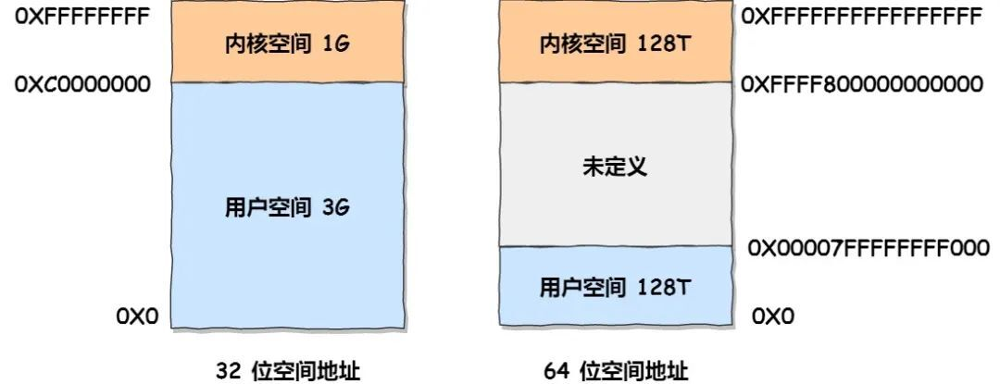

在 Linux 操作系统中，虚拟地址空间的内部又被分为内核空间和用户空间两部分，不同位数的系统，地址空间的范围也不同,通过上图可以看出：

* 32 位系统的内核空间占用 1G，位于最高处，剩下的 3G 是用户空间；
* 64 位系统的内核空间和用户空间都是 128T，分别占据整个内存空间的最高和最低处，剩下的中间部分是未定义的。

用户空间的内存分布如下所示：

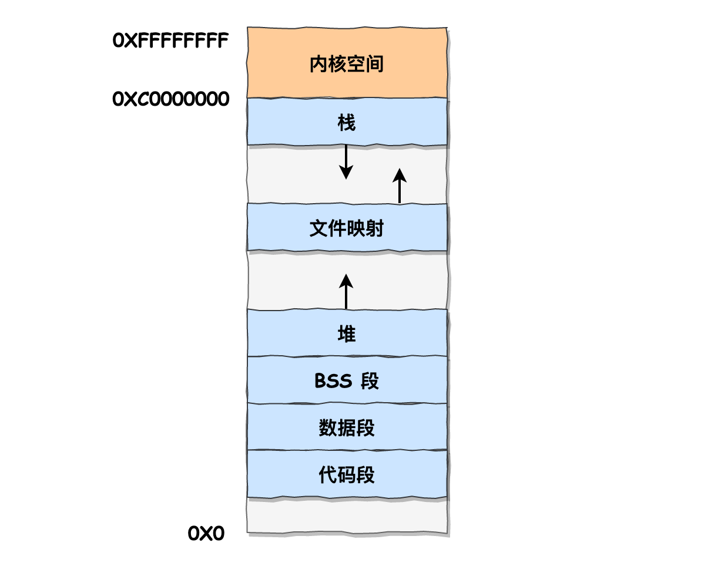

### malloc 是如何分配内存的？

实际上，malloc() 并不是系统调用，而是 C 库里的函数，用于动态分配内存。malloc 申请内存的时候，会有两种方式向操作系统申请堆内存:

* 方式一：通过 brk() 系统调用从堆分配内存,即通过 **brk() 函数将「堆顶」指针向高地址移动，获得新的内存空间**
* 方式二：通过 mmap() 系统调用在文件映射区域分配内存, mmap() 系统调用中\*\*「私有匿名映射」**的方式，在**文件映射区\*\*分配一块内存，也就是从文件映射区“偷”了一块内存。

#### 什么场景下 malloc() 会通过 brk() 分配内存？又是什么场景下通过 mmap() 分配内存？

malloc() 源码里默认定义了一个阈值：

* 如果用户分配的内存**小于 128 KB**，则**通过 brk() 申请内存**；
* 如果用户分配的内存**大于 128 KB**，则**通过 mmap() 申请内存**；

malloc() 在分配内存的时候，并不是老老实实按用户预期申请的字节数来分配内存空间大小，而是会预分配更大的空间作为内存池。

#### malloc() 分配的是物理内存吗？

不是的，malloc() 分配的是**虚拟内存**。

如果**分配后的虚拟内存没有被访问**的话，**虚拟内存是不会映射到物理内存的**，这样就不会占用物理内存了。

只有在访问已分配的虚拟地址空间的时候，操作系统通过查找页表，发现虚拟内存对应的页没有在物理内存中，就会触发缺页中断，然后操作系统会建立虚拟内存和物理内存之间的映射关系。

#### malloc 申请的内存，free 释放内存会归还给操作系统吗

* malloc 通过\*\* brk() 方式\*\*申请的内存，free 释放内存的时候，**并不会把内存归还给操作系统，而是缓存在 malloc 的内存池中**，待下次使用；
* malloc 通过 **mmap()** 方式申请的内存，free 释放内存的时候，**会把内存归还给操作系统**，内存得到真正的释放。

#### 为什么不全部使用 mmap 来分配内存？

如果都用 mmap 来分配内存，每次都要执行系统调用，系统调用会浪费不少的时间。另外，**因为 mmap 分配的内存每次释放的时候(物理内存释放)，都会归还给操作系统**，于是每次\*\* mmap 分配的虚拟地址都是缺页状态**的，在进程首次访问通过mmap分配的虚拟地址时，由于该虚拟地址对应的**物理页面\*\*尚未加载到内存中，就会发生缺页中断。

也就是说，频繁通过 mmap 分配的内存话，不仅每次都会发生运行态的切换，还会发生缺页中断（在第一次访问虚拟地址后），这样会导致 CPU 消耗较大。

为了改进这两个问题，malloc 通过 brk() 系统调用在堆空间申请内存的时候，由于堆空间是连续的，所以直接预分配更大的内存来作为内存池，**当内存释放的时候，就缓存在内存池中**。等下次在申请内存的时候，就直接从内存池取出对应的内存块就行了，而且可能这个**内存块的虚拟地址与物理地址(内存地址)的映射关系**还存在,可以直接在这个物理地址写，这样不仅减少了系统调用的次数，也减少了缺页中断的次数，这将大大降低 CPU 的消耗。

#### 既然 brk 那么牛逼，为什么不全部使用 brk 来分配？

如果我们连续申请了 10k，20k，30k 这三片内存，如果 10k 和 20k 这两片释放了，变为了空闲内存空间，如果下次申请的内存小于 30k，那么就可以重用这个空闲内存空间。

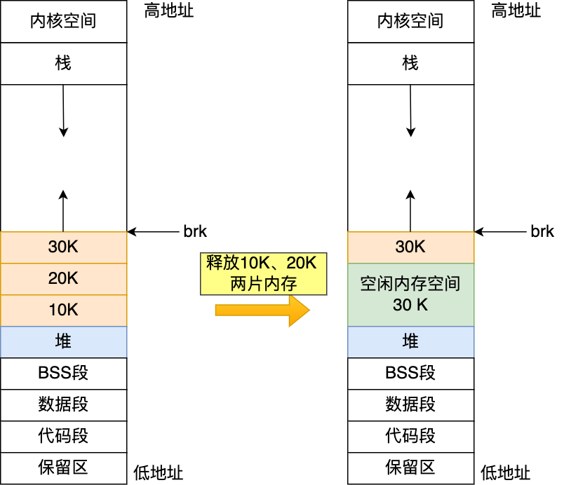

但是如果下次申请的内存大于 30k，没有可用的空闲内存空间，必须向 OS 申请，实际使用内存继续增大。因此，随着系统频繁地 malloc 和 free ，尤其对于小块内存，**堆内将产生越来越多不可用的碎片，导致“内存泄露”**。而这种“泄露”现象使用 valgrind 是无法检测出来的。

所以，malloc 实现中，充分考虑了 brk 和 mmap 行为上的差异及优缺点，默认分配大块内存 (128KB) 才使用 mmap 分配内存空间。

### free() 函数只传入一个内存地址，为什么能知道要释放多大的内存？

还记得，我前面提到， malloc 返回给用户态的内存起始地址比进程的堆空间起始地址多了 16 字节吗？

这个多出来的 16 字节就是保存了该内存块的描述信息，比如有该内存块的大小。

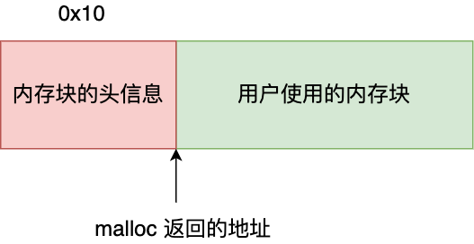

这样当执行 free() 函数时，free 会对传入进来的内存地址向左偏移 16 字节，然后从这个 16 字节的分析出当前的内存块的大小，自然就知道要释放多大的内存了。

## 如何避免预读失效和预读避免的问题

### 预读失效，怎么办？

Linux 操作系统为基于 Page Cache 的读缓存机制提供预读机制，一个例子是：

* 应用程序只想读取磁盘上文件 A 的 offset 为 0-3KB 范围内的数据，由于磁盘的基本读写单位为 block（4KB），于是操作系统至少会读 0-4KB 的内容，这恰好可以在一个 page 中装下。
* 但是操作系统出于空间局部性原理（靠近当前被访问数据的数据，在未来很大概率会被访问到），会选择将磁盘块 offset \[4KB,8KB)、\[8KB,12KB) 以及 \[12KB,16KB) 都加载到内存，于是额外在内存中申请了 3 个 page；

下图代表了操作系统的预读机制：

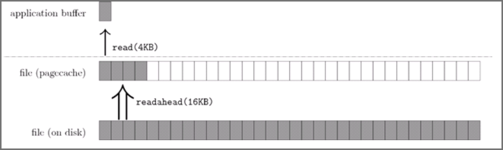

上图中，应用程序利用 read 系统调动读取 4KB 数据，实际上内核使用预读机制（ReadaHead） 机制完成了 16KB 数据的读取，也就是通过一次磁盘顺序读将多个 Page 数据装入 Page Cache。预读机制带来的好处就是减少了 **磁盘 I/O 次数，提高系统磁盘 I/O 吞吐量。**

MySQL Innodb 存储引擎的 Buffer Pool 也有类似的预读机制，MySQL 从磁盘加载页时，会提前把它相邻的页一并加载进来，目的是为了减少磁盘 IO。

#### 预读失效会带来什么问题？

如果这些被提前加载进来的页，并没有被访问，相当于这个预读工作是白做了，这个就是预读失效，这会导致不会被访问的预读页却占用了 LRU 链表前排的位置，而末尾淘汰的页（使用传统的链表存放数据）可能是热点数据，这样就大大降低了缓存命中率 。

#### 如何避免预读失效造成的影响？

Linux 操作系统和 MySQL Innodb 通过改进传统 LRU 链表来避免预读失效带来的影响，具体的改进分别如下：

* **Linux** 操作系统实现两个了 LRU 链表：活跃 LRU 链表（active\_list）和非活跃 LRU 链表（inactive\_list）；
* **MySQL** 的 Innodb 存储引擎是在一个 LRU 链表上划分来 2 个区域：young 区域 和 old 区域。

### 什么是缓存污染？

当我们在批量读取数据的时候，由于数据被访问了一次，这些大量数据都会被加入到「活跃 LRU 链表」里，然后之前缓存在活跃 LRU 链表（或者 young 区域）里的热点数据全部都被淘汰了，如果这些大量的数据在很长一段时间都不会被访问的话，那么整个活跃 LRU 链表（或者 young 区域）就被污染了。

#### 缓存污染会带来什么问题？

缓存污染带来的影响就是很致命的，等这些热数据又被再次访问的时候，由于缓存未命中，就会**产生大量的磁盘 I/O**，系统性能就会急剧下降。

#### 怎么避免缓存污染造成的影响？

只要我们提高进入到活跃 LRU 链表（或者 young 区域）的门槛，就能有效地保证活跃 LRU 链表（或者 young 区域）里的热点数据不会被轻易替换掉。

Linux 操作系统和 MySQL Innodb 存储引擎分别是这样提高门槛的：

* \*\*Linux 操作系统：\*\*在<font style="color:#DF2A3F;">内存页被访问第二次</font>的时候，才将页从 inactive list 升级到 active list 里。
* **MySQL Innodb**：在内存页被访问第二次的时候，并不会马上将该页从 old 区域升级到 young 区域，因为还要进行<font style="color:#DF2A3F;">停留在 old 区域的时间判断</font>：
  * **如果第二次的访问时间与第一次访问的时间在 1 秒内**（默认值），那么该页就不会被从 old 区域升级到 young 区域；
  * **如果第二次的访问时间与第一次访问的时间超过 1 秒**，那么该页就会从 old 区域升级到 young 区域；

在批量读取数据时候，如果这些大量数据只会被访问一次，那么它们就不会进入到活跃 LRU 链表（或者 young 区域），也就不会把热点数据淘汰，只会待在非活跃 LRU 链表（或者 old 区域）中，后续很快也会被淘汰。

# 进程管理

## 进程

### 进程状态

* **运行状态**（Running）：该时刻进程占用 CPU；
* **就绪状态**（Ready）：可运行，由于其他进程处于运行状态而暂时停止运行；
* **阻塞状态**（Blocked）：该进程正在等待某一事件发生（如等待输入/输出操作的完成）而暂时停止运行，这时，即使给它CPU控制权，它也无法运行；
* **创建状态**（new）：进程正在被创建时的状态；
* **结束状态**（Exit）：进程正在从系统中消失时的状态；
* **阻塞挂起状态**：进程在\*\*外存（硬盘）\*\*并等待某个事件的出现；
* **就绪挂起状态**：进程在**外存（硬盘）**，但只要进入内存，即刻立刻运行；

> 如果**有大量处于阻塞状态**的进程，**进程可能会占用着物理内存空间**，导致物理空间的浪费，所以在虚拟内存管理的操作系统中，通常会**把阻塞状态的进程的物理内存空间换出到硬盘**，等需要再次运行的时候，再从硬盘换入到物理内存。
>
> 那么，就需要一个新的状态，来描述进程没有占用实际的物理内存空间的情况，这个状态就是挂起状态。这跟阻塞状态是不一样，阻塞状态是等待某个事件的返回。

### 进程的控制结构

在操作系统中，是用**进程控制块**（process control block，PCB）数据结构来描述进程的，<font style="color:#DF2A3F;">PCB 是进程存在的唯一标识。</font>

#### 具体包含什么信息

**进程描述信息：**

* **进程标识符**：标识各个进程，每个进程都有一个并且唯一的标识符；
* **用户标识符**：进程归属的用户，用户标识符主要为共享和保护服务；

**进程控制和管理信息：**

* **进程当前状态**，如 new、ready、running、waiting 或 blocked 等；
* **进程优先级**：进程抢占 CPU 时的优先级；

**资源分配清单：**

* 有关内存地址空间或虚拟地址空间的信息，所打开**文件的列表**和**所使用的 I/O 设备信息**。

**CPU 相关信息：**

* **CPU 中各个寄存器的值**，当进程被切换时，CPU 的状态信息都会被保存在相应的 PCB 中，以便进程重新执行时，能从断点处继续执行。

<font style="color:rgb(44, 62, 80);">PCB 通常是通过</font>**<font style="color:rgb(48, 79, 254);">链表</font>**<font style="color:rgb(44, 62, 80);">的方式进行组织，把具有</font>**<font style="color:rgb(48, 79, 254);">相同状态的进程链在一起，组成各种队列</font>**<font style="color:rgb(44, 62, 80);">。比如：</font>

* <font style="color:rgb(44, 62, 80);">将所有处于就绪状态的进程链在一起，称为</font>**<font style="color:rgb(48, 79, 254);">就绪队列</font>**<font style="color:rgb(44, 62, 80);">；</font>
* <font style="color:rgb(44, 62, 80);">把所有因等待某事件而处于等待状态的进程链在一起就组成各种</font>**<font style="color:rgb(48, 79, 254);">阻塞队列</font>**<font style="color:rgb(44, 62, 80);">；</font>
* <font style="color:rgb(44, 62, 80);">另外，对于运行队列在单核 CPU 系统中则只有一个运行指针了，因为单核 CPU 在某个时间，只能运行一个程序。</font>

### 进程的控制

#### 创建进程

操作系统允许一个进程创建另一个进程，而且允许子进程继承父进程所拥有的资源。

创建进程的过程如下：

* 申请一个空白的 PCB，并向 PCB 中填写一些控制和管理进程的信息，比如进程的唯一标识等；
* 为该进程分配运行时所必需的资源，比如内存资源；
* 将 PCB 插入到就绪队列，等待被调度运行；

#### 终止进程

进程可以有 3 种终止方式：正常结束、异常结束以及**外界干预（信号 kill 掉）**。

当子进程被终止时，其在父进程处继承的资源应当还给父进程。而当父进程被终止时，该父进程的子进程就变为孤儿进程，会被 1 号进程收养，并由 1 号进程对它们完成状态收集工作。

终止进程的过程如下：

* 查找需要终止的进程的 PCB；
* 如果处于执行状态，则立即终止该进程的执行，然后**将 CPU 资源分配给其他进程**；
* <font style="color:#DF2A3F;">如果其还有子进程，则应将该进程的子进程交给 1 号进程接管；</font>

> <font style="color:rgb(51, 51, 51);">进程号1通常代表的是init进程，也就是系统启动时第一个运行的进程。init进程是系统中所有其他进程的祖先进程，它负责系统的初始化和进程的管理。</font>

* 将该进程所拥有的全部资源都归还给操作系统；
* 将其从 PCB 所在队列中删除；

#### 阻塞进程

当进程需要等待某一事件完成时，它可以调用阻塞语句把自己阻塞等待。而<font style="color:#DF2A3F;">一旦被阻塞等待，它只能由另一个进程唤醒</font>。

阻塞进程的过程如下：

* 找到将要被阻塞进程标识号对应的 PCB；
* 如果该进程为运行状态，则**保护其现场，将其状态转为阻塞状态，停止运行**；
* 将该 PCB 插入到阻塞队列中去；

#### 唤醒进程

进程由「运行」转变为「阻塞」状态是由于进程必须等待某一事件的完成，所以处于阻塞状态的进程是绝对不可能叫醒自己的。如果某进程正在等待 I/O 事件，需由别的进程发消息给它，则只有当该进程所期待的事件出现时，才由发现者进程用唤醒语句叫醒它。

唤醒进程的过程如下：

* 在该事件的阻塞队列中找到相应进程的 PCB；
* 将其从阻塞队列中移出，并置其状态为就绪状态；
* 把该 PCB 插入到就绪队列中，等待调度程序调度；

进程的阻塞和唤醒是一对功能相反的语句，如果某个进程调用了阻塞语句，则必有一个与之对应的唤醒语句。

### 进程的上下文切换

各个进程之间是共享 CPU 资源的，在不同的时候进程之间需要切换，让不同的进程可以在 CPU 执行，那么这个一个进程切换到另一个进程运行，称为进程的上下文切换。

任务是交给 CPU 运行的，那么在每个任务运行前，CPU 需要知道任务从哪里加载，又从哪里开始运行。所以，操作系统需要事先帮 CPU 设置好 CPU 寄存器和程序计数器。所以说，CPU 寄存器和程序计数是 CPU 在运行任何任务前，所必须依赖的环境，这些环境就叫做 CPU 上下文。

**CPU 上下文切换就是先把前一个任务的 CPU 上下文（CPU 寄存器和程序计数器）保存起来，然后加载新任务的上下文到这些寄存器和程序计数器，最后再跳转到程序计数器所指的新位置，运行新任务。系统内核会存储保持下来的上下文信息**，当此任务再次被分配给 CPU 运行时，CPU 会重新加载这些上下文，这样就能保证任务原来的状态不受影响，让任务看起来还是连续运行。

上面说到所谓的「任务」，主要包含进程、线程和中断。所以，可以根据任务的不同，把 CPU 上下文切换分成：**进程上下文切换、线程上下文切换和中断上下文切换**。

#### 进程的上下文切换到底是切换什么呢？

<font style="color:#DF2A3F;">进程是由内核管理和调度的，所以进程的切换只能发生在内核态。</font>所以，进程的上下文切换不仅包含了**虚拟内存、栈、全局变量**等用户空间的资源，还包括了**内核堆栈、寄存器**等内核空间的资源。

通常，会把**交换的信息保存在进程的 PCB**，当要运行另外一个进程的时候，我们需要从这个进程的 PCB 取出上下文，然后恢复到 CPU 中，这使得这个进程可以继续执行，如下图所示：

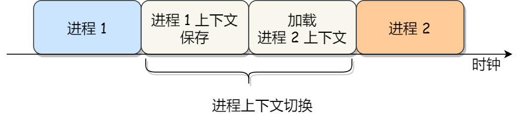

#### 发生进程上下文切换有哪些场景？

* 为了保证所有进程可以得到公平调度，CPU 时间被划分为一段段的时间片，这些时间片再被轮流分配给各个进程。这样，**当某个进程的时间片耗尽了**，进程就从运行状态变为就绪状态，系统从就绪队列选择另外一个进程运行；
* 进程在**系统资源不足**（比如内存不足）时，要等到资源满足后才可以运行，这个时候进程也会被挂起，并由系统调度其他进程运行；
* 当进程通过**睡眠函数 sleep** 这样的方法将自己主动挂起时，自然也会重新调度；
* 当有**优先级更高的进程运行**时，为了保证高优先级进程的运行，当前进程会被挂起，由高优先级进程来运行；
* 发生**硬件中断**时，CPU 上的进程会被中断挂起，转而执行内核中的中断服务程序；

## 线程

**线程是进程当中的一条执行流程。**

同一个进程内多个线程之间可以共享代码段、数据段、打开的文件等资源，但每个线程各自都有一套独立的寄存器和栈，这样可以确保线程的控制流是相对独立的。

### 线程与进程的区别

线程与进程的比较如下：

* **进程**是**资源（包括内存、打开的文件等）分配的单位**，**线程**是 **CPU 调度的单位**；
* 进程拥有一个完整的资源平台，而线程只独享必不可少的资源，如寄存器和栈；
* 线程同样具有**就绪、阻塞、执行**三种基本状态，同样具有状态之间的转换关系；
* 线程能减少并发执行的时间和空间开销；

对于，线程相比进程能减少开销，体现在：

* **线程的创建时间比进程快**，因为进程在创建的过程中，还需要资源管理信息，比如内存管理信息、文件管理信息，而线程在创建的过程中，不会涉及这些资源管理信息，而是共享它们；
* **线程的终止时间比进程快，因为线程释放的资源相比进程少很多**；
* **同一个进程内的线程切换比进程切换快**，因为线程具有相同的地址空间（虚拟内存共享），这意味着同一个进程的线程都具有同一个页表，那么**在切换的时候不需要切换页表**。而对于进程之间的切换，切换的时候要把页表给切换掉，而页表的切换过程开销是比较大的；
* 由于同一进程的各线程间共享内存和文件资源，那么在线程之间数据传递的时候，就不需要经过内核了，这就使得线程之间的**数据交互效率**更高了；

所以，不管是时间效率，还是空间效率线程比进程都要高。

## 进程间的通讯方式

### 管道

### 消息队列

消息队列是保存在内核中的消息链表，在发送数据时，会分成一个一个独立的数据单元，也就是消息体（数据块），消息体是**用户自定义的数据类型**，消息的发送方和接收方要约定好消息体的数据类型，所以每个消息体都是固定大小的存储块，不像管道是无格式的字节流数据。如果进程从消息队列中读取了消息体，内核就会把这个消息体删除。

### 共享队列

共享内存的机制，**就是拿出一块虚拟地址空间来，映射到相同的物理内存中**。这样这个进程写入的东西，另外一个进程马上就能看到了，都不需要拷贝来拷贝去，传来传去，大大提高了进程间通信的速度。

### 信号量

信号量其实是一个整型的计数器，主要用于实现进程间的**互斥与同步**，而不是用于缓存进程间通信的数据，用于配合上述的共享队列实现消息的共享。

通常<font style="color:#DF2A3F;">信号量表示资源的数量</font>，对应的变量是一个整型（sem）变量。另外，还有两个原子操作的系统调用函数来控制信号量的，分别是：

* **P 操作**：将 sem 减 1，相减后，如果 sem < 0，则进程/线程进入阻塞等待，否则继续，表明 P 操作可能会阻塞；
* **V 操作**：将 sem 加 1，相加后，如果 sem <= 0，唤醒一个等待中的进程/线程，表明 V 操作不会阻塞；

### 信号

信号是进程间通信机制中唯一的异步通信机制，因为可以在任何时候发送信号给某一进程，一旦有信号产生，我们就有下面这几种，用户进程对信号的处理方式。信号事件的来源主要有**硬件来源**（如键盘 Cltr+C ）和**软件来源**（如 kill 命令）。

1. **执行默认操作**。Linux 对每种信号都规定了默认操作，例如，上面列表中的 SIGTERM 信号，就是终止进程的意思。
2. **捕捉信号**。我们可以为信号定义一个信号处理函数。当信号发生时，我们就执行相应的信号处理函数。
3. **忽略信号**。当我们不希望处理某些信号的时候，就可以忽略该信号，不做任何处理。有两个信号是应用进程无法捕捉和忽略的，即 SIGKILL 和 SEGSTOP，它们用于在任何时候中断或结束某一进程。

### socket

跨网络与不同主机上的进程之间通信，就需要 Socket 通信了。实际上，Socket 通信不仅可以跨网络与不同主机的进程间通信，还可以在同主机上进程间通信。

# 文件系统

## 文件系统的组成

Linux 文件系统会为每个文件分配两个数据结构：索引节点（index node）和目录项（directory entry），它们主要用来记录文件的元信息和目录层次结构。

* 索引节点，也就是 inode，用来**记录文件的元信息**，比如 inode 编号、文件大小、访问权限、创建时间、修改时间、数据在磁盘的位置等等。**索引节点是文件的唯一标识**，它们之间一一对应，也同样都会被存储在硬盘中，所以索引节点同样占用磁盘空间。
* 目录项，也就是 dentry，用来**记录文件的名字、索引节点指针**以及与**其他目录项的层级关联关系**。多个目录项关联起来，就会形成目录结构，但它与索引节点不同的是，目录项是由内核维护的一个数据结构，不存放于磁盘，而是<font style="color:#DF2A3F;">缓存在内存</font>。

由于索引节点唯一标识一个文件，而目录项记录着文件的名字，所以目录项和索引节点的关系是多对一，也就是说，一个文件可以有多个别名。比如，硬链接的实现就是多个目录项中的索引节点指向同一个文件。

注意，**目录也是文件，也是用索引节点唯一标识**，和普通文件不同的是，普通文件在磁盘里面保存的是文件数据，而**目录文件**在磁盘里面保存**子目录或文件**。

### 文件格式化

磁盘进行格式化的时候，会被分成三个存储区域，分别是超级块、索引节点区和数据块区。

* **超级块**，用来存储**文件系统的详细信息**，比如块个数、块大小、空闲块等等。
* 索引节点区，用来存储索引节点；
* 数据块区，用来存储文件或目录数据；

我们不可能把超级块和索引节点区全部加载到内存，这样内存肯定撑不住，所以只有当需要使用的时候，才将其加载进内存，它们加载进内存的时机是不同的：

* **超级块：当文件系统挂载时进入内存；**
* **索引节点区：当文件被访问时进入内存；**

## 文件的使用

```c
fd = open(name, flag); # 打开文件
...
write(fd,...);         # 写数据
...
close(fd);             # 关闭文件
```

上面简单的代码是读取一个文件的过程：

* 首先用 open 系统调用打开文件，open 的参数中**包含文件的路径名和文件名**。
* 使用 write 写数据，其中 write 使用\*\* open 所返回的文件描述符\*\*，并不使用文件名作为参数。
* 使用完文件后，要用 close 系统调用关闭文件，避免资源的泄露。

我们打开了一个文件后，操作系统会跟踪进程打开的所有文件，所谓的跟踪呢，就是**操作系统为每个进程维护一个打开文件表，文件表里的每一项代表「文件描述符」**，所以说文件描述符是打开文件的标识。

操作系统在打开文件表中维护着打开文件的状态和信息：

* **文件指针**：系统跟踪上次读写位置作为**当前文件位置指针**，这种指针对打开文件的某个进程来说是唯一的；
* **文件打开计数器**：文件关闭时，操作系统必须重用其打开文件表条目，否则表内空间不够用。因为多个进程可能打开同一个文件，所以**系统在删除打开文件条目之前，必须等待最后一个进程关闭文件**，该计数器跟踪打开和关闭的数量，**当该计数为 0 时，系统关闭文件，删除该条目**；
* **文件磁盘位置**：绝大多数文件操作都要求系统修改文件数据，**该信息保存在内存中，以免每个操作都从磁盘中读取**；
* **访问权限**：每个进程打开文件都需要有一个**访问模式**（创建、只读、读写、添加等），该信息保存在进程的打开文件表中，以便操作系统能允许或拒绝之后的 I/O 请求；

在用户视角里，文件就是一个持久化的数据结构，但操作系统并不会关心你想存在磁盘上的任何的数据结构，操作系统的视角是如何把**文件数据和磁盘块对应起来**。**用户**习惯以**字节的方式**读写文件，而**操作系统**则是以**数据块**来读写文件，那屏蔽掉这种差异的工作就是文件系统了。

## 硬链接和软链接

**硬链接**是<font style="color:#DF2A3F;">多个目录项中的「索引节点」指向一个文件</font>，也就是**指向同一个 inode**，但是 inode 是不可能跨越文件系统的，**每个文件系统都有各自的 inode 数据结构和列表**，所以硬链接是不可用于跨文件系统的。由于多个目录项都是指向一个 inode，那么只有删除文件的所有硬链接以及源文件时，系统才会彻底删除该文件。

**软链接**相当于重新创建一个文件，这个文件有**独立的 inode**，但是**这个文件的内容是另外一个文件的路径**，所以访问软链接的时候，实际上相当于访问到了另外一个文件，所以软链接是可以跨文件系统的，甚至目标文件被删除了，链接文件还是在的，只不过指向的文件找不到了而已。

# 零拷贝

## 传统的文件传输

传统 I/O 的工作方式是，数据读取和写入是从用户空间到内核空间来回复制，而内核空间的数据是通过操作系统层面的 I/O 接口从磁盘读取或写入。

代码通常如下，一般会需要两个系统调用：

```c
read(file, tmp_buf, len);
write(socket, tmp_buf, len);
```

期间共发生了 4 次用户态与内核态的上下文切换，因为发生了两次系统调用，一次是 read() ，一次是 write()，每次系统调用都得先从用户态切换到内核态，等内核完成任务后，再从内核态切换回用户态。

其次，还发生了 4 次数据拷贝，其中两次是 DMA 的拷贝，另外两次则是通过 CPU 拷贝的，下面说一下这个过程：

* 第一次拷贝，把磁盘上的数据拷贝到操作系统内核的缓冲区里，这个拷贝的过程是通过 DMA 搬运的。
* 第二次拷贝，把内核缓冲区的数据拷贝到用户的缓冲区里，于是我们应用程序就可以使用这部分数据了，这个拷贝到过程是由 CPU 完成的。
* 第三次拷贝，把刚才拷贝到用户的缓冲区里的数据，再拷贝到内核的 socket 的缓冲区里，这个过程依然还是由 CPU 搬运的。
* 第四次拷贝，把内核的 socket 缓冲区里的数据，拷贝到网卡的缓冲区里，这个过程又是由 DMA 搬运的。

要想提高文件传输的性能，就需要减少「用户态与内核态的上下文切换」和「内存拷贝」的次数。

## 如何优化文件传输的性能

### 如何减少「用户态与内核态的上下文切换」的次数呢

因为用户空间没有权限操作磁盘或网卡，内核的权限最高，这些操作设备的过程都需要交由操作系统内核来完成，所以一般要通过内核去完成某些任务的时候，就需要使用操作系统提供的系统调用函数。

### 如何减少「数据拷贝」的次数?

因为文件传输的应用场景中，在用户空间我们并不会对数据「再加工」，所以数据实际上可以不用搬运到用户空间，因此用户的缓冲区是没有必要存在的。磁盘-->网卡的缓冲区

## 如何实现零拷贝

零拷贝技术实现的方式通常有 2 种：

* mmap + write
* sendfile

下面就谈一谈，它们是如何减少「上下文切换」和「数据拷贝」的次数。

### mmap + write

在前面我们知道，read() 系统调用的过程中会把内核缓冲区的数据拷贝到用户的缓冲区里，于是为了减少这一步开销，我们可以用 mmap() 替换 read() 系统调用函数。

```c
buf = mmap(file, len);
write(sockfd, buf, len);
```

mmap() 系统调用函数会直接把**内核缓冲区里的数据「映射」到用户空间**，这样，操作系统内核与用户空间就不需要再进行任何的数据拷贝操作。

具体过程如下：

* 应用进程调用了 mmap() 后，DMA 会把磁盘的数据拷贝到内核的缓冲区里。**接着，应用进程跟操作系统内核「共享」这个缓冲区；**
* 应用进程再调用 write()，操作系统直接将内核缓冲区的数据拷贝到 socket 缓冲区中，这一切都发生在内核态，由 CPU 来搬运数据；
* 最后，把内核的 socket 缓冲区里的数据，拷贝到网卡的缓冲区里，这个过程是由 DMA 搬运的。

我们可以得知，通过使用 mmap() 来代替 read()， 可以减少一次数据拷贝的过程。

但这还不是最理想的零拷贝，因为仍然需要通过 CPU 把内核缓冲区的数据拷贝到 socket 缓冲区里，而且仍然需要 4 次上下文切换，因为系统调用还是 2 次。

### sendfile

在 Linux 内核版本 2.1 中，提供了一个专门发送文件的系统调用函数 sendfile()，函数形式如下：

```c
#include <sys/socket.h>
ssize_t sendfile(int out_fd, int in_fd, off_t *offset, size_t count);
```

它的前两个参数分别是目的端和源端的文件描述符，后面两个参数是源端的偏移量和复制数据的长度，返回值是实际复制数据的长度。

首先，它可以替代前面的 read() 和 write() 这两个系统调用，这样就可以减少一次系统调用，也就减少了 2 次上下文切换的开销。

其次，该系统调用，可以直接把内核缓冲区里的数据拷贝到 socket 缓冲区里，不再拷贝到用户态，这样就只有 2 次上下文切换，和 3 次数据拷贝。如下图：

但是这还不是真正的零拷贝技术，如果网卡支持 SG-DMA（The Scatter-Gather Direct Memory Access）技术（和普通的 DMA 有所不同），我们可以进一步减少通过 CPU 把内核缓冲区里的数据拷贝到 socket 缓冲区的过程。

你可以在你的 Linux 系统通过下面这个命令，查看网卡是否支持 scatter-gather 特性：

```bash
$ ethtool -k eth0 | grep scatter-gather
scatter-gather: on
```

于是，从 Linux 内核 2.4 版本开始起，对于支持网卡支持 SG-DMA 技术的情况下， sendfile() 系统调用的过程发生了点变化，具体过程如下：

* 第一步，通过 DMA 将磁盘上的数据拷贝到内核缓冲区里；
* 第二步，缓冲区描述符和数据长度传到 socket 缓冲区，这样网卡的 SG-DMA 控制器就可以直接将内核缓存中的数据拷贝到网卡的缓冲区里，此过程不需要将数据从操作系统内核缓冲区拷贝到 socket 缓冲区中，这样就减少了一次数据拷贝；

所以，这个过程之中，只进行了 2 次数据拷贝，如下图：

这就是所谓的零拷贝（Zero-copy）技术，因为我们没有在内存层面去拷贝数据，也就是说全程没有通过 CPU 来搬运数据，所有的数据都是通过 DMA 来进行传输的。。

零拷贝技术的文件传输方式相比传统文件传输的方式，减少了 2 次上下文切换和数据拷贝次数，只需要 2 次上下文切换和数据拷贝次数，就可以完成文件的传输，而且 2 次的数据拷贝过程，都不需要通过 CPU，2 次都是由 DMA 来搬运。

所以，总体来看，零拷贝技术可以把文件传输的性能提高至少一倍以上。

### 使用零拷贝技术的项目

事实上，Kafka 这个开源项目，就利用了「零拷贝」技术，从而大幅提升了 I/O 的吞吐率，这也是 Kafka 在处理海量数据为什么这么快的原因之一。

如果你追溯 Kafka 文件传输的代码，你会发现，最终它调用了 Java NIO 库里的 transferTo 方法：

```java
@Overridepublic 
long transferFrom(FileChannel fileChannel, long position, long count) throws IOException { 
    return fileChannel.transferTo(position, count, socketChannel);
}
```

如果 Linux 系统支持 sendfile() 系统调用，那么 transferTo() 实际上最后就会使用到 sendfile() 系统调用函数。

曾经有大佬专门写过程序测试过，在同样的硬件条件下，传统文件传输和零拷拷贝文件传输的性能差异，你可以看到下面这张测试数据图，使用了零拷贝能够缩短 65% 的时间，大幅度提升了机器传输数据的吞吐量。

另外，Nginx 也支持零拷贝技术，一般默认是开启零拷贝技术，这样有利于提高文件传输的效率，是否开启零拷贝技术的配置如下：

```plain
http {
...
    sendfile on
...
}
```

sendfile 配置的具体意思:

* 设置为 on 表示，使用零拷贝技术来传输文件：sendfile ，这样只需要 2 次上下文切换，和 2 次数据拷贝。
* 设置为 off 表示，使用传统的文件传输技术：read + write，这时就需要 4 次上下文切换，和 4 次数据拷贝。

当然，要使用 sendfile，Linux 内核版本必须要 2.1 以上的版本。

## PageCache 有什么作用？

回顾前面说道文件传输过程，其中第一步都是先需要先把磁盘文件数据拷贝「内核缓冲区」里，这个「内核缓冲区」实际上是磁盘高速缓存（PageCache）。

读写磁盘相比读写内存的速度慢太多了，所以我们应该想办法把「读写磁盘」替换成「读写内存」。于是，我们会通过 DMA 把磁盘里的数据搬运到内存里，这样就可以用读内存替换读磁盘。

那问题来了，选择哪些磁盘数据拷贝到内存呢？

我们都知道程序运行的时候，具有「局部性」，所以通常，刚被访问的数据在短时间内再次被访问的概率很高，于是我们可以用 PageCache 来缓存最近被访问的数据，当空间不足时淘汰最久未被访问的缓存。

所以，读磁盘数据的时候，优先在 PageCache 找，如果数据存在则可以直接返回；如果没有，则从磁盘中读取，然后缓存 PageCache 中。并且为了降低旋转磁头这个物理动作所带来的影响，PageCache 使用了「预读功能」。

比如，假设 read 方法每次只会读 32 KB 的字节，虽然 read 刚开始只会读 0 ～ 32 KB 的字节，但内核会把其后面的 32～64 KB 也读取到 PageCache，这样后面读取 32～64 KB 的成本就很低，如果在 32～64 KB 淘汰出 PageCache 前，进程读取到它了，收益就非常大。

所以，PageCache 的优点主要是两个：

* 缓存最近被访问的数据；
* 预读功能；

这两个做法，将大大提高读写磁盘的性能。

但是，在传输大文件（GB 级别的文件）的时候，PageCache 会不起作用，那就白白浪费 DMA 多做的一次数据拷贝，造成性能的降低，即使使用了 PageCache 的零拷贝也会损失性能

这是因为如果你有很多 GB 级别文件需要传输，每当用户访问这些大文件的时候，内核就会把它们载入 PageCache 中，于是 PageCache 空间很快被这些大文件占满。

另外，由于文件太大，可能某些部分的文件数据被再次访问的概率比较低，这样就会带来 2 个问题：

* PageCache 由于长时间被大文件占据，其他「热点」的小文件可能就无法充分使用到 PageCache，于是这样磁盘读写的性能就会下降了；
* PageCache 中的大文件数据，由于没有享受到缓存带来的好处，但却耗费 DMA 多拷贝到 PageCache 一次；

## 大文件传输用什么方式实现？

我们先来看看最初的例子，当调用 read 方法读取文件时，进程实际上会阻塞在 read 方法调用，因为要等待磁盘数据的返回，如下图：

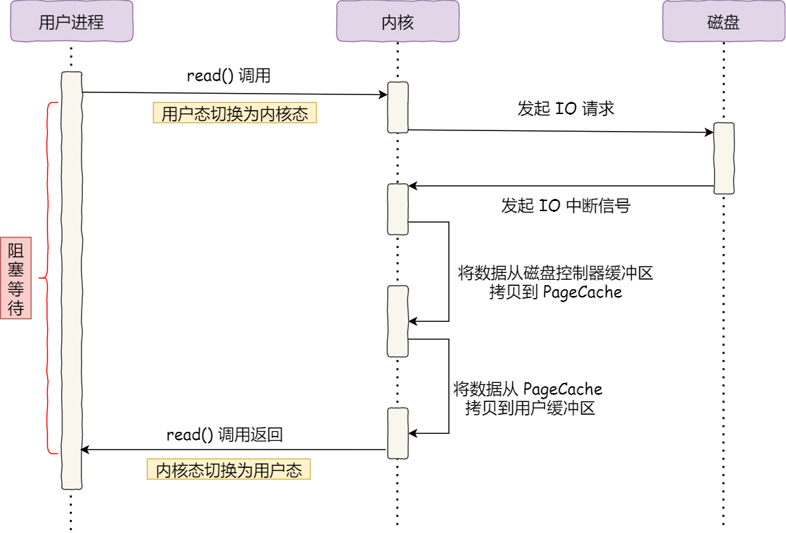

具体过程：

* 当调用 read 方法时，会阻塞着，此时内核会向磁盘发起 I/O 请求，磁盘收到请求后，便会寻址，当磁盘数据准备好后，就会向内核发起 I/O 中断，告知内核磁盘数据已经准备好；
* 内核收到 I/O 中断后，就将数据从磁盘控制器缓冲区拷贝到 PageCache 里；
* 最后，内核再把 PageCache 中的数据拷贝到用户缓冲区，于是 read 调用就正常返回了。

对于阻塞的问题，可以用异步 I/O 来解决，它工作方式如下图：

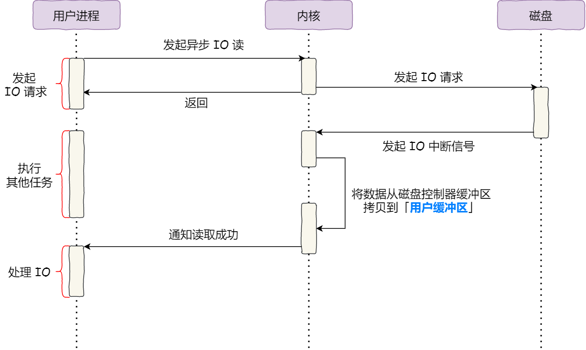

它把读操作分为两部分：

* 前半部分，内核向磁盘发起读请求，但是可以不等待数据就位就可以返回，于是进程此时可以处理其他任务；
* 后半部分，当内核将磁盘中的数据拷贝到进程缓冲区后，进程将接收到内核的通知，再去处理数据；

而且，我们可以发现，异步 I/O 并没有涉及到 PageCache，所以使用异步 I/O 就意味着要绕开 PageCache。

绕开 PageCache 的 I/O 叫直接 I/O，使用 PageCache 的 I/O 则叫缓存 I/O。通常，对于磁盘，异步 I/O 只支持直接 I/O。于是，在高并发的场景下，针对大文件的传输的方式，应该使用「异步 I/O + 直接 I/O」来替代零拷贝技术。

直接 I/O 应用场景常见的两种：

* 应用程序已经实现了磁盘数据的缓存，那么可以不需要 PageCache 再次缓存，减少额外的性能损耗。在 MySQL 数据库中，可以通过参数设置开启直接 I/O，默认是不开启；
* 传输大文件的时候，由于大文件难以命中 PageCache 缓存，而且会占满 PageCache 导致「热点」文件无法充分利用缓存，从而增大了性能开销，因此，这时应该使用直接 I/O。

另外，由于直接 I/O 绕过了 PageCache，就无法享受内核的这两点的优化：

* 内核的 I/O 调度算法会缓存尽可能多的 I/O 请求在 PageCache 中，最后「合并」成一个更大的 I/O 请求再发给磁盘，这样做是为了减少磁盘的寻址操作；
* 内核也会「预读」后续的 I/O 请求放在 PageCache 中，一样是为了减少对磁盘的操作；

于是，传输大文件的时候，使用「异步 I/O + 直接 I/O」了，就可以无阻塞地读取文件了。

所以，传输文件的时候，我们要根据文件的大小来使用不同的方式：

* 传输大文件的时候，使用「异步 I/O + 直接 I/O」；
* 传输小文件的时候，则使用「零拷贝技术」；

在 nginx 中，我们可以用如下配置，来根据文件的大小来使用不同的方式：

```plain
location /video/ { 
    sendfile on; 
    aio on; 
    directio 1024m; 
}
```

当文件大小大于 directio 值后，使用「异步 I/O + 直接 I/O」，否则使用「零拷贝技术」。

# I/O 多路复用

## 最基本的 Socket 模型

要想客户端和服务器能在网络中通信，那必须得使用 Socket 编程，它是进程间通信里比较特别的方式，特别之处在于它是可以跨主机间通信。

### 服务端的 Socket 编程过程是怎样的?

服务端首先调用 socket() 函数，创建网络协议为 IPv4，以及传输协议为 TCP 的 Socket ，接着调用 bind() 函数，给这个 Socket 绑定一个 IP 地址和端口，绑定这两个的目的是什么？

* 绑定端口的目的：当内核收到 TCP 报文，通过 TCP 头里面的端口号，来找到我们的应用程序，然后把数据传递给我们。
* 绑定 IP 地址的目的：一台机器是可以有多个网卡的，每个网卡都有对应的 IP 地址，当绑定一个网卡时，内核在收到该网卡上的包，才会发给我们；

绑定完 IP 地址和端口后，就可以调用 listen() 函数进行监听，此时对应 TCP 状态图中的 listen，如果我们要判定服务器中一个网络程序有没有启动，可以通过 netstat 命令查看对应的端口号是否有被监听。

服务端进入了监听状态后，通过调用 accept() 函数，来从内核获取客户端的连接，如果没有客户端连接，则会阻塞等待客户端连接的到来。

### 那客户端是怎么发起连接的呢？

客户端在创建好 Socket 后，调用 connect() 函数发起连接，该函数的参数要指明服务端的 IP 地址和端口号，然后万众期待的 TCP 三次握手就开始了。

在 TCP 连接的过程中，服务器的内核实际上为每个 Socket 维护了两个队列：

* 一个是「还没完全建立」连接的队列，称为 TCP 半连接队列，这个队列都是没有完成三次握手的连接，此时服务端处于 syn\_rcvd 的状态；
* 一个是「已经建立」连接的队列，称为 TCP 全连接队列，这个队列都是完成了三次握手的连接，此时服务端处于 established 状态；

当 TCP 全连接队列不为空后，服务端的 accept() 函数，就会从内核中的 TCP 全连接队列里拿出一个已经完成连接的 Socket 返回应用程序，后续数据传输都用这个 Socket。

注意，监听的 Socket 和真正用来传数据的 Socket 是两个：

* 一个叫作监听 Socket；
* 一个叫作已连接 Socket；

连接建立后，客户端和服务端就开始相互传输数据了，双方都可以通过 read() 和 write() 函数来读写数据。

至此， TCP 协议的 Socket 程序的调用过程就结束了，整个过程如下图：

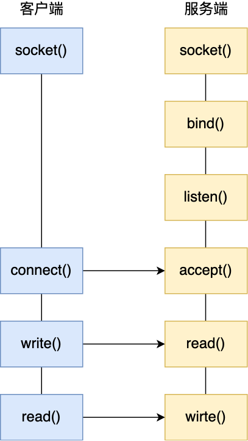

看到这，不知道你有没有觉得读写 Socket 的方式，好像读写文件一样。

是的，基于 Linux 一切皆文件的理念，在内核中 Socket 也是以「文件」的形式存在的，也是有对应的文件描述符。

## 如何服务更多的用户？

前面提到的 TCP Socket 调用流程是最简单、最基本的，它基本只能一对一通信，因为使用的是同步阻塞的方式，当服务端在还没处理完一个客户端的网络 I/O 时，或者读写操作发生阻塞时，其他客户端是无法与服务端连接的。

在改进网络 I/O 模型前，我先来提一个问题，你知道服务器单机理论最大能连接多少个客户端？

服务器肯定承载不了那么大的连接数(最大 TCP 连接数 = 客户端 IP 数×客户端端口数)，主要会受两个方面的限制：

* 文件描述符，Socket 实际上是一个文件，也就会对应一个文件描述符。在 Linux 下，单个进程打开的文件描述符数是有限制的，没有经过修改的值一般都是 1024，不过我们可以通过 ulimit 增大文件描述符的数目；
* 系统内存，每个 TCP 连接在内核中都有对应的数据结构，意味着每个连接都是会占用一定内存的；

## 多进程模型

基于最原始的阻塞网络 I/O， 如果服务器要支持多个客户端，其中比较传统的方式，就是使用多进程模型，也就是为每个客户端分配一个进程来处理请求。

服务器的主进程负责监听客户的连接，一旦与客户端连接完成，accept() 函数就会返回一个「已连接 Socket」，这时就通过 fork() 函数创建一个子进程，实际上就把父进程所有相关的东西都复制一份，包括文件描述符、内存地址空间、程序计数器、执行的代码等。

这两个进程刚复制完的时候，几乎一模一样。不过，会根据返回值来区分是父进程还是子进程，如果返回值是 0，则是子进程；如果返回值是其他的整数，就是父进程。

正因为子进程会复制父进程的文件描述符，于是就可以直接使用「已连接 Socket 」和客户端通信了，可以发现，子进程不需要关心「监听 Socket」，只需要关心「已连接 Socket」；父进程则相反，将客户服务交给子进程来处理，因此父进程不需要关心「已连接 Socket」，只需要关心「监听 Socket」。

下面这张图描述了从连接请求到连接建立，父进程创建生子进程为客户服务。

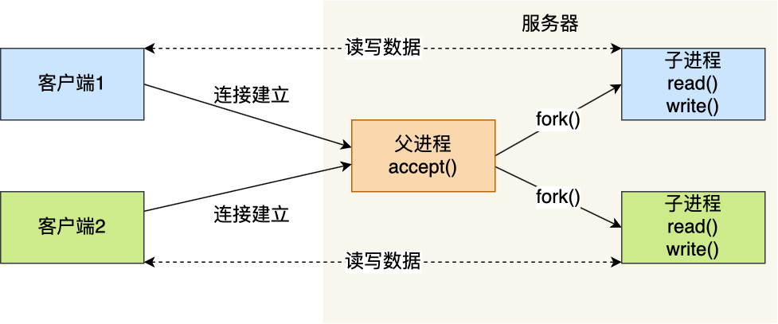

另外，当「子进程」退出时，实际上内核里还会保留该进程的一些信息，也是会占用内存的，如果不做好“回收”工作，就会变成僵尸进程，随着僵尸进程越多，会慢慢耗尽我们的系统资源。

因此，父进程要“善后”好自己的孩子，怎么善后呢？

那么有两种方式可以在子进程退出后回收资源，分别是调用 wait() 和 waitpid() 函数。

这种用多个进程来应付多个客户端的方式，在应对 100 个客户端还是可行的，但是当客户端数量高达一万时，肯定扛不住的，因为每产生一个进程，必会占据一定的系统资源，而且进程间上下文切换的“包袱”是很重的，性能会大打折扣。

进程的上下文切换不仅包含了虚拟内存、栈、全局变量等用户空间的资源，还包括了内核堆栈、寄存器等内核空间的资源。

## 多线程模型

既然进程间上下文切换的“包袱”很重，那我们就搞个比较轻量级的模型来应对多用户的请求 —— 多线程模型。

线程是运行在进程中的一个“逻辑流”，单进程中可以运行多个线程，同进程里的线程可以共享进程的部分资源，比如文件描述符列表、进程空间、代码、全局数据、堆、共享库等，这些共享些资源在上下文切换时不需要切换，而只需要切换线程的私有数据、寄存器等不共享的数据，因此同一个进程下的线程上下文切换的开销要比进程小得多。

当服务器与客户端 TCP 完成连接后，通过 pthread\_create() 函数创建线程，然后将「已连接 Socket」的文件描述符传递给线程函数，接着在线程里和客户端进行通信，从而达到并发处理的目的。

我们可以使用线程池的方式来避免线程的频繁创建和销毁，所谓的线程池，就是提前创建若干个线程，这样当由新连接建立时，将这个已连接的 Socket 放入到一个队列里，然后线程池里的线程负责从队列中取出「已连接 Socket 」进行处理。

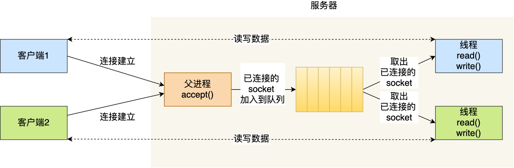

需要注意的是，这个队列是全局的，每个线程都会操作，为了避免多线程竞争，线程在操作这个队列前要加锁。上面基于进程或者线程模型的，其实还是有问题的。新到来一个 TCP 连接，就需要分配一个进程或者线程，那么如果要达到 C10K，意味着要一台机器维护 1 万个连接，相当于要维护 1 万个进程/线程，操作系统就算死扛也是扛不住的。

## I/O 多路复用

既然为每个请求分配一个进程/线程的方式不合适，那有没有可能只使用一个进程来维护多个 Socket 呢？答案是有的，那就是 I/O 多路复用技术。

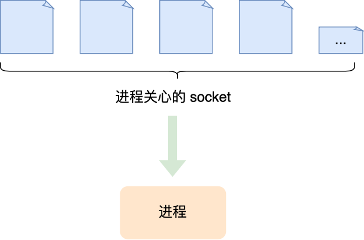

一个进程虽然任一时刻只能处理一个请求，但是处理每个请求的事件时，耗时控制在 1 毫秒以内，这样 1 秒内就可以处理上千个请求，把时间拉长来看，多个请求复用了一个进程，这就是多路复用，这种思想很类似一个 CPU 并发多个进程，所以也叫做时分多路复用。

我们熟悉的 select/poll/epoll 内核提供给用户态的多路复用系统调用，进程可以通过一个系统调用函数从内核中获取多个事件。

select/poll/epoll 是如何获取网络事件的呢？在获取事件时，先把所有连接（文件描述符）传给内核，再由内核返回产生了事件的连接，然后在用户态中再处理这些连接对应的请求即可。

select/poll/epoll 这是三个多路复用接口，都能实现 C10K 吗？接下来，我们分别说说它们。

## select/poll

select 实现多路复用的方式是，将已连接的 Socket 都放到一个文件描述符集合，然后调用 select 函数将文件描述符集合拷贝到内核里，让内核来检查是否有网络事件产生，检查的方式很粗暴，就是通过遍历文件描述符集合的方式，当检查到有事件产生后，将此 Socket 标记为可读或可写， 接着再把整个文件描述符集合拷贝回用户态里，然后用户态还需要再通过遍历的方法找到可读或可写的 Socket，然后再对其处理。

用户态只能处理内核标记的socket，而不能直接传给用户态的原因主要有两点：

1. 内核标记的socket是经过内核检查和处理后确定需要处理的socket，这样可以减少用户态需要处理的socket数量，提高效率。如果直接传给用户态所有的socket，用户态将需要处理大量的socket，会增加用户态的负担，造成资源浪费。
2. 内核标记的socket是经过内核验证的合法的socket，确保了安全性。如果直接将所有socket传给用户态，可能会涉及到未经验证的非法socket，存在安全风险。

所以，对于 select 这种方式，需要进行 2 次「遍历」文件描述符集合，一次是在内核态里，一个次是在用户态里 ，而且还会发生 2 次「拷贝」文件描述符集合，先从用户空间传入内核空间，由内核修改后，再传出到用户空间中。

select 使用固定长度的BitsMap，表示文件描述符集合，而且所支持的文件描述符的个数是有限制的，在 Linux 系统中，由内核中的 FD\_SETSIZE 限制， 默认最大值为 1024，只能监听 0~1023 的文件描述符。

poll 不再用 BitsMap 来存储所关注的文件描述符，取而代之用动态数组，以链表形式来组织，突破了 select 的文件描述符个数限制，当然还会受到系统文件描述符限制。

但是 poll 和 select 并没有太大的本质区别，都是使用「线性结构」存储进程关注的 Socket 集合，因此都需要遍历文件描述符集合来找到可读或可写的 Socket，时间复杂度为 O(n)，而且也需要在用户态与内核态之间拷贝文件描述符集合，这种方式随着并发数上来，性能的损耗会呈指数级增长。

## epoll

先复习下 epoll 的用法。如下的代码中，先用e\_poll\_create 创建一个 epoll对象 epfd，再通过 epoll\_ctl 将需要监视的 socket 添加到epfd中，最后调用 epoll\_wait 等待数据。

```c
int s = socket(AF_INET, SOCK_STREAM, 0);
bind(s, ...);
listen(s, ...)

int epfd = epoll_create(...);
epoll_ctl(epfd, ...); //将所有需要监听的socket添加到epfd中

while(1) {
    int n = epoll_wait(...);
    for(接收到数据的socket){
        //处理
    }
}
```

epoll 通过两个方面，很好解决了 select/poll 的问题。

第一点，epoll 在内核里使用红黑树来跟踪进程所有待检测的文件描述字，把需要监控的 socket 通过 epoll\_ctl() 函数加入内核中的红黑树里，红黑树是个高效的数据结构，增删改一般时间复杂度是 O(logn)。而 select/poll 内核里没有类似 epoll 红黑树这种保存所有待检测的 socket 的数据结构，所以 select/poll 每次操作时都传入整个 socket 集合给内核，而 epoll 因为在内核维护了红黑树，可以保存所有待检测的 socket ，所以只需要传入一个待检测的 socket，减少了内核和用户空间大量的数据拷贝和内存分配。

第二点， epoll 使用事件驱动的机制，内核里维护了一个链表来记录就绪事件，当某个 socket 有事件发生时，通过回调函数内核会将其加入到这个就绪事件列表中，当用户调用 epoll\_wait() 函数时，只会返回有事件发生的文件描述符的个数，不需要像 select/poll 那样轮询扫描整个 socket 集合，大大提高了检测的效率。

从下图你可以看到 epoll 相关的接口作用：

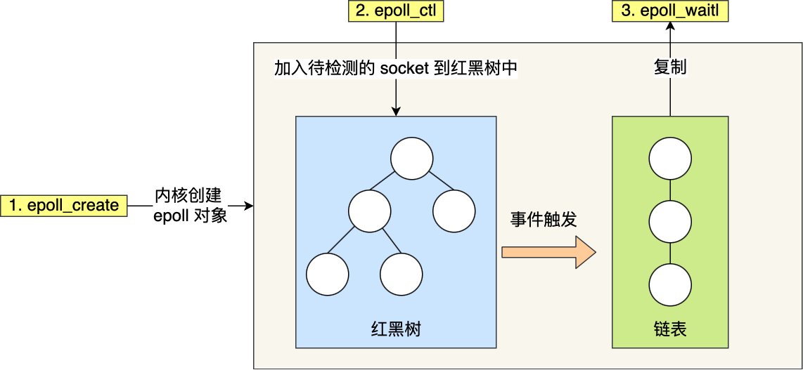

epoll 的方式即使监听的 Socket 数量越多的时候，效率不会大幅度降低，能够同时监听的 Socket 的数目也非常的多了，上限就为系统定义的进程打开的最大文件描述符个数。因而，epoll 被称为解决 C10K 问题的利器。

epoll的实现机制是通过内核与用户空间共享一个事件表，这个事件表中存放着所有需要监控的文件描述符以及它们的状态，当文件描述符的状态发生变化时，内核会将这个事件通知给用户空间，用户空间再根据事件类型进行相应的处理。

### 边缘触发和水平触发

epoll 支持两种事件触发模式，分别是边缘触发（edge-triggered，ET）和水平触发（level-triggered，LT）。

这两个术语还挺抽象的，其实它们的区别还是很好理解的。

* 使用边缘触发模式时，当被监控的 Socket 描述符上有可读事件发生时，服务器端只会从 epoll\_wait 中苏醒一次，即使进程没有调用 read 函数从内核读取数据，也依然只苏醒一次，因此我们程序要保证一次性将内核缓冲区的数据读取完；
* 使用水平触发模式时，当被监控的 Socket 上有可读事件发生时，服务器端不断地从 epoll\_wait 中苏醒，直到内核缓冲区数据被 read 函数读完才结束，目的是告诉我们有数据需要读取；

举个例子，你的快递被放到了一个快递箱里，如果快递箱只会通过短信通知你一次，即使你一直没有去取，它也不会再发送第二条短信提醒你，这个方式就是边缘触发；如果快递箱发现你的快递没有被取出，它就会不停地发短信通知你，直到你取出了快递，它才消停，这个就是水平触发的方式。

这就是两者的区别，水平触发的意思是只要满足事件的条件，比如内核中有数据需要读，就一直不断地把这个事件传递给用户；而边缘触发的意思是只有第一次满足条件的时候才触发，之后就不会再传递同样的事件了。

如果使用水平触发模式，当内核通知文件描述符可读写时，接下来还可以继续去检测它的状态，看它是否依然可读或可写。所以在收到通知后，没必要一次执行尽可能多的读写操作。

如果使用边缘触发模式，I/O 事件发生时只会通知一次，而且我们不知道到底能读写多少数据，所以在收到通知后应尽可能地读写数据，以免错失读写的机会。因此，我们会循环从文件描述符读写数据，那么如果文件描述符是阻塞的，没有数据可读写时，进程会阻塞在读写函数那里，程序就没办法继续往下执行。所以，边缘触发模式一般和非阻塞 I/O 搭配使用，程序会一直执行 I/O 操作，直到系统调用（如 read 和 write）返回错误，错误类型为 EAGAIN 或 EWOULDBLOCK。

一般来说，边缘触发的效率比水平触发的效率要高，因为边缘触发可以减少 epoll\_wait 的系统调用次数，系统调用也是有一定的开销的的，毕竟也存在上下文的切换。

select/poll 只有水平触发模式，epoll 默认的触发模式是水平触发，但是可以根据应用场景设置为边缘触发模式。

## 为什么边缘触发模式一般和非阻塞io搭配

边缘触发模式一般和非阻塞I/O搭配使用的原因主要有以下几点：

1. 避免阻塞：在边缘触发模式下，当某个事件发生时（如数据到达套接字缓冲区），epoll（或类似的I/O复用机制）会发送一次处理通知。但是，这个通知只会发送一次，无论用户是否处理这个事件。如果用户未能及时处理第一轮就绪事件，他们仍然可以随时执行epoll\_wait函数进入新一轮的阻塞监听中。为了避免在等待新数据到来时阻塞线程，结合非阻塞I/O可以确保在没有数据可读时，read调用会立即返回而不是阻塞等待。
2. 数据完整性：当数据到达套接字缓冲区时，如果采用阻塞I/O，并且随后因为某些原因（如校验和错误）数据被内核丢弃，那么使用阻塞I/O的read调用可能会阻塞线程，因为此时没有数据可读。而非阻塞I/O可以在没有数据可读时立即返回，避免了不必要的阻塞。
3. 处理效率：在边缘触发模式下，如果结合阻塞I/O使用，可能会因为等待新数据而浪费CPU资源。而非阻塞I/O允许线程在等待数据到来时执行其他任务，提高了处理效率。
4. 防止数据丢失：在边缘触发模式下，如果没有正确处理数据，可能会导致数据丢失。例如，如果仅读取了部分数据而没有继续读取剩余数据，并且后续没有更多的数据到达，那么这部分数据就会丢失。非阻塞I/O允许程序通过循环读取来确保所有数据都被读取，从而避免了数据丢失。
5. 灵活性：非阻塞I/O提供了更大的灵活性。它允许程序在等待数据到来时执行其他任务，或者同时处理多个套接字连接。这种灵活性使得非阻塞I/O成为与边缘触发模式搭配使用的理想选择。

综上所述，边缘触发模式一般和非阻塞I/O搭配使用是为了避免阻塞、确保数据完整性、提高处理效率、防止数据丢失以及提供更大的灵活性。这种组合使得程序能够高效地处理多个套接字连接，并充分利用系统资源。

## 同步非阻塞io

同步非阻塞I/O是在同步阻塞I/O的基础上，通过设置socket为非阻塞模式实现的。在这种模型下，用户进程发起I/O请求后，会立即得到一个响应，但是这个响应可能是一个错误码，表示数据还没有准备好。用户进程可以继续执行其他任务，但是需要不断轮询或询问内核数据是否准备好。当数据准备好后，用户进程可以再次发起I/O请求来获取数据。

### 特点

1. 立即响应：用户进程发起I/O请求后，会立即得到一个响应，不会阻塞等待。
2. 可能返回错误码：由于数据可能尚未准备好，因此响应可能是一个错误码（如EAGAIN或EWOULDBLOCK），表示需要稍后重试。
3. 需要轮询：用户进程需要不断轮询或询问内核数据是否准备好，这可以通过select、poll或epoll等机制实现。

这里的“非阻塞”是指当发起I/O请求时，如果数据没有立即准备好，调用不会让线程或进程进入睡眠状态等待数据就绪，而是立即返回一个错误（通常是EAGAIN或EWOULDBLOCK），表明I/O操作尚未完成。

在同步非阻塞I/O模型中，虽然线程或进程不会被阻塞在I/O操作上，但它们需要不断地检查数据是否准备好，这通常是通过循环和轮询来实现的

4. 同步性：尽管是非阻塞的，但同步非阻塞I/O仍然是同步的，因为它遵循“一问一答”的模式。即，用户进程需要主动发起I/O请求，并等待内核的响应。

### 使用场景

同步非阻塞I/O适用于那些需要同时处理多个I/O操作，但又不想被任何一个操作阻塞的情况。例如，在一个高性能的服务器中，可能需要同时处理多个客户端的连接和请求，而同步非阻塞I/O可以确保服务器不会因为等待某个慢客户端的响应而阻塞其他客户端的请求。

## 同步io与阻塞io

### 同步I/O（Synchronous I/O）

定义：

同步I/O强调的是I/O操作与程序（或线程）之间的同步关系。在同步I/O中，I/O操作被视为程序执行的一部分，程序会等待I/O操作完成后再继续执行后续的操作。换句话说，同步I/O关注的是I/O操作的完成与程序执行流程的同步。

特点：

* 顺序性：I/O操作按照定义的顺序执行，程序会等待每个I/O操作完成后再继续。
* 阻塞性：在同步I/O中，如果I/O操作是耗时的（如磁盘读写、网络通信等），那么执行I/O操作的线程或进程会被阻塞，直到I/O操作完成。

### 阻塞I/O（Blocking I/O）

定义：

阻塞I/O是从I/O操作本身的角度来看的。在阻塞I/O中，当程序发起一个I/O请求（如读取文件、发送网络数据等）时，如果数据没有立即准备好，那么发起I/O请求的线程或进程会被阻塞，直到数据准备好为止。

特点：

* 等待性：程序在发起I/O请求后，会等待数据准备好，期间不会执行其他任务。
* 阻塞性：如果数据没有立即准备好，那么发起I/O请求的线程或进程会被阻塞。

### 同步I/O与阻塞I/O的关系

* 同步I/O通常包含阻塞I/O：在大多数情况下，当我们说“同步I/O”时，我们实际上指的是阻塞I/O。因为同步I/O要求程序等待I/O操作完成后再继续执行后续操作，而阻塞I/O正是描述了在等待数据准备好期间线程或进程被阻塞的状态。
* 但并非所有同步I/O都是阻塞的：虽然同步I/O通常与阻塞I/O相关联，但在某些上下文中，同步I/O也可能以非阻塞的方式实现。例如，在某些系统或库中，你可以通过配置或调用特定的函数来使同步I/O操作变为非阻塞的。
* 异步I/O是非阻塞的：与同步I/O和阻塞I/O相对的是异步I/O，它是非阻塞的。在异步I/O中，程序发起I/O请求后会立即返回，不会等待I/O操作完成。当I/O操作完成时，系统会通过某种机制（如回调函数、事件等）通知程序。

同步I/O和阻塞I/O在描述I/O操作时具有不同的侧重点和含义。同步I/O关注的是I/O操作的完成与程序执行流程的同步，而阻塞I/O关注的是I/O操作本身在等待数据准备好期间的行为

# 文件系统

## 基本组成部分

Linux 文件系统会为每个文件分配两个数据结构：索引节点（index node）和目录项（directory entry），它们主要用来记录文件的元信息和目录层次结构。

* 索引节点，也就是 inode，用来记录文件的元信息，比如 inode 编号、文件大小、访问权限、创建时间、修改时间、数据在磁盘的位置等等。索引节点是文件的唯一标识，它们之间一一对应，也同样都会被存储在硬盘中，所以索引节点同样占用磁盘空间。
* 目录项，也就是 dentry，用来记录文件的名字、索引节点指针以及与其他目录项的层级关联关系。多个目录项关联起来，就会形成目录结构，但它与索引节点不同的是，目录项是由内核维护的一个数据结构，不存放于磁盘，而是缓存在内存。

由于索引节点唯一标识一个文件，而目录项记录着文件的名字，所以目录项和索引节点的关系是多对一，也就是说，一个文件可以有多个别名。比如，硬链接的实现就是多个目录项中的索引节点指向同一个文件。

注意，目录也是文件，也是用索引节点唯一标识，和普通文件不同的是，普通文件在磁盘里面保存的是文件数据，而目录文件在磁盘里面保存子目录或文件。

### 目录项和目录是一个东西吗？

虽然名字很相近，但是它们不是一个东西，目录是个文件，持久化存储在磁盘，而目录项是内核一个数据结构，缓存在内存。

如果查询目录频繁从磁盘读，效率会很低，所以内核会把已经读过的目录用目录项这个数据结构缓存在内存，下次再次读到相同的目录时，只需从内存读就可以，大大提高了文件系统的效率。

注意，目录项这个数据结构不只是表示目录，也是可以表示文件的。

### 那文件数据是如何存储在磁盘的呢？

磁盘读写的最小单位是扇区，扇区的大小只有 512B 大小，很明显，如果每次读写都以这么小为单位，那这读写的效率会非常低。

所以，文件系统把多个扇区组成了一个逻辑块，每次读写的最小单位就是逻辑块（数据块），Linux 中的逻辑块大小为 4KB，也就是一次性读写 8 个扇区，这将大大提高了磁盘的读写的效率。

以上就是索引节点、目录项以及文件数据的关系，下面这个图就很好的展示了它们之间的关系：

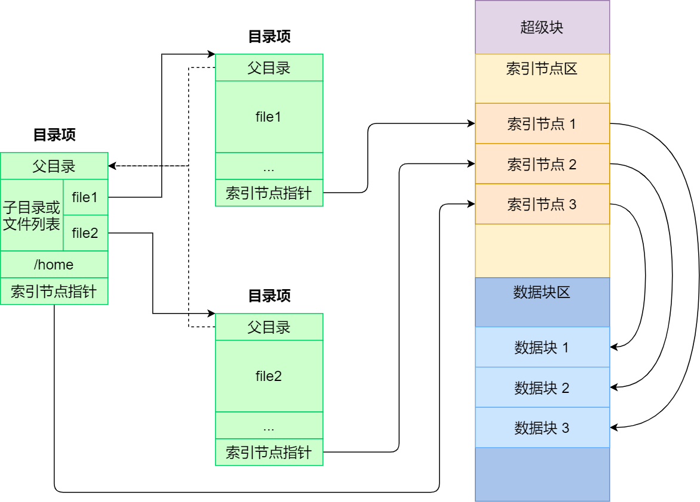

索引节点是存储在硬盘上的数据，那么为了加速文件的访问，通常会把索引节点加载到内存中。

另外，磁盘进行格式化的时候，会被分成三个存储区域，分别是超级块、索引节点区和数据块区。

* 超级块，用来存储文件系统的详细信息，比如块个数、块大小、空闲块等等。
* 索引节点区，用来存储索引节点；
* 数据块区，用来存储文件或目录数据；

我们不可能把超级块和索引节点区全部加载到内存，这样内存肯定撑不住，所以只有当需要使用的时候，才将其加载进内存，它们加载进内存的时机是不同的：

* 超级块：当文件系统挂载时进入内存；
* 索引节点区：当文件被访问时进入内存；

## 文件系统的结构

在 Linux 文件系统，把这个结构称为一个块组，那么有 N 多的块组，就能够表示 N 大的文件。

下图给出了 Linux Ext2 整个文件系统的结构和块组的内容，文件系统都由大量块组组成，在硬盘上相继排布：

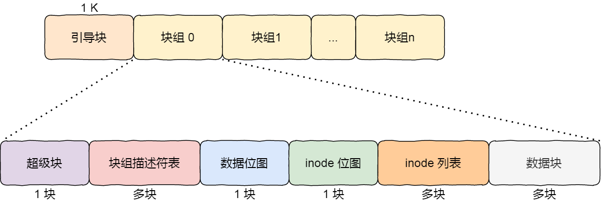

最前面的第一个块是引导块，在系统启动时用于启用引导，接着后面就是一个一个连续的块组了，块组的内容如下：

* 超级块，包含的是文件系统的重要信息，比如 inode 总个数、块总个数、每个块组的 inode 个数、每个块组的块个数等等。
* 块组描述符，包含文件系统中各个块组的状态，比如块组中空闲块和 inode 的数目等，每个块组都包含了文件系统中「所有块组的组描述符信息」。
* 数据位图和 inode 位图， 用于表示对应的数据块或 inode 是空闲的，还是被使用中。
* inode 列表，包含了块组中所有的 inode，inode 用于保存文件系统中与各个文件和目录相关的所有元数据。
* 数据块，包含文件的有用数据。

inode保存了文件的元数据信息和文件数据块的指针，用于描述文件的属性和位置；而数据块则是存储文件实际内容的最小单位，用于保存文件的数据内容。二者共同构成了UNIX文件系统的基本组成结构，实现了文件的管理和存储。

## 目录的存储

和普通文件不同的是，普通文件的块里面保存的是文件数据，而目录文件的块里面保存的是目录里面一项一项的文件信息。

在目录文件的块中，最简单的保存格式就是列表，就是一项一项地将目录下的文件信息（如文件名、文件 inode、文件类型等）列在表里。

列表中每一项就代表该目录下的文件的文件名和对应的 inode，通过这个 inode，就可以找到真正的文件。

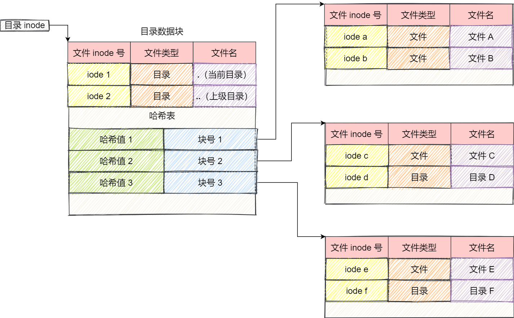

如果一个目录有超级多的文件，我们要想在这个目录下找文件，按照列表一项一项的找，效率就不高了。

于是，保存目录的格式改成哈希表，对文件名进行哈希计算，把哈希值保存起来，如果我们要查找一个目录下面的文件名，可以通过名称取哈希。如果哈希能够匹配上，就说明这个文件的信息在相应的块里面。

Linux 系统的 ext 文件系统就是采用了哈希表，来保存目录的内容，这种方法的优点是查找非常迅速，插入和删除也较简单，不过需要一些预备措施来避免哈希冲突。

目录查询是通过在磁盘上反复搜索完成，需要不断地进行 I/O 操作，开销较大。所以，为了减少 I/O 操作，把当前使用的文件目录缓存在内存，以后要使用该文件时只要在内存中操作，从而降低了磁盘操作次数，提高了文件系统的访问速度。


> 更新: 2024-07-29 09:00:45  
> 原文: <https://www.yuque.com/nibiwanxiamei/yrd6t1/a81ca98bfd55aa591c9ee415e1a45d28>