# TCP 重传、滑动窗口、流量控制、拥塞控制

***

# TCP 重传、滑动窗口、流量控制、拥塞控制

**TCP利用重传机制、滑动窗口、流量控制、拥塞控制保证其可靠性**

# 重传机制

TCP 实现可靠传输的方式之一，**通过序列号与确认应答。**

在 TCP 中，当发送端的数据到达接收主机时，接收端主机会返回一个确认应答消息，表示已收到消息。

TCP 针对数据包丢失的情况，会用**重传机制**解决。

常见的重传机制：

* 超时重传
* 快速重传
* SACK
* D-SACK

## 超时重传

设定一个定时器，当超过指定的时间后，没有收到对方的 `ACK` 确认应答报文，就会重发该数据

TCP 会在以下两种情况发生超时重传：

* 数据包丢失
* 确认应答丢失

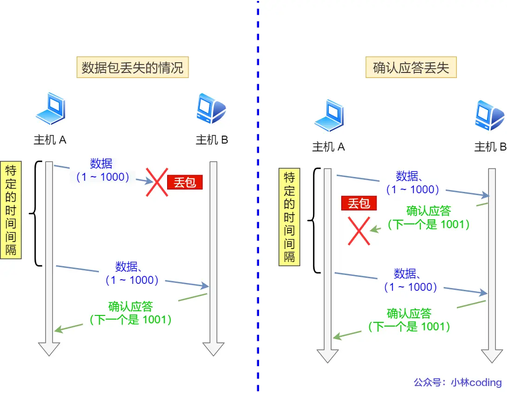

**超时重传时间 RTO 的值应该略大于报文往返 RTT 的值。这样可以保证不会提前重发，也不会延迟太久重发**

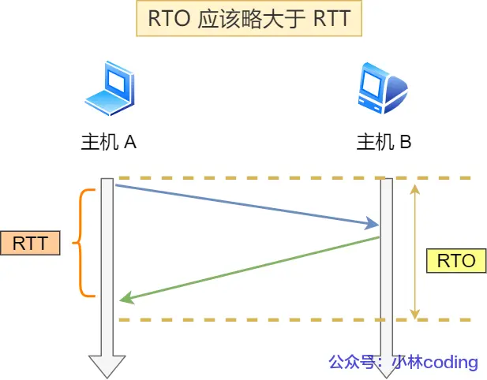

## 快重传

**快速重传（Fast Retransmit）机制**，它**不以时间为驱动，而是以数据驱动重传。收到连续三个同样的ACK就会快速重传。**

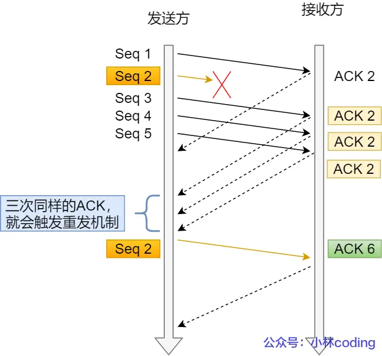

快速重传机制只解决了一个问题，就是超时时间的问题，但是它依然面临着另外一个问题。就是**重传的时是重传一个，还是重传所有的问题。**

编号的顺序是 Seq1 ~ Seq6 ，但是 Seq2、Seq3 都丢失了，那么接收方在收到 Seq4、Seq5、Seq6 时，都是回复 ACK2 给发送方，但是**发送方并不清楚这连续的 ACK2 是接收方收到哪个报文而回复的**， 那是选择重传 Seq2 一个报文，还是重传 Seq2 之后已发送的所有报文呢（Seq2、Seq3、 Seq4、Seq5、 Seq6） 呢？

## SACK 方法

还有一种实现重传机制的方式叫：`SACK`（ Selective Acknowledgment）， **选择性确认，解决快重传的问题。**

这种方式需要在 TCP 头部「选项」字段里加一个 `SACK` 的东西，**可以将已收到的数据的信息发送给「发送方」** ，这样发送方就可以知道哪些数据收到了，哪些数据没收到，，就可以**只重传丢失的数据**。

如下图，发送方收到了三次同样的 ACK 确认报文，于是就会触发快速重发机制，通过 `SACK` 信息发现只有 `200~299` 这段数据丢失，则重发时，就只选择了这个 TCP 段进行重复。

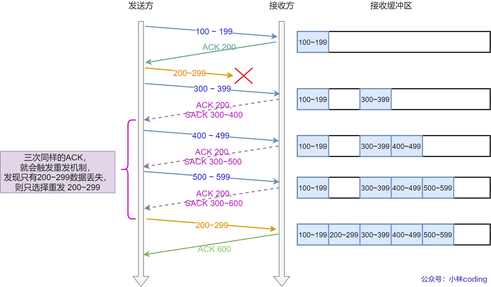

## Duplicate SACK

**使用了 SACK 来告诉「发送方」有哪些数据被重复接收了。**

*ACK 丢包*

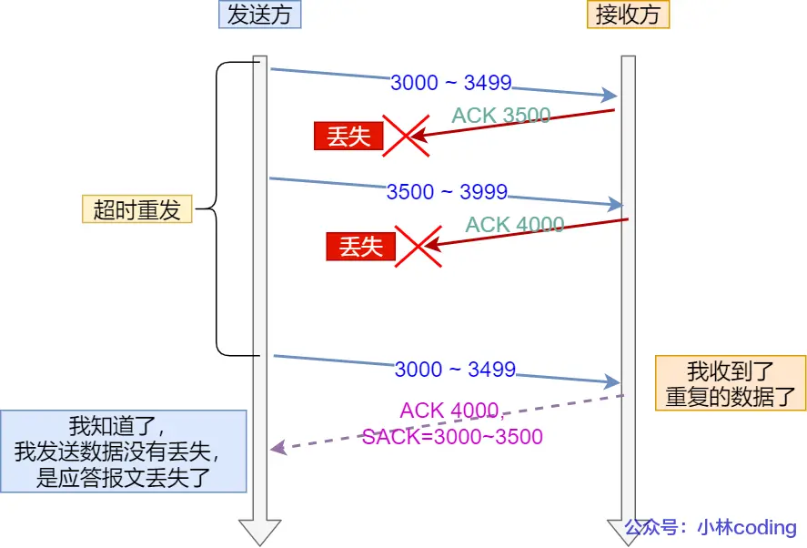

*网络延时*

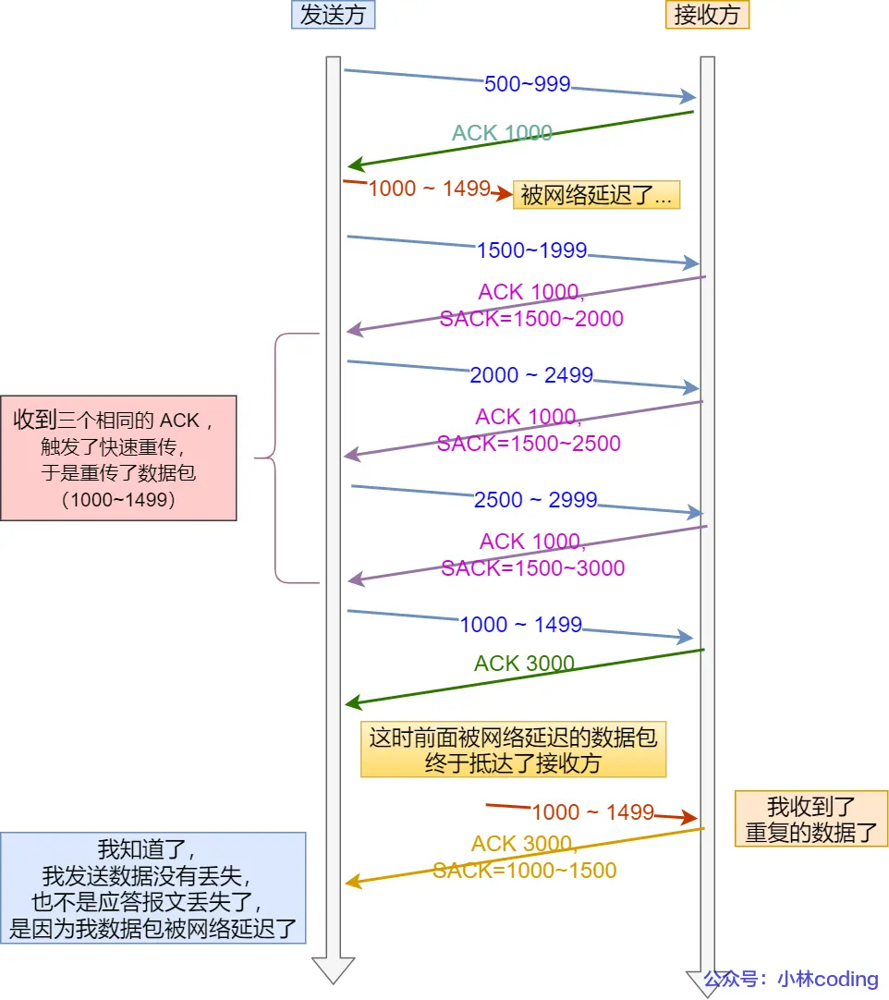

# 滑动窗口

TCP 引入了**窗口**这个概念。即使在往返时间较长的情况下，它也不会降低网络通信的效率。

那么有了窗口，就可以指定窗口大小，窗口大小就是指**无需等待确认应答，而可以继续发送数据的最大值**。

窗口的实现实际上是操作系统开辟的一个缓存空间，发送方主机在等到确认应答返回之前，必须在缓冲区中保留已发送的数据。如果按期收到确认应答，此时数据就可以从缓存区清除。

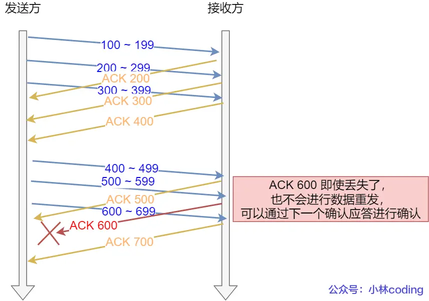

图中的 ACK 600 确认应答报文丢失，也没关系，因为可以通过下一个确认应答进行确认，只要发送方收到了 ACK 700 确认应答，就意味着 700 之前的所有数据「接收方」都收到了。这个模式就叫**累计确认**或者**累计应答**。

**接收端告诉发送端自己还有多少缓冲区可以接收数据。于是发送端就可以根据这个接收端的处理能力来发送数据，而不会导致接收端处理不过来。**

**发送方滑动窗口**

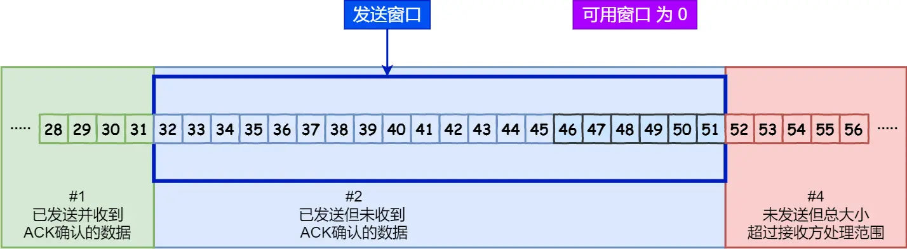

当收到之前发送的数据 `32~36` 字节的 ACK 确认应答后，如果发送窗口的大小没有变化，则**滑动窗口往右边移动 5 个字节，因为有 5 个字节的数据被应答确认**，接下来 `52~56` 字节又变成了可用窗口，那么后续也就可以发送 `52~56` 这 5 个字节的数据了。

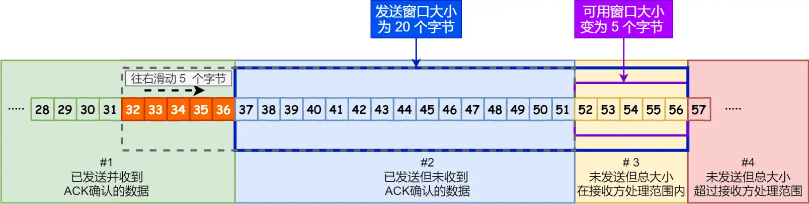

**接收方滑动窗口**

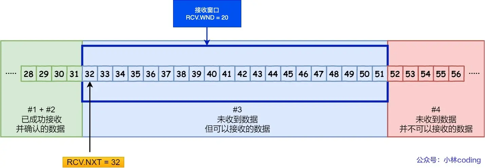

# 流量控制

发送方如果一直无脑的发数据给对方，但对方处理不过来，那么就会导致触发重发机制，从而导致网络流量的无端的浪费。

为了解决这种现象发生，**TCP 提供一种机制可以让「发送方」根据「接收方」的实际接收能力控制发送的数据量，这就是所谓的流量控制。**

举个栗子，为了简单起见，假设以下场景：

* 客户端是接收方，服务端是发送方
* 假设接收窗口和发送窗口相同，都为 `200`
* 假设两个设备在整个传输过程中都保持相同的窗口大小，不受外界影响

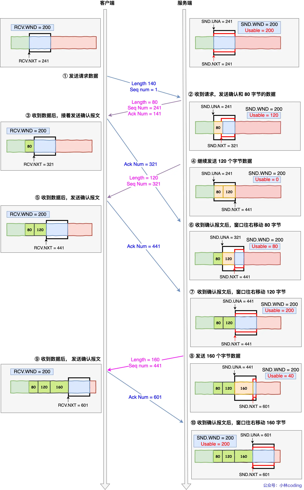

## 操作系统缓冲区与滑动窗口的关系

实际上，发送窗口和接收窗口中所存放的字节数，都是放在操作系统内存缓冲区中的，而操作系统的缓冲区，会**被操作系统调整**。

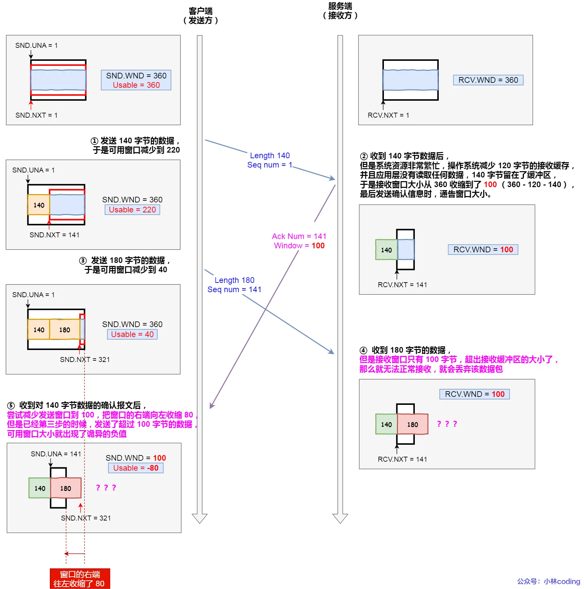

**为了防止操作系统收缩缓冲窗口后，发送端还没有收到窗口收缩的报文而发送出超出缓冲窗口大小的数据，TCP 规定是不允许同时减少缓存又收缩窗口的，而是采用\*\*\*\*先收缩窗口，过段时间再减少缓存** **，这样就可以避免了丢包情况。**

## 窗口关闭

**如果窗口大小为 0 时，就会阻止发送方给接收方传递数据，直到窗口变为非 0 为止，这就是窗口关闭。**

当发生窗口关闭时，接收方处理完数据后，会向发送方通告一个窗口非 0 的 ACK 报文，如果这个通告窗口的 ACK 报文在网络中丢失了，那就会导致发送方不发数据。

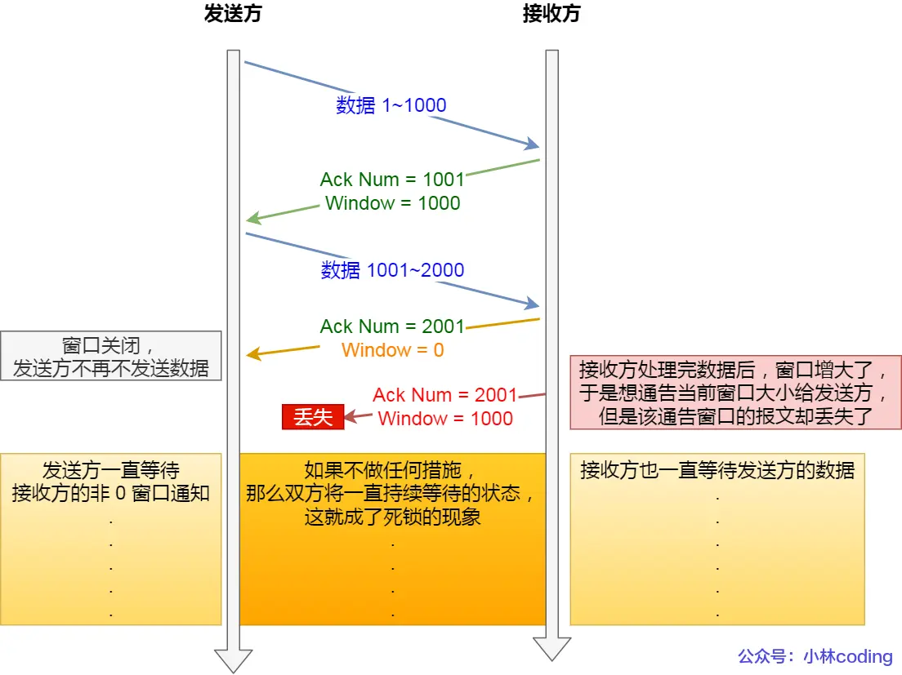

为了解决这个问题，TCP 为每个连接设有一个持续定时器，**只要 TCP 连接一方收到对方的零窗口通知，就\*\*\*\*启动持续计时器** **。**

如果持续计时器超时，就会发送**窗口探测 ( Window probe ) 报文**，而对方在确认这个探测报文时，给出自己现在的接收窗口大小。

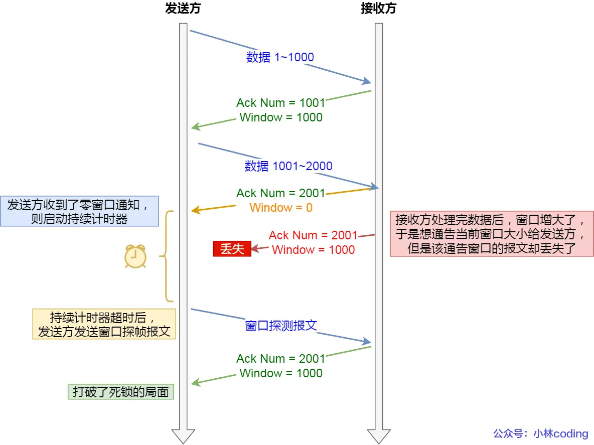

窗口探测的次数一般为 3 次，每次大约 30-60 秒（不同的实现可能会不一样）。如果 3 次过后接收窗口还是 0 的话，有的 TCP 实现就会发 `RST` 报文来中断连接。

## 糊涂窗口综合症

如果接收方太忙了，来不及取走接收窗口里的数据，那么就会导致发送方的发送窗口越来越小。

**如果接收方腾出几个字节并告诉发送方现在有几个字节的窗口，而发送方会义无反顾地发送这几个字节，这就是糊涂窗口综合症**。

`TCP + IP` 头有 `40` 个字节，为了传输那几个字节的数据，要搭上这么大的开销是不合理的。

接收方通常的策略如下:

当「窗口大小」小于 min( MSS，缓存空间/2 ) ，也就是小于 MSS 与 1/2 缓存大小中的最小值时，就会向发送方通告窗口为 `0`，也就阻止了发送方再发数据过来。

等到接收方处理了一些数据后，窗口大小 >= MSS，或者接收方缓存空间有一半可以使用，就可以把窗口打开让发送方发送数据过来。

发送方通常的策略如下:

使用 Nagle 算法，该算法的思路是延时处理，只有满足下面两个条件中的任意一个条件，才可以发送数据：

* 条件一：要等到窗口大小 >= `MSS` 并且 数据大小 >= `MSS`；
* 条件二：收到之前发送数据的 `ack` 回包；

只要上面两个条件都不满足，发送方一直在囤积数据，直到满足上面的发送条件。

# 拥塞控制

**在网络出现拥堵时，如果继续发送大量数据包，可能会导致数据包时延、丢失等，这时 TCP 就会重传数据，但是一重传就会导致网络的负担更重，于是会导致更大的延迟以及更多的丢包，这个情况就会进入恶性循环被不断地放大....**

**拥塞控制**：**避免「发送方」的数据填满整个网络。**

**拥塞窗口 cwnd**是发送方维护的一个的状态变量，它会根据**网络的拥塞程度动态变化的**。**发送窗口swnd = min(cwnd, rwnd)**

只要「发送方」没有在规定时间内接收到 ACK 应答报文，也就是**发生了超时重传，认为网络出现了拥塞。**

拥塞控制主要是四个算法：

* 慢启动
* 拥塞避免
* 快重传
* 快速恢复

## 慢开始

**当发送方每收到一个 ACK，拥塞窗口 cwnd 的大小就会加 1。**

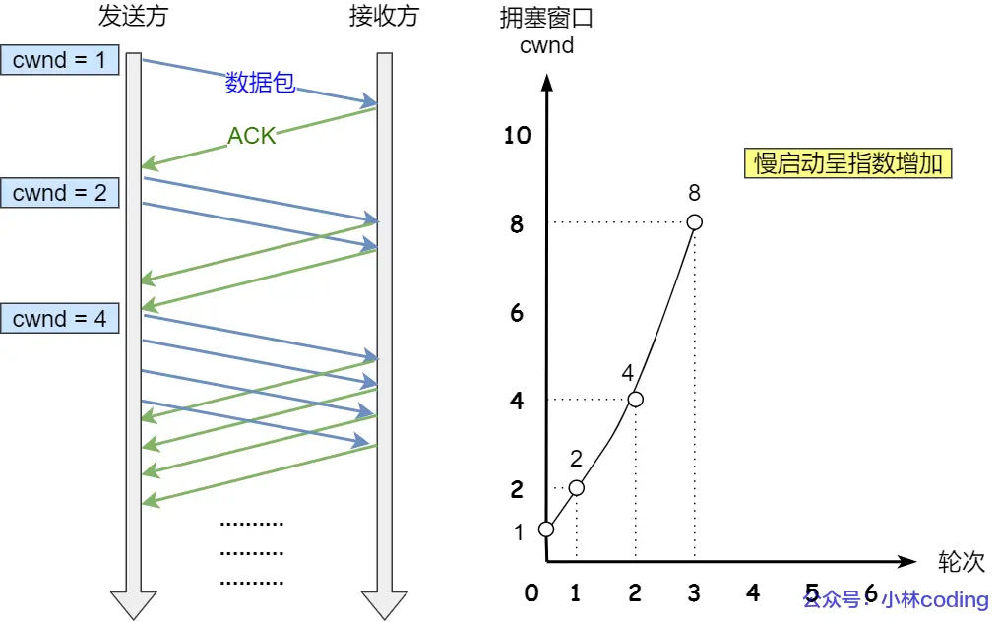

慢启动门限 `ssthresh`，当 `cwnd` >= `ssthresh` 时，就会使用「拥塞避免算法」

## 拥塞避免

**每当收到一个 ACK 时，cwnd 增加 1/cwnd。其实就是增加1。**

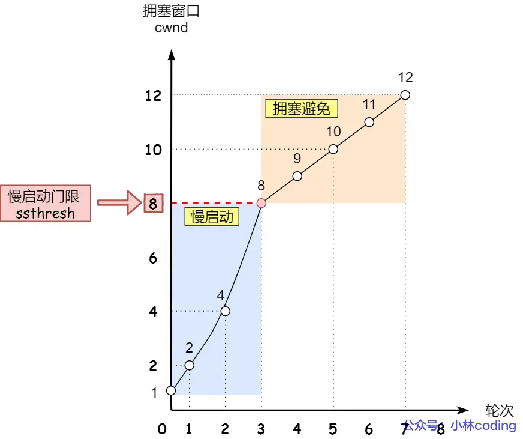

## 快重传

普通超时重传

* `ssthresh` 设为 `cwnd/2`，
* `cwnd` 重置为 `1` （是恢复为 cwnd 初始化值，我这里假定 cwnd 初始化值 1）

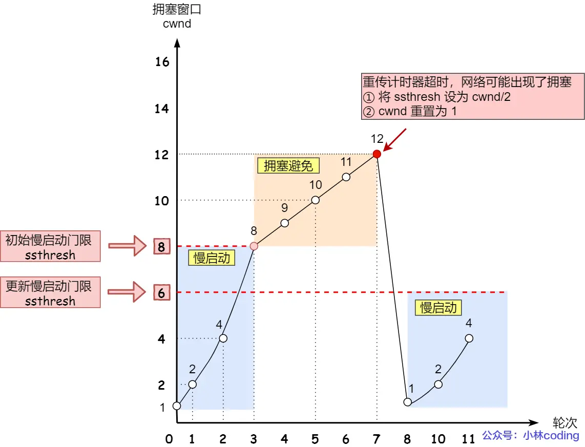

**快重传**

当接收方发现丢了一个中间包的时候，发送三次前一个包的 ACK，于是发送端就会快速地重传，不必等待超时再重传。

TCP 认为这种情况不严重，因为大部分没丢，只丢了一小部分，则 `ssthresh` 和 `cwnd` 变化如下：

* `cwnd = cwnd/2` ，也就是设置为原来的一半;
* `ssthresh = cwnd`;
* 进入快速恢复算法

## 快速恢复

快速重传和快速恢复算法一般同时使用，快速恢复算法是认为，你还能收到 3 个重复 ACK 说明网络也不那么糟糕，所以没有必要像 `RTO` 超时那么强烈。

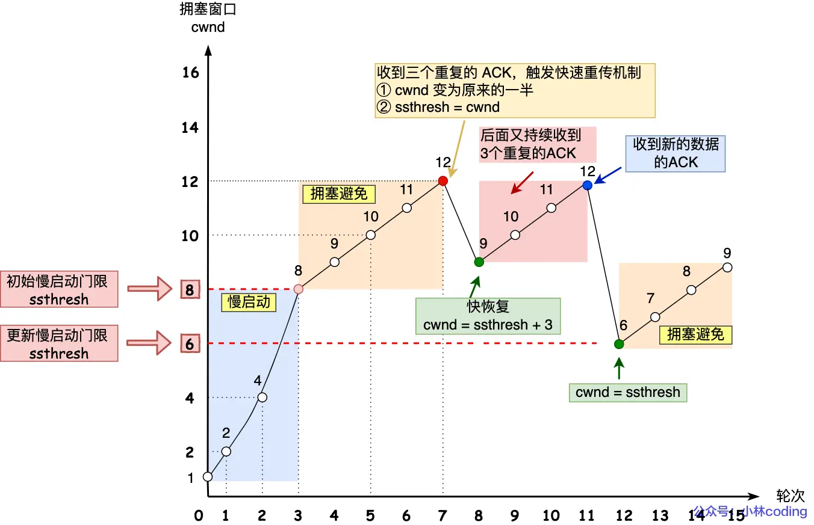

> 更新: 2024-07-23 17:16:28  
> 原文: <https://www.yuque.com/nibiwanxiamei/yrd6t1/130e68a6be1a77cc84134849cfd9eb50>