# 三次握手和四次挥手

***

> **from：xiaolincoding.com**

# TCP基本内容

## TCP报文格式

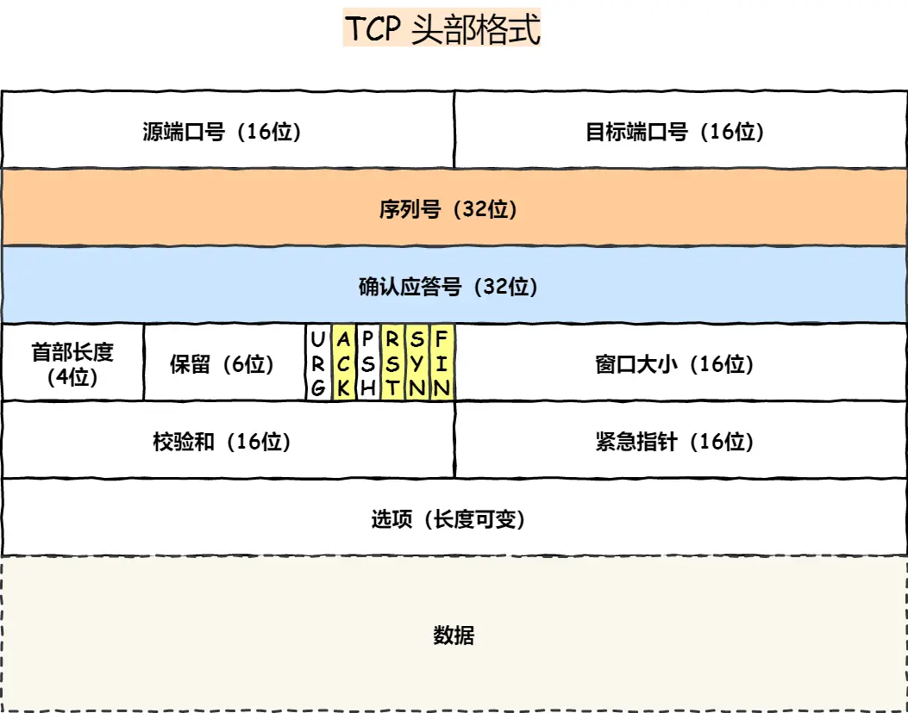

**<font style="color:rgb(48, 79, 254);">序列号</font>**<font style="color:rgb(44, 62, 80);">：在建立连接时由计算机生成的随机数作为其初始值，通过 SYN 包传给接收端主机，每发送一次数据，就「累加」一次该「数据字节数」的大小。</font>**<font style="color:rgb(48, 79, 254);">用来解决网络包乱序问题。</font>**

**<font style="color:rgb(48, 79, 254);">确认应答号</font>**<font style="color:rgb(44, 62, 80);">：指下一次「期望」收到的数据的序列号，发送端收到这个确认应答以后可以认为在这个序号以前的数据都已经被正常接收。</font>**<font style="color:rgb(48, 79, 254);">用来解决丢包的问题。</font>**

**<font style="color:rgb(48, 79, 254);">控制位：</font>**

* *<font style="color:rgb(200, 73, 255);">ACK</font>*<font style="color:rgb(44, 62, 80);">：该位为</font><font style="color:rgb(44, 62, 80);"> </font><code><font style="color:rgb(71, 101, 130);">1</font></code><font style="color:rgb(44, 62, 80);"> </font><font style="color:rgb(44, 62, 80);">时，「确认应答」的字段变为有效，TCP 规定除了最初建立连接时的</font><font style="color:rgb(44, 62, 80);"> </font><code><font style="color:rgb(71, 101, 130);">SYN</font></code><font style="color:rgb(44, 62, 80);"> </font><font style="color:rgb(44, 62, 80);">包之外该位必须设置为</font><font style="color:rgb(44, 62, 80);"> </font><code><font style="color:rgb(71, 101, 130);">1</font></code><font style="color:rgb(44, 62, 80);"> </font><font style="color:rgb(44, 62, 80);">。</font>
* *<font style="color:rgb(200, 73, 255);">RST</font>*<font style="color:rgb(44, 62, 80);">：该位为</font><font style="color:rgb(44, 62, 80);"> </font><code><font style="color:rgb(71, 101, 130);">1</font></code><font style="color:rgb(44, 62, 80);"> </font><font style="color:rgb(44, 62, 80);">时，表示 TCP 连接中出现异常必须强制断开连接。</font>
* *<font style="color:rgb(200, 73, 255);">SYN</font>*<font style="color:rgb(44, 62, 80);">：该位为</font><font style="color:rgb(44, 62, 80);"> </font><code><font style="color:rgb(71, 101, 130);">1</font></code><font style="color:rgb(44, 62, 80);"> </font><font style="color:rgb(44, 62, 80);">时，表示希望建立连接，并在其「序列号」的字段进行序列号初始值的设定。</font>
* *<font style="color:rgb(200, 73, 255);">FIN</font>*<font style="color:rgb(44, 62, 80);">：该位为 </font><code><font style="color:rgb(71, 101, 130);">1</font></code><font style="color:rgb(44, 62, 80);"> 时，表示今后不会再有数据发送，希望断开连接。当通信结束希望断开连接时，通信双方的主机之间就可以相互交换 </font><code><font style="color:rgb(71, 101, 130);">FIN</font></code><font style="color:rgb(44, 62, 80);"> 位为 1 的 TCP 段。</font>

<font style="color:rgb(44, 62, 80);"></font>

<code><font style="color:rgb(71, 101, 130);">IP</font></code><font style="color:rgb(44, 62, 80);"> 层是「不可靠」的，它不保证网络包的交付、不保证网络包的按序交付、也不保证网络包中的数据的完整性。</font>**TCP 是一个工作在传输层的可靠数据传输的服务，它能确保接收端接收的网络包是无损坏、无间隔、非冗余和按序的。**

## TCP特性

**TCP 是**\*\*<font style="color:#DF2A3F;">面向连接的、可靠的、基于字节流</font>\*\***的传输层通信协议。**


**TCP连接：\*\*\*\*<font style="color:rgb(48, 79, 254);">用于保证可靠性和流量控制维护的某些状态信息，包括 Socket、序列号和窗口大小称为连接。</font>**

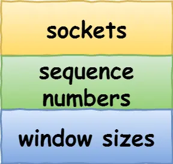

**Socket：IP + 端口；序列号：解决乱序；窗口大小：流量控制**

**确定唯一TCP连接：四元组（IP + 端口）**

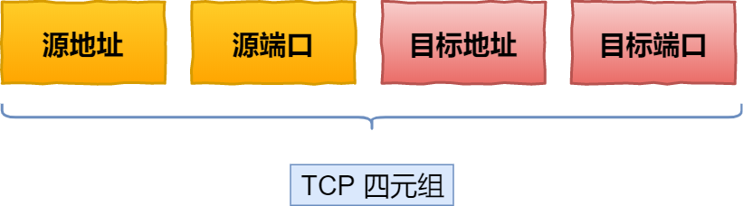

最大TCP连接数：

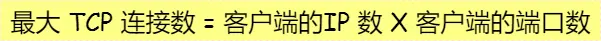

<font style="color:rgb(44, 62, 80);">对 IPv4，客户端的 IP 数最多为</font><font style="color:rgb(44, 62, 80);"> </font><code><font style="color:rgb(71, 101, 130);">2</font></code><font style="color:rgb(44, 62, 80);"> </font><font style="color:rgb(44, 62, 80);">的</font><font style="color:rgb(44, 62, 80);"> </font><code><font style="color:rgb(71, 101, 130);">32</font></code><font style="color:rgb(44, 62, 80);"> </font><font style="color:rgb(44, 62, 80);">次方，客户端的端口数最多为</font><font style="color:rgb(44, 62, 80);"> </font><code><font style="color:rgb(71, 101, 130);">2</font></code><font style="color:rgb(44, 62, 80);"> </font><font style="color:rgb(44, 62, 80);">的</font><font style="color:rgb(44, 62, 80);"> </font><code><font style="color:rgb(71, 101, 130);">16</font></code><font style="color:rgb(44, 62, 80);"> </font><font style="color:rgb(44, 62, 80);">次方，也就是服务端单机最大 TCP 连接数，约为</font><font style="color:rgb(44, 62, 80);"> </font><code><font style="color:rgb(71, 101, 130);">2</font></code><font style="color:rgb(44, 62, 80);"> </font><font style="color:rgb(44, 62, 80);">的</font><font style="color:rgb(44, 62, 80);"> </font><code><font style="color:rgb(71, 101, 130);">48</font></code><font style="color:rgb(44, 62, 80);"> </font><font style="color:rgb(44, 62, 80);">次方。</font>

<font style="color:rgb(44, 62, 80);">当然，服务端最大并发 TCP 连接数远不能达到理论上限，会受以下因素影响：</font>

* **<font style="color:rgb(48, 79, 254);">文件描述符限制</font>**<font style="color:rgb(44, 62, 80);">，每个 TCP 连接都是一个文件，如果文件描述符被占满了，会发生 Too many open files。Linux 对可打开的文件描述符的数量分别作了三个方面的限制：</font>
  * **<font style="color:rgb(48, 79, 254);">系统级</font>**<font style="color:rgb(44, 62, 80);">：当前系统可打开的最大数量，通过</font><font style="color:rgb(44, 62, 80);"> </font><code><font style="color:rgb(71, 101, 130);">cat /proc/sys/fs/file-max</font></code><font style="color:rgb(44, 62, 80);"> </font><font style="color:rgb(44, 62, 80);">查看；</font>
  * **<font style="color:rgb(48, 79, 254);">用户级</font>**<font style="color:rgb(44, 62, 80);">：指定用户可打开的最大数量，通过</font><font style="color:rgb(44, 62, 80);"> </font><code><font style="color:rgb(71, 101, 130);">cat /etc/security/limits.conf</font></code><font style="color:rgb(44, 62, 80);"> </font><font style="color:rgb(44, 62, 80);">查看；</font>
  * **<font style="color:rgb(48, 79, 254);">进程级</font>**<font style="color:rgb(44, 62, 80);">：单个进程可打开的最大数量，通过</font><font style="color:rgb(44, 62, 80);"> </font><code><font style="color:rgb(71, 101, 130);">cat /proc/sys/fs/nr_open</font></code><font style="color:rgb(44, 62, 80);"> </font><font style="color:rgb(44, 62, 80);">查看；</font>
* **<font style="color:rgb(48, 79, 254);">内存限制</font>**<font style="color:rgb(44, 62, 80);">，每个 TCP 连接都要占用一定内存，操作系统的内存是有限的，如果内存资源被占满后，会发生 OOM</font>

## TCP vs UDP

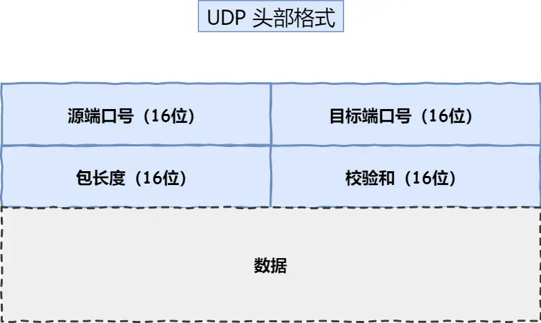

* 目标和源端口：主要是告诉 UDP 协议应该把报文发给哪个进程。
* 包长度：该字段保存了 UDP 首部的长度跟数据的长度之和。
* 校验和：校验和是为了提供可靠的 UDP 首部和数据而设计，防止收到在网络传输中受损的 UDP 包。

**TCP 和 UDP 区别：**

*<font style="color:rgb(200, 73, 255);">1. 连接</font>*

* <font style="color:rgb(44, 62, 80);">TCP 是面向连接的传输层协议，传输数据前先要建立连接。</font>
* <font style="color:rgb(44, 62, 80);">UDP 是不需要连接，即刻传输数据。</font>

*<font style="color:rgb(200, 73, 255);">2. 服务对象</font>*

* <font style="color:rgb(44, 62, 80);">TCP 是一对一的两点服务，即一条连接只有两个端点。</font>
* <font style="color:rgb(44, 62, 80);">UDP 支持一对一、一对多、多对多的交互通信</font>

*<font style="color:rgb(200, 73, 255);">3. 可靠性</font>*

* <font style="color:rgb(44, 62, 80);">TCP 是可靠交付数据的，数据可以无差错、不丢失、不重复、按序到达。</font>
* <font style="color:rgb(44, 62, 80);">UDP 是尽最大努力交付，不保证可靠交付数据。但是我们可以基于 UDP 传输协议实现一个可靠的传输协议，比如 QUIC 协议 - </font><https://xiaolincoding.com/network/3_tcp/quic.html>

*<font style="color:rgb(200, 73, 255);">4. 拥塞控制、流量控制</font>*

* <font style="color:rgb(44, 62, 80);">TCP 有拥塞控制和流量控制机制，保证数据传输的安全性。</font>
* <font style="color:rgb(44, 62, 80);">UDP 则没有，即使网络非常拥堵了，也不会影响 UDP 的发送速率。</font>

*<font style="color:rgb(200, 73, 255);">5. 首部开销</font>*

* <font style="color:rgb(44, 62, 80);">TCP 首部长度较长，会有一定的开销，首部在没有使用「选项」字段时是</font><font style="color:rgb(44, 62, 80);"> </font><code><font style="color:rgb(71, 101, 130);">20</font></code><font style="color:rgb(44, 62, 80);"> </font><font style="color:rgb(44, 62, 80);">个字节，如果使用了「选项」字段则会变长的。</font>
* <font style="color:rgb(44, 62, 80);">UDP 首部只有 8 个字节，并且是固定不变的，开销较小。</font>

*<font style="color:rgb(200, 73, 255);">6. 传输方式</font>*

* <font style="color:rgb(44, 62, 80);">TCP 是流式传输，没有边界，但保证顺序和可靠。</font>
* <font style="color:rgb(44, 62, 80);">UDP 是一个包一个包的发送，是有边界的，但可能会丢包和乱序。</font>

*<font style="color:rgb(200, 73, 255);">7. 分片不同</font>*

* <font style="color:rgb(44, 62, 80);">TCP 的数据大小如果大于 MSS 大小，则会在传输层进行分片，目标主机收到后，也同样在传输层组装 TCP 数据包，如果中途丢失了一个分片，只需要传输丢失的这个分片。</font>
* <font style="color:rgb(44, 62, 80);">UDP 的数据大小如果大于 MTU 大小，则会在 IP 层进行分片，目标主机收到后，在 IP 层组装完数据，接着再传给传输层。</font>

**TCP 和 UDP 应用场景：**

<font style="color:rgb(44, 62, 80);">TCP 是面向连接，能保证数据的可靠性交付，因此经常用于：</font>

* <code><font style="color:rgb(71, 101, 130);">FTP</font></code><font style="color:rgb(44, 62, 80);"> </font><font style="color:rgb(44, 62, 80);">文件传输；</font>
* <font style="color:rgb(44, 62, 80);">HTTP / HTTPS；</font>

<font style="color:rgb(44, 62, 80);">UDP 面向无连接，它可以随时发送数据，再加上 UDP 本身的处理既简单又高效，因此经常用于：</font>

* <font style="color:rgb(44, 62, 80);">包总量较少的通信，如</font><font style="color:rgb(44, 62, 80);"> </font><code><font style="color:rgb(71, 101, 130);">DNS</font></code><font style="color:rgb(44, 62, 80);"> </font><font style="color:rgb(44, 62, 80);">、</font><code><font style="color:rgb(71, 101, 130);">SNMP</font></code><font style="color:rgb(44, 62, 80);"> </font><font style="color:rgb(44, 62, 80);">等；</font>
* <font style="color:rgb(44, 62, 80);">视频、音频等多媒体通信；</font>
* <font style="color:rgb(44, 62, 80);">广播通信；</font>

> **为什么 UDP 头部没有「首部长度」字段，而 TCP 头部有「首部长度」字段呢？**

原因是 TCP 有**可变长**的「选项」字段，而 UDP 头部长度则是**不会变化**的，无需多一个字段去记录 UDP 的首部长度。

**TCP 计算负载数据长度：**

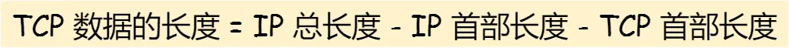

其中 IP 总长度 和 IP 首部长度，在 IP 首部格式是已知的。TCP 首部长度，则是在 TCP 首部格式已知的，所以就可以求得 TCP 数据的长度。

### TCP 和 UDP 可以使用同一个端口吗? √

传输层的「端口号」的作用，是为了区分同一个主机上不同应用程序的数据包。传输层两个传输协议 TCP 和 UDP，**<font style="color:#DF2A3F;">内核中是两个完全独立的软件模块</font>**<font style="color:#DF2A3F;">。</font>

当主机收到数据包后， IP 包头的「协议号」字段知道该数据包是 TCP/UDP，所以可以根据这个信息确定送给哪个模块（TCP/UDP）处理，送给 TCP/UDP 模块的报文根据「端口号」确定送给哪个应用程序处理。

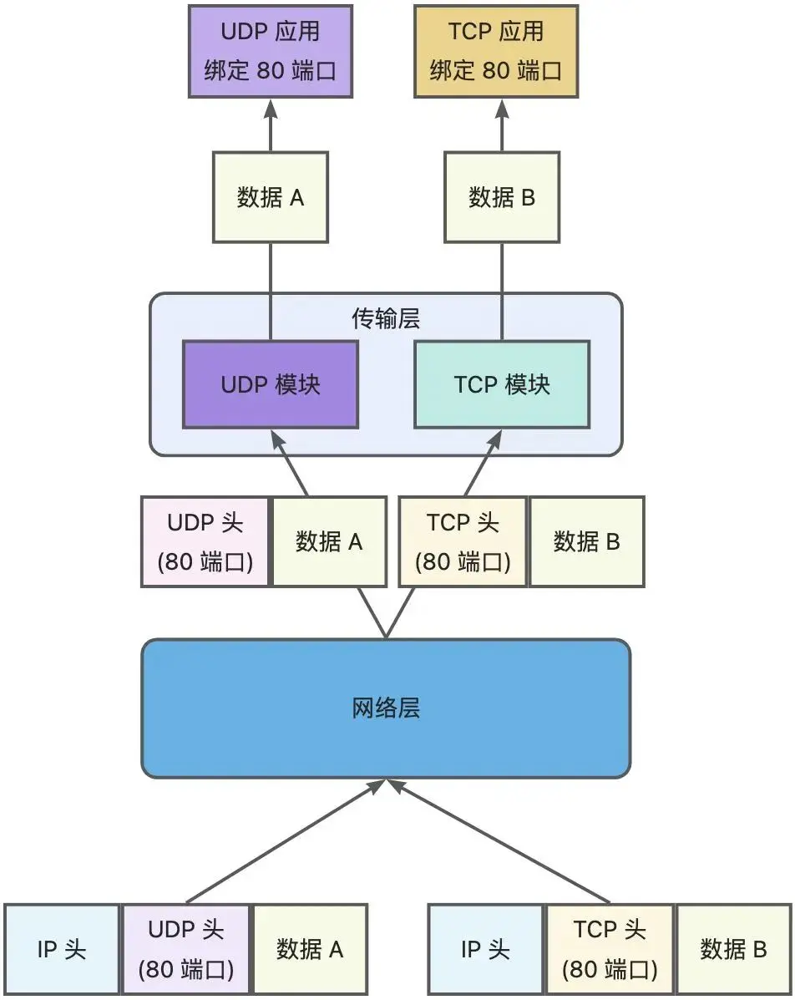

<font style="color:rgb(44, 62, 80);">TCP 网络编程如下，服务端执行 listen() 系统调用就是监听端口的动作。</font>

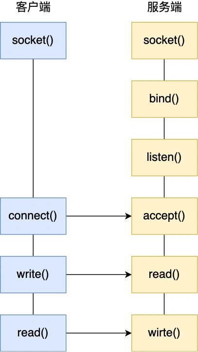

<font style="color:rgb(44, 62, 80);">UDP 网络编程如下，服务端是没有监听这个动作的，只有执行 bind() 系统调用来绑定端口的动作。</font>

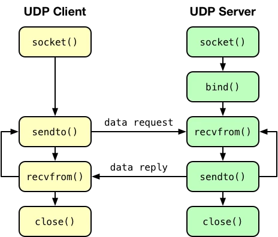

### 客户端的端口可以同时重复使用吗？

**客户端在执行 connect 函数的时候，会在内核里随机选择一个端口，然后向服务端发起 SYN 报文，然后与服务端进行三次握手。**

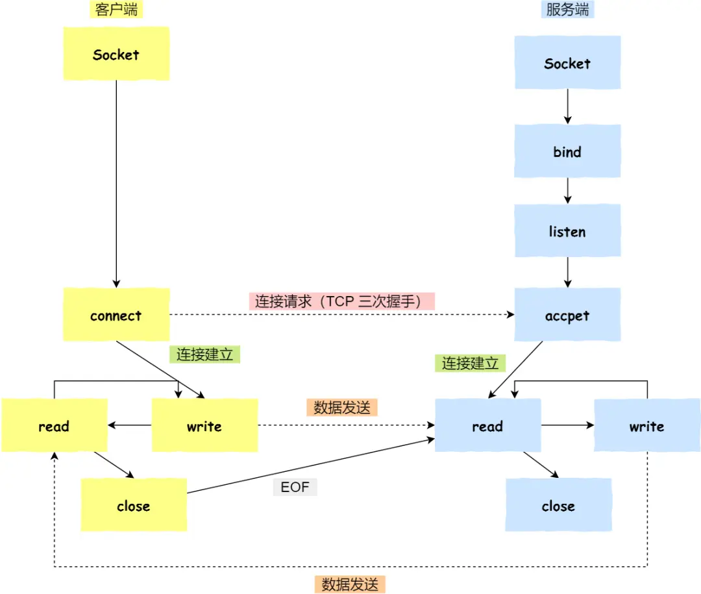

<font style="color:rgb(44, 62, 80);">客户端与服务端完成 TCP 连接建立后，可以通过 netstat 命令查看 TCP 连接。</font>

```shell
$ netstat -napt
协议  源ip地址:端口            目的ip地址：端口         状态
tcp  192.168.110.182.64992   117.147.199.51.443     ESTABLISHED
```

**比如：已经用了 64992 端口，那么还可以继续使用该端口发起连接吗？**

**<font style="color:rgb(48, 79, 254);">TCP 连接是由四元组（源IP地址，源端口，目的IP地址，目的端口）唯一确认的，那么只要四元组中其中一个元素发生了变化，那么就表示不同的 TCP 连接的。所以如果客户端已使用端口 64992 与服务端 A 建立了连接，那么客户端要与服务端 B 建立连接，还是可以使用端口 64992 的，因为内核是通过四元祖信息来定位一个 TCP 连接的，并不会因为客户端的端口号相同，而导致连接冲突的问题。</font>**

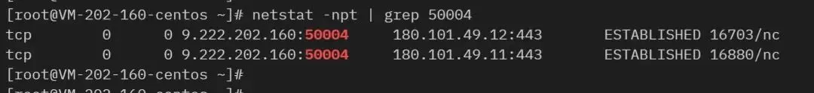

# TCP连接建立

## 三次握手

<font style="color:rgb(44, 62, 80);">TCP 是面向连接的协议，所以使用 TCP 前必须先建立连接，而</font>**<font style="color:rgb(48, 79, 254);">建立连接是通过三次握手来进行的</font>**<font style="color:rgb(44, 62, 80);">。</font>

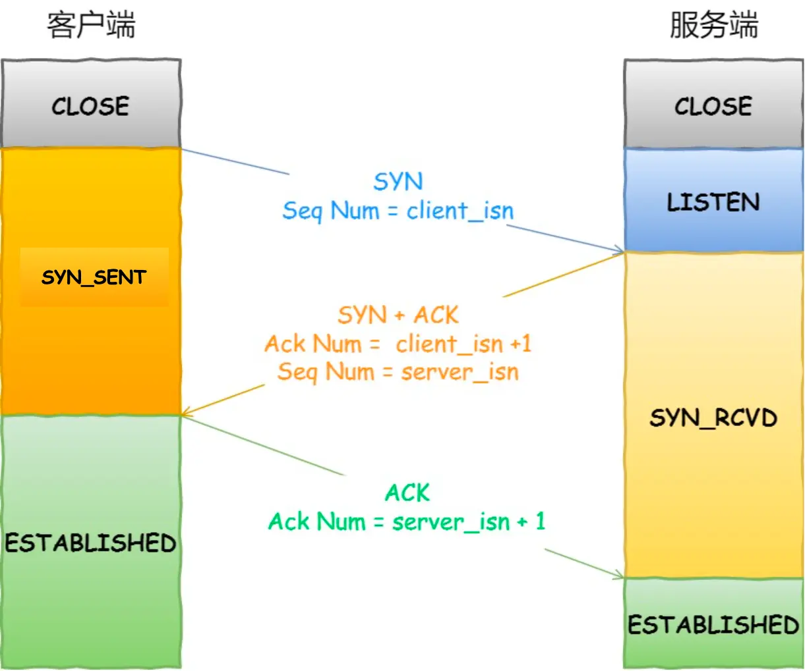

**第一握手报文 - SYN报文，发送后客户端变为SYN-SENT状态**

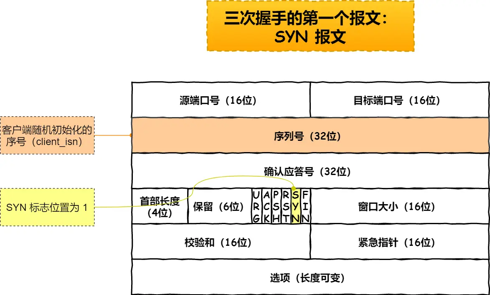

**第二握手报文 - SYN + ACK报文，发送后服务端变为SYN-REVD状态。ack = 客户端server\_isn + 1**

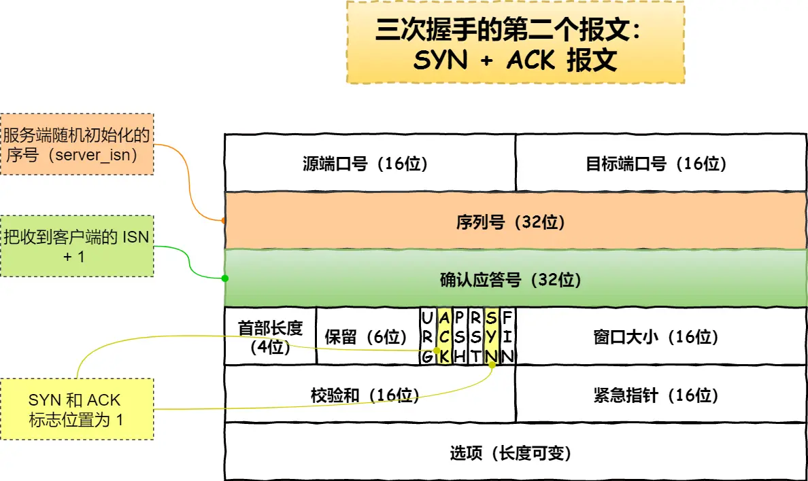

**第三握手报文 - ACK报文，发送后进入** <code>**<font style="color:#DF2A3F;">ESTABLISHED状态</font>**</code> **，ack = 服务器server\_isn + 1**

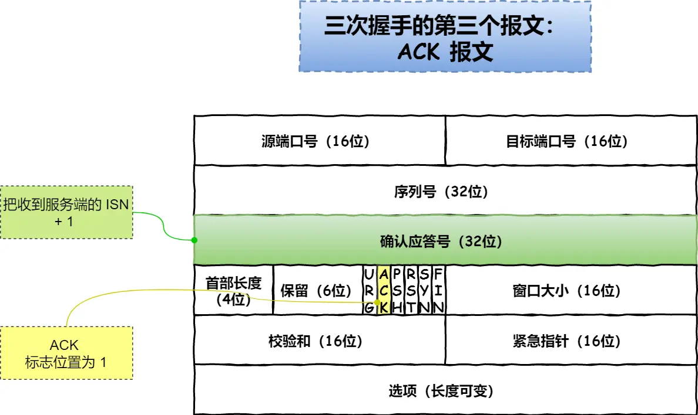

**服务端收到客户端的应答报文后，也进入** `ESTABLISHED` **状态。\*\*\*\*<font style="color:rgb(48, 79, 254);">第三次握手是可以携带数据的，前两次握手是不可以携带数据的。</font>**

**<font style="color:#DF2A3F;">客户端 connect 成功返回是在第二次握手，服务端 accept 成功返回是在三次握手成功之后。</font>**

**<font style="color:#DF2A3F;"></font>**

`netstat -napt`**查看TCP的状态**

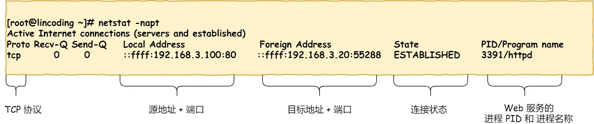

## 为什么TCP连接是三次握手

### ***避免历史连接*** **（主要原因）**

**<font style="color:#DF2A3F;">防止「历史连接」初始化了TCP连接</font>**<font style="color:#DF2A3F;">。</font>

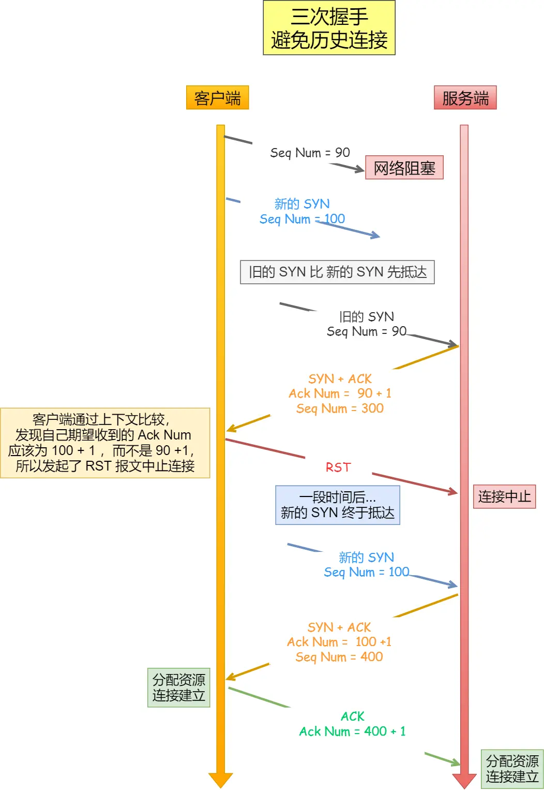

**<font style="color:#DF2A3F;">在两次握手的情况下，服务端没有中间状态给客户端来阻止历史连接，导致服务端可能建立一个历史连接，造成资源浪费</font>**<font style="color:#DF2A3F;">。</font>

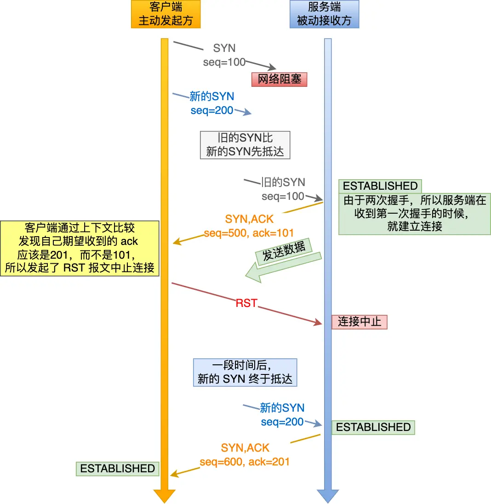

**采用两次握手建立 TCP 连接的场景下，服务端在向客户端发送数据前，并没有阻止掉历史连接，导致服务端建立了一个历史连接，又白白发送了数据，妥妥地浪费了服务端的资源。**

**要解决这种现象，最好就是在服务端发送数据前，也就是建立连接之前，要阻止掉历史连接，这样就不会造成资源浪费，而要实现这个功能，就需要三次握手**。

**所以，TCP 使用三次握手建立连接的最主要原因是防止「历史连接」初始化了连接。**

### *同步双方初始序列号*

<font style="color:rgb(44, 62, 80);">TCP 协议的通信双方， 都必须维护一个「序列号」， 序列号是可靠传输的一个关键因素，它的作用：</font>

* <font style="color:rgb(44, 62, 80);">接收方可以去除重复的数据；</font>
* <font style="color:rgb(44, 62, 80);">接收方可以根据数据包的序列号按序接收；</font>
* <font style="color:rgb(44, 62, 80);">可以标识发送出去的数据包中， 哪些是已经被对方收到的（通过 ACK 报文中的序列号知道）；</font>

<font style="color:rgb(44, 62, 80);">可见，序列号在 TCP 连接中占据着非常重要的作用，所以当客户端发送携带「初始序列号」的 </font><code><font style="color:rgb(71, 101, 130);">SYN</font></code><font style="color:rgb(44, 62, 80);"> 报文的时候，需要服务端回一个 </font><code><font style="color:rgb(71, 101, 130);">ACK</font></code><font style="color:rgb(44, 62, 80);"> 应答报文，表示客户端的 SYN 报文已被服务端成功接收，那当服务端发送「初始序列号」给客户端的时候，依然也要得到客户端的应答回应，</font>**<font style="color:rgb(48, 79, 254);">这样一来一回，才能确保双方的初始序列号能被可靠的同步。</font>**

<font style="color:rgb(44, 62, 80);">TCP 建立连接时，通过三次握手</font>**<font style="color:rgb(48, 79, 254);">能防止历史连接的建立，能减少双方不必要的资源开销，能帮助双方同步初始化序列号</font>**<font style="color:rgb(44, 62, 80);">。序列号能够保证数据包不重复、不丢弃和按序传输。</font>

## 为什么TCP连接建立要去序列号不一样

* **为了防止历史报文被下一个相同四元组的连接接收（主要方面）；**
* **为了安全性，防止黑客伪造的相同序列号的 TCP 报文被对方接收；**

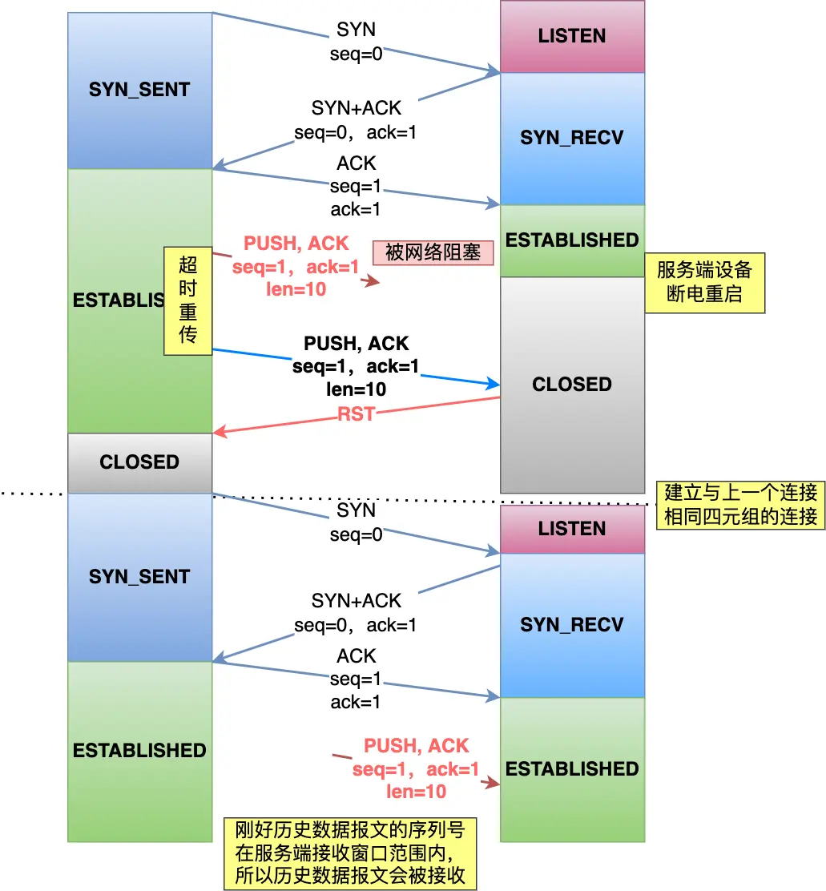

**如果每次建立连接，客户端和服务端的初始化序列号都是一样的话，很容易出现历史报文被下一个相同四元组的连接接收的问题**。**随机生成初始化序列号，可以很大程度避免产生这种问题**

***

**初始化序列号 ****<font style="color:#DF2A3F;">ISN 随机生成算法：ISN = M + F</font>****(localhost, localport, remotehost, remoteport)。**

* M是一个计时器，这个计时器每隔 4 微秒加1。
* F 是一个 Hash 算法，根据源IP、目的IP、源端口、目的端口生成一个随机数值，要保证 hash 算法不能被外部轻易推算得出。

**序列号和初始化序列号并不是无限递增的，会发生回绕为初始值的情况，这意味着无法根据序列号来判断新老数据**。**为了防止回绕导致序列号混乱，加入\*\*\*\*TCP时间戳** **，如果时间戳不是递增则丢弃**

## 握手信号丢失会如何？

* 第一次握手丢失
  * 客户端收不到服务端的 SYN-ACK 报文（第二次握手），就会触发「**超时重传**」机制，重传 SYN 报文，**重传的 SYN 报文的序列号都是一样的**。
  * `tcp_syn_retries`：重传次数 - 默认5。
  * 第一次超时重传是在 1 秒后，第二次超时重传是在 2 秒，第三次超时重传是在 4 秒后...，**每次超时的时间是上一次的 2 倍**。
* 第二次握手丢失
  * **SYN-ACK报文丢失，客户端会出发超时重传。**
  * **服务端会触发超时重传机制，重传 SYN-ACK 报文**。
  * `tcp_synack_retries`：重传次数 - 默认5。
* 第三次握手丢失
  * **ACK 报文是不会有重传的，当 ACK 丢失了，就由对方重传对应的报文**。**后续由服务器重传SYN-ACK报文，客户端没有重传机制。**

# TCP断开连接

## 四次挥手

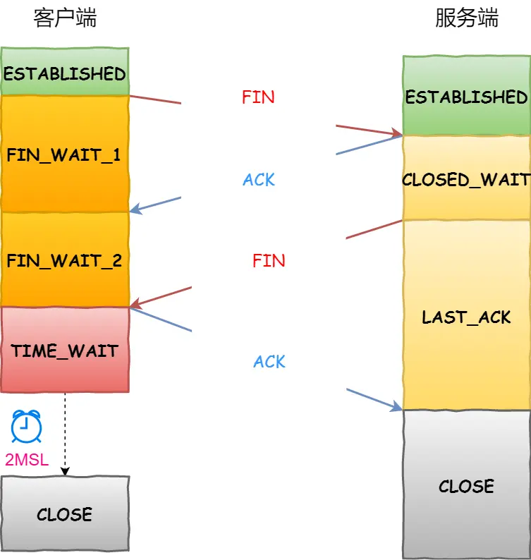

**服务端通常需要等待完成数据的发送和处理，所以服务端的** `ACK` **和** `FIN` **一般都会分开发送，因此是需要四次挥手。但是若服务端没有数据发送，则第二次第三次挥手合并，变为三次挥手。**

## 四次挥手丢失会如何？

* 第一次挥手FIN丢失
  * 客户端迟迟收不到被动方的 ACK 的话，也就会触发超时重传机制，重传 FIN 报文，重发次数由 `tcp_orphan_retries` 参数控制
* 第二次挥手ACK丢失
  * ACK是不会重传的，丢失会导致客户端超时重传FIN
* 第三次挥手FIN丢失
  * 迟迟收不到 LAST\_ACK，服务端就会重发 FIN 报文，重发次数由 `tcp_orphan_retrie`s 参数控制
* 第四次挥手ACK丢失
  * ACK 报文没有到达服务端，服务端就会重发 FIN 报文，重发次数由 `tcp_orphan_retries` 参数控制
  * 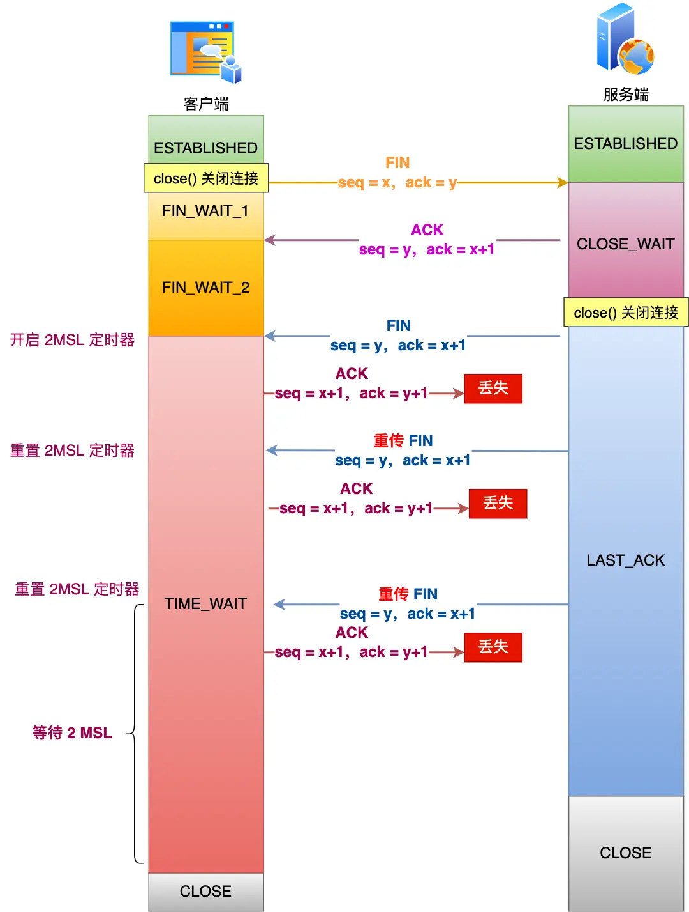

## 为什么TIME\_WAIT 等待的时间是 2MSL

`MSL` 是 Maximum Segment Lifetime，**报文最大生存时间**，它是任何报文在网络上存在的最长时间，超过这个时间报文将被丢弃。

需要 TIME-WAIT 状态，主要是两个原因：

* **防止历史连接中的数据，被后面相同四元组的连接错误的接收；**
  * **2MSL足以让两个方向上的数据包都被丢弃，使得原来连接的数据包在网络中都自然消失，再出现的数据包一定都是新建立连接所产生的。**
  * 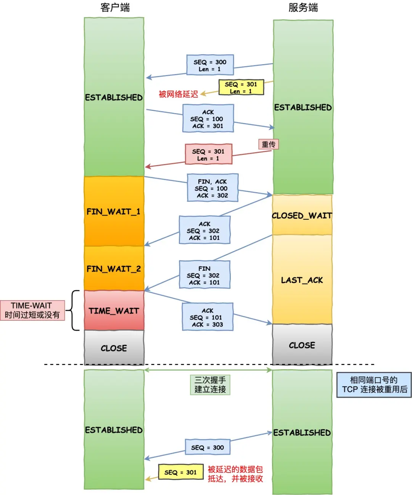
* **保证「被动关闭连接」的一方，能被正确的关闭；**
  * 若不等待2MSL，被动方发送给的FIN丢失，重传FIN发现主动放已经CLOSE，那么被动方就会被RST异常终止。

## 服务器出现大量TIME\_WAIT

TIME\_WAIT 状态是主动关闭连接方才会出现的状态，所以如果服务器出现大量的 TIME\_WAIT 状态的 TCP 连接，就是说明**服务器主动断开了很多 TCP 连接**。

* HTTP 没有使用长连接：频繁创建断开TCP连接
* HTTP 长连接超时：长时间没有数据发送，链接超时
* HTTP 长连接的请求数量达到上限：大量请求占满长连接

## 如果已经建立了连接，但是客户端突然出现故障了怎么办？

**保活机制：** 定义一个时间段，在这个时间段内，如果没有任何连接相关的活动，TCP 保活机制会开始作用，每隔一个时间间隔，发送一个探测报文，该探测报文包含的数据非常少，如果连续几个探测报文都没有得到响应，则认为当前的 TCP 连接已经死亡，系统内核将错误信息通知给上层应用程序。

**<font style="color:rgb(44, 62, 80);">在 Linux 内核可以有对应的参数可以设置保活时间、保活探测的次数、保活探测的时间间隔</font>**

```java
net.ipv4.tcp_keepalive_time=7200
net.ipv4.tcp_keepalive_intvl=75  
net.ipv4.tcp_keepalive_probes=9
```

* <font style="color:rgb(44, 62, 80);">tcp\_keepalive\_time=7200：表示保活时间是 7200 秒（2小时），也就 2 小时内如果没有任何连接相关的活动，则会启动保活机制</font>
* <font style="color:rgb(44, 62, 80);">tcp\_keepalive\_intvl=75：表示每次检测间隔 75 秒；</font>
* <font style="color:rgb(44, 62, 80);">tcp\_keepalive\_probes=9：表示检测 9 次无响应，认为对方是不可达的，从而中断本次的连接。</font>

<font style="color:rgb(44, 62, 80);">最少需要经过 2 小时 11 分 15 秒才可以发现一个「死亡」连接。</font>

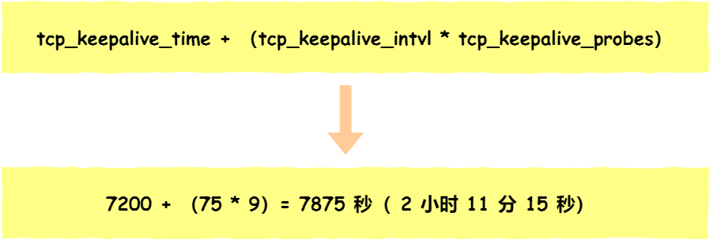

<font style="color:rgb(44, 62, 80);"></font>

> ***进程崩溃后操作系统在回收进程资源的时候，会发送 FIN 报文，而主机宕机则是无法感知的，所以需要 TCP 保活机制来探测对方是不是发生了主机宕机***

如果只是进程崩溃，操作系统一样会发送FIN报文断开连接，宕机则需要保活机制确认，并且RST断开连接

# Socket编程


* 服务端和客户端初始化 `socket`，得到文件描述符；
* 服务端调用 `bind`，将 socket 绑定在指定的 IP 地址和端口;
* 服务端调用 `listen`，进行监听；
* 服务端调用 `accept`，等待客户端连接；
* 客户端调用 `connect`，向服务端的地址和端口发起连接请求；
* 服务端 `accept` 返回用于传输的 `socket` 的文件描述符；
* 客户端调用 `write` 写入数据；服务端调用 `read` 读取数据；
* 客户端断开连接时，会调用 `close`，那么服务端 `read` 读取数据的时候，就会读取到了 `EOF`，待处理完数据后，服务端调用 `close`，表示连接关闭。

这里需要注意的是，服务端调用 `accept` 时，连接成功了会返回一个已完成连接的 socket，后续用来传输数据。

所以，监听的 socket 和真正用来传送数据的 socket，是「两个」 socket，一个叫作**监听 socket**，一个叫作**已完成连接 socket**。

成功连接建立之后，双方开始通过 read 和 write 函数来读写数据，就像往一个文件流里面写东西一样。

在建立连接的过程中Linux内核中会维护两个队列：

* 半连接队列（SYN 队列）：接收到一个 SYN 建立连接请求，处于 SYN\_RCVD 状态；
* 全连接队列（Accpet 队列）：已完成 TCP 三次握手过程，处于 ESTABLISHED 状态；

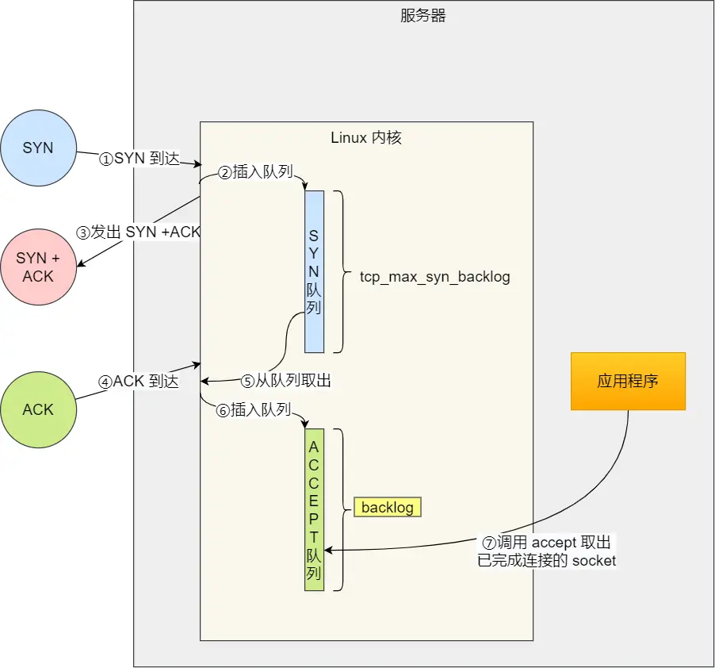

**现在通常认为 backlog 是 accept 队列。但是上限值是内核参数 somaxconn 的大小，也就说 accpet 队列长度 =**  **min(backlog, somaxconn)。**

# ‍RSA四次握手

## TLS握手过程

HTTP 由于是明文传输，所谓的明文，就是说客户端与服务端通信的信息都是肉眼可见的，随意使用一个抓包工具都可以截获通信的内容。

所以安全上存在以下三个风险：

* *窃听风险*，比如通信链路上可以获取通信内容，用户号容易没。
* *篡改风险*，比如强制植入垃圾广告，视觉污染，用户眼容易瞎。
* *冒充风险*，比如冒充淘宝网站，用户钱容易没。

HTTP**S** 在 HTTP 与 TCP 层之间加入了 TLS 协议，来解决上述的风险。

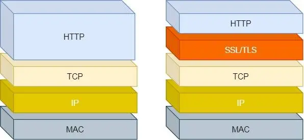

* *信息加密*： HTTP 交互信息是被加密的，第三方就无法被窃取；
* *校验机制*：校验信息传输过程中是否有被第三方篡改过，如果被篡改过，则会有警告提示；
* *身份证书*：证明淘宝是真的淘宝网；

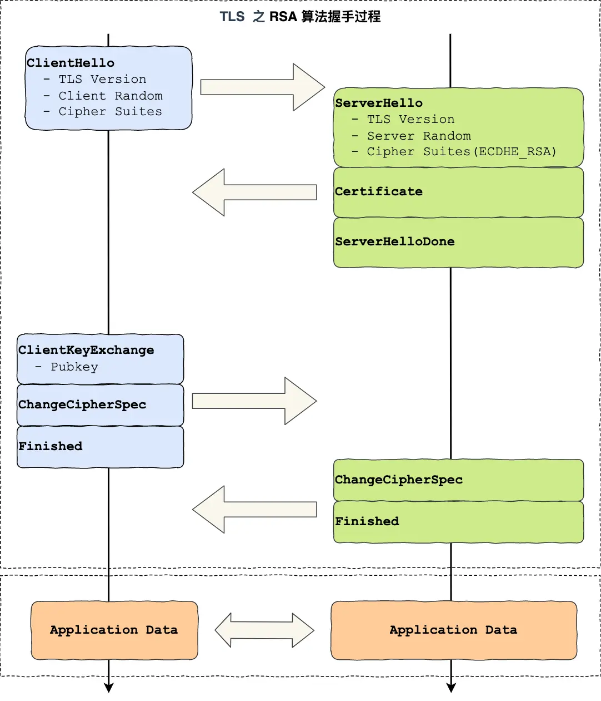

**经过「四个消息」就可以完成 TLS 握手，也就是需要 2个 RTT 的时延**

HTTPS 是应用层协议，需要先完成 TCP 连接建立，然后走 TLS 握手过程后，才能建立通信安全的连接。不同的密钥交换算法，TLS 的握手过程可能会有一些区别。

## RSA 握手过程

传统的 TLS 握手基本都是使用 RSA 算法来实现密钥交换的，在将 TLS 证书部署服务端时，**证书文件其实就是服务端的公钥，会在 TLS 握手阶段传递给客户端，而服务端的私钥则一直留在服务端**，一定要确保私钥不能被窃取。

在 RSA 密钥协商算法中，客户端会生成随机密钥，并使用服务端的公钥加密后再传给服务端。根据非对称加密算法，公钥加密的消息仅能通过私钥解密，这样服务端解密后，双方就得到了相同的密钥，再用它加密应用消息。


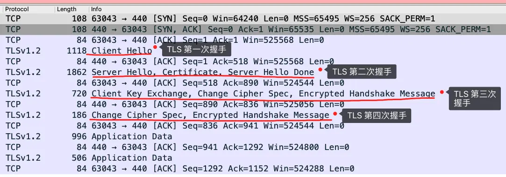

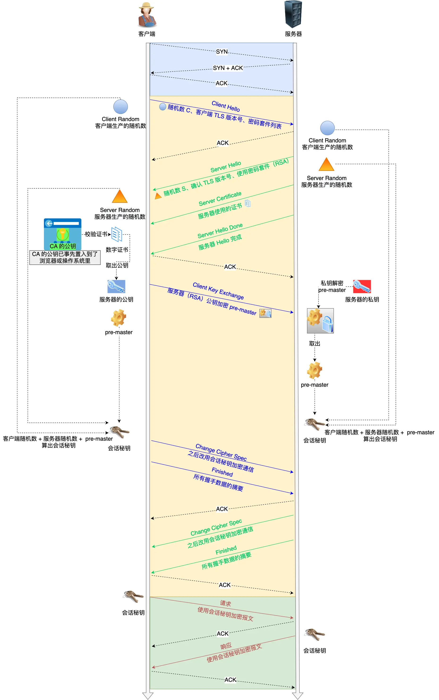

* 客户端首先会发一个「**Client Hello**」消息，消息里面有客户端使用的 TLS 版本号、支持的密码套件列表，以及生成的\_随机数（Client Random\_\*\* **）** ，这个随机数会被服务端保留，它是生成对称加密密钥的材料之一。
* 当服务端收到客户端的「Client Hello」消息后，会确认 TLS 版本号是否支持，和从密码套件列表中选择一个密码套件，以及生成\_随机数（\_\_\*\*\*\*\_*Server Random*\*\* **）** 。接着，返回「**Server Hello**」消息，消息里面有服务器确认的 TLS 版本号，也给出了随机数（Server Random），然后从客户端的密码套件列表选择了一个合适的密码套件。然后，服务端为了证明自己的身份，会发送「**Server Certificate**」给客户端，这个消息里含有数字证书。
* 客户端验证完证书后，就会生成一个新的\_随机数 (\_\_\*\*\*\*\_*pre-master*\*\* ****)**** ，用服务器的 RSA 公钥加密该随机数，通过「****Client Key Exchange****」消息传给服务端。服务端收到后，用 RSA 私钥解密，得到客户端发来的随机数 (pre-master)。****客户端和服务端双方都共享了三个随机数，分别是 Client Random、Server Random、pre-master****。双方根据已经得到的三个随机数，生成**会话密钥（Master Secret）** ，它是对称密钥，用于对后续的 HTTP 请求/响应的数据加解密。生成完「会话密钥」后，然后客户端发一个「**Change Cipher Spec**」，告诉服务端开始使用加密方式发送消息。客户端再发一个「**Encrypted Handshake Message（Finishd）** 」消息，把之前所有发送的数据做个**摘要**，再用会话密钥（master secret）加密一下，让服务器做个验证，验证加密通信「是否可用」和「之前握手信息是否有被中途篡改过」。「Change Cipher Spec」之前传输的 TLS 握手数据都是明文，之后都是对称密钥加密的密文。
* 服务器也是同样的操作，发「**Change Cipher Spec**」和「**Encrypted Handshake Message**」消息，如果双方都验证加密和解密没问题，那么握手正式完成。

**使用 RSA 密钥协商算法的最大问题是不支持前向保密**。

因为客户端传递随机数（用于生成对称加密密钥的条件之一）给服务端时使用的是公钥加密的，服务端收到后，会用私钥解密得到随机数。所以一旦服务端的私钥泄漏了，过去被第三方截获的所有 TLS 通讯密文都会被破解。

## CA证书如何认证？

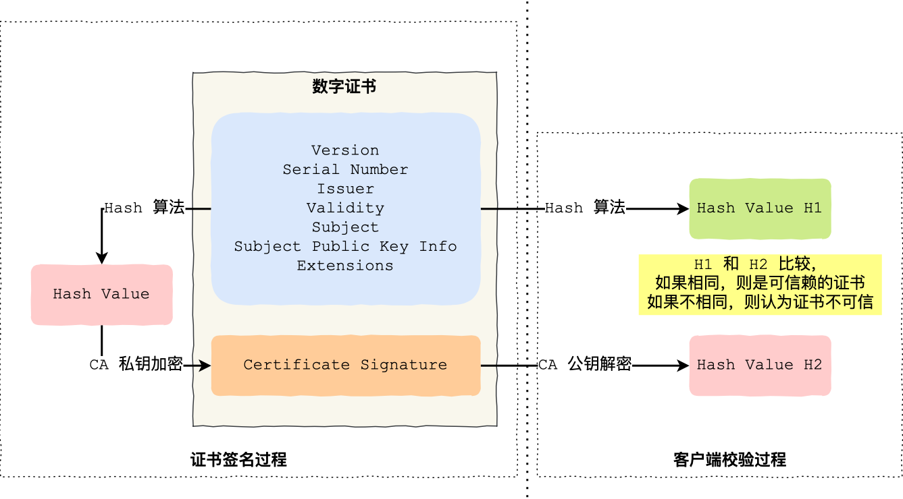

# ECDHE握手


> 更新: 2024-09-10 16:41:10  
> 原文: <https://www.yuque.com/nibiwanxiamei/yrd6t1/d968348403feebd58e55f35d6a359929>